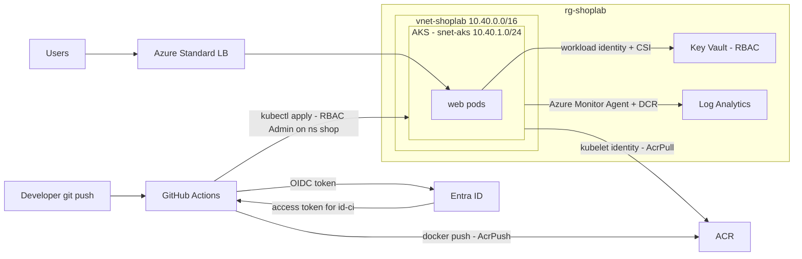

# Azure Hands-on Lab — Terraform, AKS, ACR, Key Vault and an OIDC Pipeline

<!-- DEVOPS-SHACK:HEADER -->
<p align="center">
  <a href="https://www.youtube.com/@devopsshack"></a>
  <a href="https://www.youtube.com/@shackverse"></a>
  <a href="https://devopsshack.com"></a>
  <a href="https://www.instagram.com/devopsshack"></a>
  <a href="https://github.com/jaiswaladi246/DevOps-Cloud-Interview-Preparation-by-DevOps-Shack"></a>
</p>
<p align="center"><sub>Part of <b><a href="https://github.com/jaiswaladi246/DevOps-Cloud-Interview-Preparation-by-DevOps-Shack">DevOps &amp; Cloud Interview Preparation</a></b> — created by <b><a href="https://www.youtube.com/@devopsshack">DevOps Shack</a></b>. Free to learn from; please credit DevOps Shack when sharing.</sub></p>
<!-- /DEVOPS-SHACK:HEADER -->

> Build a private-by-default AKS platform with Terraform (resource group, VNet, ACR, AKS with managed identities, Key Vault, Log Analytics), then ship an app through a secretless GitHub Actions (or Azure DevOps) pipeline that builds, pushes to ACR and deploys to AKS with Key Vault CSI secrets and Azure Monitor. Then tear it all down.

[⬅ Back to Azure for DevOps](./README.md) · [🏠 Home](../README.md)

## Goal

By the end you have this running in `centralindia`:

- A resource group, a VNet with an AKS subnet, and a Terraform state backend that uses Entra auth (no storage keys)
- An Azure Container Registry with the admin user disabled
- An AKS cluster with Azure CNI Overlay + Cilium, Entra ID + Azure RBAC, local accounts disabled, OIDC issuer and workload identity, autoscaling system pool on Azure Linux
- The kubelet identity granted `AcrPull`, so nodes pull images with no secrets
- A Key Vault (RBAC mode) whose secret is mounted into pods by the Secrets Store CSI driver using workload identity, with rotation
- Container Insights sending logs to Log Analytics through a Data Collection Rule, plus a metric alert to email
- A CI identity federated with GitHub (or Azure DevOps), with only `AcrPush` and namespace-scoped AKS rights
- A pipeline that builds, pushes, deploys and waits for rollout, and a verified cleanup

**Cost warning.** Two `Standard_D2s_v5` nodes, a Standard Load Balancer with a public IP, ACR Standard and Log Analytics ingestion come to a few USD per day. AKS uses the Free tier here. Do the lab in one or two sittings and run the cleanup.

## Architecture



| Identity | Type | Roles | Used by |
|---|---|---|---|
| AKS cluster identity | System-assigned | Network Contributor on `snet-aks` | AKS control plane (LBs, IPs) |
| Kubelet identity | User-assigned (AKS-created) | AcrPull on ACR | Nodes pulling images |
| `id-shoplab-web` | User-assigned | Key Vault Secrets User on the vault | `web` pods via workload identity |
| `id-shoplab-ci` | User-assigned | AcrPush + Reader on ACR, AKS Cluster User, AKS RBAC Admin on namespace `shop` | Pipeline via OIDC |
| You | User | AKS RBAC Cluster Admin, Key Vault Secrets Officer | Lab operator |

## Prerequisites

- An Azure subscription where you are **Owner** (or Contributor + User Access Administrator); Terraform creates role assignments.
- At least 6 free vCPUs of the `standardDSv5Family` in Central India (2 nodes + 1 autoscale/surge node). Check with `az vm list-usage -l centralindia -o table | grep -Ei "DSv5|Total Regional"`.
- Azure CLI 2.60+ (`az version`), Terraform 1.6+ (`terraform version`), `kubectl` and `kubelogin` (`az aks install-cli` installs both), `docker` is optional (we build in ACR), `jq`, `curl`, `openssl`, `envsubst` (package `gettext`).
- A GitHub account and the `gh` CLI logged in (`gh auth status`), or an Azure DevOps project for the alternative pipeline.
- A bash shell.

Work in an empty directory. Each step appends to `lab.env`, so after a dropped terminal run `source lab.env`.

---

## Step 1. Log in and set variables

```bash
mkdir -p ~/azure-aks-lab && cd ~/azure-aks-lab
az login
az account set --subscription "<your-subscription-name-or-id>"

cat > lab.env <<'VARS'
export LOCATION=centralindia
export PREFIX=shoplab
export RG=rg-shoplab
export AKS_NAME=aks-shoplab
export NS=shop
VARS
echo "export SUBSCRIPTION_ID=$(az account show --query id -o tsv)" >> lab.env
echo "export TENANT_ID=$(az account show --query tenantId -o tsv)" >> lab.env
echo "export MY_OID=$(az ad signed-in-user show --query id -o tsv)" >> lab.env
source lab.env

# Providers this lab needs
for p in Microsoft.ContainerService Microsoft.ContainerRegistry Microsoft.KeyVault \
         Microsoft.OperationalInsights Microsoft.Insights Microsoft.ManagedIdentity Microsoft.Network; do
  az provider register -n $p --wait
done
```

**Verify:** `az account show -o table` shows the right subscription, and `echo $MY_OID` prints a GUID.

## Step 2. Terraform state backend with Entra auth

State holds secrets and resource IDs, so the storage account gets no shared keys, versioning, and RBAC-only access.

```bash
source lab.env
export TFSTATE_RG=rg-${PREFIX}-tfstate
export TFSTATE_SA=sttf${PREFIX}$RANDOM
echo "export TFSTATE_RG=$TFSTATE_RG" >> lab.env
echo "export TFSTATE_SA=$TFSTATE_SA" >> lab.env

az group create -n $TFSTATE_RG -l $LOCATION -o none
az storage account create -n $TFSTATE_SA -g $TFSTATE_RG -l $LOCATION \
  --sku Standard_LRS --kind StorageV2 --min-tls-version TLS1_2 \
  --allow-blob-public-access false --allow-shared-key-access false -o none
az storage account blob-service-properties update --account-name $TFSTATE_SA -g $TFSTATE_RG \
  --enable-versioning true --enable-delete-retention true --delete-retention-days 7 -o none

az role assignment create --role "Storage Blob Data Contributor" \
  --assignee-object-id $MY_OID --assignee-principal-type User \
  --scope $(az storage account show -n $TFSTATE_SA -g $TFSTATE_RG --query id -o tsv) -o none

sleep 60   # RBAC propagation
az storage container create -n tfstate --account-name $TFSTATE_SA --auth-mode login
```

**Verify:** the last command prints `"created": true`. If you get `AuthorizationPermissionMismatch`, wait another minute and retry.

## Step 3. Terraform project: providers, variables, backend config

```bash
mkdir -p infra && cd infra
cat > backend.hcl <<VARS
resource_group_name  = "$TFSTATE_RG"
storage_account_name = "$TFSTATE_SA"
container_name       = "tfstate"
key                  = "shoplab.tfstate"
use_azuread_auth     = true
VARS
```

`infra/providers.tf`

```hcl
terraform {
  required_version = ">= 1.6"
  required_providers {
    azurerm = { source = "hashicorp/azurerm", version = "~> 4.0" }
    random  = { source = "hashicorp/random", version = "~> 3.6" }
  }
  backend "azurerm" {}
}

provider "azurerm" {
  subscription_id = var.subscription_id
  features {
    key_vault {
      purge_soft_delete_on_destroy    = true # lab only: frees the vault name on destroy
      recover_soft_deleted_key_vaults = false
    }
    log_analytics_workspace {
      permanently_delete_on_destroy = true # lab only
    }
    resource_group {
      prevent_deletion_if_contains_resources = false # lab only: CLI-created alerts live in the RG
    }
  }
}
```

`infra/variables.tf`

```hcl
variable "subscription_id" { type = string }
variable "location" {
  type    = string
  default = "centralindia"
}
variable "prefix" {
  type    = string
  default = "shoplab"
}
variable "github_repo" {
  type        = string
  description = "owner/repo that is allowed to deploy, e.g. devopsshack/shop-aks-lab"
}
variable "kubernetes_version" {
  type    = string
  default = null # null = the AKS default version for the region
}
variable "node_vm_size" {
  type    = string
  default = "Standard_D2s_v5"
}
variable "zones" {
  type    = list(string)
  default = ["1", "2", "3"] # set to [] if your subscription has zonal restrictions
}
```

`infra/lab.tfvars` (edit the repo name)

```hcl
subscription_id = "<paste $SUBSCRIPTION_ID>"
github_repo     = "<your-github-user>/shop-aks-lab"
```

```bash
sed -i "s/<paste \$SUBSCRIPTION_ID>/$SUBSCRIPTION_ID/" lab.tfvars
```

## Step 4. Resource group, network, Log Analytics and ACR

`infra/main.tf`

```hcl
data "azurerm_client_config" "current" {}

resource "random_string" "suffix" {
  length  = 5
  upper   = false
  special = false
}

locals {
  name = var.prefix
  tags = {
    project = "azure-aks-lab"
    env     = "lab"
    owner   = "devopsshack"
  }
}

resource "azurerm_resource_group" "rg" {
  name     = "rg-${local.name}"
  location = var.location
  tags     = local.tags
}

resource "azurerm_virtual_network" "vnet" {
  name                = "vnet-${local.name}"
  location            = azurerm_resource_group.rg.location
  resource_group_name = azurerm_resource_group.rg.name
  address_space       = ["10.40.0.0/16"]
  tags                = local.tags
}

resource "azurerm_subnet" "aks" {
  name                 = "snet-aks"
  resource_group_name  = azurerm_resource_group.rg.name
  virtual_network_name = azurerm_virtual_network.vnet.name
  address_prefixes     = ["10.40.1.0/24"] # Overlay: only nodes take VNet IPs
}

resource "azurerm_log_analytics_workspace" "law" {
  name                = "law-${local.name}"
  location            = azurerm_resource_group.rg.location
  resource_group_name = azurerm_resource_group.rg.name
  sku                 = "PerGB2018"
  retention_in_days   = 30
  daily_quota_gb      = 2 # lab guard against runaway ingestion
  tags                = local.tags
}

resource "azurerm_container_registry" "acr" {
  name                = "acr${local.name}${random_string.suffix.result}" # alphanumeric, globally unique
  location            = azurerm_resource_group.rg.location
  resource_group_name = azurerm_resource_group.rg.name
  sku                 = "Standard"
  admin_enabled       = false
  tags                = local.tags
}
```

## Step 5. The AKS cluster

Append to `infra/main.tf`:

```hcl
resource "azurerm_kubernetes_cluster" "aks" {
  name                = "aks-${local.name}"
  location            = azurerm_resource_group.rg.location
  resource_group_name = azurerm_resource_group.rg.name
  dns_prefix          = "aks-${local.name}"
  kubernetes_version  = var.kubernetes_version
  node_resource_group = "rg-${local.name}-aks-nodes"
  sku_tier            = "Free" # use "Standard" in production for the SLA

  oidc_issuer_enabled               = true
  workload_identity_enabled         = true
  local_account_disabled            = true
  role_based_access_control_enabled = true

  default_node_pool {
    name                        = "system"
    vm_size                     = var.node_vm_size
    vnet_subnet_id              = azurerm_subnet.aks.id
    zones                       = var.zones
    os_sku                      = "AzureLinux"
    auto_scaling_enabled        = true
    min_count                   = 2
    max_count                   = 3
    temporary_name_for_rotation = "systemtmp"
    upgrade_settings {
      max_surge = "10%"
    }
  }

  identity {
    type = "SystemAssigned"
  }

  network_profile {
    network_plugin      = "azure"
    network_plugin_mode = "overlay"
    network_data_plane  = "cilium"
    network_policy      = "cilium"
    pod_cidr            = "192.168.0.0/16"
    service_cidr        = "10.41.0.0/16"
    dns_service_ip      = "10.41.0.10"
    load_balancer_sku   = "standard"
    outbound_type       = "loadBalancer"
  }

  azure_active_directory_role_based_access_control {
    azure_rbac_enabled = true
    tenant_id          = data.azurerm_client_config.current.tenant_id
  }

  key_vault_secrets_provider {
    secret_rotation_enabled  = true
    secret_rotation_interval = "2m"
  }

  oms_agent {
    log_analytics_workspace_id      = azurerm_log_analytics_workspace.law.id
    msi_auth_for_monitoring_enabled = true
  }

  tags = local.tags

  lifecycle {
    ignore_changes = [default_node_pool[0].node_count] # the autoscaler owns this
  }
}

# Cluster identity needs rights on the custom subnet (LB frontends, node NICs)
resource "azurerm_role_assignment" "aks_subnet" {
  scope                            = azurerm_subnet.aks.id
  role_definition_name             = "Network Contributor"
  principal_id                     = azurerm_kubernetes_cluster.aks.identity[0].principal_id
  skip_service_principal_aad_check = true
}

# Nodes pull from ACR with the kubelet identity, not the cluster identity
resource "azurerm_role_assignment" "aks_acrpull" {
  scope                            = azurerm_container_registry.acr.id
  role_definition_name             = "AcrPull"
  principal_id                     = azurerm_kubernetes_cluster.aks.kubelet_identity[0].object_id
  skip_service_principal_aad_check = true
}

# You, as the operator, get cluster admin through Azure RBAC (no local admin kubeconfig exists)
resource "azurerm_role_assignment" "me_aks_admin" {
  scope                = azurerm_kubernetes_cluster.aks.id
  role_definition_name = "Azure Kubernetes Service RBAC Cluster Admin"
  principal_id         = data.azurerm_client_config.current.object_id
}
```

## Step 6. Workload and CI identities with federated credentials

`infra/identity.tf`

```hcl
# Identity for the web pods (workload identity)
resource "azurerm_user_assigned_identity" "web" {
  name                = "id-${local.name}-web"
  location            = azurerm_resource_group.rg.location
  resource_group_name = azurerm_resource_group.rg.name
  tags                = local.tags
}

resource "azurerm_federated_identity_credential" "web" {
  name                = "aks-shop-web-sa"
  resource_group_name = azurerm_resource_group.rg.name
  parent_id           = azurerm_user_assigned_identity.web.id
  audience            = ["api://AzureADTokenExchange"]
  issuer              = azurerm_kubernetes_cluster.aks.oidc_issuer_url
  subject             = "system:serviceaccount:shop:web-sa"
}

# Identity for the pipeline (GitHub Actions OIDC)
resource "azurerm_user_assigned_identity" "ci" {
  name                = "id-${local.name}-ci"
  location            = azurerm_resource_group.rg.location
  resource_group_name = azurerm_resource_group.rg.name
  tags                = local.tags
}

resource "azurerm_federated_identity_credential" "ci_github" {
  name                = "github-prod-environment"
  resource_group_name = azurerm_resource_group.rg.name
  parent_id           = azurerm_user_assigned_identity.ci.id
  audience            = ["api://AzureADTokenExchange"]
  issuer              = "https://token.actions.githubusercontent.com"
  subject             = "repo:${var.github_repo}:environment:prod"
}

resource "azurerm_role_assignment" "ci_acrpush" {
  scope                            = azurerm_container_registry.acr.id
  role_definition_name             = "AcrPush"
  principal_id                     = azurerm_user_assigned_identity.ci.principal_id
  skip_service_principal_aad_check = true
}

resource "azurerm_role_assignment" "ci_acr_reader" {
  scope                            = azurerm_container_registry.acr.id
  role_definition_name             = "Reader" # lets `az acr login -n <name>` resolve the registry
  principal_id                     = azurerm_user_assigned_identity.ci.principal_id
  skip_service_principal_aad_check = true
}

resource "azurerm_role_assignment" "ci_aks_user" {
  scope                            = azurerm_kubernetes_cluster.aks.id
  role_definition_name             = "Azure Kubernetes Service Cluster User Role" # download kubeconfig
  principal_id                     = azurerm_user_assigned_identity.ci.principal_id
  skip_service_principal_aad_check = true
}

resource "azurerm_role_assignment" "ci_aks_ns_admin" {
  scope                            = "${azurerm_kubernetes_cluster.aks.id}/namespaces/shop"
  role_definition_name             = "Azure Kubernetes Service RBAC Admin" # only inside namespace shop
  principal_id                     = azurerm_user_assigned_identity.ci.principal_id
  skip_service_principal_aad_check = true
}
```

The CI identity can push images and manage objects in `shop`, and nothing else. It cannot create namespaces, read other namespaces, or touch Azure resources beyond the registry.

## Step 7. Key Vault and Container Insights data collection

`infra/keyvault.tf`

```hcl
resource "azurerm_key_vault" "kv" {
  name                       = "kv-${local.name}-${random_string.suffix.result}"
  location                   = azurerm_resource_group.rg.location
  resource_group_name        = azurerm_resource_group.rg.name
  tenant_id                  = data.azurerm_client_config.current.tenant_id
  sku_name                   = "standard"
  enable_rbac_authorization  = true # newer 4.x releases also accept rbac_authorization_enabled
  soft_delete_retention_days = 7
  purge_protection_enabled   = false # lab only; enable in production
  tags                       = local.tags
}

resource "azurerm_role_assignment" "me_kv_officer" {
  scope                = azurerm_key_vault.kv.id
  role_definition_name = "Key Vault Secrets Officer"
  principal_id         = data.azurerm_client_config.current.object_id
}

resource "azurerm_role_assignment" "web_kv_user" {
  scope                            = azurerm_key_vault.kv.id
  role_definition_name             = "Key Vault Secrets User"
  principal_id                     = azurerm_user_assigned_identity.web.principal_id
  skip_service_principal_aad_check = true
}
```

`infra/monitoring.tf`. With `msi_auth_for_monitoring_enabled = true`, the monitoring agent authenticates with managed identity and reads its configuration from a Data Collection Rule. The CLI creates that DCR for you; in Terraform you create it yourself, otherwise the agent runs and sends nothing.

```hcl
resource "azurerm_monitor_data_collection_rule" "ci" {
  name                = "MSCI-${var.location}-aks-${local.name}"
  location            = azurerm_resource_group.rg.location
  resource_group_name = azurerm_resource_group.rg.name

  destinations {
    log_analytics {
      workspace_resource_id = azurerm_log_analytics_workspace.law.id
      name                  = "ciworkspace"
    }
  }

  data_flow {
    streams      = ["Microsoft-ContainerInsights-Group-Default"]
    destinations = ["ciworkspace"]
  }

  data_sources {
    extension {
      name           = "ContainerInsightsExtension"
      extension_name = "ContainerInsights"
      streams        = ["Microsoft-ContainerInsights-Group-Default"]
      extension_json = jsonencode({
        dataCollectionSettings = {
          interval               = "1m"
          namespaceFilteringMode = "Exclude"
          namespaces             = ["kube-system", "gatekeeper-system"]
          enableContainerLogV2   = true
        }
      })
    }
  }
  tags = local.tags
}

resource "azurerm_monitor_data_collection_rule_association" "ci" {
  name                    = "ContainerInsightsExtension"
  target_resource_id      = azurerm_kubernetes_cluster.aks.id
  data_collection_rule_id = azurerm_monitor_data_collection_rule.ci.id
}
```

`infra/outputs.tf`

```hcl
output "resource_group"         { value = azurerm_resource_group.rg.name }
output "aks_name"               { value = azurerm_kubernetes_cluster.aks.name }
output "aks_id"                 { value = azurerm_kubernetes_cluster.aks.id }
output "acr_name"               { value = azurerm_container_registry.acr.name }
output "acr_login_server"       { value = azurerm_container_registry.acr.login_server }
output "key_vault_name"         { value = azurerm_key_vault.kv.name }
output "web_client_id"          { value = azurerm_user_assigned_identity.web.client_id }
output "ci_client_id"           { value = azurerm_user_assigned_identity.ci.client_id }
output "ci_identity_name"       { value = azurerm_user_assigned_identity.ci.name }
output "law_workspace_guid"     { value = azurerm_log_analytics_workspace.law.workspace_id }
output "oidc_issuer_url"        { value = azurerm_kubernetes_cluster.aks.oidc_issuer_url }
```

## Step 8. Plan and apply

```bash
cd ~/azure-aks-lab/infra
terraform fmt
terraform init -backend-config=backend.hcl
terraform validate
terraform plan -var-file=lab.tfvars -out tfplan
terraform apply tfplan          # 8 to 12 minutes, mostly AKS
```

Save outputs for later steps:

```bash
cd ~/azure-aks-lab
for o in acr_name acr_login_server key_vault_name web_client_id ci_client_id ci_identity_name law_workspace_guid aks_id; do
  echo "export $(echo $o | tr a-z A-Z)=$(terraform -chdir=infra output -raw $o)" >> lab.env
done
source lab.env
```

**Verify:**

```bash
az aks show -g $RG -n $AKS_NAME --query "{state:provisioningState, k8s:kubernetesVersion, plugin:networkProfile.networkPluginMode, dataplane:networkProfile.networkDataplane, oidc:oidcIssuerProfile.enabled, wi:securityProfile.workloadIdentity.enabled, localAccounts:disableLocalAccounts}" -o table
az acr show -n $ACR_NAME --query "{sku:sku.name, admin:adminUserEnabled}" -o table
az storage blob list --account-name $TFSTATE_SA -c tfstate --auth-mode login --query "[].name" -o tsv
```

Expected: `Succeeded`, `overlay`, `cilium`, `True`, `True`, `True`; ACR admin `False`; the state blob `shoplab.tfstate` exists.

## Step 9. Connect to the cluster with Entra ID

There is no admin kubeconfig (local accounts are disabled), so access goes through Entra and your Azure RBAC role.

```bash
az aks get-credentials -g $RG -n $AKS_NAME --overwrite-existing
kubelogin convert-kubeconfig -l azurecli
kubectl get nodes -o wide
kubectl get pods -n kube-system | grep -E "secrets-store|ama-logs|cilium|azure-wi"
```

**Verify:** two `Ready` nodes running Azure Linux, and pods for the CSI driver (`aks-secrets-store-csi-driver`, `aks-secrets-store-provider-azure`), `ama-logs`, `cilium` and `azure-wi-webhook`. Also check ACR wiring from inside the cluster:

```bash
az aks check-acr -g $RG -n $AKS_NAME --acr $ACR_LOGIN_SERVER
```

It should end with `Your cluster can pull images from <acr>.azurecr.io!`.

## Step 10. Seed the Key Vault secret

```bash
az keyvault secret set --vault-name $KEY_VAULT_NAME -n db-password \
  --value "$(openssl rand -base64 24)" --query "{name:name, version:id}" -o table
```

If this returns `ForbiddenByRbac`, your `Key Vault Secrets Officer` assignment has not propagated yet. Wait two minutes and retry.

## Step 11. The sample application

```bash
mkdir -p ~/azure-aks-lab/app && cd ~/azure-aks-lab/app
```

`app/app.py`. It reads the mounted secret on every request and prints only its length and a short hash, so you can see rotation without leaking the value.

```python
import hashlib
import os
import socket
from http.server import BaseHTTPRequestHandler, HTTPServer

SECRET_FILE = "/mnt/secrets/db-password"


class Handler(BaseHTTPRequestHandler):
    def do_GET(self):
        if self.path == "/healthz":
            body = b"ok\n"
        else:
            try:
                with open(SECRET_FILE) as f:
                    secret = f.read().strip()
                digest = hashlib.sha256(secret.encode()).hexdigest()[:8]
                status = f"secret mounted (len={len(secret)}, sha256={digest})"
            except FileNotFoundError:
                status = "secret NOT mounted"
            body = (
                f"DevOps Shack on AKS | version={os.getenv('APP_VERSION', 'dev')} | "
                f"pod={socket.gethostname()} | {status}\n"
            ).encode()
        self.send_response(200)
        self.send_header("Content-Type", "text/plain")
        self.end_headers()
        self.wfile.write(body)

    def log_message(self, fmt, *args):
        print(f"{self.address_string()} - {fmt % args}", flush=True)


if __name__ == "__main__":
    HTTPServer(("0.0.0.0", 8080), Handler).serve_forever()
```

`app/Dockerfile`

```dockerfile
FROM python:3.12-slim
RUN useradd --uid 10001 --create-home app
WORKDIR /app
COPY app.py .
USER 10001
EXPOSE 8080
CMD ["python", "app.py"]
```

## Step 12. Kubernetes manifests

```bash
mkdir -p ~/azure-aks-lab/k8s && cd ~/azure-aks-lab/k8s
```

Placeholders like `${IMAGE}` are filled by `envsubst` with an explicit variable list, so nothing else in the files is touched.

`k8s/serviceaccount.yaml`

```yaml
apiVersion: v1
kind: ServiceAccount
metadata:
  name: web-sa
  namespace: shop
  annotations:
    azure.workload.identity/client-id: "${WEB_CLIENT_ID}"
```

`k8s/secretproviderclass.yaml`

```yaml
apiVersion: secrets-store.csi.x-k8s.io/v1
kind: SecretProviderClass
metadata:
  name: kv-shop
  namespace: shop
spec:
  provider: azure
  parameters:
    usePodIdentity: "false"
    clientID: "${WEB_CLIENT_ID}"
    keyvaultName: "${KV_NAME}"
    tenantId: "${TENANT_ID}"
    objects: |
      array:
        - |
          objectName: db-password
          objectType: secret
```

`k8s/deployment.yaml`

```yaml
apiVersion: apps/v1
kind: Deployment
metadata:
  name: web
  namespace: shop
  labels: { app: web }
spec:
  replicas: 2
  selector:
    matchLabels: { app: web }
  template:
    metadata:
      labels:
        app: web
        azure.workload.identity/use: "true"
    spec:
      serviceAccountName: web-sa
      securityContext:
        runAsNonRoot: true
        seccompProfile: { type: RuntimeDefault }
      topologySpreadConstraints:
        - maxSkew: 1
          topologyKey: topology.kubernetes.io/zone
          whenUnsatisfiable: ScheduleAnyway
          labelSelector:
            matchLabels: { app: web }
      containers:
        - name: web
          image: "${IMAGE}"
          ports:
            - containerPort: 8080
          env:
            - name: APP_VERSION
              value: "${APP_VERSION}"
          resources:
            requests: { cpu: 100m, memory: 64Mi }
            limits: { cpu: 250m, memory: 128Mi }
          readinessProbe:
            httpGet: { path: /healthz, port: 8080 }
            periodSeconds: 5
          livenessProbe:
            httpGet: { path: /healthz, port: 8080 }
            periodSeconds: 10
          securityContext:
            allowPrivilegeEscalation: false
            readOnlyRootFilesystem: true
            capabilities: { drop: ["ALL"] }
          volumeMounts:
            - name: kv-secrets
              mountPath: /mnt/secrets
              readOnly: true
      volumes:
        - name: kv-secrets
          csi:
            driver: secrets-store.csi.k8s.io
            readOnly: true
            volumeAttributes:
              secretProviderClass: kv-shop
```

`k8s/service.yaml`

```yaml
apiVersion: v1
kind: Service
metadata:
  name: web
  namespace: shop
  annotations:
    service.beta.kubernetes.io/azure-load-balancer-health-probe-request-path: /healthz
spec:
  type: LoadBalancer
  selector: { app: web }
  ports:
    - port: 80
      targetPort: 8080
```

## Step 13. Create the namespace and do a first manual deploy

Namespaces are a platform decision, so you (cluster admin) create `shop` with Pod Security `restricted` enforced. The CI identity then works only inside it.

```bash
cd ~/azure-aks-lab
kubectl create namespace $NS
kubectl label namespace $NS pod-security.kubernetes.io/enforce=restricted \
  pod-security.kubernetes.io/warn=restricted

# Build in ACR (no local Docker needed)
az acr build -r $ACR_NAME -t shop/web:manual-1 ./app

export IMAGE=$ACR_LOGIN_SERVER/shop/web:manual-1 APP_VERSION=manual-1 \
       WEB_CLIENT_ID KV_NAME=$KEY_VAULT_NAME TENANT_ID
for f in serviceaccount secretproviderclass deployment service; do
  envsubst '${IMAGE} ${APP_VERSION} ${WEB_CLIENT_ID} ${KV_NAME} ${TENANT_ID}' < k8s/$f.yaml | kubectl apply -f -
done
kubectl rollout status deployment/web -n $NS --timeout=180s
```

**Verify:**

```bash
kubectl get pods -n $NS -o wide
kubectl exec -n $NS deploy/web -- ls /mnt/secrets
kubectl exec -n $NS deploy/web -- env | grep AZURE_     # injected by the workload identity webhook
kubectl get svc web -n $NS -w                            # wait for EXTERNAL-IP, then Ctrl+C
export WEB_IP=$(kubectl get svc web -n $NS -o jsonpath='{.status.loadBalancer.ingress[0].ip}')
curl -s http://$WEB_IP/
```

Expected: `ls` shows `db-password`, the env shows `AZURE_CLIENT_ID`, `AZURE_TENANT_ID`, `AZURE_FEDERATED_TOKEN_FILE`, and curl prints `version=manual-1 ... secret mounted (len=32, sha256=xxxxxxxx)`.

## Step 14. GitHub Actions pipeline with OIDC

Create the repo (the name must match `github_repo` in `lab.tfvars`), add a `prod` environment, and store the non-secret IDs as environment variables. There are no secrets to store.

```bash
cd ~/azure-aks-lab
git init -b main && printf "infra/.terraform/\ninfra/tfplan\n*.tfstate*\nlab.env\n" > .gitignore
gh repo create shop-aks-lab --private --source . --remote origin

REPO=$(gh repo view --json nameWithOwner -q .nameWithOwner)
gh api -X PUT repos/$REPO/environments/prod > /dev/null
gh variable set AZURE_CLIENT_ID       --env prod --body "$CI_CLIENT_ID"
gh variable set AZURE_TENANT_ID       --env prod --body "$TENANT_ID"
gh variable set AZURE_SUBSCRIPTION_ID --env prod --body "$SUBSCRIPTION_ID"
gh variable set ACR_NAME              --env prod --body "$ACR_NAME"
gh variable set AKS_RG                --env prod --body "$RG"
gh variable set AKS_NAME              --env prod --body "$AKS_NAME"
gh variable set KV_NAME               --env prod --body "$KEY_VAULT_NAME"
gh variable set WEB_CLIENT_ID         --env prod --body "$WEB_CLIENT_ID"
```

Optionally add yourself as a required reviewer on the `prod` environment in the repo settings, so every deploy waits for approval.

`.github/workflows/deploy.yml`

```yaml
name: build-and-deploy

on:
  push:
    branches: [main]
    paths: ["app/**", "k8s/**", ".github/workflows/deploy.yml"]
  workflow_dispatch:

permissions:
  id-token: write   # required for OIDC
  contents: read

concurrency:
  group: deploy-prod
  cancel-in-progress: false

jobs:
  build-deploy:
    runs-on: ubuntu-latest
    environment: prod          # federated subject: repo:<owner>/<repo>:environment:prod
    env:
      IMAGE: ${{ vars.ACR_NAME }}.azurecr.io/shop/web:${{ github.sha }}
    steps:
      - uses: actions/checkout@v4

      - name: Azure login (OIDC, no secrets)
        uses: azure/login@v2
        with:
          client-id: ${{ vars.AZURE_CLIENT_ID }}
          tenant-id: ${{ vars.AZURE_TENANT_ID }}
          subscription-id: ${{ vars.AZURE_SUBSCRIPTION_ID }}

      - name: Build and push to ACR
        run: |
          az acr login -n "${{ vars.ACR_NAME }}"
          docker build -t "$IMAGE" ./app
          docker push "$IMAGE"

      - name: Install kubectl and kubelogin
        run: |
          mkdir -p "$HOME/bin"
          az aks install-cli --install-location "$HOME/bin/kubectl" \
            --kubelogin-install-location "$HOME/bin/kubelogin"
          echo "$HOME/bin" >> "$GITHUB_PATH"

      - name: Get AKS credentials (Entra, non-interactive)
        run: |
          az aks get-credentials -g "${{ vars.AKS_RG }}" -n "${{ vars.AKS_NAME }}" --overwrite-existing
          kubelogin convert-kubeconfig -l azurecli

      - name: Deploy to namespace shop
        env:
          APP_VERSION: ${{ github.sha }}
          WEB_CLIENT_ID: ${{ vars.WEB_CLIENT_ID }}
          KV_NAME: ${{ vars.KV_NAME }}
          TENANT_ID: ${{ vars.AZURE_TENANT_ID }}
        run: |
          for f in serviceaccount secretproviderclass deployment service; do
            envsubst '${IMAGE} ${APP_VERSION} ${WEB_CLIENT_ID} ${KV_NAME} ${TENANT_ID}' < k8s/$f.yaml \
              | kubectl apply -f -
          done
          kubectl rollout status deployment/web -n shop --timeout=180s

      - name: Smoke test
        run: |
          IP=$(kubectl get svc web -n shop -o jsonpath='{.status.loadBalancer.ingress[0].ip}')
          curl -fsS "http://$IP/" | tee /dev/stderr | grep -q "secret mounted"
```

```bash
mkdir -p .github/workflows   # then save the file above as .github/workflows/deploy.yml
git add . && git commit -m "AKS lab: app, manifests, pipeline" && git push -u origin main
gh run watch
```

**Verify:** the run is green; `curl -s http://$WEB_IP/` now shows `version=<commit sha>`; `az acr repository show-tags -n $ACR_NAME --repository shop/web -o table` lists the SHA tag.

## Step 15. Alternative: Azure DevOps pipeline with workload identity federation

Skip this step if you used GitHub Actions. In Azure DevOps, create an **Azure Resource Manager** service connection, choose **Workload identity federation (manual)**, name it `arm-shoplab-prod`, and copy the **Issuer** and **Subject identifier** it shows. Trust them on the same CI identity:

```bash
az identity federated-credential create -g $RG --identity-name $CI_IDENTITY_NAME \
  --name ado-arm-shoplab-prod \
  --issuer "<issuer shown by Azure DevOps, https://vstoken.dev.azure.com/<org-guid>>" \
  --subject "sc://<org>/<project>/arm-shoplab-prod" \
  --audiences api://AzureADTokenExchange
```

Finish the service connection with the CI identity's client ID, tenant ID and subscription, then **Verify and save**. Create an environment `shoplab-prod` with an approval check.

`azure-pipelines.yml`

```yaml
trigger:
  branches: { include: [main] }
  paths: { include: [app/*, k8s/*, azure-pipelines.yml] }

variables:
  azureServiceConnection: arm-shoplab-prod
  acrName: <acr name>
  aksRg: rg-shoplab
  aksName: aks-shoplab
  kvName: <key vault name>
  webClientId: <web identity client id>
  tenantId: <tenant id>
  image: $(acrName).azurecr.io/shop/web:$(Build.SourceVersion)

pool:
  vmImage: ubuntu-latest

stages:
- stage: Build
  jobs:
  - job: build_push
    steps:
    - task: AzureCLI@2
      displayName: Build and push to ACR
      inputs:
        azureSubscription: ${{ variables.azureServiceConnection }}
        scriptType: bash
        scriptLocation: inlineScript
        inlineScript: |
          az acr login -n $(acrName)
          docker build -t $(image) ./app
          docker push $(image)

- stage: Deploy
  dependsOn: Build
  jobs:
  - deployment: deploy_aks
    environment: shoplab-prod
    strategy:
      runOnce:
        deploy:
          steps:
          - checkout: self
          - task: AzureCLI@2
            displayName: Deploy to AKS
            inputs:
              azureSubscription: ${{ variables.azureServiceConnection }}
              scriptType: bash
              scriptLocation: inlineScript
              inlineScript: |
                set -euo pipefail
                mkdir -p "$HOME/bin" && export PATH="$HOME/bin:$PATH"
                az aks install-cli --install-location "$HOME/bin/kubectl" --kubelogin-install-location "$HOME/bin/kubelogin"
                az aks get-credentials -g $(aksRg) -n $(aksName) --overwrite-existing
                kubelogin convert-kubeconfig -l azurecli
                export IMAGE=$(image) APP_VERSION=$(Build.SourceVersion) \
                       WEB_CLIENT_ID=$(webClientId) KV_NAME=$(kvName) TENANT_ID=$(tenantId)
                for f in serviceaccount secretproviderclass deployment service; do
                  envsubst '${IMAGE} ${APP_VERSION} ${WEB_CLIENT_ID} ${KV_NAME} ${TENANT_ID}' < k8s/$f.yaml | kubectl apply -f -
                done
                kubectl rollout status deployment/web -n shop --timeout=180s
```

**Verify:** the Deploy stage waits on the `shoplab-prod` approval, then succeeds, and the environment's deployment history shows the run and commit.

## Step 16. Verify secrets, identity and rotation end to end

```bash
source ~/azure-aks-lab/lab.env
export WEB_IP=$(kubectl get svc web -n $NS -o jsonpath='{.status.loadBalancer.ingress[0].ip}')
for i in 1 2 3 4; do curl -s http://$WEB_IP/; done      # both pods answer, same sha256

# Rotate the secret: new version in Key Vault
az keyvault secret set --vault-name $KEY_VAULT_NAME -n db-password \
  --value "$(openssl rand -base64 24)" -o none
sleep 150                                               # rotation poll interval is 2m
curl -s http://$WEB_IP/                                 # sha256 changed, no restart

# Who read the secret? (Key Vault data-plane audit needs a diagnostic setting)
az monitor diagnostic-settings create -n kv-to-law \
  --resource $(az keyvault show -n $KEY_VAULT_NAME --query id -o tsv) \
  --workspace $(az monitor log-analytics workspace show -g $RG -n law-$PREFIX --query id -o tsv) \
  --logs '[{"categoryGroup":"audit","enabled":true}]' -o none
```

**Verify:** the hash changes after rotation while the pod names stay the same. `kubectl get pods -n $NS` shows no restarts.

## Step 17. Azure Monitor: logs, metrics and an alert

Logs take 5 to 10 minutes to appear the first time.

```bash
az extension add -n log-analytics --upgrade -y 2>/dev/null || true

# Application logs from our namespace
az monitor log-analytics query -w $LAW_WORKSPACE_GUID -o table --analytics-query "
ContainerLogV2
| where PodNamespace == 'shop'
| project TimeGenerated, PodName, LogMessage
| order by TimeGenerated desc
| take 20"

# Pod restarts and inventory
az monitor log-analytics query -w $LAW_WORKSPACE_GUID -o table --analytics-query "
KubePodInventory
| where Namespace == 'shop'
| summarize restarts = max(PodRestartCount) by Name, PodStatus
| order by restarts desc"

# Platform metric, no agent needed
az monitor metrics list --resource $AKS_ID --metric node_cpu_usage_percentage \
  --interval PT5M --aggregation Average -o table

# Email action group and a CPU alert
az monitor action-group create -g $RG -n ag-shoplab --short-name shoplab \
  --action email oncall you@example.com -o none
az monitor metrics alert create -g $RG -n aks-node-cpu-high --scopes $AKS_ID \
  --condition "avg node_cpu_usage_percentage > 80" --window-size 5m --evaluation-frequency 1m \
  --severity 2 --action ag-shoplab --description "AKS node CPU above 80%" -o none
```

**Verify:** the first query returns request log lines like `10.40.1.x - "GET / HTTP/1.1" 200 -`; you receive an email that you were added to the action group; `az monitor metrics alert list -g $RG -o table` shows the alert. In the portal, the cluster's **Insights** blade shows nodes, controllers and container logs.

## Step 18. Failure drills

Do these to see the real errors you will be asked about in interviews. Each one has a "restore" line.

**Drill A: image that does not exist.**

```bash
kubectl set image deployment/web web=$ACR_LOGIN_SERVER/shop/web:does-not-exist -n $NS
kubectl get pods -n $NS                 # ErrImagePull then ImagePullBackOff
kubectl describe pod -n $NS -l app=web | grep -A2 "Failed to pull" | head
kubectl rollout undo deployment/web -n $NS     # restore
```

The old ReplicaSet kept serving the whole time because the new pods never became Ready. That is the rolling update plus readiness probe doing its job.

**Drill B: workload loses access to Key Vault.**

```bash
WEB_PID=$(az identity show -g $RG -n id-$PREFIX-web --query principalId -o tsv)
KV_ID=$(az keyvault show -n $KEY_VAULT_NAME --query id -o tsv)
az role assignment delete --assignee $WEB_PID --role "Key Vault Secrets User" --scope $KV_ID
sleep 300
kubectl rollout restart deployment/web -n $NS
kubectl get pods -n $NS                  # new pod stuck in ContainerCreating
kubectl describe pod -n $NS -l app=web | grep -i "MountVolume.SetUp failed" | head -1   # ... 403 ...

az role assignment create --assignee-object-id $WEB_PID --assignee-principal-type ServicePrincipal \
  --role "Key Vault Secrets User" --scope $KV_ID -o none          # restore
sleep 120 && kubectl rollout restart deployment/web -n $NS
```

Run `terraform plan -var-file=lab.tfvars` afterwards: the restored assignment has a new ID, so Terraform may want to recreate it. Apply to bring state and reality back together. This is drift, live.

**Drill C: capacity and the cluster autoscaler.**

```bash
kubectl scale deployment/web -n $NS --replicas=25
kubectl get pods -n $NS | grep -c Pending
kubectl get events -n $NS --field-selector reason=TriggeredScaleUp
kubectl get nodes -w                       # a third node joins within a few minutes (max_count = 3)
kubectl scale deployment/web -n $NS --replicas=2   # restore; the extra node is removed after ~10 minutes
```

If no node is added, look for `NotTriggerScaleUp` events and check vCPU quota: this is exactly the `QuotaExceeded` path from the troubleshooting bank.

---

## Cleanup

Delete in this order so nothing is left behind, then confirm.

```bash
source ~/azure-aks-lab/lab.env

# 1. Remove the Kubernetes Service first so the load balancer rule and public IP go cleanly
kubectl delete namespace $NS --wait=true

# 2. Destroy everything Terraform created (RG, VNet, AKS and its node RG, ACR, Key Vault, LAW, identities)
cd ~/azure-aks-lab/infra
terraform destroy -var-file=lab.tfvars -auto-approve

# 3. Remove the state backend
az group delete -n $TFSTATE_RG --yes

# 4. Check nothing is left
az group list --query "[?starts_with(name, 'rg-shoplab')].name" -o tsv     # empty
az keyvault list-deleted --query "[?starts_with(name, 'kv-shoplab')].name" -o tsv   # empty (purged on destroy)
az role assignment list --assignee $MY_OID --all \
  --query "[?contains(scope, 'shoplab')].{role:roleDefinitionName, scope:scope}" -o table   # empty

# 5. Optional: delete the GitHub repo and the Azure DevOps service connection
gh repo delete $(gh repo view --json nameWithOwner -q .nameWithOwner) --yes
```

If `terraform destroy` fails, see the common errors below. As a last resort, `az group delete -n rg-shoplab --yes` removes the main RG; AKS deletes its node RG with it. Orphaned role assignments show up as "Identity not found" in the portal and can be removed with `az role assignment delete --ids <id>`.

## What to say in an interview about this project

> "I built an AKS platform on Azure with Terraform using an azurerm v4 provider and a remote state backend that uses Entra auth, so there are no storage keys. The cluster uses Azure CNI Overlay with the Cilium dataplane, so only nodes use VNet IPs. It has Entra ID with Azure RBAC and local accounts disabled, so every kubectl call is an auditable Entra identity. The OIDC issuer and workload identity are enabled.
>
> There are no secrets anywhere in the pipeline. GitHub Actions gets an OIDC token. A user-assigned identity trusts that token for the `prod` environment subject only, and holds just three things: AcrPush, the AKS Cluster User role, and RBAC Admin scoped to one namespace. Nodes pull images through the kubelet identity's AcrPull role. Pods read their database password from Key Vault through the Secrets Store CSI driver, using their own workload identity. Rotation works without restarts because the app reads the mounted file on each request.
>
> Container Insights runs through a Data Collection Rule. I had to create that DCR explicitly in Terraform, because with managed identity auth the agent sends nothing without it. I also broke things on purpose: a missing image tag, a removed Key Vault role (a 403 on the CSI mount), and autoscaler capacity. In production I'd add the Standard tier, a private cluster or authorized IP ranges, egress through Azure Firewall, Private Endpoints for ACR and Key Vault, auto-upgrade channels in maintenance windows, and GitOps with Flux instead of kubectl from CI."

Expect follow-ups on: why the kubelet identity and not the cluster identity pulls images; how the federated subject changes for branches, PRs and environments; Overlay vs flat CNI IP math; what happens to workload identity if you rebuild the cluster (a new OIDC issuer URL means you must update the federated credentials); and how you would make this multi-region.

## Common errors and fixes

| Error | Cause | Fix |
|---|---|---|
| `Error: subscription ID could not be determined and was not specified` | azurerm v4 needs it explicitly | Set `subscription_id` in `lab.tfvars` (Step 3) |
| `AuthorizationPermissionMismatch` creating the state container | Storage Blob Data role not propagated | Wait 1 to 2 minutes and retry Step 2 |
| `QuotaExceeded ... standardDSv5Family Cores` | Not enough vCPU quota for nodes plus surge | Raise quota, or set `node_vm_size` to a family with headroom |
| `SkuNotAvailable` / zonal restrictions on create | VM size not offered in a zone for your subscription | Set `zones = []` or another size in `lab.tfvars` |
| `AuthorizationFailed ... roleAssignments/write` during apply | You are Contributor, not Owner | Get Owner or User Access Administrator on the subscription |
| `kubelogin is not installed which is required to connect to AAD enabled cluster` | kubelogin missing | `az aks install-cli`, then `kubelogin convert-kubeconfig -l azurecli` |
| `Forbidden ... User does not have access to the resource in Azure` from kubectl | RBAC Cluster Admin not propagated, or old token | Wait, then `az logout && az login` and re-run Step 9 |
| `ForbiddenByRbac` on `az keyvault secret set` | Secrets Officer role not propagated | Wait two minutes, retry Step 10 |
| `AADSTS70021: No matching federated identity record found ... Subject: 'repo:...:ref:refs/heads/main'` | Workflow job is missing `environment: prod`, or repo name differs from `github_repo` | Add `environment: prod` to the job; fix `github_repo` and re-apply |
| `Unable to get ACTIONS_ID_TOKEN_REQUEST_URL env variable` | Workflow lacks `id-token: write` | Add the `permissions` block |
| Pods `ContainerCreating`, `MountVolume.SetUp failed ... 403` | Web identity lacks Key Vault Secrets User, or wrong `clientID` in the SecretProviderClass | Check the role and `WEB_CLIENT_ID`, then restart the deployment |
| Pods `ContainerCreating`, `AADSTS70021 ... system:serviceaccount:shop:default` | Pod not using `web-sa` | Ensure `serviceAccountName: web-sa` and the pod label `azure.workload.identity/use: "true"` |
| `ImagePullBackOff ... 401 Unauthorized` | AcrPull missing on the kubelet identity | `az aks check-acr`, then re-apply Terraform or `az aks update --attach-acr` |
| Pod rejected: `violates PodSecurity "restricted:latest"` | Manifest missing a security context field | Keep the `securityContext` blocks from Step 12 |
| `EXTERNAL-IP <pending>` with `AuthorizationFailed ... subnets/read` | Cluster identity lacks Network Contributor on the subnet | Confirm `azurerm_role_assignment.aks_subnet` applied, wait, and recreate the Service |
| No rows in `ContainerLogV2` | DCR or DCR association missing, or under 10 minutes since deploy | Check `az monitor data-collection rule association list --resource $AKS_ID` |
| `VaultAlreadyExists` / vault in deleted state on re-run | Soft-deleted vault from an earlier run | `az keyvault purge -n <name>`, or let a new random suffix pick a new name |
| `terraform destroy` fails with `InUseSubnetCannotBeDeleted` | Load balancer frontend still in the subnet | Delete the `shop` namespace first, wait, then destroy again |

## Where to go next

- Swap `kubectl apply` from CI for **Flux** (`az k8s-configuration flux create`) so CI only bumps an image tag in git
- Make the cluster **private** with Private Endpoints for ACR and Key Vault and a self-hosted runner in the VNet
- Add **Managed Prometheus and Grafana** (`--enable-azure-monitor-metrics`) and alert on request error rate, not just CPU
- Enforce "images only from this ACR" and "no privileged pods" with the **Azure Policy add-on**
- Rebuild the same stack in **Bicep** with a deployment stack and compare it with Terraform
- Work through the [assignments](./assignments.md) and the [scenarios and troubleshooting bank](./scenarios-and-troubleshooting.md)

[⬅ Back to Azure for DevOps](./README.md) · [🏠 Home](../README.md)

<!-- DEVOPS-SHACK:FOOTER -->
---

<div align="center">

### 🚀 Made with ❤️ by [DevOps Shack](https://www.youtube.com/@devopsshack)

**Learn DevOps, DevSecOps, Cloud and Kubernetes the practical way.**

[▶️ YouTube — DevOps Shack](https://www.youtube.com/@devopsshack) · [▶️ Hindi — @shackverse](https://www.youtube.com/@shackverse) · [🎓 devopsshack.com](https://devopsshack.com) · [📸 Instagram @devopsshack](https://www.instagram.com/devopsshack)

[🏠 Back to Home](../README.md) · [⭐ Star the original repo](https://github.com/jaiswaladi246/DevOps-Cloud-Interview-Preparation-by-DevOps-Shack)

<sub>© DevOps Shack · Licensed CC BY-NC-SA 4.0 · If you found this copy anywhere other than <a href="https://github.com/jaiswaladi246/DevOps-Cloud-Interview-Preparation-by-DevOps-Shack">github.com/jaiswaladi246</a>, the original and latest version is maintained by DevOps Shack.</sub>

</div>
<!-- /DEVOPS-SHACK:FOOTER -->
