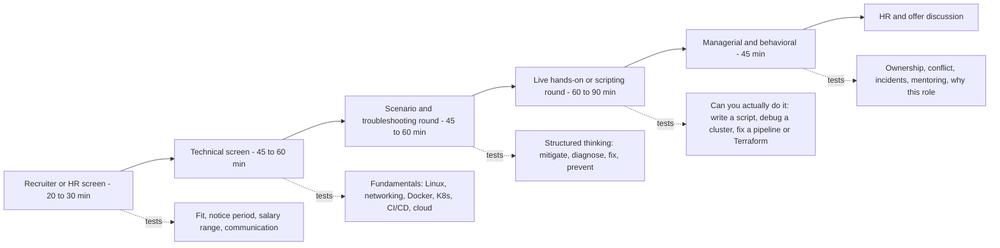
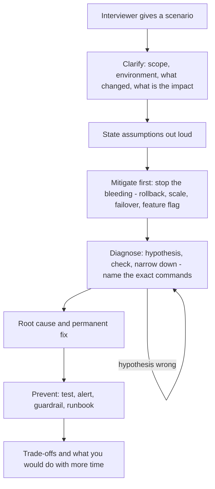
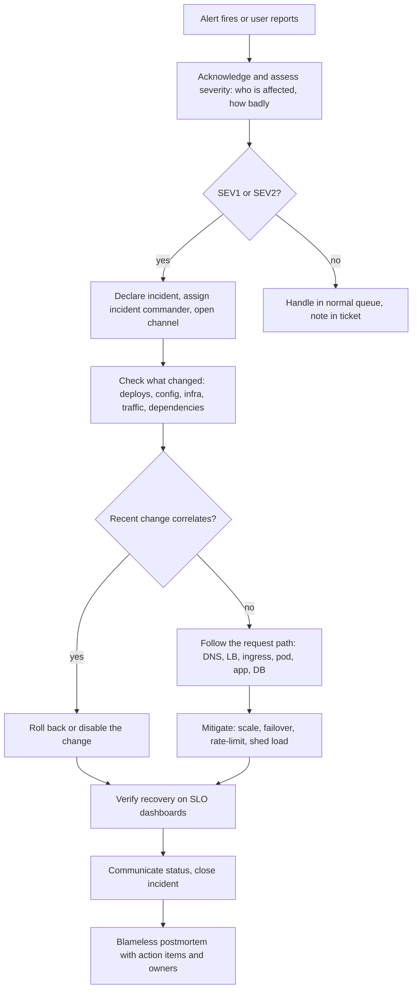
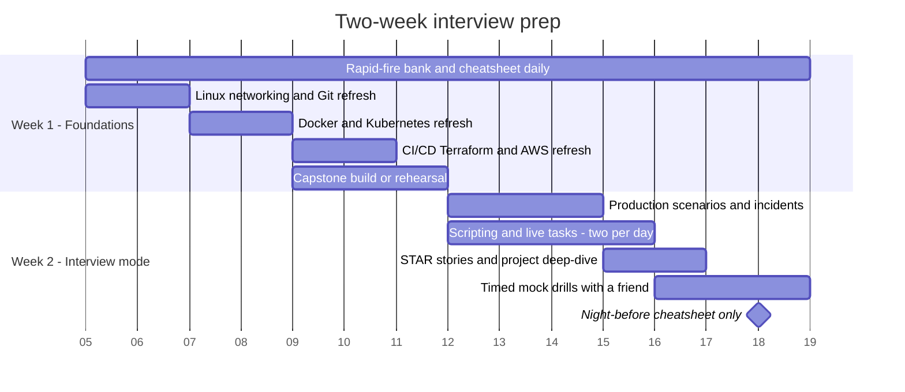

# Real-World Interview

<!-- DEVOPS-SHACK:HEADER -->

  
  
  
  
  

Part of <b><a href="https://github.com/jaiswaladi246/DevOps-Cloud-Interview-Preparation-by-DevOps-Shack">DevOps &amp; Cloud Interview Preparation</a></b> — created by <b><a href="https://www.youtube.com/@devopsshack">DevOps Shack</a></b>. Free to learn from; please credit DevOps Shack when sharing.

<!-- /DEVOPS-SHACK:HEADER -->

> The round where one question touches five tools. Production scenarios, cross-stack incidents, scripting and live hands-on tasks, rapid-fire, behavioral and project deep-dives, practised the way real DevOps, SRE and Cloud panels run them.

[🏠 Home](../README.md)

Topic folders 01 to 11 teach you the tools one at a time. Interviews do not. A senior panel will say "checkout is returning 502s since the 3 p.m. deploy, it runs on EKS behind an ALB, go" and then watch how you think: what you check first, which commands you reach for, when you roll back, how you communicate, and what you change so it never happens again. This folder trains exactly that, plus the parts nobody puts in a tool tutorial: telling your project story, answering behavioral questions with evidence, and finishing a live scripting or cluster task while someone watches your screen.

## What you'll master

- Walk into every round of a DevOps interview loop knowing what it tests and what a strong answer sounds like
- Answer open-ended production scenarios with a repeatable structure instead of a list of random commands
- Debug incidents across the stack (DNS, load balancer, Kubernetes, container, app, database, cloud IAM) out loud, in order
- Clear live hands-on rounds: write a Bash or Python script, fix a broken Dockerfile, pipeline, manifest or Terraform config with the interviewer watching
- Survive the rapid-fire round: ports, status codes, defaults, flags, one-line definitions
- Tell behavioral stories in STAR format with numbers, ownership and a real lesson
- Present one portfolio project, the [capstone](./hands-on-lab.md), so deeply that the interviewer runs out of follow-up questions

## The typical DevOps interview funnel

Most product companies and service companies run some version of this loop. Startups compress it into two or three conversations; large companies add a bar-raiser or a second hands-on round. The exact names change, the signals do not.

Each stage is a filter with a different question behind it. The screen asks "can this person talk about the work?", the technical round asks "do they know how it works?", the scenario round asks "can they be trusted on call?", the live round asks "can they do it with someone watching?", and the managerial round asks "will the team be better with them in it?". Prepare for all five; most candidates over-prepare the second and fail the fourth or fifth.

## How to answer a scenario question

Scenario questions ("a deploy went out and error rate jumped to 8%, what do you do?") reward structure far more than recall. This is the flow we teach and the one interviewers recognise as senior.

The two moves that separate strong candidates: they **ask one or two clarifying questions** before answering, and they **mitigate before they investigate**. "I'd roll back first, then find out why" is the sentence interviewers wait for when users are affected.

## Incident-response answering flow

When the question is a live incident, the interviewer is testing your on-call instincts as much as your debugging. Walk the incident lifecycle, not just the technical fix.

Say the checkpoints as you go: "First I'd check the deploy history, because most incidents follow a change." "I'd post an update in the incident channel every 15 to 30 minutes." "Afterwards I'd write a blameless postmortem with owners and due dates." That narration is worth as much as the commands.

## Two-week prep plan

If you have an interview in two weeks, this is the plan. One hour on weekdays, three to four on weekends. Week one rebuilds fundamentals and your story; week two is mocks.

Dates are placeholders; shift the start to your Monday. The rule: every day ends with 20 minutes of [rapid-fire](./rapid-fire.md) out loud, and every day of week two includes at least one timed [mock drill](./assignments.md).

## Question banks

Six banks, 200 questions each, 1,200 in total. Every answer is written as you would say it in the room.

| Bank | What it trains | Questions |
|------|----------------|-----------|
| [Production scenarios](./production-scenarios.md) | Open-ended "it is broken, go" questions across EKS, ALB, CI/CD, Terraform, databases and cloud | 200 |
| [Incident troubleshooting](./incident-troubleshooting.md) | Cross-stack debugging from symptom and exact error text to root cause and prevention | 200 |
| [Scripting & Live Hands-On Tasks](./scripting-and-live-tasks.md) | Bash and Python scripting, log parsing, live fixes to Dockerfiles, pipelines, manifests and Terraform | 200 |
| [Rapid-fire round](./rapid-fire.md) | One-line answers: ports, status codes, defaults, flags, definitions, comparisons | 200 |
| [Behavioral & STAR](./behavioral-star.md) | Incidents, conflict, ownership, on-call, mistakes, mentoring, prioritisation | 200 |
| [Projects & experience](./project-and-experience.md) | Explaining your projects, resume deep-dives, career gaps, salary and HR round | 200 |

## How interviewers score you

Most panels fill a scorecard after the round with four or five dimensions, each rated something like "strong no / no / yes / strong yes". Knowing the dimensions tells you what to show.

| Dimension | What they write down | How to score high |
|-----------|----------------------|-------------------|
| Fundamentals | Knows how things work underneath, not just which button to press | Explain the mechanism: "a Service is iptables or IPVS rules kube-proxy programs from EndpointSlices" |
| Problem solving | Structured, hypothesis-driven, narrows down instead of guessing | Say your hypothesis, the check that confirms or kills it, then the next step |
| Hands-on depth | Has really done this; names exact commands, flags, error messages | Quote real output: `0/3 nodes are available: 3 Insufficient cpu` |
| Production judgement | Thinks about blast radius, rollback, cost, security, on-call | Mitigate first, mention canaries, alerts, least privilege and cost unprompted |
| Communication | Clear, concise, checks understanding, admits gaps honestly | Lead with the answer, then the why. "I haven't used that, here's how I'd approach it" |
| Ownership and collaboration | Uses "I" for their part, "we" for the team, learns from mistakes | Numbers, decisions you made, what you'd do differently |

Interviewers are rarely looking for a perfect answer. They are deciding whether they would trust you on call next month. Every answer should leave them more confident of that.

## Top 15 mistakes

1. **Answering before clarifying.** Jumping into commands for a scenario without asking what changed, what environment, and how many users are affected.
2. **Investigating while users burn.** Debugging root cause for ten minutes when a rollback would have restored service in one.
3. **Listing tools instead of explaining reasoning.** "I'd check Prometheus, Grafana, ELK, Datadog" says nothing. "I'd check the error rate split by pod to see if it's one bad replica" says everything.
4. **Using "we" for everything.** The interviewer cannot hire your team. Say what you personally did.
5. **No numbers.** "Improved the pipeline" is forgettable; "cut build time from 22 to 7 minutes with layer caching and parallel test shards" gets written on the scorecard.
6. **Bluffing.** Inventing a flag or a feature. Senior interviewers know the edges and one bluff discredits every correct answer before it.
7. **Not knowing your own resume.** Every tool and number on it is fair game. If you cannot explain it for five minutes, remove it.
8. **Project with no depth.** Describing a tutorial project but unable to explain why the design is the way it is, what broke, or what you would change.
9. **Ignoring security and cost.** Proposing a fix or setup with public S3 buckets, static keys and a NAT gateway per environment without a word about either.
10. **Not testing your script before saying done.** In the live round, run it, show the output, and handle the empty-input and error cases.
11. **Rambling.** Five-minute answers to a rapid-fire question. Lead with the answer in one sentence, then stop or offer more.
12. **Blaming people in behavioral answers.** "The dev team pushed bad code" instead of "our pipeline let a broken migration through, so we added a gate".
13. **Freezing in the live round.** Going silent. Think out loud even when stuck; interviewers give hints to people who talk.
14. **Skipping verification.** Saying "then it's fixed" without how you would confirm: dashboards, `kubectl rollout status`, synthetic checks, SLO burn rate.
15. **No questions for the interviewer.** Ending with "no questions" signals low interest. Ask about on-call, deploy frequency and the biggest reliability problem they have.

## Learning path

**Beginner (0 to 2 years)**
- [ ] Read the [night-before cheatsheet](./cheatsheet.md) and say every row out loud
- [ ] Clear the [rapid-fire bank](./rapid-fire.md) twice, timing yourself
- [ ] Write five STAR stories from your work, college projects or labs using [behavioral-star.md](./behavioral-star.md)
- [ ] Build the free kind path of the [capstone](./hands-on-lab.md)
- [ ] Finish drills 1 to 10 in [assignments.md](./assignments.md)

**Intermediate (2 to 5 years)**
- [ ] Work through [production-scenarios.md](./production-scenarios.md) and [incident-troubleshooting.md](./incident-troubleshooting.md), answering out loud before opening each answer
- [ ] Build the full EKS path of the capstone, including the chaos exercise and postmortem
- [ ] Prepare a 2-minute and a 10-minute version of your best project with [project-and-experience.md](./project-and-experience.md)
- [ ] Finish drills 11 to 20

**Advanced (5+ years, senior and lead roles)**
- [ ] Do two timed tasks per day from [scripting-and-live-tasks.md](./scripting-and-live-tasks.md), sharing your screen with a peer, 30 to 45 minutes each
- [ ] Prepare stories about leading an incident, influencing without authority, and a decision you reversed
- [ ] Finish drills 21 to 25 with a peer acting as a tough interviewer

## Continue

- 🛠 [Capstone project: one portfolio project that ties the whole repo together](./hands-on-lab.md)
- 📝 [25 mock interview drills](./assignments.md)
- 📋 [Night-before cheatsheet](./cheatsheet.md)
- 🏠 [Home](../README.md)

<!-- DEVOPS-SHACK:FOOTER -->
---

### 🚀 Made with ❤️ by [DevOps Shack](https://www.youtube.com/@devopsshack)

**Learn DevOps, DevSecOps, Cloud and Kubernetes the practical way.**

[▶️ YouTube — DevOps Shack](https://www.youtube.com/@devopsshack) · [▶️ Hindi — @shackverse](https://www.youtube.com/@shackverse) · [🎓 devopsshack.com](https://devopsshack.com) · [📸 Instagram @devopsshack](https://www.instagram.com/devopsshack)

[🏠 Back to Home](../README.md) · [⭐ Star the original repo](https://github.com/jaiswaladi246/DevOps-Cloud-Interview-Preparation-by-DevOps-Shack)

© DevOps Shack · Licensed CC BY-NC-SA 4.0 · If you found this copy anywhere other than <a href="https://github.com/jaiswaladi246/DevOps-Cloud-Interview-Preparation-by-DevOps-Shack">github.com/jaiswaladi246</a>, the original and latest version is maintained by DevOps Shack.

<!-- /DEVOPS-SHACK:FOOTER -->
