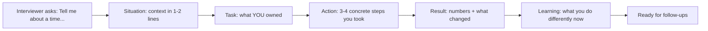

# Real-World Interview — Behavioral (STAR) for DevOps Engineers

<!-- DEVOPS-SHACK:HEADER -->

  
  
  
  
  

Part of <b><a href="https://github.com/jaiswaladi246/DevOps-Cloud-Interview-Preparation-by-DevOps-Shack">DevOps &amp; Cloud Interview Preparation</a></b> — created by <b><a href="https://www.youtube.com/@devopsshack">DevOps Shack</a></b>. Free to learn from; please credit DevOps Shack when sharing.

<!-- /DEVOPS-SHACK:HEADER -->

> Behavioral questions as they are actually asked of DevOps, SRE and cloud engineers, with what the interviewer is testing, a sample STAR answer with real numbers, and the trap to avoid · 200 questions · 🟢 Beginner 🟡 Intermediate 🔴 Advanced

[⬅ Back to Real-World Interview](./README.md) · [🏠 Home](../README.md)

## How to answer with STAR

<!-- DEVOPS-SHACK:SECTION -->
> 🎥 **Learn this hands-on with DevOps Shack** → [YouTube @devopsshack](https://www.youtube.com/@devopsshack) · [Hindi @shackverse](https://www.youtube.com/@shackverse) · [Courses at devopsshack.com](https://devopsshack.com)

Spend roughly 10% on Situation, 10% on Task, 60% on Action and 20% on Result. Say "I", not "we", when you describe actions. Every Result should carry a number: minutes of downtime, deploys per week, dollars saved, tickets closed, MTTR before and after. Keep a bank of 8–10 real stories and map each one to several questions.

## Table of contents
- [Outages, incidents & mistakes](#outages-incidents--mistakes) — Q1–Q25
- [Conflict & collaboration with developers](#conflict--collaboration-with-developers) — Q26–Q50
- [Saying no: risk, unsafe deploys & quality](#saying-no-risk-unsafe-deploys--quality) — Q51–Q75
- [On-call, burnout, toil & automation](#on-call-burnout-toil--automation) — Q76–Q100
- [Ownership, migrations & mentoring](#ownership-migrations--mentoring) — Q101–Q125
- [Ambiguity, prioritisation & delivery](#ambiguity-prioritisation--delivery) — Q126–Q150
- [Security, compliance & cross-team work](#security-compliance--cross-team-work) — Q151–Q175
- [Manager & HR round](#manager--hr-round) — Q176–Q200

---

## Outages, incidents & mistakes

<!-- DEVOPS-SHACK:SECTION -->
> 🎥 **Learn this hands-on with DevOps Shack** → [YouTube @devopsshack](https://www.youtube.com/@devopsshack) · [Hindi @shackverse](https://www.youtube.com/@shackverse) · [Courses at devopsshack.com](https://devopsshack.com)

### Q1. Tell me about a time you caused a production outage. 🟡

<b>Answer</b>

**What they're really testing →** Ownership, honesty, and whether you fixed the system rather than just the symptom.

**Sample STAR answer →**
- **Situation:** I was rotating the TLS certificate on our public ALB. I updated the Terraform `aws_lb_listener` but the new ACM cert was issued for `api.example.com` only, not the `*.example.com` SAN that mobile clients used.
- **Task:** I owned the change and was on-call that week.
- **Action:** Alerts fired on 5xx and TLS handshake errors within 4 minutes. I announced in the incident channel that it was my change, rolled back with `terraform apply` on the previous commit, and confirmed recovery with `curl -vI` against both hostnames. Afterwards I added a pre-apply check that compares SANs on the old and new certificate and a synthetic check per hostname.
- **Result:** 11 minutes of partial impact for mobile users. The SAN check has blocked two similar mistakes since, and certificate changes now go through a staging listener first.

**Avoid →** Picking a fake "outage" that had no impact, or blaming the reviewer who approved your PR.

### Q2. Describe the worst incident you have been part of. What was your role? 🟡

<b>Answer</b>

**What they're really testing →** Composure under pressure, clarity of role, and whether you understand incident command.

**Sample STAR answer →**
- **Situation:** Our primary RDS PostgreSQL instance ran out of storage at 2 a.m. because a runaway job wrote 400 GB of audit rows. Checkout was down.
- **Task:** I was the secondary on-call; the primary took incident command and asked me to own the database recovery.
- **Action:** I paused the offending CronJob with `kubectl patch cronjob audit-export -p '{"spec":{"suspend":true}}'`, increased allocated storage (storage autoscaling was off), and while the modification ran I worked with the app owner to delete the junk rows in batches to avoid long locks. I posted updates every 15 minutes for the commander.
- **Result:** Checkout restored in 47 minutes. Follow-ups: storage autoscaling enabled, a `FreeStorageSpace` alarm at 20%, and row-count limits on the job.

**Avoid →** Making yourself the hero of every part of the incident; clearly name what you did versus the team.

### Q3. Tell me about a mistake you made early in your career and what you learned. 🟢

<b>Answer</b>

**What they're really testing →** Self-awareness and growth, especially for juniors.

**Sample STAR answer →**
- **Situation:** In my first month I ran `rm -rf ./build/*` from what I thought was a project directory on a shared Jenkins agent, but my shell was in the workspace root.
- **Task:** Restore the agent and make sure it did not happen again.
- **Action:** I told my lead immediately, we re-provisioned the agent from its Ansible role in about 30 minutes, and I re-triggered the 6 failed pipelines. I then moved the cleanup into the pipeline itself using `cleanWs()` so nobody needed to run manual deletes.
- **Result:** No lasting impact beyond 30 minutes of blocked builds. I learned to avoid manual changes on shared machines and to always `pwd` before destructive commands. Today I push for "no SSH to fix things" as a team norm.

**Avoid →** A mistake so trivial it says nothing, or one where you never told anyone.

### Q4. Tell me about a time you were paged for something you did not understand. 🟢

<b>Answer</b>

**What they're really testing →** Whether you escalate sensibly instead of guessing or freezing.

**Sample STAR answer →**
- **Situation:** Two weeks into on-call I got paged for `KafkaConsumerLagHigh` on a service I had never touched.
- **Task:** Stabilise or escalate within our 15-minute acknowledgement SLA.
- **Action:** I acknowledged, opened the runbook linked in the alert, and checked consumer lag in Grafana. The runbook said to scale consumers, but lag was growing on one partition only, which the runbook did not cover. I paged the owning team's secondary after 10 minutes with a summary: "Lag on partition 7 only, consumers healthy, suspect a poison message." They confirmed and skipped the offset.
- **Result:** Resolved in 35 minutes. I then added a "single-partition lag" section to the runbook with the exact `kafka-consumer-groups.sh --describe` command.

**Avoid →** Saying you "figured it out alone" when the right answer was to escalate.

### Q5. How did you run a blameless postmortem after an incident you caused? 🟡

<b>Answer</b>

**What they're really testing →** Whether you understand blameless culture as "fix the system", not "nobody is responsible".

**Sample STAR answer →**
- **Situation:** A Helm upgrade I ran removed a `PodDisruptionBudget`, and a node drain during patching took all 3 replicas of our auth service down at once.
- **Task:** I volunteered to write and facilitate the postmortem.
- **Action:** I wrote a timeline from Slack and the `kubectl get events` history, framed contributing factors as system gaps (the chart allowed PDB removal silently, no diff was reviewed, node drains were not rate-limited), and asked "what made this easy to do?" rather than "who did it?". I kept my own name in the timeline factually.
- **Result:** Three action items shipped in two weeks: `helm diff` required in CI, a Kyverno policy requiring a PDB for Deployments with more than 1 replica, and a drain script with `--disable-eviction=false`. No repeat in the following 9 months.

**Avoid →** Using "blameless" to dodge saying it was your change.

### Q6. Tell me about an incident where the root cause turned out to be different from what everyone first assumed. 🔴

<b>Answer</b>

**What they're really testing →** Debugging discipline and resistance to confirmation bias.

**Sample STAR answer →**
- **Situation:** p99 latency on our API tripled after a release. The team was ready to roll back the application code.
- **Task:** As incident lead, I had to decide whether to roll back or keep investigating.
- **Action:** I asked for a rollback in parallel, but latency stayed high after it, so the code was not the cause. I compared node-level metrics and saw high CPU steal on nodes from a new instance family the cluster autoscaler had started using that morning. I cordoned those nodes, drained them, and pinned the node group to the previous type.
- **Result:** p99 back to 180 ms within 25 minutes of the cordon. We added `node_cpu_seconds_total{mode="steal"}` to the dashboard and now test instance-type changes in a canary node group first.

**Avoid →** Telling a story where you were right and everyone else was dumb.

### Q7. Have you ever had to roll back a release under pressure? Walk me through it. 🟢

<b>Answer</b>

**What they're really testing →** Calm execution and knowing your rollback path before you need it.

**Sample STAR answer →**
- **Situation:** A Friday afternoon release of our payments service started throwing `NullPointerException` on 8% of requests.
- **Task:** I was the release engineer and owned the go/no-go.
- **Action:** Error rate crossed our 2% rollback threshold within 6 minutes. I didn't wait for a fix-forward: I ran `argocd app rollback payments` to the previous synced revision, watched the error-rate panel and the `kubectl rollout status` output, then froze auto-sync so the bad commit would not redeploy.
- **Result:** Errors back to baseline in 9 minutes total. The developer fixed the bug Monday; we added a 10% canary step using Argo Rollouts so the next bad release would hit far fewer users.

**Avoid →** Describing a rollback with no defined threshold, as if you just "had a feeling".

### Q8. Tell me about a time monitoring did not catch a problem. What did you do? 🟡

<b>Answer</b>

**What they're really testing →** Whether you close observability gaps systematically.

**Sample STAR answer →**
- **Situation:** A customer emailed support that password-reset emails had not arrived for 3 hours. All our dashboards were green.
- **Task:** I was asked to find out why monitoring missed it.
- **Action:** The email worker was running and healthy, but the SES sending quota had been hit and the worker was logging and swallowing the throttling error. Our alerts only checked pod health and HTTP 5xx. I added a business metric (`emails_sent_total` by type) and an alert when the reset-email rate dropped to zero for 15 minutes during business hours. I also added the SES `Reputation` and `Send` CloudWatch metrics to the dashboard.
- **Result:** We now detect email outages in under 20 minutes, and I ran a review of 12 other async workers to add "work is actually happening" alerts.

**Avoid →** Only saying "we added more alerts" without explaining why the original signal was wrong.

### Q9. Describe a time you had to communicate an outage to non-technical stakeholders. 🟡

<b>Answer</b>

**What they're really testing →** Translating technical detail into business impact.

**Sample STAR answer →**
- **Situation:** Our order-sync to the warehouse system failed for 4 hours overnight, delaying about 1,200 shipments.
- **Task:** The operations director wanted an explanation by 9 a.m.
- **Action:** I wrote a half-page note with three sections: what customers experienced (orders delayed, none lost), why (an expired API credential for the warehouse integration), and what we changed (credential moved to Secrets Manager with rotation and an expiry alert 14 days ahead). I avoided terms like "401" and "IAM".
- **Result:** The director forwarded it to the customer team unchanged, and they used it for proactive customer emails. That format became our template for business-facing incident summaries.

**Avoid →** Drowning non-technical people in stack traces or hiding the impact.

### Q10. Tell me about a time you ran an incident as the incident commander. 🔴

<b>Answer</b>

**What they're really testing →** Coordination: roles, communication cadence, and decision-making.

**Sample STAR answer →**
- **Situation:** A bad CoreDNS ConfigMap change broke DNS for half our EKS workloads. Around 15 engineers jumped into the channel.
- **Task:** I took incident command.
- **Action:** I assigned roles in the first 3 minutes: one ops lead to investigate, one comms lead to update the status page every 20 minutes, one scribe. I stopped parallel unco-ordinated changes by declaring "no changes without announcing them here". The ops lead found the ConfigMap diff; I approved the revert and asked for `kubectl rollout restart deployment coredns -n kube-system`.
- **Result:** Resolved in 32 minutes. The postmortem credited the clear roles with avoiding a second outage from conflicting fixes. We added CoreDNS config to GitOps with a required review.

**Avoid →** Describing yourself as both commander and the person typing every fix.

### Q11. Tell me about a data-loss incident or near miss. 🔴

<b>Answer</b>

**What they're really testing →** Seriousness about backups, restores, and verification.

**Sample STAR answer →**
- **Situation:** A migration script deleted 18,000 customer address rows in production due to a missing `WHERE` clause.
- **Task:** I owned database operations and had to restore the data without rolling back the whole database.
- **Action:** I used RDS point-in-time restore to spin up a new instance at 2 minutes before the script ran, exported just the affected rows with `pg_dump --table=addresses --data-only`, and loaded them into a staging table in production. The app team verified and merged rows that had not been edited since.
- **Result:** All rows recovered in 2.5 hours with zero lost customer edits. Afterwards we required migrations to run inside a transaction with a row-count assertion, and I started quarterly restore drills because this was the first real restore we had ever done.

**Avoid →** Claiming backups "just worked" without mentioning that restores need testing.

### Q12. Tell me about a time a change you approved in code review caused a problem. 🟡

<b>Answer</b>

**What they're really testing →** Shared ownership, and whether you improve review quality.

**Sample STAR answer →**
- **Situation:** I approved a Terraform PR that changed a security group's `ingress` block. The plan output looked fine, but it replaced the rule set and briefly dropped access from our bastion and the CI runners.
- **Task:** Recover access and understand why review did not catch it.
- **Action:** I re-applied the previous config, then realised the plan showed `-/+` (replace) and I skimmed past it. I proposed posting the `terraform plan` summary as a PR comment with destroy/replace counts highlighted, and failing CI when a protected resource is destroyed unless a `allow-destroy` label is set.
- **Result:** 20 minutes of blocked CI. The plan comment caught 3 accidental replacements in the next quarter.

**Avoid →** Saying "the author should have tested it", since you approved it too.

### Q13. Have you ever been on call during a major cloud provider outage? 🟡

<b>Answer</b>

**What they're really testing →** Handling things outside your control and resilience design.

**Sample STAR answer →**
- **Situation:** During a regional AWS incident affecting EC2 API calls in our primary region, new pods could not get nodes, and autoscaling stalled during peak traffic.
- **Task:** Keep the service up while we could not provision.
- **Action:** I confirmed via the AWS Health Dashboard that it was provider-side, stopped our deploys (they would have churned pods onto non-existent capacity), raised HPA minimums only where existing nodes had headroom, and shed load by switching off the non-critical recommendations widget through a feature flag.
- **Result:** We stayed up at degraded quality for 2 hours. Follow-up: we kept 20% warm headroom during peak season and wrote a "provider outage" runbook covering deploy freezes and load-shedding flags.

**Avoid →** "There was nothing we could do, it was AWS."

### Q14. Tell me about an incident you resolved but never fully found the root cause of. 🔴

<b>Answer</b>

**What they're really testing →** Intellectual honesty and how you manage residual risk.

**Sample STAR answer →**
- **Situation:** Once a week, at random, one of our Java services would hang with all threads blocked. Restarting fixed it.
- **Task:** Find the cause, or at least contain it.
- **Action:** I added an automated `jstack` thread dump on liveness-probe failure, saved to S3, before the kubelet restarted the container. Over 4 incidents the dumps pointed to a connection-pool deadlock in an old HTTP client, but we could never reproduce it. I contained it with a tighter liveness probe and a pool timeout, and logged a ticket to upgrade the client.
- **Result:** Impact went from 10-minute hangs to 40-second auto-recoveries. I was explicit in the postmortem that the root cause was "probable, not confirmed".

**Avoid →** Pretending you always find the root cause.

### Q15. Describe a time you made an incident worse while trying to fix it. 🔴

<b>Answer</b>

**What they're really testing →** Humility, and whether you learned to slow down during incidents.

**Sample STAR answer →**
- **Situation:** Redis memory was at 95% and evicting keys. I ran `FLUSHDB` on what I thought was the cache-only database.
- **Task:** I was primary on-call.
- **Action:** That database also held session data, so 40,000 users were logged out. I owned it in the channel immediately, the sessions were not recoverable, so we posted a status update and the app team added a login banner. In the postmortem I proposed splitting sessions onto a separate Redis instance with `maxmemory-policy noeviction` and requiring a second person to confirm destructive commands during incidents.
- **Result:** Session store separated within a sprint. I now say my intended action out loud in the channel before running anything destructive.

**Avoid →** Hiding your part in the incident timeline.

### Q16. Tell me about a time you noticed a problem before it became an outage. 🟢

<b>Answer</b>

**What they're really testing →** Proactiveness and attention to trends.

**Sample STAR answer →**
- **Situation:** During a routine dashboard review I noticed our EKS cluster had used 220 of 250 available IPs in one subnet.
- **Task:** Nobody owned IP capacity planning; I picked it up.
- **Action:** I checked the VPC CNI settings and saw `WARM_IP_TARGET` defaulting high, which reserved many unused IPs per node. I tuned `WARM_IP_TARGET=2` and `MINIMUM_IP_TARGET`, added a secondary CIDR for pods, and created an alert at 80% subnet usage.
- **Result:** Free IPs went from 30 to over 400. Two months later a traffic spike scaled us to 3x the node count, which would have failed with "failed to assign an IP address to container".

**Avoid →** Making it sound like luck rather than a habit of reviewing signals.

### Q17. Tell me about a time an incident was caused by another team. How did you handle it? 🟡

<b>Answer</b>

**What they're really testing →** Collaboration without finger-pointing.

**Sample STAR answer →**
- **Situation:** The network team changed a firewall rule that blocked our services from reaching the on-prem LDAP server. Logins failed for internal tools.
- **Task:** Restore access and avoid a blame fight.
- **Action:** I gathered evidence (`nc -vz ldap.internal 636` timing out from our subnet only, change calendar entry 20 minutes earlier) and messaged their on-call with the facts and a specific ask: "Can you check rule CHG-4412 for our 10.20.0.0/16 range?" I did not post blame in the wide channel.
- **Result:** Fixed in 15 minutes after contact. We agreed jointly to add our critical dependencies to their change-review checklist, and they invited us to their change board.

**Avoid →** "It was their fault" as your main message.

### Q18. Tell me about a time you had to make a decision during an incident with incomplete information. 🔴

<b>Answer</b>

**What they're really testing →** Judgment under uncertainty and reversible decisions.

**Sample STAR answer →**
- **Situation:** Error rates were climbing in our EU region and we had no clear cause after 15 minutes.
- **Task:** As incident commander I had to decide whether to fail traffic over to the US region, which would add latency and had data-residency implications.
- **Action:** I checked with our DPO contact that a temporary failover for read traffic was allowed, then shifted 50% of reads by changing Route 53 weighted records, not 100%, so we could observe. Errors dropped proportionally, which confirmed the problem was regional infrastructure.
- **Result:** We moved the remaining reads, limited impact to 22 minutes, and the cause (a failing NAT gateway in one AZ) was found 40 minutes later. I chose a reversible, partial action first.

**Avoid →** Claiming you waited for full certainty before acting.

### Q19. Tell me about the first time you joined an on-call rotation. How did you prepare? 🟢

<b>Answer</b>

**What they're really testing →** Preparation habits and humility.

**Sample STAR answer →**
- **Situation:** I joined the SRE rotation for 14 services after 6 weeks at the company.
- **Task:** Be useful on call without causing harm.
- **Action:** I shadowed two shifts, read the last 10 postmortems, and walked through every runbook, fixing broken links and outdated commands as I went (I found 9). I checked that I had working access to the cluster, AWS console, PagerDuty and the database read replica before my first shift.
- **Result:** My first solo week had 4 pages and I resolved 3 without escalation. My runbook fixes became part of our onboarding checklist.

**Avoid →** Saying you just "learned on the job" with no preparation.

### Q20. Tell me about a recurring incident you finally eliminated. 🟡

<b>Answer</b>

**What they're really testing →** Moving from firefighting to permanent fixes.

**Sample STAR answer →**
- **Situation:** Our Jenkins controller ran out of disk roughly every 10 days, killing all builds, and someone would manually delete old workspaces.
- **Task:** I took the ticket that had been re-opened 7 times.
- **Action:** I found build artifacts were retained forever. I set `buildDiscarder(logRotator(numToKeepStr: '20'))` in the shared library, moved artifacts to S3 with a 30-day lifecycle rule, and added a disk alert at 75%.
- **Result:** Controller disk usage dropped from 480 GB to 90 GB and the incident never recurred in the following year, saving roughly 2 hours of interrupt work per occurrence.

**Avoid →** Not quantifying how often it recurred before your fix.

### Q21. Describe a time you had to wake someone up during an incident. 🟢

<b>Answer</b>

**What they're really testing →** Knowing when escalation is right and doing it respectfully.

**Sample STAR answer →**
- **Situation:** At 3 a.m. the billing database replica lag hit 30 minutes and invoices were being generated from stale data.
- **Task:** I had no write access to that database and the runbook said to page the DBA on-call.
- **Action:** I spent 10 minutes confirming it wasn't a monitoring artefact, paused the invoice job to stop further damage, then paged the DBA with a short summary: what, since when, what I had already done.
- **Result:** The DBA found a long-running vacuum blocking replay and resolved it in 20 minutes. They thanked me for the clear handover, and we added "pause invoice job" to the runbook as step one.

**Avoid →** Implying you avoid escalating because it "bothers people".

### Q22. Tell me about an incident caused by a dependency upgrade. 🟡

<b>Answer</b>

**What they're really testing →** Change-risk awareness for "small" upgrades.

**Sample STAR answer →**
- **Situation:** A routine base-image bump from `node:18` to `node:20` merged by Renovate broke our image-processing service, which used a native module compiled for the old ABI.
- **Task:** Restore service and stop unreviewed runtime upgrades.
- **Action:** I rolled back the image tag, then configured Renovate to auto-merge patch updates only and group major runtime bumps into a separate PR requiring an integration-test job that exercises native modules.
- **Result:** 14 minutes of failed uploads. Since then, 3 major upgrades went through cleanly with the new test gate.

**Avoid →** Concluding "we stopped auto-updates", which trades one risk for a worse one.

### Q23. Tell me about a time you discovered a production issue during a demo or launch. 🟡

<b>Answer</b>

**What they're really testing →** Grace under visible pressure.

**Sample STAR answer →**
- **Situation:** During a product launch, the marketing campaign drove 6x normal traffic and our signup API started returning 503s from the ingress.
- **Task:** I was the on-duty platform engineer in the launch war room.
- **Action:** HPA was scaling pods but they sat `Pending` because the cluster autoscaler hit the node group's `maxSize`. I raised `maxSize` from 10 to 30 via Terraform with a targeted apply, and in the meantime enabled the queue-based signup fallback the team had built.
- **Result:** Signups recovered in 12 minutes and we finished the day with 18,000 new accounts. I then added load testing at 10x to every launch checklist.

**Avoid →** Blaming marketing for "not telling us".

### Q24. Tell me about a time you had to handle an incident outside your area of expertise. 🔴

<b>Answer</b>

**What they're really testing →** Structured debugging when you are not the domain expert.

**Sample STAR answer →**
- **Situation:** Our ML inference service on GPU nodes started returning garbage predictions. The ML team was offline in another timezone.
- **Task:** I was on call and had never worked with the model-serving stack.
- **Action:** I focused on what had changed: the deploy history showed none, but the node group had rotated to a new AMI with a different NVIDIA driver version. I compared `nvidia-smi` output on old and new nodes, pinned the node group's AMI back to the prior version and recycled the nodes.
- **Result:** Predictions back to normal in 50 minutes. I wrote up the findings for the ML team, who added a driver-version check to the model's startup probe.

**Avoid →** Pretending expertise you didn't have; show the method instead.

### Q25. What is the most important lesson you have learned from incidents? 🟢

<b>Answer</b>

**What they're really testing →** Maturity and whether you can generalise from experience.

**Sample STAR answer →**
- **Situation:** Looking back at about 30 postmortems I was involved in at my last company, I grouped the root causes.
- **Task:** I wanted one lesson to drive what I prioritise.
- **Action:** Roughly 70% were triggered by changes (deploys, config, infra), not random failure. So I focused on making changes safer: progressive delivery, automated rollback on error-budget burn, and smaller batches.
- **Result:** Change failure rate dropped from about 18% to 7% over two quarters. My lesson: most outages are change-induced, so invest in safe, small, reversible changes.

**Avoid →** A generic answer like "always stay calm" with no evidence behind it.

---

## Conflict & collaboration with developers

<!-- DEVOPS-SHACK:SECTION -->
> 🎥 **Learn this hands-on with DevOps Shack** → [YouTube @devopsshack](https://www.youtube.com/@devopsshack) · [Hindi @shackverse](https://www.youtube.com/@shackverse) · [Courses at devopsshack.com](https://devopsshack.com)

### Q26. Tell me about a disagreement you had with a developer. How did you resolve it? 🟢

<b>Answer</b>

**What they're really testing →** Whether you resolve conflict with data and empathy, not authority.

**Sample STAR answer →**
- **Situation:** A senior developer wanted their service to skip our container image scan because it added 4 minutes to every pipeline.
- **Task:** Keep the security gate without becoming the team's blocker.
- **Action:** I sat with him to look at the pipeline. The scan pulled the full Trivy vulnerability DB on every run. I enabled DB caching on the runner and scoped the scan to `--severity HIGH,CRITICAL --ignore-unfixed` for the blocking step, with a full report in a non-blocking job.
- **Result:** Scan time fell from 4 minutes to 40 seconds and he became an advocate for the gate in his team.

**Avoid →** "I explained the policy and he accepted it." That's not resolution, that's rank.

### Q27. Describe a time developers blamed "infra" for a problem that was in their code. 🟡

<b>Answer</b>

**What they're really testing →** Diplomacy and evidence-based debugging.

**Sample STAR answer →**
- **Situation:** A team reported "Kubernetes is killing our pods randomly" and escalated to my manager.
- **Task:** Find the real cause without making them defensive.
- **Action:** `kubectl describe pod` showed `Last State: Terminated, Reason: OOMKilled, Exit Code: 137`. I pulled the memory graph, which showed steady growth until the 512Mi limit, and shared it in a short call framed as "here's what the platform sees, can we look at the heap together?". A heap dump showed an unbounded in-memory cache.
- **Result:** They capped the cache and restarts went from about 30 a day to zero. I added an OOMKilled panel to their dashboard so they could self-diagnose next time.

**Avoid →** Any version of "I proved them wrong".

### Q28. Tell me about a time you had to influence a team you had no authority over. 🟡

<b>Answer</b>

**What they're really testing →** Influence through enablement, not mandates.

**Sample STAR answer →**
- **Situation:** I wanted all 12 product teams to add readiness probes; only 3 had them, and rolling deploys caused brief 502s.
- **Task:** I owned the platform but not their services.
- **Action:** I measured the 502s per deploy for each team and shared a short ranked table, then opened ready-to-merge PRs adding probes to the 4 worst services, using their existing `/health` endpoints. I also added a warning (not a block) in CI when probes were missing.
- **Result:** Within 6 weeks 11 of 12 teams had probes and deploy-time 502s dropped by about 95%. Only after that did we make it a blocking policy.

**Avoid →** Escalating to management as your first move.

### Q29. Tell me about a time a developer pushed back on a process you introduced. 🟢

<b>Answer</b>

**What they're really testing →** Whether you listen and adapt your process.

**Sample STAR answer →**
- **Situation:** I introduced a required staging deploy before production. Developers complained it added a day to small fixes.
- **Task:** Keep the safety benefit without the delay.
- **Action:** I looked at the data: 80% of changes were config or copy changes that never failed in staging. I proposed a fast lane: PRs labelled `low-risk` with only config/text diffs could go straight to production with a canary, while code changes still went through staging.
- **Result:** Median lead time for small changes dropped from 26 hours to 2 hours, and change failure rate did not move.

**Avoid →** Defending a process because "it's best practice".

### Q30. Describe a situation where you and a developer had different priorities. 🟡

<b>Answer</b>

**What they're really testing →** Negotiation and finding shared goals.

**Sample STAR answer →**
- **Situation:** A product team needed a new Kafka topic and consumer group for a feature due in 3 days; I was mid-way through a Kubernetes upgrade with a fixed maintenance window.
- **Task:** Serve both without sacrificing the upgrade.
- **Action:** I asked what they actually needed by when: they needed a topic to test against, not production. I gave them a self-service topic in the dev cluster through our Terraform module that same day and scheduled the production topic for after the window.
- **Result:** They hit their date and my upgrade went ahead. I then made topic creation fully self-service in all environments so this conflict wouldn't come up again.

**Avoid →** Framing it as "my work vs. their work" with a winner.

### Q31. Tell me about a time you had to tell a developer their code was not production-ready. 🟡

<b>Answer</b>

**What they're really testing →** Delivering hard feedback constructively.

**Sample STAR answer →**
- **Situation:** A new service was scheduled to go live with no metrics, logging to local files only, and a single replica.
- **Task:** I was the platform reviewer on the production-readiness checklist.
- **Action:** I sent the developer a private note before the review meeting listing the 4 gaps, why each mattered (for example, "a single replica means every node drain is an outage"), and offered to pair on the fixes. I scaffolded the Prometheus client and stdout logging in a PR.
- **Result:** The launch slipped 2 days, not 2 weeks, and the service has had zero incidents in its first 6 months. The developer later reused my PR as a template for two more services.

**Avoid →** Surprising someone with a public "no" in a meeting.

### Q32. How did you build trust with a development team that saw DevOps as a bottleneck? 🔴

<b>Answer</b>

**What they're really testing →** Understanding of DevOps as a service and culture, not a gate.

**Sample STAR answer →**
- **Situation:** When I joined, every environment request went through a Jira ticket to the ops team with a 5-day median wait. Developers openly called us "the ticket wall".
- **Task:** I was hired to modernise the platform.
- **Action:** I counted our top 5 ticket types (they were 70% of volume), then automated them one by one: namespace creation via a GitOps template, DNS records via ExternalDNS, database users via a Terraform module behind a PR. I joined each team's standup once a month to hear what blocked them.
- **Result:** Ticket volume fell 65% in a quarter, median wait went from 5 days to under 1 hour for self-service items, and our internal survey score went from 2.9 to 4.3 out of 5.

**Avoid →** Saying the developers "needed to understand ops better".

### Q33. Tell me about a time you collaborated with a developer to fix a performance problem. 🟡

<b>Answer</b>

**What they're really testing →** Pairing across the dev/ops boundary.

**Sample STAR answer →**
- **Situation:** Our search API's p95 rose from 300 ms to 1.4 s over a month as traffic grew.
- **Task:** Find whether it was infra or code, together with the owning developer.
- **Action:** I enabled OpenTelemetry tracing for the service and we looked at traces together. 70% of time was spent on sequential database calls, an N+1 query pattern. He fixed the query; I tuned the connection pool and moved the read path to the replica.
- **Result:** p95 dropped to 220 ms and we downsized the database by one instance class, saving about $1,100 a month.

**Avoid →** Pretending you fixed application code you didn't own.

### Q34. Describe a time you had a conflict with a peer on your own DevOps team. 🟡

<b>Answer</b>

**What they're really testing →** Peer-level conflict handling and willingness to compromise.

**Sample STAR answer →**
- **Situation:** A teammate wanted to standardise on Pulumi; I preferred staying with Terraform, which we already had 40 modules in.
- **Task:** Reach a decision without the debate dragging for weeks.
- **Action:** I proposed we write down evaluation criteria first (migration cost, team skill, state management, hiring), then each build the same small VPC stack in both tools. We scored it together and shared it with the team.
- **Result:** We stayed on Terraform because migration cost dominated, but adopted his idea of writing tests in a real language using Terratest. He told me later he appreciated that the process was fair.

**Avoid →** A story where you simply "won the argument".

### Q35. Tell me about a time you received feedback from a developer that was hard to hear. 🟢

<b>Answer</b>

**What they're really testing →** Coachability.

**Sample STAR answer →**
- **Situation:** In a retro, a developer said my pipeline error messages were "useless" and they spent hours guessing why builds failed.
- **Task:** Take it seriously rather than defensively.
- **Action:** I asked for three examples. One showed only `exit code 1` from a shell step. I added `set -euo pipefail`, clear `echo "::error::..."` messages for common failures (missing env var, failing tests, image scan), and a link to a troubleshooting page from each failure.
- **Result:** "Why did my build fail?" Slack questions dropped from about 15 to 3 a week.

**Avoid →** Responding to "feedback" stories with how the feedback was wrong.

### Q36. Tell me about a time you had to work with a difficult stakeholder. 🟡

<b>Answer</b>

**What they're really testing →** Empathy and finding out what's really driving someone.

**Sample STAR answer →**
- **Situation:** A product manager kept escalating that environments were "always broken" and demanded a dedicated ops engineer.
- **Task:** Understand the real problem.
- **Action:** I asked for 30 minutes and listened. His real pain was demo environments for sales that broke when developers deployed to shared staging. I built ephemeral preview environments per branch using an Argo CD ApplicationSet with a pull-request generator, auto-deleted after 72 hours.
- **Result:** Sales demos ran from stable, dedicated URLs and escalations stopped. He became one of the platform team's biggest supporters in planning.

**Avoid →** Labelling the person as "difficult" throughout your answer.

### Q37. Tell me about a time you helped developers own their services in production. 🔴

<b>Answer</b>

**What they're really testing →** "You build it, you run it" understanding and change management.

**Sample STAR answer →**
- **Situation:** All pages for 25 services went to a 4-person ops team. We were burning out, and developers never saw their own failures.
- **Task:** Move first-line on-call to service teams without dumping it on them.
- **Action:** I gave each team a dashboard and alert set from a shared template, cut noisy alerts first (from 180 alert rules to 60 actionable ones), ran on-call training, and kept the platform team as secondary for 3 months.
- **Result:** Ops pages dropped 70%, MTTR fell from 48 to 22 minutes because the code owners responded, and developers began fixing the noisy alerts themselves.

**Avoid →** Making it sound like you offloaded pain without preparing teams.

### Q38. Describe a time you had to say "I was wrong" to a developer. 🟢

<b>Answer</b>

**What they're really testing →** Humility.

**Sample STAR answer →**
- **Situation:** I insisted a team's intermittent 504s came from their slow endpoint and asked them to optimise it.
- **Task:** After they spent a day on it, the 504s continued.
- **Action:** I dug back in and found the ALB idle timeout was 60 seconds while our Nginx ingress `proxy-read-timeout` was 30 seconds, and a long-running export endpoint hit that. I told the team directly that I'd sent them down the wrong path, fixed the timeout annotation on that ingress, and documented the timeout chain.
- **Result:** 504s disappeared. The team appreciated the honesty and I learned to verify the whole request path before pointing at code.

**Avoid →** A story where your "mistake" was actually someone else's.

### Q39. Tell me about a time you had to align multiple teams on a shared standard. 🔴

<b>Answer</b>

**What they're really testing →** Driving consensus at scale.

**Sample STAR answer →**
- **Situation:** 9 teams had 9 different Helm chart styles, making upgrades and security fixes slow.
- **Task:** Create a shared base chart that teams would actually adopt.
- **Action:** I formed a small working group with one engineer from 4 teams, drafted an RFC with the chart's values contract, and held two open review sessions. We built a library chart with escape hatches for custom needs and migrated 2 services as a pilot.
- **Result:** 8 of 9 teams migrated in a quarter. A later CVE in our sidecar config was patched in all services in 1 day instead of 2 weeks.

**Avoid →** "I wrote the standard and sent an email."

### Q40. Tell me about a time a developer deployed something unsafe without going through the process. 🟡

<b>Answer</b>

**What they're really testing →** Holding people accountable without vilifying them.

**Sample STAR answer →**
- **Situation:** A developer used his admin kubeconfig to `kubectl edit` a production Deployment and bump replicas during a spike. Argo CD later reverted it mid-spike, causing an outage.
- **Task:** Understand why he bypassed GitOps and close the gap.
- **Action:** I talked to him one-on-one. He said a PR took 25 minutes to merge and sync, too slow for an emergency. I didn't make it a disciplinary issue; I added an emergency path (a fast-track merge with one approval and Argo CD sync on webhook), and we moved personal admin access to break-glass roles with logging.
- **Result:** Emergency changes via Git now land in under 4 minutes, and direct `kubectl edit` in production dropped to zero.

**Avoid →** Ending the story with "and he got written up".

### Q41. How did you handle a developer who constantly asked you to do things they could do themselves? 🟢

<b>Answer</b>

**What they're really testing →** Enabling self-service while remaining helpful.

**Sample STAR answer →**
- **Situation:** One developer messaged me 3–4 times a day to restart pods or fetch logs.
- **Task:** Reduce interruptions without damaging the relationship.
- **Action:** I gave his team a namespaced RBAC Role allowing `get logs`, `rollout restart` and `describe`, then did a 30-minute session showing him `kubectl logs -f deploy/<name>` and our Grafana Loki queries. I wrote a one-page "help yourself" guide.
- **Result:** His requests dropped to about one a week, and the guide was later used to onboard 20 more developers.

**Avoid →** Sounding annoyed or condescending about the person.

### Q42. Tell me about a time you mediated a conflict between two other engineers. 🔴

<b>Answer</b>

**What they're really testing →** Senior-level facilitation.

**Sample STAR answer →**
- **Situation:** A backend lead and our DBA argued for two weeks about whether to add a read replica or cache layer for a slow report, blocking a release.
- **Task:** As the tech lead on platform, I was asked to unblock it.
- **Action:** I got both in one meeting, asked each to state the problem in numbers, and found they agreed on the goal (report under 2 seconds) but disagreed on cost and freshness. We ran a one-day experiment: replica latency measured at 1.8 s, cache at 200 ms but with 5-minute staleness that product said was fine.
- **Result:** Decision made in 3 days. Both felt heard because the data decided, not seniority.

**Avoid →** Taking sides or making the call yourself without involving them.

### Q43. Tell me about a time you worked with QA to improve release quality. 🟢

<b>Answer</b>

**What they're really testing →** Cross-functional collaboration and shift-left thinking.

**Sample STAR answer →**
- **Situation:** QA ran manual regression on a shared environment twice a week; tests often failed because of other teams' deploys.
- **Task:** Give QA stable, repeatable environments.
- **Action:** I worked with the QA lead to containerise their Playwright suite, and ran it in the pipeline against an ephemeral namespace spun up per PR with seeded test data.
- **Result:** Flaky "environment" failures dropped from 30% to under 5%, and regression feedback went from days to 25 minutes per PR.

**Avoid →** Treating QA as an afterthought rather than a partner.

### Q44. Tell me about a time you had to explain a technical constraint to a product manager. 🟢

<b>Answer</b>

**What they're really testing →** Communication with non-engineers.

**Sample STAR answer →**
- **Situation:** A PM wanted real-time export of all customer data in one click; the data was 2 TB and spread across 3 databases.
- **Task:** Explain why "real-time" wasn't realistic and offer an alternative.
- **Action:** I used an analogy: copying a whole library versus lending one book. I proposed an async export that emails a download link within 30 minutes, built on a queue and S3 pre-signed URLs.
- **Result:** The PM accepted, the feature shipped in 3 weeks, and customer satisfaction on exports was 4.6 out of 5.

**Avoid →** Just saying "that's not possible" without a path forward.

### Q45. Describe a time you disagreed with your manager's technical decision. 🟡

<b>Answer</b>

**What they're really testing →** Disagree-and-commit and respectful escalation.

**Sample STAR answer →**
- **Situation:** My manager wanted to move from managed EKS to self-managed Kubernetes on EC2 to save the control-plane fee.
- **Task:** I believed the operational cost would outweigh the savings.
- **Action:** I put together a one-page comparison: control-plane fee about $73 per cluster per month across 4 clusters versus an estimated 20% of one engineer's time for etcd backups, upgrades and certificate rotation. I asked to discuss it in our 1:1, not in front of the team.
- **Result:** He agreed to stay on EKS. I also told him that if he'd decided otherwise I'd have committed fully, and I'd have tracked the cost to revisit later.

**Avoid →** "I just did what I was told" or "I went over his head."

### Q46. Tell me about a time you had to collaborate with a remote team in another timezone. 🟢

<b>Answer</b>

**What they're really testing →** Async communication skills.

**Sample STAR answer →**
- **Situation:** I worked on a migration with a team 9.5 hours behind us; we had a 1-hour overlap.
- **Task:** Keep the project moving without daily calls.
- **Action:** I wrote a daily handoff note in a shared doc: done, blocked, decisions needed, with links to PRs. We used the overlap hour only for decisions. I made sure my PRs had clear descriptions and test evidence so they could review without me.
- **Result:** The migration finished 1 week early, and the other team adopted the handoff format for their other projects.

**Avoid →** Complaining about timezones without showing how you adapted.

### Q47. Tell me about a time you changed your mind after listening to someone else. 🟡

<b>Answer</b>

**What they're really testing →** Open-mindedness.

**Sample STAR answer →**
- **Situation:** I proposed a single shared EKS cluster for all environments to save cost.
- **Task:** Get the design approved.
- **Action:** A security engineer argued that a shared cluster meant a dev namespace compromise could reach production secrets via node-level access. I initially thought network policies were enough, but she showed how a privileged dev pod could read other pods' service-account tokens on the same node. I revised the design to separate production and non-production clusters.
- **Result:** The extra cluster cost about $250 a month, and that boundary later made our SOC 2 audit much simpler.

**Avoid →** A story where you only "changed your mind" on something trivial.

### Q48. Tell me about a time you helped a team adopt a tool they were resistant to. 🟡

<b>Answer</b>

**What they're really testing →** Change management and empathy for the learning curve.

**Sample STAR answer →**
- **Situation:** Teams resisted moving from Jenkins freestyle jobs to GitHub Actions because they had years of custom jobs.
- **Task:** Lead the migration with minimal disruption.
- **Action:** I built reusable workflows for the 3 common patterns (build-test-push, deploy, scheduled job) and migrated one team's pipelines myself as a showcase, measuring before and after. I held office hours twice a week.
- **Result:** The showcase team's build time dropped from 18 to 7 minutes, which sold the rest. 140 jobs migrated in 4 months, and Jenkins was decommissioned, saving about $900 a month in agents.

**Avoid →** "We set a deadline and turned off the old system."

### Q49. Tell me about a time a collaboration did not go well. 🔴

<b>Answer</b>

**What they're really testing →** Honest reflection on failure, not a disguised success story.

**Sample STAR answer →**
- **Situation:** I co-led a logging migration from ELK to Loki with a data-platform engineer. We never agreed on scope, and two months in we had duplicated work and an unhappy stakeholder.
- **Task:** Recover the project.
- **Action:** I admitted to my manager that we'd skipped writing a shared design doc. We paused for a week, wrote one with clear ownership (I owned agents and retention, he owned queries and dashboards), and set a weekly 20-minute sync.
- **Result:** We finished 5 weeks late. My lesson: write down ownership and scope at kickoff, even with someone you get along with.

**Avoid →** Turning the failure into "and then it all turned out great" with no lesson.

### Q50. How do you make sure developers trust your on-call decisions about their services? 🔴

<b>Answer</b>

**What they're really testing →** Credibility and transparency as an operator.

**Sample STAR answer →**
- **Situation:** As platform on-call I sometimes had to roll back or scale services owned by other teams, and some leads complained afterwards.
- **Task:** Make these interventions predictable and accepted.
- **Action:** I proposed a written "operator authority" agreement: platform on-call may roll back, scale, or toggle documented kill switches without asking, but must notify the owning team's channel within 5 minutes with the reason and metrics. I got each team lead to sign off on it.
- **Result:** Complaints stopped; teams knew exactly what to expect. Average time-to-mitigation for cross-team incidents fell from 25 to 11 minutes.

**Avoid →** "I just did what was needed and explained later" with no agreed framework.

---

## Saying no: risk, unsafe deploys & quality

<!-- DEVOPS-SHACK:SECTION -->
> 🎥 **Learn this hands-on with DevOps Shack** → [YouTube @devopsshack](https://www.youtube.com/@devopsshack) · [Hindi @shackverse](https://www.youtube.com/@shackverse) · [Courses at devopsshack.com](https://devopsshack.com)

### Q51. Tell me about a time you pushed back on an unsafe production deploy. 🟡

<b>Answer</b>

**What they're really testing →** Courage to say no, backed by evidence, with an alternative.

**Sample STAR answer →**
- **Situation:** At 5 p.m. before a long weekend, a team wanted to deploy a schema migration that dropped a column still read by the old version of their service.
- **Task:** I was the release approver.
- **Action:** I showed them that during a rolling update, old pods would still be querying the column, which would cause errors for several minutes. I proposed an expand-contract approach: deploy code that stops reading the column now, and drop the column in a later release.
- **Result:** They shipped the code change that evening safely and dropped the column 2 weeks later with zero errors. The team added expand-contract to their migration checklist.

**Avoid →** Saying no without offering a safe path to yes.

### Q52. Describe a time you stopped a release that the business wanted badly. 🔴

<b>Answer</b>

**What they're really testing →** Balancing business pressure with reliability, and escalating properly.

**Sample STAR answer →**
- **Situation:** A marketing launch was tied to a new pricing service. Load tests the day before showed p99 latency of 4 seconds at 50% of expected traffic.
- **Task:** I had to recommend go or no-go to the VP.
- **Action:** I presented the data plainly: at expected launch traffic we projected timeouts for about 1 in 5 checkouts. I offered two options: delay 48 hours to fix the slow query, or launch with the old pricing path and switch over behind a feature flag once fixed. I made it clear the decision was theirs, with risks laid out.
- **Result:** They chose the flag option. The launch went out on time on the old path, and the new service went live 2 days later after the query fix took p99 to 300 ms.

**Avoid →** Presenting yourself as the person who "overruled the VP".

### Q53. Tell me about a time you were asked to skip testing to meet a deadline. 🟢

<b>Answer</b>

**What they're really testing →** Whether you protect quality while being pragmatic.

**Sample STAR answer →**
- **Situation:** My lead asked me to skip the integration test stage to push a hotfix faster; the stage took 35 minutes.
- **Task:** Get the hotfix out quickly but safely.
- **Action:** I suggested running only the integration tests tagged for the affected module (about 6 minutes) instead of skipping all of them, and I watched the canary closely after deploy.
- **Result:** The hotfix shipped in 20 minutes with targeted tests. Later I split the full suite into parallel shards, cutting it to 12 minutes, so the pressure to skip went away.

**Avoid →** Either "I just skipped it" or "I refused" with no middle ground.

### Q54. Tell me about a time you insisted on a change freeze. 🟡

<b>Answer</b>

**What they're really testing →** Understanding of when freezes help and their costs.

**Sample STAR answer →**
- **Situation:** Our error budget for the month was 90% consumed by day 12 after three incidents.
- **Task:** As SRE for the service, I had to apply our error-budget policy.
- **Action:** I declared a freeze on feature releases, not on fixes, and shared the budget burn chart with the product team. I worked with them to prioritise reliability items from the postmortems during the freeze.
- **Result:** The freeze lasted 9 days. We shipped 4 reliability fixes and the following month used only 30% of the budget. Product accepted it because the policy was agreed upfront, not invented in the moment.

**Avoid →** Describing freezes as a punishment for developers.

### Q55. Tell me about a time you refused to grant someone production access. 🟡

<b>Answer</b>

**What they're really testing →** Least privilege applied with tact.

**Sample STAR answer →**
- **Situation:** A contractor asked for AWS `AdministratorAccess` in production to "debug faster".
- **Task:** Help him debug without giving broad access.
- **Action:** I asked what he needed. He wanted to read CloudWatch logs and describe ECS tasks. I gave him a read-only role scoped to that service's log groups and cluster, valid through AWS IAM Identity Center for 8-hour sessions.
- **Result:** He had what he needed within an hour, and our access review that quarter found no over-privileged contractors.

**Avoid →** Saying "no" and stopping there.

### Q56. Describe a time you had to push back on a deadline. 🟢

<b>Answer</b>

**What they're really testing →** Honest estimation and negotiating scope.

**Sample STAR answer →**
- **Situation:** I was asked to deliver a new multi-account AWS landing zone in 2 weeks.
- **Task:** Estimate honestly and propose what was achievable.
- **Action:** I broke the work down: accounts and SSO (3 days), networking with Transit Gateway (5 days), guardrails with SCPs and Config (4 days), logging (3 days). I proposed delivering accounts, SSO and logging in 2 weeks so teams could start, with networking and guardrails 2 weeks later.
- **Result:** My manager agreed. Phase 1 shipped on day 9, and the full landing zone on day 26.

**Avoid →** Just saying "I told them it wasn't possible".

### Q57. Tell me about a time you stopped someone from making a risky infrastructure change. 🟡

<b>Answer</b>

**What they're really testing →** Spotting risk in plans and reviews.

**Sample STAR answer →**
- **Situation:** A teammate's Terraform PR renamed a resource from `aws_db_instance.main` to `aws_db_instance.primary` for readability. The plan showed the database would be destroyed and recreated.
- **Task:** I was the reviewer.
- **Action:** I flagged the `-/+ destroy and then create replacement` line and suggested a `moved` block so Terraform would track it as a rename without touching the real resource.
- **Result:** The plan went to `0 to add, 0 to change, 0 to destroy`. We then added `prevent_destroy = true` lifecycle rules on all stateful resources.

**Avoid →** Not explaining the safe alternative.

### Q58. How did you handle being overruled after raising a risk? 🔴

<b>Answer</b>

**What they're really testing →** Disagree-and-commit, and limiting damage professionally.

**Sample STAR answer →**
- **Situation:** I raised that migrating our DNS provider during peak season was risky. Leadership decided to go ahead to meet a contract end date.
- **Task:** Make the migration as safe as possible once decided.
- **Action:** I documented the risk and the decision in the change ticket, then lowered TTLs to 60 seconds 48 hours ahead, exported and diffed every record between providers with a script, and kept the old provider live for a week as a rollback.
- **Result:** The migration went through with one missed TXT record, caught by the diff before cutover. I did not say "I told you so"; I wrote up the checklist we used for next time.

**Avoid →** Sulking, or letting it fail to prove a point.

### Q59. Tell me about a time you pushed for adding tests or checks that others saw as overhead. 🟢

<b>Answer</b>

**What they're really testing →** Whether you can justify quality investments.

**Sample STAR answer →**
- **Situation:** Our Ansible playbooks had no testing; a syntax error once took down config on 40 servers.
- **Task:** Convince the team to adopt testing.
- **Action:** I added `ansible-lint` and `ansible-playbook --syntax-check` to CI (2 minutes total), then piloted Molecule with Docker for our two most-used roles and showed it catching a broken handler.
- **Result:** In the next quarter linting caught 11 issues before merge. The team adopted Molecule for all new roles.

**Avoid →** Making it sound like you added process for its own sake.

### Q60. Describe a situation where you chose not to automate something. 🔴

<b>Answer</b>

**What they're really testing →** Judgment about when automation isn't worth it.

**Sample STAR answer →**
- **Situation:** A teammate wanted to automate failover of our primary database to another region based on health checks.
- **Task:** Decide whether full automation was safe.
- **Action:** I pointed out that automatic cross-region failover on a false positive could cause split-brain writes and data loss, and that we'd failed over only once in 3 years. I proposed automating the steps (a single runbook script) but keeping a human decision to trigger it.
- **Result:** The scripted failover took 8 minutes in our drill compared to 45 manual, with no risk of automated false positives.

**Avoid →** Suggesting you are against automation in general.

### Q61. Tell me about a time you raised a concern that turned out to be wrong. 🟡

<b>Answer</b>

**What they're really testing →** Calibration and humility about your warnings.

**Sample STAR answer →**
- **Situation:** I objected to moving our CI runners to Spot instances because I expected interruptions to fail builds.
- **Task:** The team agreed to a 2-week pilot.
- **Action:** I tracked interruption rates honestly: across 6 instance types and 3 AZs, interruptions hit under 1% of jobs, and automatic retry handled them.
- **Result:** I told the team my concern was overstated, and we rolled Spot out to all runners, saving about 65% on CI compute. I learned to suggest a measured pilot instead of opposing based on assumptions.

**Avoid →** Refusing to admit you were wrong.

### Q62. Tell me about a time you protected a deadline by cutting scope rather than quality. 🟡

<b>Answer</b>

**What they're really testing →** Scope negotiation and MVP thinking.

**Sample STAR answer →**
- **Situation:** We had 3 weeks to deliver centralised logging for a compliance audit.
- **Task:** I owned delivery.
- **Action:** I listed must-haves for the audit (collection from all production systems, 1-year retention, access control) versus nice-to-haves (custom dashboards, alert rules, dev environments). I shipped Fluent Bit to S3 with Object Lock and Athena queries first.
- **Result:** Audit-ready in 16 days. Dashboards and dev coverage followed in the next month without pressure.

**Avoid →** "We worked weekends and did everything."

### Q63. Tell me about a time you blocked a pull request. 🟢

<b>Answer</b>

**What they're really testing →** Code review with a constructive tone.

**Sample STAR answer →**
- **Situation:** A PR added an AWS access key and secret as plain environment variables in a GitHub Actions workflow file.
- **Task:** Block it, and help the author do it right.
- **Action:** I requested changes, explained the risk, and suggested OIDC with `aws-actions/configure-aws-credentials` and `role-to-assume` so no long-lived keys were needed. I linked our example workflow. I also asked the author to rotate the key since it was in Git history.
- **Result:** Fixed the same day, key rotated, and we added Gitleaks to pre-commit and CI.

**Avoid →** A harsh "this is wrong" review with no guidance.

### Q64. Describe a time you had to balance speed of delivery against reliability. 🟡

<b>Answer</b>

**What they're really testing →** Using SLOs and data, not gut feeling, for trade-offs.

**Sample STAR answer →**
- **Situation:** Product wanted daily releases; ops wanted weekly because releases caused incidents.
- **Task:** Find an agreement both sides trusted.
- **Action:** I proposed SLOs with an error-budget policy: if budget is healthy, release as often as you want; if it's below 25%, releases need extra review. I also introduced automated canary analysis to make each release safer.
- **Result:** The team went to 8–10 releases a week while availability stayed above the 99.9% SLO for 3 quarters.

**Avoid →** Taking only the "ops" side as if reliability always wins.

### Q65. Tell me about a time you escalated a risk to leadership. 🔴

<b>Answer</b>

**What they're really testing →** Knowing when and how to escalate.

**Sample STAR answer →**
- **Situation:** Our Kubernetes clusters were 3 minor versions behind and EKS standard support for our version was ending in 4 months, after which extended support would cost 6x per cluster-hour.
- **Task:** Get prioritisation from leadership; the work kept losing to features.
- **Action:** I wrote a one-page memo: deadline, cost increase (about $3,000 extra a month across our clusters), security risk, and an 8-week plan needing 1.5 engineers. I asked my manager to bring me to the leadership sync.
- **Result:** It was prioritised that week, and we completed the upgrades 3 weeks before the deadline.

**Avoid →** Escalating with complaints instead of options and numbers.

### Q66. Tell me about a time you identified a single point of failure and got it fixed. 🟡

<b>Answer</b>

**What they're really testing →** Systems thinking and follow-through.

**Sample STAR answer →**
- **Situation:** During an architecture review I found our internal artifact repository (Nexus) ran on one EC2 instance with a local disk, and every build depended on it.
- **Task:** Make it resilient without a big project.
- **Action:** I moved the blob store to S3, put the instance in an Auto Scaling group of 1 with a launch template and EBS snapshots, and added a pull-through cache in each CI region.
- **Result:** When the instance failed a hardware check 3 months later, it came back in 6 minutes with no data loss and builds kept working from the cache.

**Avoid →** Saying you found the SPOF but not how you got buy-in or fixed it.

### Q67. Tell me about a time you had to deliver bad news about a project. 🟢

<b>Answer</b>

**What they're really testing →** Transparency and early communication.

**Sample STAR answer →**
- **Situation:** Halfway through a migration to a new CI system, I found our self-hosted runners couldn't reach a legacy service behind a VPN, which would add 3 weeks.
- **Task:** Tell my manager and stakeholders.
- **Action:** I told my manager the same day, with the cause, two options (VPN appliance or migrate the service first), and a revised timeline for each.
- **Result:** They chose to migrate the service first. Because I told them early, the product teams adjusted plans without surprise.

**Avoid →** Waiting until the deadline to reveal the delay.

### Q68. Tell me about a time you pushed back on a vendor or tool choice. 🔴

<b>Answer</b>

**What they're really testing →** Evaluating tools on requirements, not hype.

**Sample STAR answer →**
- **Situation:** Leadership was about to sign a 3-year contract for an all-in-one observability platform after a slick demo.
- **Task:** I was asked for a technical opinion.
- **Action:** I ran a 2-week proof of concept with our real data volume: 2 TB of logs a day. At their per-GB pricing the estimated cost was 3x the quote, which assumed 600 GB. I also checked OpenTelemetry support and data export options to avoid lock-in.
- **Result:** We negotiated a 1-year contract with log sampling and a volume cap, saving an estimated $180,000 over the original proposal.

**Avoid →** Opposing a tool because you prefer another, without data.

### Q69. Tell me about a time you insisted on documentation before go-live. 🟢

<b>Answer</b>

**What they're really testing →** Operational readiness thinking.

**Sample STAR answer →**
- **Situation:** A new payment-reconciliation service was ready to go live with no runbook; only its author knew how it worked.
- **Task:** I owned the production-readiness review.
- **Action:** I asked for a runbook covering the top 5 failure modes before go-live and offered to write it with the author in a 1-hour session, using his knowledge and my template.
- **Result:** Two weeks later, while the author was on vacation, the service failed on a malformed bank file and the on-call engineer fixed it in 15 minutes using section 3 of the runbook.

**Avoid →** Asking for documentation without helping to produce it.

### Q70. Describe a time you had to decline a request from a senior leader. 🔴

<b>Answer</b>

**What they're really testing →** Professional courage and diplomacy upward.

**Sample STAR answer →**
- **Situation:** A director asked me to give a partner company direct read access to our production database for an integration.
- **Task:** Protect customer data without blocking the partnership.
- **Action:** I explained that direct access would expose PII for all customers and break our data-processing agreements. I proposed an API with only the needed fields, or a daily anonymised export to an S3 bucket shared via a bucket policy limited to their account.
- **Result:** They chose the export; it shipped in a week, and our security review passed without exceptions.

**Avoid →** Making the leader look foolish in your story.

### Q71. Tell me about a time you added a guardrail that prevented future mistakes. 🟡

<b>Answer</b>

**What they're really testing →** Preventive thinking over policing.

**Sample STAR answer →**
- **Situation:** Twice in one quarter, someone created an S3 bucket with public access for a quick test.
- **Task:** Make it impossible to repeat by accident.
- **Action:** I enabled S3 Block Public Access at the account level across all accounts via Terraform, added an SCP preventing it from being turned off, and created a documented exception path for the one public static-site bucket via CloudFront with Origin Access Control.
- **Result:** Zero public buckets in the following year, and no developer complaints because the legitimate use case had a supported path.

**Avoid →** A guardrail with no exception path, which teaches people to bypass you.

### Q72. Tell me about a time you had to slow down a team that was moving too fast. 🔴

<b>Answer</b>

**What they're really testing →** Balancing team velocity with sustainability.

**Sample STAR answer →**
- **Situation:** A startup team I joined was deploying 20 times a day with no rollback plan and no monitoring beyond uptime pings. Two incidents a week had become normal.
- **Task:** Improve safety without killing their speed.
- **Action:** I didn't add approvals. I added three things: health-check-based automatic rollback in their deploy, basic RED metrics, and a 15-minute post-incident review habit.
- **Result:** They kept deploying about 18 times a day, while incidents dropped from 2 a week to 2 a month.

**Avoid →** Introducing heavy process like change boards for a fast-moving team.

### Q73. Tell me about a time you questioned a requirement. 🟢

<b>Answer</b>

**What they're really testing →** Curiosity about the "why" behind requests.

**Sample STAR answer →**
- **Situation:** I was asked to keep all application logs for 7 years "for compliance".
- **Task:** Implement it, or confirm it was needed.
- **Action:** I asked the compliance team for the source. The requirement was 7 years for financial transaction records, not all debug logs. We agreed: transaction audit logs for 7 years in S3 Glacier Deep Archive, everything else for 30 days.
- **Result:** Projected storage cost went from about $9,000 a month to $600 a month.

**Avoid →** Implementing expensive requirements without checking them.

### Q74. Describe a time you said no to an urgent feature request because of technical debt. 🟡

<b>Answer</b>

**What they're really testing →** Managing technical debt visibly.

**Sample STAR answer →**
- **Situation:** A team wanted a new region added to our deployment pipeline within a week. Our pipeline had hardcoded region values in 40 places.
- **Task:** Avoid copy-pasting debt that would make the next region even harder.
- **Action:** I didn't say flat no. I said "yes in 10 days instead of 5", and spent the extra days refactoring the region into a matrix variable in our reusable workflow.
- **Result:** The new region shipped on day 9, and when a third region was requested 2 months later it took 1 day.

**Avoid →** Using "technical debt" as a vague reason to refuse work.

### Q75. Tell me about a time you balanced a security requirement against developer experience. 🔴

<b>Answer</b>

**What they're really testing →** Making secure the easy path.

**Sample STAR answer →**
- **Situation:** Security wanted MFA and VPN for every `kubectl` command, which made developers' workflow painful and pushed them to share kubeconfigs.
- **Task:** Meet the security goal while keeping access usable.
- **Action:** I set up SSO-based Kubernetes access with short-lived tokens (EKS access entries mapped to IAM Identity Center permission sets), private API endpoint reachable through our zero-trust client, and an 8-hour session length.
- **Result:** One login a day instead of per command, shared kubeconfigs disappeared, and security got per-user audit logs in CloudTrail.

**Avoid →** Presenting security and developer experience as zero-sum.

---

## On-call, burnout, toil & automation

<!-- DEVOPS-SHACK:SECTION -->
> 🎥 **Learn this hands-on with DevOps Shack** → [YouTube @devopsshack](https://www.youtube.com/@devopsshack) · [Hindi @shackverse](https://www.youtube.com/@shackverse) · [Courses at devopsshack.com](https://devopsshack.com)

### Q76. Tell me about a time you automated a repetitive manual task. 🟢

<b>Answer</b>

**What they're really testing →** Recognising toil and measuring the payoff.

**Sample STAR answer →**
- **Situation:** Every new hire needed accounts in GitHub, AWS, Jira and Grafana. I spent about 2 hours per person, roughly 8 hires a month.
- **Task:** Remove the manual work.
- **Action:** I wrote a GitHub Actions workflow triggered by a YAML file per user in a repo. It used the GitHub Terraform provider for team membership, IAM Identity Center group assignment, and the Grafana API. HR or the hiring manager opened a PR; I just approved it.
- **Result:** Onboarding time per person fell from 2 hours to 5 minutes of review, saving about 15 hours a month, and offboarding became a single PR delete, which auditors liked.

**Avoid →** Automating something without saying how much time it saved.

### Q77. How have you dealt with on-call burnout, yours or your team's? 🟡

<b>Answer</b>

**What they're really testing →** Self-awareness and whether you fix the root cause (noise) rather than just coping.

**Sample STAR answer →**
- **Situation:** Our 4-person rotation averaged 35 pages a week; two people had night pages 3 nights out of 7. One engineer told me he was thinking of quitting.
- **Task:** I was the tech lead and had to fix it.
- **Action:** I exported a month of PagerDuty data and categorised each alert: 60% were non-actionable (CPU above 80% for 5 minutes, disk warnings on auto-expanding volumes). I deleted or downgraded those to tickets, converted the rest to SLO burn-rate alerts, and got agreement for a day off after any night with more than 2 pages.
- **Result:** Pages fell to 6 a week, night pages to about 1 a week, and the engineer stayed.

**Avoid →** "I just pushed through", which signals poor sustainability.

### Q78. Tell me about a time you reduced alert noise. 🟡

<b>Answer</b>

**What they're really testing →** Understanding symptom-based alerting.

**Sample STAR answer →**
- **Situation:** We had 400 Prometheus alert rules, many duplicating each other; one network blip fired 50 alerts.
- **Task:** Make every page actionable.
- **Action:** I applied one rule: page on user-facing symptoms (error rate, latency, saturation that predicts failure), ticket on causes. I grouped alerts in Alertmanager by `cluster` and `service` with `group_wait: 30s` and added inhibition rules so a `NodeDown` suppressed pod alerts on that node.
- **Result:** Rules went from 400 to 110, and pages per incident from about 20 to 2. Engineers stopped muting the alert channel.

**Avoid →** Measuring success by "fewer alerts" alone, without checking you still catch incidents.

### Q79. Tell me about the most valuable piece of automation you've built. 🔴

<b>Answer</b>

**What they're really testing →** Impact and the ability to pick high-leverage problems.

**Sample STAR answer →**
- **Situation:** Environment creation for a new customer (we ran single-tenant deployments) took a week of manual Terraform, DNS, certificates and Helm installs.
- **Task:** Make it fast and repeatable as sales were growing.
- **Action:** I built a pipeline that took a tenant config YAML, ran a Terraform workspace per tenant using our modules, issued certificates via cert-manager, registered DNS with ExternalDNS, and created an Argo CD Application from an ApplicationSet. I added smoke tests at the end.
- **Result:** Provisioning dropped from 5 days to 40 minutes, we onboarded 30 customers in the next 6 months without hiring, and the sales team could promise go-live dates confidently.

**Avoid →** Picking a script that saved you 10 minutes once.

### Q80. Describe a time you wrote or improved a runbook. 🟢

<b>Answer</b>

**What they're really testing →** Operational empathy for the next person.

**Sample STAR answer →**
- **Situation:** Our "database failover" runbook was a 3-year-old wiki page with outdated hostnames.
- **Task:** Make it usable at 3 a.m. by someone who'd never done it.
- **Action:** I rewrote it in Git next to the code: symptoms, decision checklist, exact commands (`aws rds failover-db-cluster --db-cluster-identifier prod-aurora`), how to verify, and how to roll back. Then I asked a junior engineer to follow it in staging while I watched silently.
- **Result:** He finished in 12 minutes and found 2 unclear steps, which I fixed. In the next real failover, the on-call used it with no escalation.

**Avoid →** Writing a runbook nobody tested.

### Q81. Tell me about a time you eliminated toil for your team rather than yourself. 🟡

<b>Answer</b>

**What they're really testing →** Team-level thinking.

**Sample STAR answer →**
- **Situation:** My team spent about 6 hours a week answering "can you increase my pod limits" or "add me to this namespace" requests.
- **Task:** Make these self-service and safe.
- **Action:** I moved namespace quotas and RoleBindings into a Git repo with a simple YAML per team, applied by Argo CD, with an OPA Gatekeeper policy capping quotas so anyone could open a PR and a team lead could approve it.
- **Result:** Requests to my team dropped by 90%, average turnaround from 1 day to 30 minutes, and we reclaimed about 5 hours a week for project work.

**Avoid →** A story where only your own day got easier.

### Q82. How do you decide what toil to automate first? 🟡

<b>Answer</b>

**What they're really testing →** Prioritisation with data.

**Sample STAR answer →**
- **Situation:** My team had a long list of manual tasks and everyone had a favourite to automate.
- **Task:** Pick the right order.
- **Action:** For two weeks we logged every manual task in a spreadsheet: frequency, minutes, error risk, and who could do it. I scored them by (frequency × time) plus a risk weighting for anything that had caused an incident. Certificate renewals ranked top because they were infrequent but caused 2 outages.
- **Result:** We automated the top 5 in a quarter with cert-manager, a log-rotation fix, and three scripts, cutting measured toil from 38% to 18% of team time.

**Avoid →** "I automate whatever annoys me most."

### Q83. Tell me about an automation that went wrong. 🔴

<b>Answer</b>

**What they're really testing →** Understanding of blast radius and safety rails in automation.

**Sample STAR answer →**
- **Situation:** I wrote a Lambda to stop untagged EC2 instances in non-production every night to save cost. A bug in the account filter made it run in a production account too.
- **Task:** Stop the damage and fix the design.
- **Action:** Within 10 minutes we restarted 14 instances. I fixed the filter, but more importantly added: an explicit allow-list of account IDs, a dry-run mode that posts a report to Slack a day before acting, and a cap of 20 instances per run.
- **Result:** 25 minutes of impact on two internal tools. The tool then ran safely for a year, saving around $4,000 a month.

**Avoid →** Concluding "automation is dangerous" instead of "automation needs guardrails".

### Q84. Tell me about a time you improved your team's on-call handover. 🟢

<b>Answer</b>

**What they're really testing →** Process improvement and communication.

**Sample STAR answer →**
- **Situation:** On-call shifts changed on Monday with no handover; issues found on Sunday were rediscovered on Tuesday.
- **Task:** Make handover consistent.
- **Action:** I created a short handover template in our incident channel: open incidents, silenced alerts with expiry, risky changes scheduled this week, and anything "weird but not broken". I added a 15-minute Monday call.
- **Result:** Repeat investigations dropped noticeably, and silenced alerts no longer stayed silenced for weeks; we found and cleared 7 forgotten silences in the first month.

**Avoid →** Generic "we improved communication" with nothing concrete.

### Q85. Describe a time you were overwhelmed with work. How did you handle it? 🟢

<b>Answer</b>

**What they're really testing →** Self-management and asking for help.

**Sample STAR answer →**
- **Situation:** In one month I was on call, leading a Kubernetes upgrade, and handling a spike in support tickets after a teammate left.
- **Task:** Avoid dropping something important.
- **Action:** I listed everything with deadlines and impact and took it to my manager, asking which items could slip. We moved the ticket queue to a shared rotation and pushed the upgrade by 2 weeks within the support window.
- **Result:** The upgrade finished safely and on-call was handled without escalations. I learned to raise overload early with a concrete list rather than silently working late.

**Avoid →** Glorifying 80-hour weeks.

### Q86. Tell me about a time you built self-healing into a system. 🟡

<b>Answer</b>

**What they're really testing →** Designing for automatic recovery.

**Sample STAR answer →**
- **Situation:** A legacy worker on EC2 got stuck about twice a week, and someone had to SSH in and restart it.
- **Task:** Remove the manual restart.
- **Action:** I added a health endpoint to the worker that reported the time of the last processed job, ran it as a systemd service with `Restart=on-failure`, and put it in an Auto Scaling group with an ELB health check so a stuck instance would be replaced.
- **Result:** Manual restarts went from 8 a month to zero. Recovery time dropped from up to an hour (waiting for someone to notice) to under 5 minutes.

**Avoid →** Self-healing that hides a real bug forever; mention you tracked the restarts too.

### Q87. Tell me about a time you introduced SLOs. 🔴

<b>Answer</b>

**What they're really testing →** Practical SRE adoption, not textbook definitions.

**Sample STAR answer →**
- **Situation:** Our team alerted on dozens of infrastructure metrics but had no shared definition of "reliable enough". Every incident review was a debate.
- **Task:** Introduce SLOs for our 5 most critical services.
- **Action:** I worked with each product owner to define user journeys (login, search, checkout), picked SLIs from load-balancer data (ratio of non-5xx responses under 500 ms), set targets from 30 days of history (99.5% to 99.9%), and configured multi-window burn-rate alerts (1h and 6h windows). I published a weekly SLO report.
- **Result:** Pages fell by half, and when checkout burned 40% of its monthly budget in a day, product agreed to pause features without argument.

**Avoid →** Setting SLOs at 99.99% without looking at historical data.

### Q88. Tell me about a time you made on-call more fair. 🟡

<b>Answer</b>

**What they're really testing →** Team health and empathy.

**Sample STAR answer →**
- **Situation:** Our on-call schedule was split by timezone, and the India-based engineers took all weekend nights for US-hour traffic.
- **Task:** I was asked to redesign the rotation.
- **Action:** I set up follow-the-sun: India covered India daytime, the US team covered US daytime, and weekend shifts rotated equally across everyone. I also pushed for on-call compensation to be consistent across countries.
- **Result:** Night pages for India-based engineers dropped by about 80%, and our team engagement survey score on workload rose from 2.8 to 4.0.

**Avoid →** Ignoring fairness and focusing only on coverage.

### Q89. Describe a time you used scripting to fix a problem quickly. 🟢

<b>Answer</b>

**What they're really testing →** Practical scripting ability.

**Sample STAR answer →**
- **Situation:** After a misconfigured lifecycle policy, about 3,000 objects in an S3 bucket moved to Glacier and the app could not read them.
- **Task:** Restore them quickly.
- **Action:** I wrote a short script: list objects with `aws s3api list-objects-v2`, filter by `StorageClass == GLACIER`, and call `aws s3api restore-object` with `Tier=Expedited` for the most-used ones and `Standard` for the rest, running in parallel with `xargs -P 20`.
- **Result:** Critical objects available within 15 minutes, the rest within 5 hours. I fixed the lifecycle rule and added a test for it in Terraform.

**Avoid →** Describing a script without saying what problem it solved.

### Q90. Tell me about a time you pushed back on adding a new manual process. 🟡

<b>Answer</b>

**What they're really testing →** Preventing toil before it starts.

**Sample STAR answer →**
- **Situation:** After an incident, management proposed that every production deploy require a signed-off checklist in a spreadsheet.
- **Task:** Address the real risk without adding a manual step to 50 deploys a week.
- **Action:** I mapped each checklist item to an automatic check: tests passed, image scanned, change ticket linked, canary healthy. I implemented them as required status checks and an Argo Rollouts analysis.
- **Result:** Management got the same guarantees plus an audit trail, and deploy lead time stayed the same.

**Avoid →** Rejecting the concern behind the process.

### Q91. Tell me about a time you supported a teammate who was struggling on call. 🟢

<b>Answer</b>

**What they're really testing →** Team support and psychological safety.

**Sample STAR answer →**
- **Situation:** A newer teammate froze during his first serious incident and didn't escalate for 40 minutes.
- **Task:** Help him without embarrassing him.
- **Action:** Afterwards I talked to him privately; he said he didn't want to look incompetent. I shared my own first-incident story, then we set up a "page me anytime, no questions" agreement for his next 3 shifts and did two game-day exercises together.
- **Result:** On his next incident he escalated within 10 minutes and handled most of it himself. He now mentors new joiners on the same thing.

**Avoid →** Describing a teammate's failure in a judgmental way.

### Q92. Tell me about a time you used chaos engineering or game days. 🔴

<b>Answer</b>

**What they're really testing →** Proactive resilience testing with safety controls.

**Sample STAR answer →**
- **Situation:** We claimed our service survived an AZ failure, but nobody had tested it.
- **Task:** Run a controlled game day.
- **Action:** I planned it with stop conditions (error rate above 2% for 2 minutes), told stakeholders in advance, and used AWS Fault Injection Service to stop all instances in one AZ in staging first, then in production during low traffic.
- **Result:** Staging revealed a hard-coded AZ in our Redis client config, which would have caused a full outage. After fixing it, the production test passed with a 0.3% error blip for 90 seconds.

**Avoid →** Chaos experiments without stop conditions or stakeholder notice.

### Q93. Describe a time automation saved you during an incident. 🟡

<b>Answer</b>

**What they're really testing →** Valuing investments in tooling.

**Sample STAR answer →**
- **Situation:** A compromised developer laptop meant we had to rotate all CI secrets immediately.
- **Task:** Rotate around 60 secrets across 3 systems fast.
- **Action:** Months earlier I'd built a rotation script for our quarterly rotations: it created new credentials, updated AWS Secrets Manager, and triggered rolling restarts via External Secrets refresh. I ran it for all secrets with a single command.
- **Result:** All secrets rotated in 25 minutes instead of an estimated full day of manual work, closing the exposure window quickly.

**Avoid →** Presenting it as luck instead of deliberate preparation.

### Q94. Tell me about a time you challenged "we've always done it this way". 🟡

<b>Answer</b>

**What they're really testing →** Constructive challenge of legacy practices.

**Sample STAR answer →**
- **Situation:** Our team patched 200 servers by SSH-ing in monthly and running `yum update` in a loop, taking 2 full days.
- **Task:** Propose a better way.
- **Action:** I showed that we could build a new AMI monthly with Packer, then roll it through Auto Scaling groups with instance refresh, keeping a `MinHealthyPercentage` of 90. I piloted it on one service.
- **Result:** Patching time went from 2 days to 3 hours, mostly unattended, and every server was identical, ending configuration drift issues.

**Avoid →** Disrespecting the people who built the old process.

### Q95. How do you protect your own time for project work while handling interrupts? 🟢

<b>Answer</b>

**What they're really testing →** Practical time management.

**Sample STAR answer →**
- **Situation:** My team of 5 was interrupted constantly by Slack requests and nobody finished project work.
- **Task:** I proposed a change.
- **Action:** We set up an "interrupt shield" rotation: one person per week handled all Slack requests and tickets; others muted the support channel. We tracked the volume to show which requests to automate.
- **Result:** Project delivery improved (we finished 4 of 5 quarterly goals vs 2 the previous quarter), and the tracked data justified automating the 3 most frequent requests.

**Avoid →** "I just ignore Slack."

### Q96. Tell me about the longest on-call incident you've worked. How did you manage yourself? 🔴

<b>Answer</b>

**What they're really testing →** Stamina management and handing off safely.

**Sample STAR answer →**
- **Situation:** A storage corruption issue on our self-hosted Elasticsearch cluster took 14 hours to recover from.
- **Task:** I led the technical recovery.
- **Action:** After 5 hours, I noticed I was making errors in commands, so I wrote a detailed handoff (state of each index, what was restored from snapshots, next steps) and handed off to a colleague for 4 hours of rest. I came back for the final restore phase. We restored from S3 snapshots index by index, prioritising the customer-facing search index.
- **Result:** Search was back in 3 hours, full recovery in 14. Afterwards we decided to move to a managed OpenSearch service, which removed this failure class.

**Avoid →** Bragging about working 20 hours straight; it signals poor judgment.

### Q97. Tell me about a time you made a pipeline faster. 🟢

<b>Answer</b>

**What they're really testing →** Practical CI/CD optimisation.

**Sample STAR answer →**
- **Situation:** Our monorepo pipeline took 42 minutes; developers batched changes to avoid it.
- **Task:** Bring it under 15 minutes.
- **Action:** I profiled the stages: Docker builds took 18 minutes with no layer caching, and tests ran serially. I enabled BuildKit with registry cache (`--cache-from type=registry`), reordered the Dockerfile so dependencies installed before copying source, split tests into 6 parallel shards, and only built services whose paths changed.
- **Result:** Median pipeline time dropped to 11 minutes and deploys per day doubled.

**Avoid →** Not giving before/after numbers.

### Q98. Tell me about a time you automated compliance evidence or reporting. 🔴

<b>Answer</b>

**What they're really testing →** Applying automation beyond deploy pipelines.

**Sample STAR answer →**
- **Situation:** Before each SOC 2 audit, two engineers spent about 3 weeks taking screenshots of IAM settings, backups and access reviews.
- **Task:** Reduce that effort.
- **Action:** I wrote scheduled jobs that exported evidence monthly to a locked S3 bucket: IAM credential reports, AWS Config compliance summaries, backup job results, and GitHub branch-protection settings via the API. I mapped each output to the specific audit controls.
- **Result:** Audit prep dropped from 3 weeks to 3 days, and the auditors accepted the automated evidence. We also caught 2 control drifts mid-year rather than at audit time.

**Avoid →** Treating compliance as someone else's problem.

### Q99. Describe a time you had to keep a legacy system running while building its replacement. 🟡

<b>Answer</b>

**What they're really testing →** Balancing maintenance with new work.

**Sample STAR answer →**
- **Situation:** We were replacing a VM-based deployment system with Kubernetes over 6 months while the old system still served 80% of traffic.
- **Task:** Keep the old one stable without spending all our time on it.
- **Action:** I set a rule: on the old system only security patches and incident fixes, no new features. I automated the most frequent manual task (log cleanup), and we tracked old-system hours each week to show the cost of delaying migration.
- **Result:** Old-system time dropped from 40% to 15% of team capacity, and the migration finished in 5 months.

**Avoid →** Neglecting the legacy system and causing an outage.

### Q100. What does a healthy on-call look like to you, and have you built one? 🔴

<b>Answer</b>

**What they're really testing →** Mature views on operational sustainability.

**Sample STAR answer →**
- **Situation:** At my last company, I was asked to design the on-call model for a new SRE team covering 30 services.
- **Task:** Set it up to be sustainable from day one.
- **Action:** I set targets based on the Google SRE guidance: at most 2 actionable incidents per 12-hour shift, every page linked to a runbook, weekly review of all pages, and a minimum of 6 people per rotation. I added compensation and time off after heavy nights, and made alert quality a quarterly team goal.
- **Result:** Over the first year we averaged 1.4 pages a shift, nobody on the rotation left, and MTTR stayed under 20 minutes.

**Avoid →** Accepting constant night pages as normal.

---

## Ownership, migrations & mentoring

<!-- DEVOPS-SHACK:SECTION -->
> 🎥 **Learn this hands-on with DevOps Shack** → [YouTube @devopsshack](https://www.youtube.com/@devopsshack) · [Hindi @shackverse](https://www.youtube.com/@shackverse) · [Courses at devopsshack.com](https://devopsshack.com)

### Q101. Tell me about a migration you led. 🟡

<b>Answer</b>

**What they're really testing →** Planning, risk management, and execution on a large change.

**Sample STAR answer →**
- **Situation:** We ran 35 services on EC2 with Ansible-based deploys taking 40 minutes each, and scaling was manual.
- **Task:** I led the move to EKS over two quarters.
- **Action:** I grouped services by risk, migrated 3 stateless low-traffic services first, and built a shared Helm chart and GitOps setup with Argo CD. For each service we ran both platforms behind a weighted Route 53 record, moving 10% → 50% → 100% over a week, with rollback being a DNS weight change.
- **Result:** All 35 services migrated in 5 months with one customer-visible incident (7 minutes). Deploy time dropped to 6 minutes and EC2 spend fell 30% through bin-packing.

**Avoid →** A "big bang" story with no rollback plan.

### Q102. Tell me about something you owned end to end. 🟢

<b>Answer</b>

**What they're really testing →** Ownership beyond your assigned ticket.

**Sample STAR answer →**
- **Situation:** Our team had no backups for the self-hosted GitLab instance beyond nightly VM snapshots nobody had tested.
- **Task:** I volunteered to own GitLab backup and restore.
- **Action:** I scheduled `gitlab-backup create` daily to S3 with versioning, backed up `gitlab.rb` and `gitlab-secrets.json` separately (the backup is useless without the secrets file), and did a full restore to a test VM.
- **Result:** The first restore test failed because of a version mismatch, which I documented and fixed. Now restores run quarterly and take 45 minutes.

**Avoid →** Choosing a story where "end to end" was just doing your assigned ticket.

### Q103. Tell me about a time you mentored a junior engineer. 🟢

<b>Answer</b>

**What they're really testing →** Teaching ability and patience.

**Sample STAR answer →**
- **Situation:** A fresher joined with Linux basics but no Kubernetes or Terraform experience.
- **Task:** My manager asked me to make him productive in 2 months.
- **Action:** I built a 6-week plan with a real ticket each week, increasing in difficulty: update a ConfigMap, add a Helm value, write a Terraform module for an S3 bucket, then a full new service deployment. We paired for 30 minutes daily and I reviewed his PRs with explanations, not just fixes.
- **Result:** By week 7 he was taking normal tickets independently and joined on-call shadowing in month 3.

**Avoid →** Describing mentoring as "I answered his questions".

### Q104. Tell me about a time you took ownership of a problem nobody wanted. 🟡

<b>Answer</b>

**What they're really testing →** Initiative on unglamorous work.

**Sample STAR answer →**
- **Situation:** Flaky end-to-end tests failed about 25% of pipeline runs; everyone just hit "retry".
- **Task:** I took ownership even though it wasn't my team's suite.
- **Action:** I collected failure data from 500 runs and found 4 tests caused 80% of failures, mainly due to fixed `sleep` calls and shared test data. I fixed two myself with proper waits, quarantined the other two into a non-blocking job, and opened tickets with the owning teams.
- **Result:** Flaky failure rate dropped from 25% to 3%, saving roughly 60 CI hours a week.

**Avoid →** Taking ownership in a way that steps on another team's toes.

### Q105. Describe a large migration that went wrong partway. How did you recover? 🔴

<b>Answer</b>

**What they're really testing →** Resilience and course correction.

**Sample STAR answer →**
- **Situation:** Midway through migrating from Docker Swarm to Kubernetes, we discovered that 6 services depended on Swarm's routing mesh with sticky sessions, which our Kubernetes ingress didn't replicate by default.
- **Task:** I led the migration and had to replan.
- **Action:** I paused those 6 migrations and continued the others. I tested session affinity on our ingress (cookie-based affinity annotations) and found 2 services needed a Redis session store instead. I re-baselined the plan publicly with the new dates.
- **Result:** The overall migration finished 4 weeks late but without customer issues. My retrospective added a "hidden behaviour inventory" step to future migrations.

**Avoid →** Hiding the setback in the story.

### Q106. Tell me about a time you onboarded yourself into an unfamiliar codebase or system quickly. 🟢

<b>Answer</b>

**What they're really testing →** Learning speed and approach.

**Sample STAR answer →**
- **Situation:** I joined a team that owned a large Terraform monorepo with 300 resources across 4 AWS accounts and no diagram.
- **Task:** Become useful within 2 weeks.
- **Action:** I generated a dependency graph with `terraform graph`, read the last 3 months of merged PRs, and drew an architecture diagram as I went. I asked one focused 30-minute session per area with the most experienced engineer.
- **Result:** I shipped my first change on day 6. The diagram became the team's onboarding doc and cut the next joiner's ramp-up noticeably.

**Avoid →** "I read all the documentation", which sounds passive.

### Q107. Tell me about a time you helped someone grow into a role. 🟡

<b>Answer</b>

**What they're really testing →** Developing others beyond technical skills.

**Sample STAR answer →**
- **Situation:** A mid-level engineer on my team wanted to become a tech lead but had never led a project.
- **Task:** Give her a safe opportunity to lead.
- **Action:** I gave her ownership of our log-retention cost project, with me as a sounding board. I coached her on writing a design doc, running a kickoff, and presenting to leadership, but let her make the decisions.
- **Result:** She delivered it in 6 weeks, reducing log storage costs by 45%, and was promoted to tech lead 6 months later.

**Avoid →** Taking credit for their growth.

### Q108. Describe a time you led a database migration. 🔴

<b>Answer</b>

**What they're really testing →** Careful planning for stateful systems.

**Sample STAR answer →**
- **Situation:** We needed to migrate a 900 GB self-managed PostgreSQL 11 database on EC2 to Amazon RDS for PostgreSQL 15.
- **Task:** I owned the migration with a downtime budget of 15 minutes.
- **Action:** I used AWS DMS with full load plus change data capture, validated row counts and checksums on the 20 most important tables, and rehearsed the cutover 3 times in staging. On the day, I stopped writes, waited for CDC lag to hit zero, switched the connection string in Secrets Manager, and rolled the apps.
- **Result:** Cutover took 9 minutes of write downtime. Two sequences were out of sync, caught by my checklist and fixed with `setval` before re-enabling writes.

**Avoid →** Skipping data validation in your story.

### Q109. Tell me about a time you created a learning resource for your team. 🟢

<b>Answer</b>

**What they're really testing →** Knowledge sharing.

**Sample STAR answer →**
- **Situation:** Developers kept asking how to debug pods in our clusters.
- **Task:** Reduce repeat questions.
- **Action:** I wrote a "Kubernetes debugging in 10 commands" guide with real examples from our clusters (`kubectl describe`, `logs --previous`, `get events --sort-by=.lastTimestamp`, `debug` with an ephemeral container) and ran a 45-minute recorded session.
- **Result:** Over 40 developers watched it, and debugging questions in our channel dropped by around half.

**Avoid →** Making it about producing docs no one read.

### Q110. Tell me about a time you had to hand over ownership of something you built. 🟡

<b>Answer</b>

**What they're really testing →** Avoiding being a single point of failure yourself.

**Sample STAR answer →**
- **Situation:** I'd built our internal deployment CLI and was the only one who could maintain it. I was moving to another team.
- **Task:** Hand it over cleanly within a month.
- **Action:** I wrote an architecture README, added tests to the 3 most fragile areas, recorded two walkthroughs, and had the new owner make the next 3 releases while I reviewed.
- **Result:** After I left, the new owner shipped 6 releases with no help from me. My manager cited it as a model handover.

**Avoid →** Being proud of being irreplaceable.

### Q111. Tell me about a time you led a cloud migration from on-premises. 🔴

<b>Answer</b>

**What they're really testing →** Strategy, sequencing and stakeholder management on a large program.

**Sample STAR answer →**
- **Situation:** Our company's data-centre lease ended in 12 months; 60 applications had to move to AWS.
- **Task:** I was the technical lead for the migration.
- **Action:** I categorised apps using the 6 Rs: 25 rehosted with AWS Application Migration Service, 20 replatformed to containers or RDS, 8 retired, 7 retained in a colo for licensing. I set up the landing zone first (accounts, networking, Direct Connect, logging) and ran migration waves every 2 weeks with a go/no-go checklist.
- **Result:** Completed in 10 months; 8 retired apps alone saved about $40,000 a year in licences, and we exited the data centre 2 months before the lease ended.

**Avoid →** Claiming you "lifted and shifted everything" with no strategy.

### Q112. Describe a time you took initiative without being asked. 🟢

<b>Answer</b>

**What they're really testing →** Proactiveness and judgment about what's worth doing.

**Sample STAR answer →**
- **Situation:** I noticed our AWS bill had a $2,300 monthly charge for unattached EBS volumes and old snapshots.
- **Task:** Nobody had asked, but it was easy to fix.
- **Action:** I listed unattached volumes with `aws ec2 describe-volumes --filters Name=status,Values=available`, confirmed with owners via tags, snapshotted and deleted them, and set up a Data Lifecycle Manager policy for snapshot retention.
- **Result:** Saved about $2,100 a month, and I presented it in the team meeting, which led to a monthly cost review.

**Avoid →** Initiative that bypassed owners or caused risk.

### Q113. Tell me about a time you raised the bar for your team's engineering standards. 🟡

<b>Answer</b>

**What they're really testing →** Leading by example.

**Sample STAR answer →**
- **Situation:** Terraform code across our team had no formatting, no module versioning and no docs.
- **Task:** Improve consistency without a top-down mandate.
- **Action:** I added `terraform fmt -check`, `tflint` and `terraform-docs` to pre-commit and CI, pinned module sources to Git tags, and refactored one module as an example. I explained the "why" in a 20-minute team session.
- **Result:** Within 2 months all repos passed the checks, and review time per PR dropped because style debates disappeared.

**Avoid →** Standards introduced by blocking everyone's PRs overnight.

### Q114. Tell me about a time you had to learn a new technology quickly for a project. 🟢

<b>Answer</b>

**What they're really testing →** Learning ability under pressure.

**Sample STAR answer →**
- **Situation:** A client required their app to run on Azure, and I had only worked on AWS.
- **Task:** Deliver AKS infrastructure in 3 weeks.
- **Action:** I mapped AWS concepts I knew to Azure equivalents (VPC to VNet, IAM roles to managed identities, ALB to Application Gateway), did focused hands-on labs in the evenings for a week, then wrote the Terraform with the `azurerm` provider, asking an Azure-experienced colleague to review.
- **Result:** Delivered in 18 days, and the client renewed the engagement.

**Avoid →** Claiming you mastered it in days.

### Q115. Tell me about a time you built a platform used by other teams. 🔴

<b>Answer</b>

**What they're really testing →** Product thinking for internal platforms.

**Sample STAR answer →**
- **Situation:** 15 product teams each wrote their own CI/CD, Terraform and Kubernetes manifests, with very different quality.
- **Task:** I led a small team building an internal developer platform.
- **Action:** We treated it like a product: interviewed 10 developers, picked the top 3 pains (new service setup, environment creation, secrets), and built golden-path templates in Backstage that scaffolded a repo with CI, Helm chart, Argo CD app and Vault policy. We tracked adoption and survey scores.
- **Result:** Time to first production deploy for a new service dropped from 3 weeks to 1 day. 80% of new services used the template within 6 months, without mandating it.

**Avoid →** Building a platform nobody asked for and forcing it on teams.

### Q116. Tell me about a time you onboarded a team onto your platform or tool. 🟡

<b>Answer</b>

**What they're really testing →** Customer empathy as a platform engineer.

**Sample STAR answer →**
- **Situation:** A data-engineering team was moving their Airflow deployment onto our shared Kubernetes platform.
- **Task:** Make their onboarding smooth.
- **Action:** I ran a kickoff to learn their needs (large ephemeral pods, spot-friendly), created a dedicated node pool with taints and tolerations, and sat with them for their first deploy. I set up a shared channel and checked in weekly for a month.
- **Result:** Onboarding took 2 weeks instead of the estimated 6, and moving their batch tasks to spot nodes cut their compute cost by 55%.

**Avoid →** "We sent them our documentation."

### Q117. Describe a time you led without a formal title. 🟡

<b>Answer</b>

**What they're really testing →** Leadership potential.

**Sample STAR answer →**
- **Situation:** After our tech lead left, our team of 6 had no lead for 3 months, and sprint planning was chaotic.
- **Task:** Nobody asked me, but I wanted to keep the team effective.
- **Action:** I offered to run planning and the weekly incident review until a new lead joined, kept a public list of priorities agreed with our manager, and made sure decisions were documented in our ADR folder.
- **Result:** We delivered our quarter's key goal (Kubernetes 1.30 upgrade across 4 clusters) on time. When the new lead joined, I handed over a clean backlog and decision history.

**Avoid →** Sounding like you took over others' decisions.

### Q118. Tell me about a time you made a decision you later regretted on a project you led. 🔴

<b>Answer</b>

**What they're really testing →** Reflection and decision quality over time.

**Sample STAR answer →**
- **Situation:** When designing our CI platform, I chose to self-host runners on a fixed fleet of EC2 instances because it seemed cheaper.
- **Task:** Own the consequences.
- **Action:** Within 6 months the fleet was either idle at night or overloaded at peak, and we spent hours patching runners. I wrote an honest review comparing actual cost and engineer time, and moved to autoscaling ephemeral runners using Actions Runner Controller on Kubernetes.
- **Result:** Queue time at peak went from 8 minutes to under 1, and cost dropped 35% due to scale-to-zero. My lesson: include operational time, not just infrastructure cost, in decisions.

**Avoid →** Choosing a "regret" that's secretly a strength.

### Q119. Tell me about a time you helped a developer learn DevOps practices. 🟢

<b>Answer</b>

**What they're really testing →** Spreading DevOps culture.

**Sample STAR answer →**
- **Situation:** A backend developer wanted to understand why his deploys failed in Kubernetes but worked locally.
- **Task:** Teach him to debug himself rather than fixing it for him.
- **Action:** We paired on his failing deployment. I walked him through `kubectl get pods`, `describe`, and `logs`; the issue was a missing environment variable from a Secret. I then showed him how our Helm values map to the manifests.
- **Result:** He fixed the next two deploy issues alone and later contributed a pipeline improvement to our shared library.

**Avoid →** "I just fixed it for him."

### Q120. Describe a time you led a Kubernetes cluster upgrade. 🟡

<b>Answer</b>

**What they're really testing →** Methodical approach to risky platform changes.

**Sample STAR answer →**
- **Situation:** Our 4 EKS clusters were on 1.28 and needed to reach 1.31 before end of standard support.
- **Task:** I owned the upgrade plan.
- **Action:** For each version step I ran `kubent` and checked for deprecated APIs, upgraded add-ons (VPC CNI, CoreDNS, kube-proxy) to compatible versions, upgraded the dev cluster first and soaked for a week, then used blue/green node groups so I could move workloads and fall back quickly.
- **Result:** All 4 clusters reached 1.31 in 6 weeks. One deprecated `PodSecurityPolicy` reference in an old chart was caught in dev, not production.

**Avoid →** Upgrading production first or skipping minor versions.

### Q121. Tell me about a time you inherited a messy system. 🟡

<b>Answer</b>

**What they're really testing →** How you stabilise before improving.

**Sample STAR answer →**
- **Situation:** I inherited a set of 20 Jenkins pipelines written over 5 years, many with hardcoded credentials and copy-pasted logic.
- **Task:** Make them safe and maintainable.
- **Action:** First I moved credentials into the Jenkins credentials store and rotated all exposed ones (week 1). Then I identified 3 patterns covering 17 pipelines and created a shared library. I migrated them in small PRs with the owning teams.
- **Result:** Credential exposure fixed in 1 week; pipeline code shrank from about 6,000 lines to 900 over 2 months.

**Avoid →** Rewriting everything immediately without stabilising.

### Q122. Tell me about a time you ran a knowledge-sharing initiative. 🟢

<b>Answer</b>

**What they're really testing →** Contribution to team culture.

**Sample STAR answer →**
- **Situation:** Knowledge in our 10-person infrastructure group was siloed; only one person understood networking.
- **Task:** Spread knowledge to reduce bus-factor risk.
- **Action:** I started a fortnightly 30-minute "infra deep dive" where a team member explained one system they owned, recorded and indexed in our wiki. I did the first one on our VPC and Transit Gateway setup.
- **Result:** 18 sessions in 9 months. When our networking expert went on leave, two others handled a VPN issue using the recorded session.

**Avoid →** Making it sound like a one-off presentation.

### Q123. Describe a time you pushed a long-running project over the finish line. 🟡

<b>Answer</b>

**What they're really testing →** Persistence and closing out work.

**Sample STAR answer →**
- **Situation:** A migration from Helm 2 to Helm 3 had been "80% done" for a year; the last 20% was the hardest legacy releases.
- **Task:** I volunteered to finish it.
- **Action:** I listed the remaining 14 releases, ranked by risk, and used the `helm-2to3` plugin to convert them one by one in maintenance windows, rewriting 3 charts that relied on removed features. I gave a 2-line status update each Friday.
- **Result:** Finished in 5 weeks; we removed Tiller from all clusters, closing a long-standing security finding.

**Avoid →** Not explaining why it had stalled and what you did differently.

### Q124. Tell me about a time you supported a colleague through a difficult period at work. 🟢

<b>Answer</b>

**What they're really testing →** Empathy and teamwork.

**Sample STAR answer →**
- **Situation:** A teammate was dealing with a family emergency and was missing deadlines on a shared project.
- **Task:** Keep the project on track while supporting him.
- **Action:** I privately offered to take over his remaining part (writing Terraform for the new VPC endpoints), suggested he talk to our manager about leave, and covered his on-call week by swapping with him.
- **Result:** The project shipped on time, he took 2 weeks off, and he later covered for me when I needed it.

**Avoid →** Sharing private details about a colleague.

### Q125. Tell me about a time you set the technical direction for a team. 🔴

<b>Answer</b>

**What they're really testing →** Strategic thinking and bringing people along.

**Sample STAR answer →**
- **Situation:** Our infrastructure team handled tickets reactively with no roadmap; leadership questioned our value.
- **Task:** As senior engineer, I was asked to propose a 12-month direction.
- **Action:** I gathered data (ticket categories, incident causes, developer survey), identified 3 themes (self-service, reliability, cost), and wrote a roadmap with measurable goals for each quarter. I reviewed it with the team first, then with leadership.
- **Result:** Approved with 2 extra headcount. By the end of the year, ticket volume was down 50%, availability went from 99.5% to 99.9%, and cloud cost per customer fell 22%.

**Avoid →** A vision with no metrics or team input.

---

## Ambiguity, prioritisation & delivery

<!-- DEVOPS-SHACK:SECTION -->
> 🎥 **Learn this hands-on with DevOps Shack** → [YouTube @devopsshack](https://www.youtube.com/@devopsshack) · [Hindi @shackverse](https://www.youtube.com/@shackverse) · [Courses at devopsshack.com](https://devopsshack.com)

### Q126. Tell me about a time you worked on a project with unclear requirements. 🟡

<b>Answer</b>

**What they're really testing →** Turning ambiguity into a plan.

**Sample STAR answer →**
- **Situation:** My manager asked me to "make our infrastructure more reliable" with no further detail.
- **Task:** Turn that into something deliverable.
- **Action:** I analysed the last 6 months of incidents and grouped them: 40% from deploys, 25% from capacity, 20% from expired certificates and secrets. I proposed 3 specific goals (canary deploys, autoscaling, automated cert renewal) and confirmed them with my manager before starting.
- **Result:** Over the next quarter incidents dropped from 12 to 5, and I had a clear story for my performance review.

**Avoid →** Waiting for someone to clarify everything before starting.

### Q127. How do you prioritise when everything is urgent? 🟢

<b>Answer</b>

**What they're really testing →** A clear prioritisation method.

**Sample STAR answer →**
- **Situation:** One Monday I had a failing production backup, a developer blocked on a staging environment, a security finding due Friday, and a planned upgrade.
- **Task:** Decide the order.
- **Action:** I ranked by impact and reversibility: the failing backup first (risk of unrecoverable data loss), then the blocked developer (quick, unblocked others), then the security finding (deadline Friday), and moved the upgrade to the next day. I told each requester when to expect their item.
- **Result:** All four done by Wednesday; nobody was surprised because I communicated timelines up front.

**Avoid →** "I work extra hours to do everything."

### Q128. Tell me about a time you had to make a decision without enough data. 🟡

<b>Answer</b>

**What they're really testing →** Comfort with uncertainty and reversible choices.

**Sample STAR answer →**
- **Situation:** We had to pick an instance type for a new service with no production traffic history.
- **Task:** Choose a size without over- or under-provisioning badly.
- **Action:** I ran a quick load test with k6 to estimate per-request CPU and memory, picked a conservative starting size with HPA at 60% CPU, and set a reminder to review after 2 weeks of real traffic with Kubernetes VPA in recommendation mode.
- **Result:** After 2 weeks, VPA showed we were 40% over-provisioned; I right-sized requests, saving about $800 a month.

**Avoid →** Making a one-way decision when a reversible one was available.

### Q129. Describe a time you had to juggle project work with production support. 🟢

<b>Answer</b>

**What they're really testing →** Context switching and time boxing.

**Sample STAR answer →**
- **Situation:** I was building a Terraform module library while also being the team's go-to for production issues.
- **Task:** Finish the library on time.
- **Action:** I blocked mornings for the project and handled support in the afternoon unless it was a real incident. I made my availability visible in my Slack status and calendar, and handed lower-priority questions to the support rotation.
- **Result:** I delivered the library 3 days ahead of schedule, and support response time stayed under 2 hours.

**Avoid →** Implying support doesn't matter.

### Q130. Tell me about a time priorities changed suddenly. How did you respond? 🟡

<b>Answer</b>

**What they're really testing →** Adaptability without losing work.

**Sample STAR answer →**
- **Situation:** Two weeks into a monitoring revamp, a major customer required SSO and audit logging for our admin tools within 3 weeks to renew their contract.
- **Task:** Switch to the new priority.
- **Action:** I wrote a short status note on the monitoring work (what was done, what was left, how to resume) and merged everything stable behind a flag. Then I set up an OIDC proxy (oauth2-proxy) in front of the admin tools with our identity provider and shipped audit logs to our SIEM.
- **Result:** SSO went live in 12 days and the contract was renewed. I resumed monitoring work 3 weeks later with no rework thanks to the status note.

**Avoid →** Complaining about priority changes.

### Q131. Tell me about a time you had to choose between two good options. 🟡

<b>Answer</b>

**What they're really testing →** Structured decision-making.

**Sample STAR answer →**
- **Situation:** We had to choose between Argo CD and Flux for GitOps across 6 clusters.
- **Task:** I led the evaluation.
- **Action:** I listed criteria with the team: multi-cluster management, UI for developers, RBAC with SSO, Helm support, and team familiarity. Both met most technical needs; the deciding factors were Argo CD's UI (developers wanted to see sync status without kubectl) and existing team experience. I wrote it up as an ADR.
- **Result:** Rolled out Argo CD in 4 weeks. Six months later the ADR helped a new hire understand why without re-arguing.

**Avoid →** Claiming one option was obviously terrible.

### Q132. Describe a time you delivered something with very little guidance. 🟢

<b>Answer</b>

**What they're really testing →** Independence.

**Sample STAR answer →**
- **Situation:** In my first DevOps role, I was asked to set up monitoring for our 10 EC2 servers. Nobody on the team had used Prometheus.
- **Task:** Get basic monitoring working.
- **Action:** I set up Prometheus and Grafana with Docker Compose on a small instance, installed `node_exporter` on each server via an Ansible role, and imported a standard node dashboard. I added 3 alerts (instance down, disk above 85%, high memory) to a Slack channel.
- **Result:** Live in 2 weeks; the disk alert caught a nearly-full log volume in its first week.

**Avoid →** Overstating the scale of a beginner project.

### Q133. Tell me about a time you missed a deadline. 🟡

<b>Answer</b>

**What they're really testing →** Accountability and communication.

**Sample STAR answer →**
- **Situation:** I committed to having our new staging environment ready for a QA cycle by Friday.
- **Task:** Deliver, or manage expectations.
- **Action:** By Wednesday I realised the RDS snapshot restore with anonymisation would take longer than estimated. I told the QA lead immediately, offered a partial environment with seeded test data for Friday, and the full anonymised data copy by Tuesday.
- **Result:** QA started on time with the partial setup; the full environment arrived Tuesday. I now add a buffer for anything involving large data copies.

**Avoid →** Blaming others or the estimate itself.

### Q134. Tell me about a time you simplified something complex. 🔴

<b>Answer</b>

**What they're really testing →** Valuing simplicity and removing complexity.

**Sample STAR answer →**
- **Situation:** Our deployment stack had Jenkins triggering Ansible, which templated Kubernetes YAML and applied it with custom scripts: 4 tools, and only 2 people understood it.
- **Task:** Simplify it without disrupting delivery.
- **Action:** I proposed GitHub Actions for CI only (build, test, push image, bump tag in a config repo) and Argo CD for CD from that repo with Helm. I migrated service by service with both paths available for 2 weeks per service.
- **Result:** We removed 2 tools and about 3,000 lines of glue scripts. New engineers could ship on day 2 instead of week 2, and deploy failures dropped by 60%.

**Avoid →** Replacing one complex system with another.

### Q135. How have you handled conflicting requests from two managers? 🟡

<b>Answer</b>

**What they're really testing →** Transparency and escalation.

**Sample STAR answer →**
- **Situation:** My manager wanted me on a cost-reduction project; another team's manager asked me to help with their urgent launch, both for the same 2 weeks.
- **Task:** Avoid quietly disappointing one of them.
- **Action:** I put both requests in a short message to both managers with my estimate for each and asked them to agree on the order. I suggested I could give the launch 2 days for the infrastructure parts only.
- **Result:** They agreed on that split. The launch went fine, and the cost project finished 2 days later than planned with everyone aware.

**Avoid →** Trying to secretly do both and failing at both.

### Q136. Tell me about a time you had to estimate work you'd never done. 🟢

<b>Answer</b>

**What they're really testing →** Estimation approach.

**Sample STAR answer →**
- **Situation:** I was asked how long it would take to set up a service mesh (Istio) across our clusters, something I'd never done.
- **Task:** Give a credible estimate.
- **Action:** I spent 2 days on a spike in a test cluster, installing Istio with `istioctl`, enabling sidecar injection on one namespace, and testing mTLS. Then I broke the work into tasks and gave a range (4–7 weeks) with the main uncertainty named: compatibility with our existing ingress.
- **Result:** It took 6 weeks, within the range. Leadership trusted the estimate because I'd explained the uncertainty.

**Avoid →** Giving a single confident number with no basis.

### Q137. Tell me about a time you had to deliver under a hard regulatory or contractual deadline. 🔴

<b>Answer</b>

**What they're really testing →** Delivery under fixed constraints.

**Sample STAR answer →**
- **Situation:** A contract required all customer data for EU clients to be hosted in the EU within 90 days.
- **Task:** I led the infrastructure side of standing up a new EU region.
- **Action:** I used our existing Terraform modules to create the region stack, set up a separate database cluster, worked with the app team on tenant routing by region, and planned a per-customer migration with export, import and verification.
- **Result:** All 45 EU customers migrated by day 82. Because we reused modules, region setup took 3 weeks instead of the estimated 8.

**Avoid →** Not mentioning how you managed the risk of missing the deadline.

### Q138. Describe a time you said no to a task to focus on something more important. 🟡

<b>Answer</b>

**What they're really testing →** Focus and communicating trade-offs.

**Sample STAR answer →**
- **Situation:** During a critical PCI-related network segmentation project, a team asked me to set up a new Grafana dashboard for them.
- **Task:** Protect focus without being unhelpful.
- **Action:** I explained the project deadline, pointed them to our dashboard-as-code template, and offered 15 minutes to show them how to use it.
- **Result:** They created the dashboard themselves in an hour. The segmentation project finished on time for the audit.

**Avoid →** A cold refusal.

### Q139. Tell me about a time you worked on something where success was hard to measure. 🔴

<b>Answer</b>

**What they're really testing →** Defining meaningful metrics.

**Sample STAR answer →**
- **Situation:** I was asked to improve "developer experience" on our platform.
- **Task:** Define how we'd know it improved.
- **Action:** I picked DORA metrics (deploy frequency, lead time, change failure rate, MTTR) from our CI and incident data, plus a quarterly 5-question developer survey. I established a baseline before changing anything.
- **Result:** Over two quarters, lead time went from 3 days to 6 hours and survey satisfaction from 3.1 to 4.2. Having a baseline let us prove impact and secure funding for the next phase.

**Avoid →** Saying "people seemed happier" as the result.

### Q140. Tell me about a time you had to work with incomplete documentation. 🟢

<b>Answer</b>

**What they're really testing →** Resourcefulness.

**Sample STAR answer →**
- **Situation:** I had to restore a legacy application whose only documentation was a README saying "deploy with the script".
- **Task:** Get it running in a new environment.
- **Action:** I read the script, traced environment variables it expected, checked the running production server's systemd unit and config files, and documented each finding as I went.
- **Result:** It ran in the new environment after a day, and I left behind a full setup guide and a Dockerfile so nobody had to reverse-engineer it again.

**Avoid →** Complaining about the lack of docs without improving them.

### Q141. Describe a project where you had to balance cost against performance. 🟡

<b>Answer</b>

**What they're really testing →** FinOps thinking.

**Sample STAR answer →**
- **Situation:** Our AWS bill grew 40% in 6 months, mostly compute for a batch analytics job.
- **Task:** Reduce cost without missing the 6 a.m. report deadline.
- **Action:** I moved the batch job to Spot instances with diversified instance types and checkpointing, and moved the always-on API to Graviton instances after testing performance. I also bought a Compute Savings Plan for the steady baseline.
- **Result:** Monthly compute cost dropped from $28,000 to $16,500, and the report still finished by 5:20 a.m.

**Avoid →** Cost cutting that quietly increased risk.

### Q142. Tell me about a time you had to start a project from zero. 🟡

<b>Answer</b>

**What they're really testing →** Bootstrapping and early decisions.

**Sample STAR answer →**
- **Situation:** I was the first DevOps hire at a 20-person startup: everything deployed from developer laptops to a single EC2 instance.
- **Task:** Build a basic, sustainable platform.
- **Action:** I prioritised: (1) Terraform for all infrastructure with remote state in S3 and locking, (2) GitHub Actions to build Docker images and deploy to ECS Fargate, (3) basic CloudWatch alarms and a status page. I deliberately skipped Kubernetes since the team was small.
- **Result:** Within 2 months deploys went from manual weekly to automated daily, and the setup scaled to 10x traffic over the next year without redesign.

**Avoid →** Over-engineering for a scale you didn't have.

### Q143. Tell me about a time you had to prioritise technical debt against new features. 🟡

<b>Answer</b>

**What they're really testing →** Making debt visible and negotiable.

**Sample STAR answer →**
- **Situation:** Our Terraform state was one giant file for all environments; every plan took 12 minutes and locked everyone out.
- **Task:** Get time to split it while the team had feature pressure.
- **Action:** I tracked how much time the team lost waiting on plans and lock conflicts (about 6 engineer-hours a week), presented it to the manager, and proposed spending 20% of one sprint splitting state per environment and component using `terraform state mv` and `moved` blocks.
- **Result:** Plans dropped to under 1 minute, and lock conflicts disappeared. The time paid itself back in about 3 weeks.

**Avoid →** Asking for time for debt without quantifying the cost.

### Q144. Tell me about a time you had to deliver quickly and it affected quality. 🔴

<b>Answer</b>

**What they're really testing →** Honesty about trade-offs and cleaning up after.

**Sample STAR answer →**
- **Situation:** For a demo to a key investor, I set up a new environment in 2 days, skipping Terraform and clicking resources in the console.
- **Task:** Deliver the demo and then deal with the debt.
- **Action:** I logged every manual resource as I went. After the demo, I imported them with Terraform `import` blocks, generated configuration with `terraform plan -generate-config-out`, and cleaned it up.
- **Result:** The demo went well. Importing took 3 days, and I found a security group open to `0.0.0.0/0` on port 22 that I'd created in a hurry and fixed it. My lesson: shortcuts are fine if you track them and pay them back immediately.

**Avoid →** Implying you never take shortcuts.

### Q145. Describe a time you used data to change a team's priorities. 🟡

<b>Answer</b>

**What they're really testing →** Data-driven influence.

**Sample STAR answer →**
- **Situation:** The team wanted to spend a quarter on a new logging tool; I felt deploy safety was the bigger issue.
- **Task:** Make the case objectively.
- **Action:** I categorised the last 20 incidents: 13 were triggered by deploys, 2 involved logging gaps. I shared the chart in planning and proposed spending most of the quarter on canary releases and automated rollback.
- **Result:** The team agreed. Deploy-triggered incidents dropped from 13 to 3 the next quarter, and we did a smaller logging fix in parallel.

**Avoid →** Dismissing the team's idea outright.

### Q146. Tell me about a time you worked on a project that got cancelled. 🟢

<b>Answer</b>

**What they're really testing →** Maturity and salvaging value.

**Sample STAR answer →**
- **Situation:** I spent 6 weeks building a multi-cloud failover to GCP; leadership cancelled it when budgets were cut.
- **Task:** Close it out properly.
- **Action:** I documented the design and learnings, archived the code, and extracted reusable parts: our Terraform modules became cloud-agnostic in structure, and the DNS failover logic was reused for multi-region within AWS.
- **Result:** The multi-region work shipped 2 months later, partly built on my cancelled project.

**Avoid →** Sounding bitter about the cancellation.

### Q147. Tell me about a time you had to break down a large problem into smaller pieces. 🟢

<b>Answer</b>

**What they're really testing →** Decomposition.

**Sample STAR answer →**
- **Situation:** I was asked to containerise a monolithic Java application with 15 years of history.
- **Task:** Make it run in Kubernetes.
- **Action:** I split the work: (1) build a Docker image that runs locally, (2) externalise configuration to environment variables, (3) move file uploads from local disk to S3, (4) make sessions stateless with Redis, (5) add health endpoints, (6) deploy to staging. Each step was a separate PR that worked on VMs too.
- **Result:** Done in 7 weeks, and every intermediate step was releasable, so nothing waited on a big-bang cutover.

**Avoid →** Describing it as a single huge task.

### Q148. Tell me about a time you had to choose between fixing a root cause and applying a quick workaround. 🔴

<b>Answer</b>

**What they're really testing →** Pragmatism with follow-through.

**Sample STAR answer →**
- **Situation:** Our NAT gateway costs spiked because pods pulled large images from Docker Hub through NAT on every node scale-up, and we were also hitting Docker Hub rate limits (`toomanyrequests`).
- **Task:** Stop the failing pulls today and fix it properly.
- **Action:** Workaround first: I authenticated pulls with a Docker Hub paid account using an image pull secret to stop the rate-limit failures. Then I set up an ECR pull-through cache rule and a VPC endpoint for ECR and S3, and updated image references.
- **Result:** Failed pulls stopped the same day. NAT data processing costs dropped by about $1,400 a month after the proper fix.

**Avoid →** Leaving the workaround in place forever.

### Q149. Describe a time you worked across several projects at once. 🟡

<b>Answer</b>

**What they're really testing →** Organisation and visibility.

**Sample STAR answer →**
- **Situation:** As a DevOps engineer supporting 4 product teams, I had work in progress for all of them at once.
- **Task:** Avoid dropping things.
- **Action:** I kept a single Kanban board across all teams with WIP limits of 3, posted a short weekly update in each team's channel, and asked each team lead monthly to re-rank their requests.
- **Result:** My average lead time on requests went from 9 days to 4, and teams stopped chasing me for status.

**Avoid →** "I'm just very organised" with no method.

### Q150. Tell me about a time you made a tough call that was unpopular. 🟡

<b>Answer</b>

**What they're really testing →** Conviction plus communication.

**Sample STAR answer →**
- **Situation:** I decided to remove SSH access from all production servers after we finished moving to immutable AMIs and SSM Session Manager.
- **Task:** Make the change despite pushback from engineers used to SSH.
- **Action:** I explained why (audit logs, no unmanaged keys, no drift), showed that Session Manager gave the same shell with logging, and kept a break-glass procedure. I gave 4 weeks' notice and ran two demos.
- **Result:** SSH closed on all 150 instances. Complaints stopped within a month, and the next audit passed the access-control section with no findings.

**Avoid →** Making an unpopular call without explaining it.

---

## Security, compliance & cross-team work

<!-- DEVOPS-SHACK:SECTION -->
> 🎥 **Learn this hands-on with DevOps Shack** → [YouTube @devopsshack](https://www.youtube.com/@devopsshack) · [Hindi @shackverse](https://www.youtube.com/@shackverse) · [Courses at devopsshack.com](https://devopsshack.com)

### Q151. Tell me about a time you worked with the security team on a vulnerability. 🟢

<b>Answer</b>

**What they're really testing →** Collaboration with security and urgency.

**Sample STAR answer →**
- **Situation:** Security flagged a critical CVE in the OpenSSL version used in our base images.
- **Task:** Patch all affected services quickly.
- **Action:** I used our Trivy scan results stored per image to list 23 affected services, rebuilt the base image with the patched package, and triggered rebuilds via Renovate PRs. I shared a tracking sheet with security showing status per service.
- **Result:** All 23 patched and deployed within 48 hours, well within the 7-day SLA for criticals.

**Avoid →** Treating security as the team that "creates work for you".

### Q152. Tell me about a time you found a security issue in your own infrastructure. 🟡

<b>Answer</b>

**What they're really testing →** Honesty and proactive security mindset.

**Sample STAR answer →**
- **Situation:** While reviewing IAM, I found an access key I'd created a year earlier for a one-off migration, still active with `s3:*` on all buckets.
- **Task:** Remediate and check for misuse.
- **Action:** I deactivated the key, checked CloudTrail for its usage (last used 11 months ago, only from our office IP), deleted it, and reported it to security as a self-found finding. I then set up an AWS Config rule for access keys older than 90 days.
- **Result:** No misuse found. The Config rule found 6 more stale keys across the org.

**Avoid →** Hiding self-found issues.

### Q153. Describe a time you prepared infrastructure for a compliance audit (SOC 2, ISO 27001, PCI). 🟡

<b>Answer</b>

**What they're really testing →** Practical compliance experience.

**Sample STAR answer →**
- **Situation:** Our company was going for its first SOC 2 Type II audit in 6 months.
- **Task:** I owned infrastructure controls.
- **Action:** I mapped controls to technical measures: CloudTrail organisation trail with log file validation, encryption at rest everywhere via default EBS and S3 encryption, IAM Identity Center with MFA, quarterly access reviews, and change management through PRs with required approvals. I wrote short evidence guides for each.
- **Result:** The audit closed with zero infrastructure exceptions, and the evidence process became a quarterly routine.

**Avoid →** Making compliance sound like paperwork only.

### Q154. Tell me about a time you handled a leaked secret. 🔴

<b>Answer</b>

**What they're really testing →** Incident response for security events.

**Sample STAR answer →**
- **Situation:** A developer pushed a database password to a public GitHub repo; GitHub secret scanning alerted us 4 minutes later.
- **Task:** I was on call and led the response.
- **Action:** I rotated the password immediately in Secrets Manager and restarted the dependent pods, checked database logs for connections from unknown IPs, made the repo private, and rewrote history with `git filter-repo` (while treating the secret as compromised regardless). I involved security and documented the timeline.
- **Result:** Credential rotated in 18 minutes, no unauthorised access found. We enabled push protection on all repos and moved the app to IAM database authentication.

**Avoid →** Thinking deleting the commit is enough.

### Q155. Tell me about a time a security requirement slowed delivery. How did you handle it? 🟡

<b>Answer</b>

**What they're really testing →** Making security workable.

**Sample STAR answer →**
- **Situation:** Security required manual review of every new third-party container image, with a 5-day backlog.
- **Task:** Keep the control but remove the delay.
- **Action:** I worked with the security lead to define automatic approval criteria: image from a verified publisher, signed, no critical CVEs, and under a size limit. I implemented these as a pipeline check with Trivy and Cosign verification, so only exceptions needed manual review.
- **Result:** 85% of images were auto-approved within minutes, and the security team's review queue dropped from 40 to 6 a week.

**Avoid →** Bypassing the requirement.

### Q156. Describe a time you introduced a security tool into the CI/CD pipeline. 🟢

<b>Answer</b>

**What they're really testing →** Shift-left practice.

**Sample STAR answer →**
- **Situation:** We had no automated checks for infrastructure misconfigurations.
- **Task:** Add IaC scanning without overwhelming developers.
- **Action:** I added Checkov to our Terraform pipeline in report-only mode for a month, triaged the 300 findings into real issues and false positives with suppressions, then made high-severity findings blocking.
- **Result:** We fixed 45 real issues (like unencrypted buckets and open security groups), and blocking mode stopped 12 risky changes in the next quarter.

**Avoid →** Turning on blocking mode on day one with hundreds of findings.

### Q157. Tell me about a time you had to work with legal or compliance on a technical decision. 🟡

<b>Answer</b>

**What they're really testing →** Communication with non-engineering stakeholders.

**Sample STAR answer →**
- **Situation:** We wanted to use a US-based SaaS log analytics tool, but our legal team was concerned about GDPR because logs contained IP addresses and emails.
- **Task:** Find a compliant solution.
- **Action:** I met with legal to understand the specific concern, then proposed redacting emails and truncating IPs in our Fluent Bit pipeline before shipping, and using the vendor's EU data region. I provided legal with a data-flow diagram.
- **Result:** Legal approved within a week, and the data processing agreement was signed with clear data categories.

**Avoid →** Seeing legal as an obstacle.

### Q158. Tell me about a time you implemented least privilege for a team or system. 🟡

<b>Answer</b>

**What they're really testing →** Practical IAM experience.

**Sample STAR answer →**
- **Situation:** All our CI pipelines used one IAM role with `AdministratorAccess`.
- **Task:** Reduce blast radius without breaking pipelines.
- **Action:** I used IAM Access Analyzer policy generation from 90 days of CloudTrail activity to draft per-pipeline policies, created one role per repository with an OIDC trust condition on `token.actions.githubusercontent.com:sub` for that repo and branch, and rolled out over 3 weeks.
- **Result:** 30 pipelines moved off the admin role, and two failed attempts from a forked PR were blocked by the trust condition later that year.

**Avoid →** Applying least privilege in a way that blocks teams for weeks.

### Q159. Tell me about a time you responded to a suspected security incident. 🔴

<b>Answer</b>

**What they're really testing →** Calm, evidence-preserving response.

**Sample STAR answer →**
- **Situation:** GuardDuty raised `CryptoCurrency:EC2/BitcoinTool.B!DNS` on one of our build agents.
- **Task:** I was first responder.
- **Action:** I isolated the instance by attaching a security group with no inbound or outbound rules (rather than terminating it), took an EBS snapshot for forensics, and engaged security. We found a compromised npm dependency in a build had run a miner. I rotated all credentials the agent could access and rebuilt agents as ephemeral.
- **Result:** Contained within 30 minutes, no data exfiltration found. We moved to ephemeral runners and added dependency pinning with lockfile verification.

**Avoid →** Terminating the instance immediately and destroying evidence.

### Q160. Describe a time you worked with a networking team on a cross-team project. 🟢

<b>Answer</b>

**What they're really testing →** Cross-team coordination.

**Sample STAR answer →**
- **Situation:** We needed private connectivity from our AWS VPCs to an on-premises data centre for a database migration.
- **Task:** I owned the AWS side; the network team owned on-prem.
- **Action:** We agreed on CIDR ranges first to avoid overlaps, I set up a Site-to-Site VPN with a Transit Gateway attachment, and we tested BGP routes together in a joint session with a shared checklist.
- **Result:** Connectivity went live in 2 weeks with no routing conflicts, and we later upgraded to Direct Connect with the same design.

**Avoid →** Describing the other team as slow.

### Q161. Tell me about a time you pushed for a security improvement that others didn't see as a priority. 🔴

<b>Answer</b>

**What they're really testing →** Making the business case for security.

**Sample STAR answer →**
- **Situation:** Our Kubernetes clusters allowed any pod to run as root with privileged mode, and developers resisted Pod Security Standards.
- **Task:** Get it prioritised.
- **Action:** I demonstrated in a test cluster how a privileged pod could mount the host filesystem and read other pods' secrets. Then I ran a report showing only 4 of 60 workloads actually needed privileges. I enabled Pod Security Admission with `enforce: baseline` and `warn: restricted` labels per namespace, and helped the 4 teams with exceptions.
- **Result:** All namespaces enforced baseline within 6 weeks, and our next penetration test found no container-escape paths.

**Avoid →** Fear-based arguments with no demonstration or data.

### Q162. Tell me about a time you had to handle a penetration test finding. 🟡

<b>Answer</b>

**What they're really testing →** Prioritisation and remediation.

**Sample STAR answer →**
- **Situation:** An external pentest found our application exposed `/actuator/env` publicly, leaking configuration values.
- **Task:** Remediate quickly and verify.
- **Action:** I blocked `/actuator/*` at the ingress for external traffic within an hour, then worked with developers to limit exposed actuator endpoints to `health` and `prometheus` and serve them on a separate management port. I checked whether any exposed values were secrets and rotated two.
- **Result:** Fixed in 1 day, verified by the pentesters in a retest, and we added a synthetic check that alerts if any `/actuator` path returns 200 externally.

**Avoid →** Only fixing the single endpoint without checking for the class of issue.

### Q163. Describe a time you worked with finance or management on cloud costs. 🟡

<b>Answer</b>

**What they're really testing →** Business awareness.

**Sample STAR answer →**
- **Situation:** Finance asked why our AWS bill had grown 60% year-on-year with only 20% customer growth.
- **Task:** Explain the growth and propose savings.
- **Action:** I enforced cost-allocation tags, built a monthly cost-per-team report using Cost Explorer grouped by tags, and found the biggest drivers: unoptimised data transfer across AZs, oversized dev environments running 24/7, and no Savings Plans. I proposed fixes with estimated savings.
- **Result:** Monthly spend fell 28% over a quarter, and finance now gets a monthly report they understand.

**Avoid →** Using engineering jargon with finance.

### Q164. Tell me about a time you introduced secrets management. 🟡

<b>Answer</b>

**What they're really testing →** Practical secrets hygiene.

**Sample STAR answer →**
- **Situation:** Our app secrets lived in `.env` files on servers and in plain Kubernetes Secrets committed to Git as base64.
- **Task:** Move to proper secrets management.
- **Action:** I set up AWS Secrets Manager as the source of truth, installed External Secrets Operator to sync into Kubernetes using IRSA, removed secrets from Git history, and rotated every secret that had been in Git.
- **Result:** Zero secrets in Git, scanned continuously with Gitleaks, and database credentials now rotate every 30 days automatically.

**Avoid →** Forgetting to rotate secrets that were already exposed.

### Q165. Tell me about a time you had to support an audit with very short notice. 🟢

<b>Answer</b>

**What they're really testing →** Organisation under pressure.

**Sample STAR answer →**
- **Situation:** A customer requested a security questionnaire and evidence for their vendor audit within 5 days.
- **Task:** Provide accurate infrastructure answers and evidence.
- **Action:** I reused our existing SOC 2 evidence where possible, generated fresh exports (encryption settings, backup reports, IAM MFA status) with AWS CLI scripts, and flagged two questions where our honest answer was "partially" with a remediation date.
- **Result:** Delivered in 3 days; the customer appreciated the honesty and signed the contract.

**Avoid →** Overstating your security posture to pass.

### Q166. Describe a time you worked with a data or analytics team on infrastructure. 🟡

<b>Answer</b>

**What they're really testing →** Supporting different workloads.

**Sample STAR answer →**
- **Situation:** The data team's Spark jobs on EMR took 6 hours nightly and cost $9,000 a month.
- **Task:** Help them improve both time and cost.
- **Action:** I analysed the cluster metrics with them and found executors were mostly idle waiting on S3 reads of many small files. They compacted files to Parquet; I moved the cluster to managed scaling with Spot task nodes.
- **Result:** Jobs ran in 2 hours and cost dropped to $3,500 a month.

**Avoid →** Taking credit for the application-level changes they made.

### Q167. Tell me about a time you implemented audit logging. 🔴

<b>Answer</b>

**What they're really testing →** Designing for tamper resistance and usefulness.

**Sample STAR answer →**
- **Situation:** We couldn't answer "who changed what in production" across AWS and Kubernetes during an investigation.
- **Task:** Build a central, trustworthy audit trail.
- **Action:** I enabled an organisation CloudTrail to a dedicated log-archive account with S3 Object Lock in compliance mode, enabled EKS control-plane audit logs, and shipped both to our SIEM. Only the security team had read access to the archive account.
- **Result:** We could answer any "who did this" question in minutes. During a later incident, the trail identified a misconfigured automation role within 10 minutes.

**Avoid →** Storing audit logs where the people being audited can delete them.

### Q168. Tell me about a time you balanced a customer's request against security policy. 🟡

<b>Answer</b>

**What they're really testing →** Problem solving within constraints.

**Sample STAR answer →**
- **Situation:** An enterprise customer wanted to whitelist our outbound IPs, but our services used a dynamic NAT setup.
- **Task:** Meet the requirement without weakening security.
- **Action:** I allocated Elastic IPs to our NAT gateways in each AZ, documented them, and routed only the traffic to that customer's endpoints through a dedicated egress path so other traffic wasn't affected.
- **Result:** The customer onboarded in a week, and we published a stable IP list for other enterprise customers.

**Avoid →** Opening up security to please a customer.

### Q169. Tell me about a time you collaborated with support or customer success teams. 🟢

<b>Answer</b>

**What they're really testing →** Empathy for customer-facing teams.

**Sample STAR answer →**
- **Situation:** Support kept escalating "is the platform down?" questions to engineering during incidents.
- **Task:** Give them the information directly.
- **Action:** I set up a public status page integrated with our incident tool and a read-only Grafana dashboard with 4 key panels for support. I ran a short session on how to read them.
- **Result:** Escalations to engineering during incidents dropped by about 70%, and support could answer customers faster.

**Avoid →** Treating support questions as interruptions.

### Q170. Describe a time you had to deal with a vendor during an outage. 🟡

<b>Answer</b>

**What they're really testing →** Managing external dependencies under pressure.

**Sample STAR answer →**
- **Situation:** Our third-party payment gateway started timing out, causing checkout failures.
- **Task:** Get it resolved while reducing customer impact.
- **Action:** I opened a P1 ticket with evidence (request IDs, timestamps, latency graphs), joined their bridge call, and in parallel enabled our secondary payment provider for 50% of traffic via a feature flag.
- **Result:** Checkout success recovered to 97% within 20 minutes using the secondary provider. The vendor fixed their issue 2 hours later; we kept dual-provider routing permanently.

**Avoid →** Just waiting on the vendor.

### Q171. Tell me about a time you helped developers write more secure code or configuration. 🟢

<b>Answer</b>

**What they're really testing →** Security enablement.

**Sample STAR answer →**
- **Situation:** Most Dockerfiles in our org ran as root and used `latest` tags.
- **Task:** Improve them without manual reviews.
- **Action:** I created a base image with a non-root user, added Hadolint to CI with a few rules turned to errors (DL3007 for `latest`, DL3002 for running as root), and opened example PRs for the 5 most-used services.
- **Result:** Within 2 months, 90% of images ran as non-root with pinned tags.

**Avoid →** Writing a policy document and expecting compliance.

### Q172. Tell me about a time you implemented disaster recovery with business stakeholders. 🔴

<b>Answer</b>

**What they're really testing →** Translating business needs into RTO/RPO and testing them.

**Sample STAR answer →**
- **Situation:** Our DR plan was a document nobody had tested; leadership assumed we could recover "in an hour".
- **Task:** Define realistic targets and prove them.
- **Action:** I met with product and finance to agree RTO and RPO per service tier (Tier 1: RTO 1 hour, RPO 5 minutes). I set up cross-region Aurora global database for Tier 1, automated infrastructure recreation with Terraform in the DR region, and ran a full DR drill.
- **Result:** The first drill took 3.5 hours due to DNS and secrets gaps; after fixes, the second drill hit 50 minutes. Leadership now had real numbers instead of assumptions.

**Avoid →** Claiming DR works without having tested it.

### Q173. Describe a time you had to communicate a security risk to non-technical leaders. 🟡

<b>Answer</b>

**What they're really testing →** Risk framing for business.

**Sample STAR answer →**
- **Situation:** Our main app ran on an end-of-life OS version with no more security patches.
- **Task:** Get budget for the upgrade project.
- **Action:** I framed it in business terms: likelihood of exploitation, cost of a breach compared to industry figures, the customer contracts requiring supported software, and the upgrade cost (about 6 engineer-weeks). I kept it to one slide.
- **Result:** Approved the same meeting; the upgrade finished in 7 weeks.

**Avoid →** Leading with CVE numbers and jargon.

### Q174. Tell me about a time you worked across departments to implement a policy. 🔴

<b>Answer</b>

**What they're really testing →** Organisation-wide change.

**Sample STAR answer →**
- **Situation:** We had no consistent tagging, making costs and ownership impossible to track across 40 AWS accounts.
- **Task:** Implement a tagging policy across engineering, finance and data teams.
- **Action:** I agreed a minimal tag set (owner, team, environment, cost-centre) with finance and team leads, enforced it with AWS Organizations tag policies and an SCP denying resource creation without required tags in new accounts, and backfilled existing resources with a script plus team owners.
- **Result:** Tag coverage went from 30% to 96% in 3 months, and finance could allocate 95% of costs to teams.

**Avoid →** Enforcing without agreement, which leads to bypasses.

### Q175. Tell me about a time you made a security process easier for everyone. 🟡

<b>Answer</b>

**What they're really testing →** Usable security.

**Sample STAR answer →**
- **Situation:** Access to production databases required a ticket, manual approval by a DBA, and a shared password.
- **Task:** Make it safer and faster.
- **Action:** I set up just-in-time access: an approval in our chat tool granted a temporary IAM role for 2 hours, with IAM database authentication and session logging.
- **Result:** Average access time went from 4 hours to 5 minutes, shared passwords were removed, and every session was logged for audit.

**Avoid →** Assuming security processes must be slow.

---

## Manager & HR round

<!-- DEVOPS-SHACK:SECTION -->
> 🎥 **Learn this hands-on with DevOps Shack** → [YouTube @devopsshack](https://www.youtube.com/@devopsshack) · [Hindi @shackverse](https://www.youtube.com/@shackverse) · [Courses at devopsshack.com](https://devopsshack.com)

### Q176. Tell me about yourself. 🟢

<b>Answer</b>

**What they're really testing →** A focused 90-second story that links your past to this role.

**Sample STAR answer →**
- **Situation:** "I'm a DevOps engineer with 3 years of experience, currently at a fintech company running about 40 microservices on EKS."
- **Task:** "I own our CI/CD platform and infrastructure-as-code, and I'm on the on-call rotation."
- **Action:** "Most recently I moved our pipelines from Jenkins to GitHub Actions with OIDC to AWS, and introduced Argo CD for GitOps."
- **Result:** "That took deploy time from 40 minutes to 8 and removed all long-lived AWS keys. I'm looking for a role with larger-scale Kubernetes and SRE work, which is why this position interests me."

**Avoid →** Reciting your resume line by line or starting from school.

### Q177. Why do you want to work in DevOps? 🟢

<b>Answer</b>

**What they're really testing →** Genuine motivation, not "it pays well".

**Sample STAR answer →**
- **Situation:** "I started as a support engineer, and most tickets I handled came from failed manual deployments."
- **Task:** "I got curious about why releases broke so often."
- **Action:** "I automated our deploy steps with a Bash script, then learned Jenkins and Docker to make it repeatable. Seeing a release go from a 3-hour manual task to a 10-minute pipeline hooked me."
- **Result:** "What I like is that DevOps work multiplies everyone else's productivity. I want to keep building systems that make shipping safe and boring."

**Avoid →** "DevOps is in demand" as your main reason.

### Q178. Why are you leaving your current job? 🟢

<b>Answer</b>

**What they're really testing →** Professionalism and whether you'll leave them for the same reason.

**Sample STAR answer →**
- **Situation:** "I've been at my company for 3 years and learned a lot, especially on AWS and Terraform."
- **Task:** "I want to work on larger-scale Kubernetes and reliability engineering."
- **Action:** "Our infrastructure is stable and small now, which is good for the company, but the growth opportunities in that area are limited. I discussed it with my manager, and they understand."
- **Result:** "This role's focus on multi-cluster Kubernetes and SLOs is exactly the next step I want."

**Avoid →** Badmouthing your current employer or manager.

### Q179. Why do you want to join our company? 🟢

<b>Answer</b>

**What they're really testing →** Whether you researched them.

**Sample STAR answer →**
- **Situation:** "I read your engineering blog post about moving to Karpenter and multi-region active-active."
- **Task:** "Those are exactly the problems I want to work on."
- **Action:** "In my current role I set up the Cluster Autoscaler and a warm-standby DR region, so I understand the trade-offs you described, and I'd like to go deeper."
- **Result:** "I also like that your platform team treats developers as customers. That matches how I've worked."

**Avoid →** Generic answers like "it's a great company".

### Q180. What are your salary expectations? 🟡

<b>Answer</b>

**What they're really testing →** Whether you're within budget and negotiate professionally.

**Sample STAR answer →**
- **Situation:** "Based on my research on salary data for DevOps engineers with 3–4 years of experience in this city, and my current package..."
- **Task:** "...I'm looking for a total compensation in the range of X to Y."
- **Action:** "I'm flexible depending on the full package, like stock, bonus, learning budget and on-call compensation. Could you share the budgeted range for this role?"
- **Result:** You give a researched range, anchor reasonably, and keep room to negotiate.

**Avoid →** Giving a single low number too early, or refusing to answer at all.

### Q181. What is your notice period, and can you join earlier? 🟢

<b>Answer</b>

**What they're really testing →** Availability and how you handle commitments.

**Sample STAR answer →**
- **Situation:** "My notice period is 60 days."
- **Task:** "I want to leave my current team in a good state."
- **Action:** "I've already documented my key systems and have a handover plan. I can request an early release once I resign; in my company that's commonly approved at 30–45 days if handover is complete."
- **Result:** "I can commit to a joining date within 45 to 60 days and will keep you updated."

**Avoid →** Promising a date you can't keep, or suggesting you'd abandon your current team.

### Q182. What is your biggest weakness? 🟡

<b>Answer</b>

**What they're really testing →** Self-awareness and active improvement.

**Sample STAR answer →**
- **Situation:** "I used to take on too many things myself instead of delegating or asking for help."
- **Task:** "During a Kubernetes upgrade I almost missed the deadline because I didn't ask for support early."
- **Action:** "Now I break projects into tasks at the start, share them on our board, and raise risks in standup as soon as I see them."
- **Result:** "On my last two projects I split work with a teammate and both finished on time."

**Avoid →** Fake weaknesses like "I work too hard" or "I'm a perfectionist".

### Q183. Where do you see yourself in 5 years? 🟢

<b>Answer</b>

**What they're really testing →** Ambition aligned with the role, and likelihood of staying.

**Sample STAR answer →**
- **Situation:** "Today I'm strong in CI/CD and AWS."
- **Task:** "In 5 years I'd like to be a senior or staff-level platform engineer."
- **Action:** "That means designing platform architecture, setting reliability standards with SLOs, and mentoring others. I'm working toward it by leading small projects and studying distributed systems."
- **Result:** "I'd like to grow into that here, since your platform team is building exactly those things."

**Avoid →** "I want your job" or "I don't know".

### Q184. You have a counter-offer from your current employer. What would you do? 🟡

<b>Answer</b>

**What they're really testing →** Whether you're using them for leverage.

**Sample STAR answer →**
- **Situation:** "If I receive a counter-offer..."
- **Task:** "...I'd remember why I started looking: the growth in Kubernetes and SRE work, not just money."
- **Action:** "I'd evaluate both offers honestly on the work, team and growth, and I'd be transparent with you if anything changed."
- **Result:** "My reason for moving is the work itself, which a counter-offer typically doesn't change."

**Avoid →** Saying you'll accept whichever pays more.

### Q185. Tell me about a time you received critical feedback from your manager. 🟡

<b>Answer</b>

**What they're really testing →** Coachability and growth.

**Sample STAR answer →**
- **Situation:** My manager told me my incident updates were too technical for leadership and arrived too late.
- **Task:** Improve how I communicated during incidents.
- **Action:** I adopted a template: impact, current status, next update time. I posted updates every 20 minutes even with no change, and asked my manager to review my next two.
- **Result:** In the next quarterly review, the VP of engineering specifically mentioned the incident communication as clear.

**Avoid →** Choosing feedback you secretly disagree with and explaining why it was wrong.

### Q186. Why should we hire you over other candidates? 🟡

<b>Answer</b>

**What they're really testing →** Fit and confidence without arrogance.

**Sample STAR answer →**
- **Situation:** "Your job description focuses on EKS, Terraform, and reducing on-call noise."
- **Task:** "Those are the three things I've done most in the past 2 years."
- **Action:** "I've run EKS upgrades across 4 clusters, built our Terraform module library, and cut our page volume from 35 to 6 a week."
- **Result:** "I can contribute from the first month, and I care about the team side, like runbooks and mentoring, which helps the whole team scale."

**Avoid →** Comparing yourself to other candidates you don't know.

### Q187. Describe your ideal manager. 🟢

<b>Answer</b>

**What they're really testing →** Working style and fit.

**Sample STAR answer →**
- **Situation:** "The best manager I had gave clear goals and then trusted me to figure out how."
- **Task:** "She expected me to raise risks early."
- **Action:** "We had weekly 1:1s focused on blockers and growth, and she gave direct feedback quickly rather than saving it for reviews."
- **Result:** "I grew the most under that style, and I also try to be that kind of teammate: clear, honest and reliable."

**Avoid →** Describing a manager who leaves you completely alone.

### Q188. Tell me about a gap in your resume. 🟢

<b>Answer</b>

**What they're really testing →** Honesty and whether skills stayed current.

**Sample STAR answer →**
- **Situation:** "I took 8 months off for family reasons in 2025."
- **Task:** "I wanted to stay current while away."
- **Action:** "In the last 3 months I rebuilt my skills with a home lab: an EKS cluster with Terraform, Argo CD, and Prometheus, all on my GitHub, and I passed the CKA exam."
- **Result:** "I'm ready to contribute right away and happy to walk through the lab."

**Avoid →** Lying about the gap or over-explaining personal details.

### Q189. How do you handle stress? 🟢

<b>Answer</b>

**What they're really testing →** Resilience, particularly for on-call roles.

**Sample STAR answer →**
- **Situation:** "During a 3-hour checkout outage, with the CTO in the channel, pressure was high."
- **Task:** "I was the on-call engineer."
- **Action:** "I focus on structure: I write down what I know, what I've tried and what's next, and I post updates on a fixed cadence. That keeps panic out. Outside work, I protect sleep and exercise, especially during on-call weeks."
- **Result:** "We resolved it methodically, and that habit of writing things down has helped me in every incident since."

**Avoid →** "I don't get stressed."

### Q190. What questions do you have for us? 🟡

<b>Answer</b>

**What they're really testing →** Curiosity and seriousness about the role.

**Sample STAR answer →**
- **Situation:** At the end of an interview for a platform role, I was asked this.
- **Task:** Learn about the real job, not just perks.
- **Action:** I asked: "How many pages does the on-call rotation get in an average week?", "What does your deploy process look like from merge to production?", "What's the biggest infrastructure problem you want this hire to solve in 6 months?", "How are postmortems run?"
- **Result:** Their answers showed a healthy on-call, and the interviewer later told me the questions showed I understood the role.

**Avoid →** "No questions" or asking only about leave and salary.

### Q191. Tell me about your greatest professional achievement. 🟡

<b>Answer</b>

**What they're really testing →** Scale of impact and what you value.

**Sample STAR answer →**
- **Situation:** Our team deployed once a week in a 4-hour weekend window with frequent rollbacks.
- **Task:** I proposed and led a CI/CD redesign.
- **Action:** I introduced trunk-based development with feature flags, a GitHub Actions pipeline with automated tests and image scanning, and progressive delivery with Argo Rollouts.
- **Result:** We went from 1 deploy a week to 15 a day, change failure rate from 25% to 6%, and weekend release windows disappeared, which the team valued most.

**Avoid →** Picking an achievement with no measurable outcome.

### Q192. How do you keep your skills up to date? 🟢

<b>Answer</b>

**What they're really testing →** Continuous learning habits.

**Sample STAR answer →**
- **Situation:** "The DevOps ecosystem changes fast; for example, Kubernetes ships 3 minor versions a year."
- **Task:** "I want to stay current without chasing every trend."
- **Action:** "I read the release notes for the tools we run, keep a small home lab to try new things (I tested Karpenter and Gateway API there before proposing them at work), and do one certification or course a year."
- **Result:** "Karpenter went from my lab to production at work and cut our node costs by 20%."

**Avoid →** Listing blogs you read without showing application.

### Q193. Have you ever disagreed with a company decision? What did you do? 🔴

<b>Answer</b>

**What they're really testing →** Professional maturity about organisational decisions.

**Sample STAR answer →**
- **Situation:** My company decided to cut the SRE team by half and move on-call entirely to product teams in one month.
- **Task:** I disagreed with the timeline, not the direction.
- **Action:** I raised my concern with my manager in writing, with a proposal: a 3-month transition, starting with the 5 most stable services, plus runbook and alert cleanup first. Once the decision was made, I committed to making it work.
- **Result:** Leadership kept the direction but extended the timeline to 2 months. The transition had one significant incident, which was far fewer than I'd feared.

**Avoid →** Publicly criticising leadership or quietly resisting.

### Q194. What would your current teammates say about you? 🟢

<b>Answer</b>

**What they're really testing →** Self-perception backed by evidence.

**Sample STAR answer →**
- **Situation:** "In my last 360 review, I got consistent feedback."
- **Task:** "I'll share what peers actually wrote."
- **Action:** "They said I'm the person they go to when something breaks because I stay calm and explain what I'm doing, and that my runbooks are easy to follow. One area to improve was saying no more often instead of overcommitting."
- **Result:** "I've been working on the second point by using our board to make my workload visible."

**Avoid →** Only positives with no evidence.

### Q195. You've been in your current company for only 1 year. Why move so soon? 🟡

<b>Answer</b>

**What they're really testing →** Whether you're a flight risk.

**Sample STAR answer →**
- **Situation:** "I joined expecting to work on a Kubernetes migration, but 3 months in the project was cancelled due to budget cuts."
- **Task:** "Since then, my work has been mostly maintaining legacy VMs."
- **Action:** "I tried to create growth opportunities by automating patching and setting up monitoring, but the company's direction doesn't include container platforms."
- **Result:** "I'm looking for a role where I can stay long term and grow in Kubernetes and platform work, which is why I'm selective in applying."

**Avoid →** Sounding like you leave whenever things get boring.

### Q196. How do you handle working on legacy technology you don't enjoy? 🟡

<b>Answer</b>

**What they're really testing →** Attitude and professionalism.

**Sample STAR answer →**
- **Situation:** I was assigned to maintain a set of Perl deployment scripts on Solaris servers for 6 months.
- **Task:** Keep them working, even though it wasn't my preferred tech.
- **Action:** I treated it as a chance to understand the business logic, documented the scripts, and wrote characterisation tests. That made it possible to propose replacing them with Ansible, with a clear map of what each script did.
- **Result:** We replaced them in 2 months, and I learned a lot about the business-critical batch flows along the way.

**Avoid →** Complaining about "boring" work.

### Q197. How do you approach the first 90 days in a new DevOps role? 🔴

<b>Answer</b>

**What they're really testing →** Onboarding strategy and humility before changing things.

**Sample STAR answer →**
- **Situation:** When I joined my last company as a senior DevOps engineer, there was pressure to "fix everything".
- **Task:** Make an impact without breaking trust.
- **Action:** Days 1–30: listen, read postmortems, shadow on-call, and map systems. Days 31–60: deliver 2–3 small wins (I fixed noisy alerts and automated environment creation). Days 61–90: propose a roadmap based on what I learned, reviewed with the team.
- **Result:** By day 90 my roadmap was approved, and the team was on board because I'd listened first and delivered small wins.

**Avoid →** "I'd immediately migrate everything to Kubernetes."

### Q198. Are you comfortable with on-call and occasional out-of-hours work? 🟡

<b>Answer</b>

**What they're really testing →** Realistic expectations and boundaries.

**Sample STAR answer →**
- **Situation:** "In my current role I'm on a 1-in-5 rotation, with about 3 pages a week."
- **Task:** "I'm comfortable with on-call; it's part of owning production."
- **Action:** "I'd like to understand your rotation size, page volume, and how alert quality is managed, because I care about on-call being sustainable. In my current team I reduced pages by 80% by fixing alert quality."
- **Result:** "So yes, and I'd also want to help keep it healthy."

**Avoid →** Either refusing on-call outright or agreeing to unlimited availability.

### Q199. Tell me about a time you had to adapt to a big organisational change. 🔴

<b>Answer</b>

**What they're really testing →** Adaptability and positive influence during change.

**Sample STAR answer →**
- **Situation:** Our company was acquired, and we had to move from our AWS setup to the parent company's Azure-based platform within a year.
- **Task:** I was asked to lead our team's side of the integration.
- **Action:** I kept our team informed openly, mapped our services to their platform's equivalents, identified gaps (they had no managed Kafka equivalent, so we kept Confluent Cloud), and migrated in phases. I also arranged Azure training for the team.
- **Result:** Migration completed in 10 months; we lost no one from the team during the transition, which leadership highlighted as unusual.

**Avoid →** Expressing resentment about the change.

### Q200. Is there anything else you'd like us to know about you? 🔴

<b>Answer</b>

**What they're really testing →** Whether you can close strongly and fill gaps from the interview.

**Sample STAR answer →**
- **Situation:** At the end of a final round, I realised we hadn't discussed my incident-management experience, which the job description emphasised.
- **Task:** Close the gap concisely.
- **Action:** I said: "One thing we didn't cover: I've been incident commander for about 15 major incidents, and I introduced our postmortem template. I'd be happy to share an anonymised example." I kept it under a minute.
- **Result:** The hiring manager later said it addressed a concern from another interviewer, and I got the offer.

**Avoid →** Saying "no, I think we covered everything" when something important was missed.

---

[⬅ Back to Real-World Interview](./README.md) · [🏠 Home](../README.md)

<!-- DEVOPS-SHACK:FOOTER -->
---

### 🚀 Made with ❤️ by [DevOps Shack](https://www.youtube.com/@devopsshack)

**Learn DevOps, DevSecOps, Cloud and Kubernetes the practical way.**

[▶️ YouTube — DevOps Shack](https://www.youtube.com/@devopsshack) · [▶️ Hindi — @shackverse](https://www.youtube.com/@shackverse) · [🎓 devopsshack.com](https://devopsshack.com) · [📸 Instagram @devopsshack](https://www.instagram.com/devopsshack)

[🏠 Back to Home](../README.md) · [⭐ Star the original repo](https://github.com/jaiswaladi246/DevOps-Cloud-Interview-Preparation-by-DevOps-Shack)

© DevOps Shack · Licensed CC BY-NC-SA 4.0 · If you found this copy anywhere other than <a href="https://github.com/jaiswaladi246/DevOps-Cloud-Interview-Preparation-by-DevOps-Shack">github.com/jaiswaladi246</a>, the original and latest version is maintained by DevOps Shack.

<!-- /DEVOPS-SHACK:FOOTER -->
