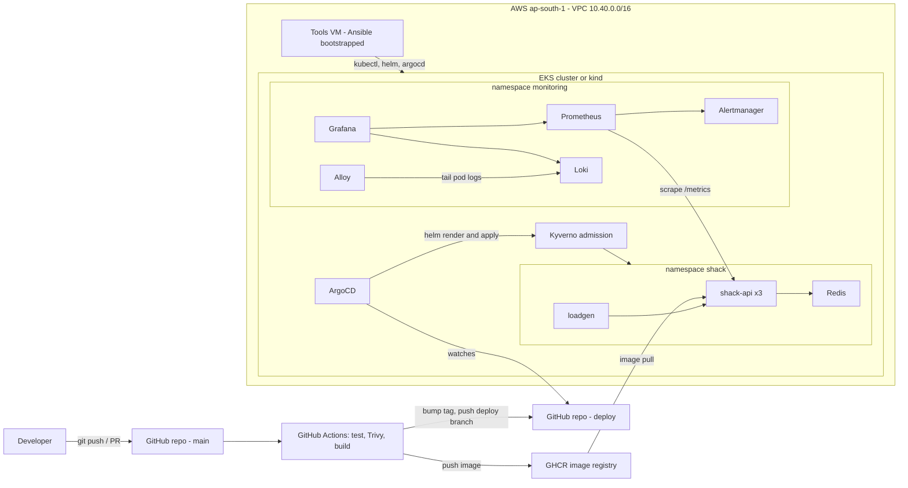

# Capstone Project — One Portfolio Project That Ties the Whole Repo Together

<!-- DEVOPS-SHACK:HEADER -->
<p align="center">
  <a href="https://www.youtube.com/@devopsshack"></a>
  <a href="https://www.youtube.com/@shackverse"></a>
  <a href="https://devopsshack.com"></a>
  <a href="https://www.instagram.com/devopsshack"></a>
  <a href="https://github.com/jaiswaladi246/DevOps-Cloud-Interview-Preparation-by-DevOps-Shack"></a>
</p>
<p align="center"><sub>Part of <b><a href="https://github.com/jaiswaladi246/DevOps-Cloud-Interview-Preparation-by-DevOps-Shack">DevOps &amp; Cloud Interview Preparation</a></b> — created by <b><a href="https://www.youtube.com/@devopsshack">DevOps Shack</a></b>. Free to learn from; please credit DevOps Shack when sharing.</sub></p>
<!-- /DEVOPS-SHACK:HEADER -->

> Build, ship, observe, secure and break a small production-style service: Terraform VPC + EKS (or a free kind path), an Ansible-bootstrapped tools VM, a multi-stage Docker image, GitHub Actions CI with tests and Trivy, GitOps deploys with ArgoCD and Helm, Prometheus/Grafana/Loki with a real alert, admission-time security gates, a chaos exercise and a written postmortem.

[⬅ Back to Real-World Interview](./README.md) · [🏠 Home](../README.md)

## Goal

This is the project you put at the top of your resume and talk about for 20 minutes in an interview. Every topic folder in this repo shows up in it:

| Repo topic | Where it appears in the capstone |
|------------|----------------------------------|
| [Linux](../01-linux/README.md), [Networking](../03-networking/README.md) | Tools VM hardening, DNS chaos exercise, debugging with `dig` and `curl` |
| [Git](../02-git/README.md), [CI/CD](../06-cicd/README.md) | Branch protection, GitHub Actions pipeline, GitOps deploy branch |
| [Docker](../04-docker/README.md) | Multi-stage, non-root, read-only image |
| [Kubernetes](../05-kubernetes/README.md) | Helm chart, probes, PDB, topology spread, drains |
| [Terraform](../07-terraform/README.md), [AWS](../09-aws/README.md) | VPC + EKS with remote state, access entries, tools VM |
| [Ansible](../08-ansible/README.md) | Idempotent bootstrap of the tools VM |
| [Monitoring](../10-monitoring/README.md) | Prometheus, Grafana, Loki, Alloy, a PrometheusRule that pages |
| [DevSecOps](../11-devsecops/README.md) | Trivy in CI, Kyverno admission policies, least-privilege tokens |

The app is deliberately small, **shack-api**: a Python Flask service that counts page hits in Redis and exposes Prometheus metrics. The app is not the point. The platform around it is.

By the end you will have:

- A Git repository with app, infrastructure, configuration management, chart, pipeline and docs
- A running Kubernetes cluster (EKS on AWS, or kind on your laptop) with the app deployed by ArgoCD
- A CI pipeline that tests, scans, builds, pushes and promotes images without anyone running `kubectl`
- Metrics, logs and an alert that fires when the 5xx ratio crosses 5 percent
- Admission policies that reject `:latest` images, root containers and pods without limits
- Evidence from two chaos experiments and a blameless postmortem you wrote yourself

**Cost warning.** The EKS path is not free tier: roughly 6 to 9 USD per day in `ap-south-1` (details in [Cost notes](#cost-notes)). Build it in one or two sittings and destroy it. The kind path costs nothing and covers every step except Terraform and the cloud tools VM.

## Architecture



Two loops matter. The **delivery loop**: a merge to `main` triggers CI, CI pushes an image and commits the new tag to the `deploy` branch, ArgoCD notices and syncs, Kyverno validates every object on the way in. The **feedback loop**: Prometheus scrapes the app, evaluates the alert rule, Alertmanager routes it, Loki holds the logs you read during the incident.

### Final repository layout

```text
devops-capstone/
├── app/
│   ├── main.py
│   ├── test_main.py
│   ├── requirements.txt
│   ├── requirements-dev.txt
│   ├── Dockerfile
│   └── .dockerignore
├── infra/terraform/
│   ├── versions.tf  variables.tf  vpc.tf  eks.tf  tools.tf  outputs.tf
├── kind/kind-config.yaml
├── ansible/
│   ├── inventory.ini
│   └── bastion.yml
├── charts/shack-api/
│   ├── Chart.yaml
│   ├── values.yaml
│   └── templates/
│       ├── deployment.yaml  service.yaml  pdb.yaml  redis.yaml
│       ├── loadgen.yaml  servicemonitor.yaml  prometheusrule.yaml
├── monitoring/
│   ├── kps-values.yaml  loki-values.yaml  alloy-values.yaml
├── policies/kyverno-baseline.yaml
├── argocd/application.yaml
├── .github/workflows/ci.yml
├── .trivyignore
└── docs/
    └── postmortem-dns-outage.md
```

## Prerequisites

| Tool | Version used | Check |
|------|--------------|-------|
| Git and a GitHub account | any | `git --version`, `gh auth status` |
| Docker Engine or Docker Desktop | 27+ | `docker version` |
| Python | 3.12 | `python3 --version` |
| kubectl | within one minor of the cluster | `kubectl version --client` |
| Helm | 3.15+ | `helm version` |
| Ansible | ansible-core 2.16+ | `ansible --version` |
| Terraform (EKS path) | 1.10+ (for S3 native locking) | `terraform version` |
| AWS CLI v2 (EKS path) | 2.x | `aws sts get-caller-identity` |
| kind (free path) | 0.24+ | `kind version` |
| jq, curl, dig | any | `jq --version` |

- **EKS path:** an AWS sandbox account where you can create VPC, EKS, EC2, IAM and S3 resources, and an SSH key pair at `~/.ssh/id_ed25519`.
- **kind path:** 8 GB of free RAM for Docker; the monitoring stack is the heavy part.
- Pick one path and stay on it. Steps marked **(EKS)** or **(kind)** are path-specific; everything else is shared.

---

## Step 1. Create the repository

```bash
gh repo create devops-capstone --public --clone
cd devops-capstone
mkdir -p app infra/terraform kind ansible charts/shack-api/templates \
         monitoring policies argocd .github/workflows docs
git checkout -b main 2>/dev/null || true
```

The repository is public on purpose: ArgoCD can read it without credentials, recruiters can browse it, and GHCR images can be made public for free.

## Step 2. Write the app and its tests

`app/main.py`:

```python
import logging
import os
import sys
import time

import redis
from flask import Flask, Response, g, jsonify, request
from prometheus_client import CONTENT_TYPE_LATEST, Counter, Histogram, generate_latest

logging.basicConfig(stream=sys.stdout, level=logging.INFO,
                    format="%(asctime)s %(levelname)s %(name)s %(message)s")
log = logging.getLogger("shack-api")

app = Flask(__name__)
REDIS_HOST = os.getenv("REDIS_HOST", "localhost")
VERSION = os.getenv("APP_VERSION", "dev")
store = redis.Redis(host=REDIS_HOST, port=6379,
                    socket_connect_timeout=1, socket_timeout=1)

REQUESTS = Counter("http_requests_total", "HTTP requests", ["path", "method", "status"])
LATENCY = Histogram("http_request_duration_seconds", "Request latency in seconds", ["path"])
SKIP = {"/metrics", "/healthz", "/readyz"}


@app.before_request
def start_timer():
    g.start = time.perf_counter()


@app.after_request
def record(response):
    if request.path not in SKIP:
        path = request.url_rule.rule if request.url_rule else "unmatched"
        REQUESTS.labels(path, request.method, str(response.status_code)).inc()
        LATENCY.labels(path).observe(time.perf_counter() - g.start)
    return response


@app.get("/")
def index():
    try:
        hits = store.incr("hits")
    except redis.exceptions.RedisError as exc:
        log.error("redis unavailable: %s", exc)
        return jsonify(error="dependency unavailable"), 503
    return jsonify(app="shack-api", version=VERSION, hits=hits)


@app.get("/healthz")
def healthz():
    return jsonify(status="ok")


@app.get("/readyz")
def readyz():
    return jsonify(status="ready")


@app.get("/metrics")
def metrics():
    return Response(generate_latest(), content_type=CONTENT_TYPE_LATEST)
```

Three design choices you will be asked about:

- **Liveness and readiness do not check Redis.** If they did, a Redis blip would mark every replica unready at once (or restart them all), turning a dependency problem into a full outage. The app returns 503 for the request that needs Redis and stays up for everything else.
- **The `path` label uses the route template**, not the raw URL, so a scanner hitting random URLs cannot explode metric cardinality.
- **Probe and metrics endpoints are excluded** from the request counter so the error ratio reflects user traffic.

`app/test_main.py`:

```python
import pytest
import redis

import main as shack


class FakeRedis:
    def __init__(self):
        self.count = 0

    def incr(self, key):
        self.count += 1
        return self.count


class BrokenRedis:
    def incr(self, key):
        raise redis.exceptions.ConnectionError("Temporary failure in name resolution")


@pytest.fixture
def client():
    shack.app.testing = True
    return shack.app.test_client()


def test_index_counts_hits(client, monkeypatch):
    monkeypatch.setattr(shack, "store", FakeRedis())
    assert client.get("/").get_json()["hits"] == 1
    assert client.get("/").get_json()["hits"] == 2


def test_index_returns_503_when_redis_is_down(client, monkeypatch):
    monkeypatch.setattr(shack, "store", BrokenRedis())
    resp = client.get("/")
    assert resp.status_code == 503
    assert resp.get_json()["error"] == "dependency unavailable"


def test_probes_and_metrics(client):
    assert client.get("/healthz").status_code == 200
    assert client.get("/readyz").status_code == 200
    assert "http_requests_total" in client.get("/metrics").get_data(as_text=True)
```

`app/requirements.txt` and `app/requirements-dev.txt`:

```text
flask==3.1.2
gunicorn==23.0.0
redis==5.2.1
prometheus-client==0.21.1
```

```text
pytest==8.3.4
```

Pin exact versions so builds are reproducible, and let Dependabot or Renovate raise the upgrade PRs.

**Verify:**

```bash
cd app
python3 -m venv .venv && . .venv/bin/activate
pip install -r requirements.txt -r requirements-dev.txt
python -m pytest -q
# 3 passed
deactivate && cd ..
```

## Step 3. Multi-stage Docker build

`app/Dockerfile`:

```dockerfile
# syntax=docker/dockerfile:1

FROM python:3.12-slim AS build
WORKDIR /src
COPY requirements.txt .
RUN pip install --no-cache-dir --prefix=/install -r requirements.txt

FROM python:3.12-slim AS runtime
ENV PYTHONDONTWRITEBYTECODE=1 \
    PYTHONUNBUFFERED=1
RUN useradd --uid 10001 --no-create-home --shell /usr/sbin/nologin app
WORKDIR /app
COPY --from=build /install /usr/local
COPY main.py .
USER 10001
EXPOSE 8080
CMD ["gunicorn", "--bind", "0.0.0.0:8080", "--workers", "1", "--threads", "4", \
     "--access-logfile", "-", "main:app"]
```

`app/.dockerignore`:

```text
.venv
__pycache__
*.pyc
test_main.py
requirements-dev.txt
```

Why it looks like this:

- The **build stage** installs dependencies into `/install`; only that directory and `main.py` reach the runtime image. No compilers, no pip cache, no tests.
- **Numeric non-root user** (`10001`) so Kubernetes can verify `runAsNonRoot` without reading `/etc/passwd`.
- **One worker, four threads.** `prometheus_client` keeps metrics in process memory; several gunicorn worker processes would each expose different counters unless you configure multiprocess mode. Scale with replicas instead.
- `PYTHONDONTWRITEBYTECODE` lets the container run with a read-only root filesystem.

**Verify locally with a real Redis:**

```bash
docker network create capstone
docker run -d --name redis --network capstone redis:7.4-alpine
docker build -t shack-api:local app
docker run -d --name api --network capstone -e REDIS_HOST=redis -p 8080:8080 shack-api:local
curl -s localhost:8080/ | jq      # {"app":"shack-api","hits":1,"version":"dev"}
curl -s localhost:8080/metrics | grep http_requests_total
docker stop redis && curl -s -o /dev/null -w '%{http_code}\n' localhost:8080/   # 503
docker images shack-api:local --format '{{.Size}}'                               # roughly 150-180MB
docker rm -f api redis && docker network rm capstone
```

## Step 4. (EKS) Remote state, VPC and EKS with Terraform

Create the state bucket once, by hand, because Terraform cannot store its state in a bucket it has not created yet:

```bash
export AWS_REGION=ap-south-1
ACCOUNT_ID=$(aws sts get-caller-identity --query Account --output text)
aws s3api create-bucket --bucket "capstone-tfstate-${ACCOUNT_ID}" \
  --region "$AWS_REGION" --create-bucket-configuration LocationConstraint="$AWS_REGION"
aws s3api put-bucket-versioning --bucket "capstone-tfstate-${ACCOUNT_ID}" \
  --versioning-configuration Status=Enabled
aws s3api put-public-access-block --bucket "capstone-tfstate-${ACCOUNT_ID}" \
  --public-access-block-configuration BlockPublicAcls=true,IgnorePublicAcls=true,BlockPublicPolicy=true,RestrictPublicBuckets=true
```

`infra/terraform/versions.tf` (replace the account ID in the bucket name):

```hcl
terraform {
  required_version = ">= 1.10"

  required_providers {
    aws = {
      source  = "hashicorp/aws"
      version = "~> 5.80"
    }
  }

  backend "s3" {
    bucket       = "capstone-tfstate-123456789012"
    key          = "capstone/terraform.tfstate"
    region       = "ap-south-1"
    encrypt      = true
    use_lockfile = true
  }
}

provider "aws" {
  region = var.region

  default_tags {
    tags = {
      Project     = "devops-capstone"
      Environment = "lab"
      Owner       = var.owner
    }
  }
}
```

`use_lockfile = true` uses S3 native locking (Terraform 1.10+), so no DynamoDB table is needed.

`infra/terraform/variables.tf`:

```hcl
variable "region" {
  type    = string
  default = "ap-south-1"
}

variable "name" {
  type    = string
  default = "capstone"
}

variable "k8s_version" {
  description = "Pick a version currently in EKS standard support"
  type        = string
  default     = "1.34"
}

variable "owner" {
  type = string
}

variable "my_ip_cidr" {
  description = "Your public IP as a /32, for SSH and the EKS public endpoint"
  type        = string
}

variable "ssh_public_key_path" {
  type    = string
  default = "~/.ssh/id_ed25519.pub"
}
```

`infra/terraform/vpc.tf`:

```hcl
data "aws_availability_zones" "available" {
  state = "available"
}

locals {
  azs = slice(data.aws_availability_zones.available.names, 0, 2)
}

module "vpc" {
  source  = "terraform-aws-modules/vpc/aws"
  version = "~> 5.16"

  name = "${var.name}-vpc"
  cidr = "10.40.0.0/16"
  azs  = local.azs

  public_subnets  = ["10.40.0.0/24", "10.40.1.0/24"]
  private_subnets = ["10.40.10.0/24", "10.40.11.0/24"]

  enable_nat_gateway   = true
  single_nat_gateway   = true # lab only: one NAT is a single point of failure
  enable_dns_hostnames = true

  public_subnet_tags  = { "kubernetes.io/role/elb" = 1 }
  private_subnet_tags = { "kubernetes.io/role/internal-elb" = 1 }
}
```

`infra/terraform/eks.tf`:

```hcl
module "eks" {
  source  = "terraform-aws-modules/eks/aws"
  version = "~> 20.31"

  cluster_name    = var.name
  cluster_version = var.k8s_version

  cluster_endpoint_public_access       = true
  cluster_endpoint_public_access_cidrs = [var.my_ip_cidr]
  cluster_endpoint_private_access      = true

  # The identity running terraform gets cluster-admin through an access entry
  enable_cluster_creator_admin_permissions = true

  vpc_id     = module.vpc.vpc_id
  subnet_ids = module.vpc.private_subnets

  cluster_addons = {
    coredns                = {}
    kube-proxy             = {}
    vpc-cni                = {}
    eks-pod-identity-agent = {}
  }

  eks_managed_node_groups = {
    default = {
      instance_types = ["t3.large"]
      capacity_type  = "ON_DEMAND"
      min_size       = 2
      max_size       = 3
      desired_size   = 2
    }
  }

  # Let the tools VM reach the private API endpoint
  cluster_security_group_additional_rules = {
    tools_vm_https = {
      description              = "Tools VM to Kubernetes API"
      type                     = "ingress"
      protocol                 = "tcp"
      from_port                = 443
      to_port                  = 443
      source_security_group_id = aws_security_group.tools.id
    }
  }

  # Give the tools VM role cluster-admin through the EKS access API
  access_entries = {
    tools_vm = {
      principal_arn = aws_iam_role.tools.arn
      policy_associations = {
        admin = {
          policy_arn   = "arn:aws:eks::aws:cluster-access-policy/AmazonEKSClusterAdminPolicy"
          access_scope = { type = "cluster" }
        }
      }
    }
  }
}
```

`t3.large` rather than `t3.medium` is deliberate: with the VPC CNI, a `t3.medium` allows only 17 pods, and ArgoCD, Kyverno, the monitoring stack and system pods together need more than two of those.

`infra/terraform/tools.tf`:

```hcl
data "aws_ssm_parameter" "ubuntu" {
  name = "/aws/service/canonical/ubuntu/server/24.04/stable/current/amd64/hvm/ebs-gp3/ami-id"
}

resource "aws_iam_role" "tools" {
  name = "${var.name}-tools-vm"
  assume_role_policy = jsonencode({
    Version = "2012-10-17"
    Statement = [{
      Effect    = "Allow"
      Principal = { Service = "ec2.amazonaws.com" }
      Action    = "sts:AssumeRole"
    }]
  })
}

resource "aws_iam_role_policy_attachment" "tools_ssm" {
  role       = aws_iam_role.tools.name
  policy_arn = "arn:aws:iam::aws:policy/AmazonSSMManagedInstanceCore"
}

resource "aws_iam_role_policy" "tools_eks" {
  name = "describe-capstone-cluster"
  role = aws_iam_role.tools.id
  policy = jsonencode({
    Version = "2012-10-17"
    Statement = [{
      Effect   = "Allow"
      Action   = ["eks:DescribeCluster"]
      Resource = module.eks.cluster_arn
    }]
  })
}

resource "aws_iam_instance_profile" "tools" {
  name = "${var.name}-tools-vm"
  role = aws_iam_role.tools.name
}

resource "aws_key_pair" "tools" {
  key_name   = "${var.name}-tools"
  public_key = file(pathexpand(var.ssh_public_key_path))
}

resource "aws_security_group" "tools" {
  name        = "${var.name}-tools-vm"
  description = "Tools VM"
  vpc_id      = module.vpc.vpc_id

  ingress {
    description = "SSH from my IP only"
    from_port   = 22
    to_port     = 22
    protocol    = "tcp"
    cidr_blocks = [var.my_ip_cidr]
  }

  egress {
    description = "Package downloads and AWS APIs"
    from_port   = 0
    to_port     = 0
    protocol    = "-1"
    cidr_blocks = ["0.0.0.0/0"]
  }
}

resource "aws_instance" "tools" {
  ami                         = data.aws_ssm_parameter.ubuntu.value
  instance_type               = "t3.small"
  subnet_id                   = module.vpc.public_subnets[0]
  vpc_security_group_ids      = [aws_security_group.tools.id]
  iam_instance_profile        = aws_iam_instance_profile.tools.name
  key_name                    = aws_key_pair.tools.key_name
  associate_public_ip_address = true

  metadata_options {
    http_tokens = "required" # IMDSv2 only
  }

  root_block_device {
    volume_size = 20
    volume_type = "gp3"
    encrypted   = true
  }

  tags = { Name = "${var.name}-tools-vm" }
}
```

`infra/terraform/outputs.tf`:

```hcl
output "cluster_name" {
  value = module.eks.cluster_name
}

output "region" {
  value = var.region
}

output "tools_public_ip" {
  value = aws_instance.tools.public_ip
}
```

Apply:

```bash
cd infra/terraform
terraform init
terraform fmt -check && terraform validate
terraform plan -out tfplan \
  -var "owner=$(whoami)" \
  -var "my_ip_cidr=$(curl -s https://checkip.amazonaws.com)/32"
terraform apply tfplan          # 15-20 minutes, EKS is the slow part
aws eks update-kubeconfig --name "$(terraform output -raw cluster_name)" --region ap-south-1
cd ../..
```

**Verify:**

```bash
kubectl get nodes -o wide                 # 2 nodes Ready, private IPs in 10.40.10.x / 10.40.11.x
kubectl -n kube-system get pods           # aws-node, kube-proxy, coredns, eks-pod-identity-agent Running
aws eks list-access-entries --cluster-name capstone --query accessEntries
```

## Step 5. (kind) The free path

`kind/kind-config.yaml`:

```yaml
kind: Cluster
apiVersion: kind.x-k8s.io/v1alpha4
name: capstone
nodes:
  - role: control-plane
  - role: worker
  - role: worker
```

```bash
kind create cluster --config kind/kind-config.yaml
kubectl cluster-info --context kind-capstone
kubectl get nodes        # 1 control-plane + 2 workers Ready
```

Two workers matter: the drain exercise in Step 16 needs somewhere for pods to go. On this path you skip Terraform, and in Step 6 you run the Ansible playbook against your own machine (or a local Multipass/Vagrant VM) instead of an EC2 instance.

## Step 6. Bootstrap the tools VM with Ansible

The tools VM is where on-call engineers (and CI runners, in a bigger setup) get a known-good toolbox: pinned `kubectl`, `helm`, `argocd` and the AWS CLI, a working kubeconfig, and a hardened SSH daemon. Building it with Ansible instead of by hand means you can throw it away and rebuild it in five minutes.

`ansible/inventory.ini` (EKS path, generated from Terraform output):

```bash
printf '[tools]\n%s ansible_user=ubuntu ansible_ssh_private_key_file=~/.ssh/id_ed25519\n' \
  "$(terraform -chdir=infra/terraform output -raw tools_public_ip)" > ansible/inventory.ini
cat ansible/inventory.ini
```

For the kind path, point it at your own machine instead (Debian or Ubuntu, because the playbook uses `apt`):

```ini
[tools]
localhost ansible_connection=local
```

`ansible/bastion.yml`:

```yaml
- name: Bootstrap the capstone tools VM
  hosts: tools
  become: true
  vars:
    arch: amd64
    kubectl_version: "v1.34.1"
    helm_version: "v3.19.0"
    argocd_version: "v3.1.8"
    cluster_name: capstone
    region: ap-south-1
    tools_user: "{{ ansible_user | default('ubuntu') }}"

  tasks:
    - name: Install base packages
      ansible.builtin.apt:
        name: [curl, unzip, jq, git, ca-certificates, dnsutils, bash-completion, unattended-upgrades]
        state: present
        update_cache: true
        cache_valid_time: 3600

    - name: Download AWS CLI v2
      ansible.builtin.get_url:
        url: https://awscli.amazonaws.com/awscli-exe-linux-x86_64.zip
        dest: /tmp/awscliv2.zip
        mode: "0644"
      tags: [eks]

    - name: Unpack AWS CLI v2
      ansible.builtin.unarchive:
        src: /tmp/awscliv2.zip
        dest: /tmp
        remote_src: true
        creates: /tmp/aws/install
      tags: [eks]

    - name: Install AWS CLI v2
      ansible.builtin.command: /tmp/aws/install --update
      args:
        creates: /usr/local/bin/aws
      tags: [eks]

    - name: Install kubectl
      ansible.builtin.get_url:
        url: "https://dl.k8s.io/release/{{ kubectl_version }}/bin/linux/{{ arch }}/kubectl"
        dest: /usr/local/bin/kubectl
        mode: "0755"

    - name: Download Helm
      ansible.builtin.unarchive:
        src: "https://get.helm.sh/helm-{{ helm_version }}-linux-{{ arch }}.tar.gz"
        dest: /tmp
        remote_src: true
        creates: "/tmp/linux-{{ arch }}/helm"

    - name: Install Helm
      ansible.builtin.copy:
        src: "/tmp/linux-{{ arch }}/helm"
        dest: /usr/local/bin/helm
        remote_src: true
        mode: "0755"

    - name: Install argocd CLI
      ansible.builtin.get_url:
        url: "https://github.com/argoproj/argo-cd/releases/download/{{ argocd_version }}/argocd-linux-{{ arch }}"
        dest: /usr/local/bin/argocd
        mode: "0755"

    - name: Enable kubectl completion and alias
      ansible.builtin.blockinfile:
        path: "/home/{{ tools_user }}/.bashrc"
        marker: "# {mark} capstone tooling"
        block: |
          source <(kubectl completion bash)
          alias k=kubectl
          complete -o default -F __start_kubectl k
      become: false

    - name: Write kubeconfig using the instance role
      ansible.builtin.command: >
        aws eks update-kubeconfig --name {{ cluster_name }} --region {{ region }}
      args:
        creates: "/home/{{ tools_user }}/.kube/config"
      become: false
      tags: [eks]

    - name: Disable SSH password authentication
      ansible.builtin.lineinfile:
        path: /etc/ssh/sshd_config
        regexp: '^#?PasswordAuthentication'
        line: PasswordAuthentication no
        validate: /usr/sbin/sshd -t -f %s
      notify: Restart ssh
      tags: [eks]

    - name: Disable SSH root login
      ansible.builtin.lineinfile:
        path: /etc/ssh/sshd_config
        regexp: '^#?PermitRootLogin'
        line: PermitRootLogin no
        validate: /usr/sbin/sshd -t -f %s
      notify: Restart ssh
      tags: [eks]

  handlers:
    - name: Restart ssh
      ansible.builtin.service:
        name: ssh
        state: restarted
```

Run it:

```bash
cd ansible
ansible tools -i inventory.ini -m ping
ansible-playbook -i inventory.ini bastion.yml --diff               # EKS path
# ansible-playbook -i inventory.ini bastion.yml --skip-tags eks -K  # kind path, on your laptop
```

The `eks`-tagged tasks are skipped on the kind path: no AWS CLI, no EKS kubeconfig, and the playbook never touches your laptop's SSH daemon.

**Verify:**

```bash
ansible-playbook -i inventory.ini bastion.yml          # second run: changed=0 is the idempotency proof
ansible tools -i inventory.ini -a "kubectl get nodes"  # works from the VM through the private endpoint
ansible tools -i inventory.ini -a "helm version --short"
cd ..
```

If `kubectl get nodes` from the VM hangs, the cluster security group rule from Step 4 is missing. If it returns `the server has asked for the client to provide credentials`, the access entry for the VM role is missing.

## Step 7. Write the Helm chart

`charts/shack-api/Chart.yaml`:

```yaml
apiVersion: v2
name: shack-api
description: Capstone demo API with Redis, load generator, metrics and alerts
type: application
version: 0.1.0
appVersion: "0.1.0"
```

`charts/shack-api/values.yaml` (CI rewrites `image.repository` and `image.tag` on the deploy branch):

```yaml
image:
  repository: ghcr.io/your-github-user/shack-api
  tag: "set-by-ci"
  pullPolicy: IfNotPresent

replicaCount: 3

resources:
  requests:
    cpu: 50m
    memory: 64Mi
  limits:
    memory: 128Mi

redis:
  image: redis:7.4-alpine

loadgen:
  enabled: true
  image: curlimages/curl:8.10.1
  intervalSeconds: "0.2"

alerts:
  errorRatioThreshold: "0.05"
```

No CPU limit on purpose: CPU limits cause CFS throttling and latency spikes for bursty request handlers, while a memory limit protects the node. That is a classic follow-up question.

`charts/shack-api/templates/deployment.yaml`:

```yaml
apiVersion: apps/v1
kind: Deployment
metadata:
  name: shack-api
  labels:
    app.kubernetes.io/name: shack-api
spec:
  replicas: {{ .Values.replicaCount }}
  revisionHistoryLimit: 5
  selector:
    matchLabels:
      app.kubernetes.io/name: shack-api
  strategy:
    type: RollingUpdate
    rollingUpdate:
      maxSurge: 1
      maxUnavailable: 0
  template:
    metadata:
      labels:
        app.kubernetes.io/name: shack-api
    spec:
      securityContext:
        runAsNonRoot: true
        runAsUser: 10001
        seccompProfile:
          type: RuntimeDefault
      topologySpreadConstraints:
        - maxSkew: 1
          topologyKey: kubernetes.io/hostname
          whenUnsatisfiable: ScheduleAnyway
          labelSelector:
            matchLabels:
              app.kubernetes.io/name: shack-api
      containers:
        - name: api
          image: "{{ .Values.image.repository }}:{{ .Values.image.tag }}"
          imagePullPolicy: {{ .Values.image.pullPolicy }}
          env:
            - name: REDIS_HOST
              value: redis
            - name: APP_VERSION
              value: {{ .Values.image.tag | quote }}
          ports:
            - name: http
              containerPort: 8080
          readinessProbe:
            httpGet:
              path: /readyz
              port: http
            periodSeconds: 5
          livenessProbe:
            httpGet:
              path: /healthz
              port: http
            initialDelaySeconds: 10
            periodSeconds: 10
          resources:
            {{- toYaml .Values.resources | nindent 12 }}
          securityContext:
            allowPrivilegeEscalation: false
            readOnlyRootFilesystem: true
            capabilities:
              drop: ["ALL"]
          volumeMounts:
            - name: tmp
              mountPath: /tmp
      volumes:
        - name: tmp
          emptyDir: {}
```

Gunicorn needs a writable `/tmp` for worker heartbeat files, which is why a read-only root filesystem comes with an `emptyDir` at `/tmp`.

`charts/shack-api/templates/service.yaml`:

```yaml
apiVersion: v1
kind: Service
metadata:
  name: shack-api
  labels:
    app.kubernetes.io/name: shack-api
spec:
  selector:
    app.kubernetes.io/name: shack-api
  ports:
    - name: http
      port: 80
      targetPort: http
```

`charts/shack-api/templates/pdb.yaml`:

```yaml
apiVersion: policy/v1
kind: PodDisruptionBudget
metadata:
  name: shack-api
spec:
  minAvailable: 2
  selector:
    matchLabels:
      app.kubernetes.io/name: shack-api
```

`charts/shack-api/templates/redis.yaml` (single replica, no persistence: a deliberate weakness the chaos exercise will expose):

```yaml
apiVersion: apps/v1
kind: Deployment
metadata:
  name: redis
  labels:
    app.kubernetes.io/name: redis
spec:
  replicas: 1
  selector:
    matchLabels:
      app.kubernetes.io/name: redis
  template:
    metadata:
      labels:
        app.kubernetes.io/name: redis
    spec:
      securityContext:
        runAsNonRoot: true
        runAsUser: 999
        runAsGroup: 1000
        fsGroup: 1000
        seccompProfile:
          type: RuntimeDefault
      containers:
        - name: redis
          image: {{ .Values.redis.image }}
          args: ["redis-server", "--save", "", "--appendonly", "no"]
          ports:
            - name: redis
              containerPort: 6379
          readinessProbe:
            tcpSocket:
              port: redis
            periodSeconds: 5
          resources:
            requests:
              cpu: 25m
              memory: 32Mi
            limits:
              memory: 128Mi
          securityContext:
            allowPrivilegeEscalation: false
            readOnlyRootFilesystem: true
            capabilities:
              drop: ["ALL"]
          volumeMounts:
            - name: data
              mountPath: /data
      volumes:
        - name: data
          emptyDir: {}
---
apiVersion: v1
kind: Service
metadata:
  name: redis
spec:
  selector:
    app.kubernetes.io/name: redis
  ports:
    - name: redis
      port: 6379
      targetPort: redis
```

`charts/shack-api/templates/loadgen.yaml` (steady traffic so the dashboards and alert have something to measure; it logs only failures, which gives you a client-side view in Loki):

```yaml
{{- if .Values.loadgen.enabled }}
apiVersion: apps/v1
kind: Deployment
metadata:
  name: loadgen
  labels:
    app.kubernetes.io/name: loadgen
spec:
  replicas: 1
  selector:
    matchLabels:
      app.kubernetes.io/name: loadgen
  template:
    metadata:
      labels:
        app.kubernetes.io/name: loadgen
    spec:
      securityContext:
        runAsNonRoot: true
        runAsUser: 100
        seccompProfile:
          type: RuntimeDefault
      containers:
        - name: loadgen
          image: {{ .Values.loadgen.image }}
          command: ["/bin/sh", "-c"]
          args:
            - |
              while true; do
                code=$(curl -s -o /dev/null -w '%{http_code}' --max-time 2 http://shack-api/)
                [ "$code" = "200" ] || echo "$(date -u +%Y-%m-%dT%H:%M:%SZ) client_error status=$code"
                sleep {{ .Values.loadgen.intervalSeconds }}
              done
          resources:
            requests:
              cpu: 10m
              memory: 16Mi
            limits:
              memory: 32Mi
          securityContext:
            allowPrivilegeEscalation: false
            readOnlyRootFilesystem: true
            capabilities:
              drop: ["ALL"]
{{- end }}
```

`charts/shack-api/templates/servicemonitor.yaml`:

```yaml
apiVersion: monitoring.coreos.com/v1
kind: ServiceMonitor
metadata:
  name: shack-api
  labels:
    app.kubernetes.io/name: shack-api
spec:
  selector:
    matchLabels:
      app.kubernetes.io/name: shack-api
  endpoints:
    - port: http
      path: /metrics
      interval: 15s
```

`charts/shack-api/templates/prometheusrule.yaml`:

```yaml
apiVersion: monitoring.coreos.com/v1
kind: PrometheusRule
metadata:
  name: shack-api
  labels:
    app.kubernetes.io/name: shack-api
spec:
  groups:
    - name: shack-api.rules
      rules:
        - alert: ShackApiHighErrorRatio
          expr: |
            sum(rate(http_requests_total{namespace="{{ .Release.Namespace }}",service="shack-api",status=~"5.."}[2m]))
              /
            sum(rate(http_requests_total{namespace="{{ .Release.Namespace }}",service="shack-api"}[2m]))
              > {{ .Values.alerts.errorRatioThreshold }}
          for: 2m
          labels:
            severity: critical
            team: platform
          annotations:
            summary: "shack-api is returning too many 5xx responses"
            description: {{`"5xx ratio is {{ $value | humanizePercentage }} over the last 2 minutes."`}}
            runbook_url: "https://github.com/your-github-user/devops-capstone/blob/main/docs/runbook.md"
        - alert: ShackApiReplicasUnavailable
          expr: |
            kube_deployment_status_replicas_available{namespace="{{ .Release.Namespace }}",deployment="shack-api"} < 2
          for: 2m
          labels:
            severity: warning
            team: platform
          annotations:
            summary: "shack-api has fewer than 2 available replicas"
```

Note the backtick block around the description. Both Helm and Prometheus use `{{ }}`; without escaping, Helm tries to render `$value` and the chart fails with `undefined variable "$value"`.

**Verify the chart renders and lints before anything touches a cluster:**

```bash
helm lint charts/shack-api
helm template shack charts/shack-api --namespace shack | kubectl apply --dry-run=client -f - 2>&1 | tail -n 3
helm template shack charts/shack-api --namespace shack | grep -A2 'description:'
```

The client dry run will complain that `ServiceMonitor` and `PrometheusRule` kinds are unknown until the monitoring stack installs those CRDs in Step 10. Everything else should print `created (dry run)`.

## Step 8. CI pipeline: tests, Trivy, build, push, promote

`.github/workflows/ci.yml`:

```yaml
name: ci

on:
  pull_request:
  push:
    branches: [main]
    paths-ignore:
      - "docs/**"
      - "**.md"

permissions:
  contents: read

concurrency:
  group: ci-${{ github.ref }}
  cancel-in-progress: true

jobs:
  test:
    runs-on: ubuntu-latest
    defaults:
      run:
        working-directory: app
    steps:
      - uses: actions/checkout@v4
      - uses: actions/setup-python@v5
        with:
          python-version: "3.12"
          cache: pip
          cache-dependency-path: app/requirements*.txt
      - run: pip install -r requirements.txt -r requirements-dev.txt
      - run: python -m pytest -q

  scan-repo:
    runs-on: ubuntu-latest
    steps:
      - uses: actions/checkout@v4
      - name: Trivy filesystem scan - dependencies, secrets, IaC and K8s misconfig
        uses: aquasecurity/trivy-action@0.33.1
        with:
          scan-type: fs
          scan-ref: .
          scanners: vuln,secret,misconfig
          severity: HIGH,CRITICAL
          ignore-unfixed: true
          exit-code: "1"

  build:
    needs: [test, scan-repo]
    runs-on: ubuntu-latest
    permissions:
      contents: write
      packages: write
    steps:
      - uses: actions/checkout@v4

      - name: Set lowercase image name
        run: echo "IMAGE=ghcr.io/${GITHUB_REPOSITORY_OWNER,,}/shack-api" >> "$GITHUB_ENV"

      - uses: docker/setup-buildx-action@v3

      - uses: docker/login-action@v3
        with:
          registry: ghcr.io
          username: ${{ github.actor }}
          password: ${{ secrets.GITHUB_TOKEN }}

      - name: Build image (load locally for scanning)
        uses: docker/build-push-action@v6
        with:
          context: app
          load: true
          tags: ${{ env.IMAGE }}:${{ github.sha }}
          cache-from: type=gha
          cache-to: type=gha,mode=max

      - name: Trivy image scan
        uses: aquasecurity/trivy-action@0.33.1
        with:
          image-ref: ${{ env.IMAGE }}:${{ github.sha }}
          severity: HIGH,CRITICAL
          ignore-unfixed: true
          exit-code: "1"

      - name: Push image
        if: github.event_name == 'push'
        run: docker push "${IMAGE}:${GITHUB_SHA}"

      - name: Promote - commit new tag to the deploy branch
        if: github.event_name == 'push'
        run: |
          yq -i '.image.repository = strenv(IMAGE) | .image.tag = strenv(GITHUB_SHA)' charts/shack-api/values.yaml
          git config user.name "github-actions[bot]"
          git config user.email "41898282+github-actions[bot]@users.noreply.github.com"
          git commit -am "deploy: shack-api ${GITHUB_SHA::7}"
          git push --force origin HEAD:refs/heads/deploy
```

How the pieces fit:

- **Least-privilege token.** The workflow default is `contents: read`; only the `build` job gets `packages: write` (push to GHCR) and `contents: write` (push the deploy branch).
- **Scan before push.** The image is built with `load: true`, scanned, and pushed only if Trivy passes. A vulnerable image never reaches the registry.
- **Immutable tags.** The image tag is the commit SHA, so every running pod maps to exactly one commit. No `:latest`.
- **Why a separate `deploy` branch?** `main` is protected (Step 9) and requires PRs and passing checks, so a bot cannot push to it. The pipeline rebuilds `deploy` as "main plus one commit that sets the tag", and ArgoCD watches `deploy`. In a larger organisation the same idea is a separate environment-config repository.
- Pin third-party actions to a full commit SHA in production (`uses: aquasecurity/trivy-action@<sha>`) so a moved tag cannot change what runs in your pipeline.

Commit and push everything you have so far:

```bash
git add -A
git commit -m "capstone: app, docker, terraform, ansible, chart, ci"
git push -u origin main
gh run watch
```

**Verify:**

```bash
gh run list --limit 3
git fetch origin deploy && git show origin/deploy:charts/shack-api/values.yaml | head -n 4
```

The first run will very likely fail `scan-repo` on Terraform findings: egress to `0.0.0.0/0`, a public EKS endpoint, a public IP on the tools VM. That is the gate working. Step 9 deals with it properly.

After the first successful push, open the package page on GitHub (your profile, Packages, `shack-api`, Package settings) and change visibility to **Public**, so the cluster can pull it without an image pull secret.

## Step 9. Repository security gates

Three gates protect `main` before anything reaches the cluster.

**1. Triage scanner findings instead of muting the scanner.** For each Trivy finding: fix it if you can, otherwise accept it in `.trivyignore` with the exact ID Trivy printed and a reason. Example structure (use the IDs from your own scan output):

```text
# .trivyignore — every entry needs an owner-readable reason
# Tools VM egress to 0.0.0.0/0: needs package mirrors and AWS APIs; lab only, no inbound except SSH from one /32
<ID printed by Trivy for unrestricted egress>
# EKS public endpoint: restricted to a single /32 via cluster_endpoint_public_access_cidrs
<ID printed by Trivy for public cluster access>
```

Being able to say "we had 14 findings, fixed 11, and accepted 3 with documented reasons" is a far better interview answer than "the scan passed".

**2. Branch protection on `main`.** Require a PR and the three CI checks:

```bash
OWNER=$(gh repo view --json owner -q .owner.login)
gh api -X PUT "repos/${OWNER}/devops-capstone/branches/main/protection" --input - <<'__JSON__'
{
  "required_status_checks": { "strict": true, "contexts": ["test", "scan-repo", "build"] },
  "enforce_admins": true,
  "required_pull_request_reviews": { "required_approving_review_count": 0 },
  "restrictions": null,
  "allow_force_pushes": false,
  "allow_deletions": false
}
__JSON__
```

`required_approving_review_count: 0` is a solo-developer compromise: you cannot approve your own PR, but every change still goes through a PR and green checks. On a team, set it to 1 or 2 and add CODEOWNERS.

**3. Secret hygiene.** No cloud credentials live in the repo or in GitHub secrets for this project: CI only talks to GHCR with the short-lived `GITHUB_TOKEN`, and the tools VM uses an instance role. Trivy's secret scanner catches accidental commits.

**Verify:**

```bash
git checkout -b test/protection
echo "# gate test" >> README.md && git commit -am "test: gate" && git push -u origin test/protection
gh pr create --fill
gh pr checks --watch        # test, scan-repo and build must all pass before merge is allowed
git checkout main && git commit --allow-empty -m "direct push test"
git push origin main 2>&1 | tail -n 3   # rejected: "protected branch hook declined"
git reset --hard origin/main            # drop the test commit
```

Merge the PR with `gh pr merge --squash --delete-branch` once checks pass.

## Step 10. Install Prometheus, Alertmanager and Grafana

`monitoring/kps-values.yaml`:

```yaml
fullnameOverride: kps

prometheus:
  prometheusSpec:
    # Pick up ServiceMonitors and PrometheusRules from every namespace,
    # not only the ones labelled with this Helm release
    serviceMonitorSelectorNilUsesHelmValues: false
    ruleSelectorNilUsesHelmValues: false
    podMonitorSelectorNilUsesHelmValues: false
    retention: 2d
    resources:
      requests:
        cpu: 200m
        memory: 512Mi

alertmanager:
  alertmanagerSpec:
    resources:
      requests:
        cpu: 20m
        memory: 64Mi

grafana:
  additionalDataSources:
    - name: Loki
      type: loki
      uid: loki
      access: proxy
      url: http://loki.monitoring.svc.cluster.local:3100

# Managed control planes (EKS) and kind do not expose these to scrapes;
# leaving them on just produces permanently-down targets and noisy alerts
kubeControllerManager:
  enabled: false
kubeScheduler:
  enabled: false
kubeEtcd:
  enabled: false
kubeProxy:
  enabled: false
```

```bash
helm repo add prometheus-community https://prometheus-community.github.io/helm-charts
helm repo add grafana https://grafana.github.io/helm-charts
helm repo update
helm upgrade --install kps prometheus-community/kube-prometheus-stack \
  --namespace monitoring --create-namespace \
  -f monitoring/kps-values.yaml \
  --set grafana.adminPassword="$(openssl rand -base64 18)" \
  --wait --timeout 10m
```

The Grafana password is generated at install time and never committed. In production, pin every chart with `--version` and record what is running with `helm list -A`.

**Verify:**

```bash
kubectl -n monitoring get pods                 # prometheus-kps-prometheus-0, alertmanager-kps-alertmanager-0, kps-grafana, operator, kube-state-metrics, node-exporter
kubectl -n monitoring get svc                  # note kps-prometheus, kps-alertmanager, kps-grafana
kubectl get crd | grep monitoring.coreos.com   # servicemonitors, prometheusrules, podmonitors ...
kubectl -n monitoring get secret kps-grafana -o jsonpath='{.data.admin-password}' | base64 -d; echo
```

## Step 11. Install Loki and Alloy for logs

`monitoring/loki-values.yaml` (single binary, filesystem storage, lab sizing):

```yaml
deploymentMode: SingleBinary

loki:
  auth_enabled: false
  commonConfig:
    replication_factor: 1
  storage:
    type: filesystem
  schemaConfig:
    configs:
      - from: "2024-04-01"
        store: tsdb
        object_store: filesystem
        schema: v13
        index:
          prefix: loki_index_
          period: 24h
  limits_config:
    retention_period: 48h

singleBinary:
  replicas: 1
  persistence:
    enabled: false   # lab only: logs are lost if the Loki pod restarts

read:
  replicas: 0
write:
  replicas: 0
backend:
  replicas: 0

gateway:
  enabled: false
lokiCanary:
  enabled: false
test:
  enabled: false
chunksCache:
  enabled: false
resultsCache:
  enabled: false
```

`monitoring/alloy-values.yaml` (one Alloy replica tails pod logs through the Kubernetes API and ships them to Loki):

```yaml
controller:
  type: deployment
  replicas: 1

alloy:
  configMap:
    content: |
      discovery.kubernetes "pods" {
        role = "pod"
      }

      discovery.relabel "pods" {
        targets = discovery.kubernetes.pods.targets

        rule {
          source_labels = ["__meta_kubernetes_namespace"]
          target_label  = "namespace"
        }
        rule {
          source_labels = ["__meta_kubernetes_pod_name"]
          target_label  = "pod"
        }
        rule {
          source_labels = ["__meta_kubernetes_pod_container_name"]
          target_label  = "container"
        }
        rule {
          source_labels = ["__meta_kubernetes_pod_label_app_kubernetes_io_name"]
          target_label  = "app"
        }
      }

      loki.source.kubernetes "pods" {
        targets    = discovery.relabel.pods.output
        forward_to = [loki.write.default.receiver]
      }

      loki.write "default" {
        endpoint {
          url = "http://loki.monitoring.svc.cluster.local:3100/loki/api/v1/push"
        }
      }
```

A single Deployment replica is used instead of the chart's default DaemonSet because `loki.source.kubernetes` reads logs through the API server: every DaemonSet pod would tail every pod in the cluster and ship duplicates. At real scale you would run the DaemonSet with file-based collection (`loki.source.file` on `/var/log/pods`) filtered to each node's own pods.

```bash
helm upgrade --install loki grafana/loki -n monitoring -f monitoring/loki-values.yaml --wait --timeout 10m
helm upgrade --install alloy grafana/alloy -n monitoring -f monitoring/alloy-values.yaml --wait
```

**Verify:**

```bash
kubectl -n monitoring get svc loki                 # ClusterIP, port 3100
kubectl -n monitoring logs deploy/alloy -c alloy --tail=20 | grep -i error   # should print nothing
kubectl -n monitoring port-forward svc/loki 3100:3100 &
sleep 2
curl -s localhost:3100/ready                       # ready
curl -s 'localhost:3100/loki/api/v1/labels' | jq   # namespace, pod, container, app ...
kill %1
```

## Step 12. Admission-time security gates with Kyverno

CI scans what you build. Admission control enforces what actually runs, including anything someone applies by hand at 2 a.m.

```bash
helm repo add kyverno https://kyverno.github.io/kyverno/
helm repo update
helm upgrade --install kyverno kyverno/kyverno -n kyverno --create-namespace --wait
```

`policies/kyverno-baseline.yaml`:

```yaml
apiVersion: kyverno.io/v1
kind: ClusterPolicy
metadata:
  name: shack-baseline
  annotations:
    policies.kyverno.io/description: >-
      Pinned image tags, non-root containers and memory limits for the shack namespace.
spec:
  background: true
  rules:
    - name: disallow-latest-tag
      match:
        any:
          - resources:
              kinds: [Pod]
              namespaces: [shack]
      validate:
        failureAction: Enforce
        message: "Use an immutable image tag, not :latest or an untagged image."
        pattern:
          spec:
            containers:
              - image: "*:* & !*:latest"

    - name: require-run-as-non-root
      match:
        any:
          - resources:
              kinds: [Pod]
              namespaces: [shack]
      validate:
        failureAction: Enforce
        message: "Pods must set securityContext.runAsNonRoot: true."
        pattern:
          spec:
            securityContext:
              runAsNonRoot: true

    - name: require-memory-limits
      match:
        any:
          - resources:
              kinds: [Pod]
              namespaces: [shack]
      validate:
        failureAction: Enforce
        message: "Every container needs a memory limit."
        pattern:
          spec:
            containers:
              - resources:
                  limits:
                    memory: "?*"
```

Kyverno auto-generates matching rules for Deployments, StatefulSets, Jobs and the rest, so a bad Deployment is rejected at `kubectl apply` (or ArgoCD sync) time instead of silently failing to create pods later.

```bash
kubectl apply -f policies/kyverno-baseline.yaml
kubectl create namespace shack
```

**Verify the gate rejects bad workloads and accepts good ones:**

```bash
kubectl get clusterpolicy shack-baseline        # READY True
kubectl -n shack run bad --image=nginx:latest
# Error from server: admission webhook "validate.kyverno.svc-fail" denied the request:
# resource Pod/shack/bad was blocked due to the following policies
# shack-baseline:
#   disallow-latest-tag: 'validation error: Use an immutable image tag ...'
#   require-memory-limits: ...
#   require-run-as-non-root: ...
helm template shack charts/shack-api -n shack | kubectl apply -n shack --dry-run=server -f - | grep -c "created (server dry run)"
```

The server-side dry run goes through admission webhooks, so it proves your own chart passes the policies before ArgoCD ever tries to sync it.

## Step 13. Install ArgoCD

```bash
kubectl create namespace argocd
kubectl apply -n argocd --server-side \
  -f https://raw.githubusercontent.com/argoproj/argo-cd/stable/manifests/install.yaml
kubectl -n argocd rollout status deploy/argocd-server --timeout=5m
```

`--server-side` avoids the `metadata.annotations: Too long` error that client-side apply hits on ArgoCD's large CRDs. For production, install a pinned version (replace `stable` with a release tag) or use the `argo/argo-cd` Helm chart.

```bash
argocd admin initial-password -n argocd
kubectl -n argocd port-forward svc/argocd-server 8081:443 &
argocd login localhost:8081 --username admin --insecure
argocd account update-password      # then delete the initial secret
kubectl -n argocd delete secret argocd-initial-admin-secret
```

**Verify:**

```bash
argocd version --short
kubectl -n argocd get pods      # server, repo-server, application-controller, applicationset-controller, redis, dex, notifications
```

## Step 14. Deploy shack-api the GitOps way

`argocd/application.yaml`:

```yaml
apiVersion: argoproj.io/v1alpha1
kind: Application
metadata:
  name: shack-api
  namespace: argocd
  finalizers:
    - resources-finalizer.argocd.argoproj.io
spec:
  project: default
  source:
    repoURL: https://github.com/your-github-user/devops-capstone.git
    targetRevision: deploy
    path: charts/shack-api
    helm:
      releaseName: shack
      valueFiles:
        - values.yaml
  destination:
    server: https://kubernetes.default.svc
    namespace: shack
  syncPolicy:
    automated:
      prune: true
      selfHeal: true
    syncOptions:
      - CreateNamespace=true
    retry:
      limit: 5
      backoff:
        duration: 10s
        factor: 2
        maxDuration: 3m
```

Commit this file through a PR like every other change, then apply it once. From here on, nobody runs `kubectl apply` against the `shack` namespace.

```bash
kubectl apply -f argocd/application.yaml
argocd app wait shack-api --health --sync --timeout 300
```

**Verify the app and the full GitOps loop:**

```bash
argocd app get shack-api                    # Sync Status: Synced, Health Status: Healthy
kubectl -n shack get deploy,pods,svc,pdb
kubectl -n shack port-forward svc/shack-api 8080:80 &
curl -s localhost:8080/ | jq                # version equals the commit SHA on main
kill %%
```

Now prove the loop end to end. Change something visible, ship it through a PR, and watch the cluster follow without touching `kubectl`:

```bash
git checkout -b feat/replicas
yq -i '.replicaCount = 4' charts/shack-api/values.yaml
git commit -am "feat: run 4 replicas" && git push -u origin feat/replicas
gh pr create --fill && gh pr checks --watch && gh pr merge --squash --delete-branch
gh run watch                                # main build pushes image and rebuilds the deploy branch
argocd app wait shack-api --sync --health
kubectl -n shack get deploy shack-api       # READY 4/4
argocd app history shack-api                # one entry per deploy, each with its git revision
```

Also try drift: `kubectl -n shack scale deploy shack-api --replicas=1`. With `selfHeal: true`, ArgoCD puts it back within seconds. That is the answer to "what stops people hot-fixing production by hand?"

## Step 15. Wire up dashboards and prove the alert fires

Open Grafana:

```bash
kubectl -n monitoring port-forward svc/kps-grafana 3000:80 &
# browse http://localhost:3000, user admin, password from Step 10
```

Create a dashboard called **shack-api** with these panels:

| Panel | PromQL or LogQL |
|-------|-----------------|
| Requests per second | `sum(rate(http_requests_total{namespace="shack"}[1m]))` |
| 5xx ratio | `sum(rate(http_requests_total{namespace="shack",status=~"5.."}[2m])) / sum(rate(http_requests_total{namespace="shack"}[2m]))` |
| p95 latency | `histogram_quantile(0.95, sum by (le) (rate(http_request_duration_seconds_bucket{namespace="shack"}[5m])))` |
| Available replicas | `kube_deployment_status_replicas_available{namespace="shack"}` |
| Restarts (15 min) | `sum by (pod) (increase(kube_pod_container_status_restarts_total{namespace="shack"}[15m]))` |
| App errors (Loki) | `{namespace="shack", container="api"} \|= "redis unavailable"` |
| Client-side failures (Loki) | `sum(count_over_time({namespace="shack", container="loadgen"} \|= "client_error" [1m]))` |

Export the dashboard JSON into `monitoring/dashboards/shack-api.json` and commit it, so the dashboard is code too.

**Verify the target and rules are loaded:**

```bash
kubectl -n monitoring port-forward svc/kps-prometheus 9090:9090 &
sleep 2
curl -s 'localhost:9090/api/v1/targets?state=active' \
  | jq -r '.data.activeTargets[] | select(.labels.namespace=="shack") | "\(.labels.pod) \(.health)"'
curl -s localhost:9090/api/v1/rules | jq -r '.data.groups[] | select(.name=="shack-api.rules") | .rules[].name'
```

**Prove the alert path end to end.** Pause ArgoCD auto-sync first, otherwise self-heal undoes your test within seconds:

```bash
argocd app set shack-api --sync-policy none
kubectl -n shack scale deploy redis --replicas=0
# wait about 3 minutes: 2m rate window plus "for: 2m"
curl -s localhost:9090/api/v1/alerts | jq -r '.data.alerts[] | "\(.labels.alertname) \(.state)"'
# ShackApiHighErrorRatio pending  ->  ShackApiHighErrorRatio firing
kubectl -n monitoring port-forward svc/kps-alertmanager 9093:9093 &
sleep 2
curl -s localhost:9093/api/v2/alerts | jq -r '.[].labels.alertname'   # ShackApiHighErrorRatio (and Watchdog)
argocd app set shack-api --sync-policy automated --self-heal --auto-prune   # self-heal restores redis
```

`Watchdog` is supposed to fire all the time: it is a dead man's switch. Route it to an external heartbeat service and you get paged when the alerting pipeline itself dies.

To deliver alerts to Slack, add an `alertmanager.config` block with a `slack_configs` receiver to `kps-values.yaml` and keep the webhook URL in a Kubernetes Secret referenced through `alertmanagerSpec.secrets`, never in Git.

## Step 16. Chaos exercise 1: kill pods and drain a node

Chaos engineering is a hypothesis you test, not random breakage. Write the hypothesis down first, in `docs/chaos-log.md`:

> **Hypothesis:** with 4 replicas, a PDB of `minAvailable: 2` and `maxUnavailable: 0`, killing API pods one at a time and draining a node causes no user-visible errors. **Measure:** server-side 5xx ratio in Prometheus, client-side failures in loadgen logs.

**Part A: kill API pods one at a time.**

```bash
for i in 1 2 3 4 5; do
  victim=$(kubectl -n shack get pod -l app.kubernetes.io/name=shack-api \
           -o jsonpath='{.items[0].metadata.name}')
  echo "$(date -u +%T) killing $victim"
  kubectl -n shack delete pod "$victim" --wait=false
  sleep 15
done
kubectl -n shack get pods -l app.kubernetes.io/name=shack-api
```

Check both sides:

```bash
# server side: did the app return 5xx?
curl -s 'localhost:9090/api/v1/query' \
  --data-urlencode 'query=sum(increase(http_requests_total{namespace="shack",status=~"5.."}[10m]))' | jq -r '.data.result[0].value[1]'
# client side: did loadgen see failures the server never counted?
kubectl -n shack logs deploy/loadgen --since=10m | grep -c client_error
```

What you will most likely see: **zero 5xx on the server, but a handful of `status=000` failures on the client.** The killed pod stopped accepting connections before every node's kube-proxy had removed it from the Service endpoints, so a few connections were refused. Server-side metrics cannot count requests that never reached a server. That is finding number one, and the fix is a short `preStop` delay so the pod keeps serving while endpoints converge. Add it to the `api` container in `deployment.yaml` through a PR:

```yaml
          lifecycle:
            preStop:
              exec:
                command: ["sleep", "5"]
```

`terminationGracePeriodSeconds` (default 30) must stay longer than the preStop sleep plus the time gunicorn needs to finish in-flight requests. Rerun the loop after the change ships: client errors should drop to zero.

**Part B: drain a node.**

```bash
NODE=$(kubectl -n shack get pod -l app.kubernetes.io/name=shack-api -o jsonpath='{.items[0].spec.nodeName}')
kubectl drain "$NODE" --ignore-daemonsets --delete-emptydir-data --timeout=5m
kubectl -n shack get pods -o wide
curl -s localhost:8080/ | jq .hits          # after re-running the port-forward from Step 14
kubectl uncordon "$NODE"
```

Things to notice and write down:

- `kubectl drain` uses the Eviction API, so it **respects the PDB**: it never takes the API below 2 available replicas, and you may see `Cannot evict pod as it would violate the pod's disruption budget` retries in the output. `kubectl delete pod` in Part A ignores PDBs entirely. Knowing that difference is a standard interview question.
- If Redis lived on the drained node, **the hit counter reset to 1** and the API returned 503s for the seconds Redis took to reschedule. Single replica, no persistence, no PDB: finding number two.
- `--delete-emptydir-data` was required because Redis and the API use `emptyDir` volumes, and drain refuses to destroy that data without the flag.

## Step 17. Chaos exercise 2: break cluster DNS

> **Hypothesis:** if CoreDNS becomes unavailable, the API keeps serving because it already holds Redis connections, and our alert fires within 5 minutes if users are affected.

```bash
echo "$(date -u +%T) DNS broken"
kubectl -n kube-system scale deploy coredns --replicas=0
kubectl -n shack run dnstest --rm -i --restart=Never --image=busybox:1.36 --overrides='{
  "spec": {
    "securityContext": {"runAsNonRoot": true, "runAsUser": 65534},
    "containers": [{
      "name": "dnstest", "image": "busybox:1.36",
      "command": ["nslookup", "redis.shack.svc.cluster.local"],
      "resources": {"limits": {"memory": "32Mi"}}
    }]
  }
}'
# ;; connection timed out; no servers could be reached
```

The test pod passes the Kyverno gates (pinned tag, non-root, memory limit) and proves DNS is down. Now watch the app for two minutes: **nothing happens.** The 5xx ratio stays at zero because each API pod's Redis client reuses a connection opened before DNS broke. A silent outage is sitting in the cluster.

Now simulate what happens next in real life, a routine deploy:

```bash
argocd app set shack-api --sync-policy none        # pause GitOps for the drill
kubectl -n shack rollout restart deploy/shack-api
kubectl -n shack rollout status deploy/shack-api   # succeeds: readiness does not depend on Redis
kubectl -n shack logs deploy/shack-api --tail=5
# ERROR shack-api redis unavailable: Error -3 connecting to redis:6379. Temporary failure in name resolution.
```

The new pods start, pass readiness, receive traffic, and fail every request that needs Redis. Within roughly four minutes `ShackApiHighErrorRatio` goes to firing.

Investigate as if you did not know the cause, and note every timestamp:

```bash
curl -s localhost:9090/api/v1/alerts | jq -r '.data.alerts[] | "\(.labels.alertname) \(.state) \(.activeAt)"'
kubectl -n shack get events --sort-by=.lastTimestamp | tail
kubectl -n kube-system get deploy coredns          # READY 0/0  <- there it is
kubectl -n kube-system get endpointslices -l k8s-app=kube-dns
```

Also notice what else broke. Grafana reaches Prometheus and Loki by Service DNS name, so **your dashboards fail during a DNS outage** with datasource errors. Prometheus itself kept working because it scrapes pod IPs it learns from the Kubernetes API, and it found Alertmanager the same way. But if Alertmanager were sending to Slack, that notification needs DNS too. Your observability and paging path depended on the component that failed.

Restore and confirm recovery:

```bash
kubectl -n kube-system scale deploy coredns --replicas=2
kubectl -n kube-system rollout status deploy/coredns
echo "$(date -u +%T) DNS restored"
kubectl -n shack logs deploy/shack-api --since=1m | grep -c "redis unavailable"   # trending to 0
argocd app set shack-api --sync-policy automated --self-heal --auto-prune
```

On EKS, CoreDNS is a managed add-on. Scaling it to zero is fine for a drill; in a real cluster you would protect it with a PDB (the add-on ships one) and alert on `kube_deployment_status_replicas_available{deployment="coredns"}`.

## Step 18. Write the postmortem

The postmortem is the part of this project most candidates skip and most interviewers remember. Write it blameless (systems and gaps, not people), with real timestamps from your drill and owned action items.

`docs/postmortem-dns-outage.md`:

```markdown
# Postmortem: shack-api 5xx after deploy during cluster DNS outage

**Date:** 2026-01-17 · **Severity:** SEV2 (lab drill) · **Author:** <you> · **Status:** Action items in progress

## Summary
Cluster DNS (CoreDNS) was unavailable for 19 minutes. Existing API pods kept working on
pooled Redis connections, so nothing alerted. A routine rollout 11 minutes into the outage
replaced those pods; the new pods could not resolve `redis` and returned 503 on every
request to `/` for 8 minutes until CoreDNS was restored.

## Impact
- 8 minutes of 100% failure on `/` (about 2,400 failed requests from loadgen)
- Grafana dashboards unavailable for the full 19 minutes
- No data loss

## Timeline (UTC)
| Time | Event |
|------|-------|
| 10:02 | CoreDNS scaled to 0 (fault injected) |
| 10:02 to 10:13 | No user impact; no alert; outage undetected |
| 10:13 | Rollout restart of shack-api; new pods Ready |
| 10:14 | 5xx ratio reaches 100% |
| 10:16 | ShackApiHighErrorRatio pending |
| 10:18 | ShackApiHighErrorRatio firing |
| 10:19 | Responder opens Grafana: datasource errors |
| 10:21 | App logs show "Temporary failure in name resolution" |
| 10:21 | coredns deployment found at 0/0 |
| 10:21 | CoreDNS scaled to 2 |
| 10:22 | 5xx ratio back to 0; alert resolves 10:24 |

## Root cause
CoreDNS had zero replicas. Name resolution failed for every new connection in the cluster.

## Contributing factors
1. No alert on CoreDNS availability; the outage was invisible for 11 minutes.
2. Readiness checks (correctly) do not test Redis, but no synthetic check tested the
   full request path, so new pods took traffic they could not serve.
3. Rollouts were not gated on error rate; a deploy proceeded into a broken environment.
4. Grafana depended on cluster DNS, removing dashboards during the incident.

## What went well
- The 5xx alert fired 4 minutes after user impact started.
- Logs in Loki (queried via port-forward) pointed straight at name resolution.

## Action items
| # | Action | Owner | Due | Type |
|---|--------|-------|-----|------|
| 1 | Alert when CoreDNS available replicas < 2 for 1m | platform | 2026-01-24 | Detect |
| 2 | Synthetic probe (blackbox exporter) on `/` every 30s | platform | 2026-01-24 | Detect |
| 3 | Argo Rollouts canary with error-rate analysis before full rollout | platform | 2026-02-07 | Prevent |
| 4 | Route Watchdog to external heartbeat so a broken paging path pages | platform | 2026-01-31 | Detect |
| 5 | NodeLocal DNSCache to reduce blast radius of CoreDNS failures | platform | 2026-02-14 | Mitigate |
| 6 | Redis: 2 replicas with persistence, or a managed service (from chaos drill 1) | app | 2026-02-14 | Prevent |
| 7 | preStop delay on API pods (from chaos drill 1) | app | done | Prevent |

## Lessons
A dependency failure can hide behind connection reuse and surface later on an unrelated
change. Alert on the health of shared infrastructure directly, not only on symptoms.
```

Commit it through a PR. Then implement action item 1 for real (a second `PrometheusRule`, in a `platform` chart or the monitoring values), rerun the DNS drill, and record that detection time dropped from 11 minutes to about 1. Before-and-after numbers are what turn a lab into a story.

---

## Verification checklist

Run through this before you call the project done, and screenshot the results for your README.

| Check | Command or place | Expected |
|-------|------------------|----------|
| Tests and scans gate merges | GitHub PR page | `test`, `scan-repo`, `build` required and green |
| Direct pushes to main blocked | `git push origin main` with a local commit | `protected branch hook declined` |
| Image is immutable and scanned | `kubectl -n shack get deploy shack-api -o jsonpath='{..image}'` | `ghcr.io/<you>/shack-api:<40-char SHA>` |
| GitOps in control | `argocd app get shack-api` | Synced, Healthy, revision = latest deploy commit |
| Drift self-heals | `kubectl -n shack scale deploy shack-api --replicas=1` | back to 4 within seconds |
| Policies enforce | `kubectl -n shack run bad --image=nginx:latest` | denied by `shack-baseline` |
| Metrics scraped | Prometheus targets | 4 `shack-api` targets `up` |
| Logs flowing | Grafana Explore, Loki `{namespace="shack"}` | recent lines from api and redis |
| Alert works | Step 15 drill | ShackApiHighErrorRatio firing in Alertmanager |
| Tools VM rebuildable | `ansible-playbook bastion.yml` twice | second run `changed=0` |
| Postmortem written | `docs/postmortem-dns-outage.md` | timeline, root cause, owned action items |

## Cleanup

Delete in this order, so nothing is orphaned (controllers can create cloud resources that Terraform does not know about):

```bash
# 1. Apps first: the finalizer makes ArgoCD delete everything it created
kubectl -n argocd delete application shack-api
kubectl get svc -A | grep LoadBalancer        # must be empty before terraform destroy

# 2. Platform components
helm uninstall alloy loki kps -n monitoring
helm uninstall kyverno -n kyverno
kubectl delete -n argocd -f https://raw.githubusercontent.com/argoproj/argo-cd/stable/manifests/install.yaml

# 3a. (EKS) Infrastructure
cd infra/terraform
terraform destroy -var "owner=$(whoami)" -var "my_ip_cidr=$(curl -s https://checkip.amazonaws.com)/32"
cd ../..
ACCOUNT_ID=$(aws sts get-caller-identity --query Account --output text)
aws s3 rm "s3://capstone-tfstate-${ACCOUNT_ID}" --recursive
aws s3api list-object-versions --bucket "capstone-tfstate-${ACCOUNT_ID}" \
  --query '{Objects: [Versions, DeleteMarkers][][].{Key: Key, VersionId: VersionId}}' --output json > /tmp/del.json
aws s3api delete-objects --bucket "capstone-tfstate-${ACCOUNT_ID}" --delete file:///tmp/del.json
aws s3api delete-bucket --bucket "capstone-tfstate-${ACCOUNT_ID}"

# 3b. (kind)
kind delete cluster --name capstone
```

**Verify nothing is left billing you (EKS path):**

```bash
aws eks list-clusters --region ap-south-1
aws ec2 describe-nat-gateways --region ap-south-1 --filter Name=state,Values=available --query 'NatGateways[].NatGatewayId'
aws ec2 describe-addresses --region ap-south-1 --query 'Addresses[].PublicIp'
aws ec2 describe-volumes --region ap-south-1 --filters Name=status,Values=available --query 'Volumes[].VolumeId'
aws elbv2 describe-load-balancers --region ap-south-1 --query 'LoadBalancers[].LoadBalancerName'
```

All five should return empty lists. The EKS module also creates a KMS key for secrets encryption; `terraform destroy` schedules it for deletion with a waiting period, and keys pending deletion are not billed.

Keep the GitHub repository. It is your portfolio. Add screenshots of ArgoCD, the Grafana dashboard and the firing alert to the README before you tear the cluster down.

## Cost notes

Approximate on-demand prices in `ap-south-1`; check the AWS pricing pages for current numbers.

| Resource | Rate | Per day |
|----------|------|---------|
| EKS control plane | 0.10 USD/hour | 2.40 USD |
| 2 x t3.large nodes | about 0.09 USD/hour each | about 4.30 USD |
| NAT gateway | about 0.056 USD/hour plus per-GB processing | about 1.35 USD plus data |
| t3.small tools VM | about 0.02 USD/hour | about 0.55 USD |
| Public IPv4 addresses | 0.005 USD/hour each | about 0.36 USD for 3 |
| EBS (node and VM root volumes), S3 state, CloudWatch logs | small | under 0.50 USD |
| **Total** | | **roughly 6 to 9 USD per day** |

How to keep it down:

- Build in one or two long sessions and destroy in between. Terraform makes rebuilding a 20-minute wait, not a day of work.
- Do Steps 1 to 3 and 7 to 9 before `terraform apply`: none of them need the cluster.
- Spot nodes (`capacity_type = "SPOT"`) cut the node line by around 60 to 70 percent; fine for a lab, and a good talking point.
- Set an AWS Budget with an email alert at 20 USD before you start.
- Or do the whole thing on kind for free and describe the EKS Terraform as "written, planned and applied once, then destroyed for cost".

## How to put it on your resume

Lead with the outcome, name the tools, include a number. Pick three or four of these and adapt them to what you actually measured.

- Built an end-to-end delivery platform for a containerised Python service: Terraform-provisioned VPC and EKS, GitHub Actions CI, ArgoCD GitOps with Helm, and Prometheus, Grafana and Loki observability.
- Designed a CI pipeline with unit tests, Trivy dependency, secret, IaC and image scanning, and SHA-tagged images; vulnerable images are blocked before they reach the registry, and merge-to-production takes under 6 minutes with no manual `kubectl`.
- Enforced runtime guardrails with Kyverno admission policies (no `:latest` images, non-root only, mandatory memory limits) and hardened containers with read-only root filesystems and dropped capabilities.
- Automated tools-VM provisioning with an idempotent Ansible playbook (pinned kubectl, Helm, ArgoCD and AWS CLI, SSH hardening, IAM-role-based EKS access with no static keys).
- Ran chaos experiments (pod kills, node drains, CoreDNS outage); found a silent DNS failure masked by connection pooling, wrote a blameless postmortem, and cut detection time from 11 minutes to 1 minute with new alerts.
- Eliminated client-visible errors during pod termination by adding preStop delays, verified with client-side failure metrics from Loki.

Put the GitHub link right next to the project title. Interviewers do click it, so the repo README needs the architecture diagram, a "how to run" section and the screenshots.

## How to present it in an interview

**The 2-minute version** (for "tell me about a project"):

1. **Why:** "I wanted one project that shows the full lifecycle, from infrastructure to incident response, rather than ten disconnected tutorials."
2. **What:** "A small Flask service with Redis on EKS. Terraform builds the VPC and cluster, Ansible builds a tools VM, GitHub Actions tests and scans every change, ArgoCD deploys it from Git, and Prometheus, Grafana and Loki watch it."
3. **The interesting part:** "Then I broke it on purpose. Killing CoreDNS caused no errors at first, because the app reused existing Redis connections. The outage only surfaced 11 minutes later when a routine deploy replaced the pods. I wrote a postmortem and added alerts that cut detection to about a minute."
4. **Result:** "Merge to running in production in under 6 minutes, no manual kubectl, policies that block insecure workloads, and a measured improvement from the chaos work."

**The 10-minute version:** draw the architecture diagram from memory, left to right: developer, GitHub, Actions, GHCR, deploy branch, ArgoCD, cluster, monitoring. Then walk one change through the delivery loop and one failure through the feedback loop.

**Follow-up questions you should be ready for:**

| They ask | Your short answer |
|----------|-------------------|
| Why ArgoCD instead of `kubectl apply` from CI? | Pull-based: the cluster needs no credentials in CI, Git is the audit log, drift is detected and self-healed, rollback is a revert. |
| Why a separate deploy branch? | `main` is protected and requires PRs; the bot cannot push there. Larger teams use a separate config repo for the same reason. |
| How do you roll back? | Revert the commit on `main` so CI builds and promotes the previous code; for speed, `argocd app rollback` after disabling auto-sync. |
| Why don't probes check Redis? | A shared-dependency check fails every replica at once and turns a partial outage into a full one. |
| Why no CPU limit? | CFS throttling hurts latency for bursty workloads; requests guarantee scheduling, memory limits protect the node. |
| What would you change for real production? | Multi-AZ NAT, Redis with replicas or ElastiCache, Argo Rollouts canaries, External Secrets, an ingress with TLS through the AWS Load Balancer Controller, remote Loki storage on S3, pinned action SHAs. |
| What does Trivy fail the build on? | HIGH and CRITICAL with a fix available; unfixable ones are tracked, and IaC exceptions live in `.trivyignore` with reasons. |
| What was the hardest bug? | The client-side errors during pod termination that server metrics never showed; fixed with a preStop delay. |
| How much did it cost? | About 6 to 9 USD a day on EKS; I built it in sessions and destroyed it in between, and the kind path is free. |

Be honest about scope. "This is a lab, not production, and here is exactly what I would add for production" is a strong senior signal. Claiming the lab served real users is not.

## Common errors and fixes

| Error | Cause | Fix |
|-------|-------|-----|
| `Error acquiring the state lock` | A previous apply crashed while holding the S3 lock file | Make sure no other run is active, then `terraform force-unlock <LOCK_ID>` |
| `kubectl` from the VM hangs | Cluster security group does not allow 443 from the tools VM | Check `cluster_security_group_additional_rules` and that private endpoint access is on |
| `the server has asked for the client to provide credentials` | No EKS access entry for the caller's IAM principal | `aws eks list-access-entries`; add an entry and policy association |
| `ImagePullBackOff`, `401 Unauthorized` from ghcr.io | GHCR package is private | Make the package public, or add an image pull secret |
| `invalid reference format: repository name must be lowercase` | GitHub owner has uppercase letters | Lowercase the image name as in the CI step (`${GITHUB_REPOSITORY_OWNER,,}`) |
| `scan-repo` fails on first run | Trivy found real IaC misconfigurations | Fix them, or accept with an ID and reason in `.trivyignore` |
| ArgoCD: `one or more synchronization tasks are not valid` and `no matches for kind "ServiceMonitor"` | Monitoring CRDs not installed yet | Install kube-prometheus-stack (Step 10) before the ArgoCD app |
| ArgoCD sync fails with `admission webhook "validate.kyverno.svc-fail" denied the request` | Chart violates a Kyverno policy | Read the message; fix the chart (tag, `runAsNonRoot`, memory limit), not the policy |
| `helm template` fails with `undefined variable "$value"` | Prometheus template in a Helm chart not escaped | Wrap it: `{{` + backtick + `{{ $value }}` + backtick + `}}` |
| ServiceMonitor exists but no targets in Prometheus | Selector mismatch: label or port name differs from the Service | Service must carry `app.kubernetes.io/name: shack-api` and a port named `http` |
| Rules not loaded | Release-label selector still active | `ruleSelectorNilUsesHelmValues: false` in kps values |
| Redis `CrashLoopBackOff` with permission errors | Read-only rootfs or wrong user writing `/data` | Mount `emptyDir` at `/data`, run as uid 999 with `fsGroup: 1000` |
| Pods `Pending`, `Too many pods` | `t3.medium` VPC CNI limit of 17 pods per node | Use `t3.large` or add a node; or enable prefix delegation on the VPC CNI |
| Manual `kubectl scale` reverts immediately | ArgoCD self-heal | Expected. For drills, `argocd app set shack-api --sync-policy none` and re-enable after |
| `Cannot evict pod as it would violate the pod's disruption budget` | Drain respecting the PDB | Expected; drain retries until replacement pods are ready elsewhere |

[⬅ Back to Real-World Interview](./README.md) · [🏠 Home](../README.md)

<!-- DEVOPS-SHACK:FOOTER -->
---

<div align="center">

### 🚀 Made with ❤️ by [DevOps Shack](https://www.youtube.com/@devopsshack)

**Learn DevOps, DevSecOps, Cloud and Kubernetes the practical way.**

[▶️ YouTube — DevOps Shack](https://www.youtube.com/@devopsshack) · [▶️ Hindi — @shackverse](https://www.youtube.com/@shackverse) · [🎓 devopsshack.com](https://devopsshack.com) · [📸 Instagram @devopsshack](https://www.instagram.com/devopsshack)

[🏠 Back to Home](../README.md) · [⭐ Star the original repo](https://github.com/jaiswaladi246/DevOps-Cloud-Interview-Preparation-by-DevOps-Shack)

<sub>© DevOps Shack · Licensed CC BY-NC-SA 4.0 · If you found this copy anywhere other than <a href="https://github.com/jaiswaladi246/DevOps-Cloud-Interview-Preparation-by-DevOps-Shack">github.com/jaiswaladi246</a>, the original and latest version is maintained by DevOps Shack.</sub>

</div>
<!-- /DEVOPS-SHACK:FOOTER -->
