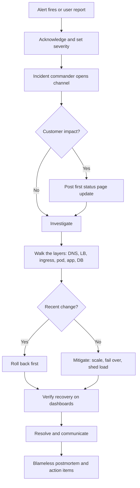
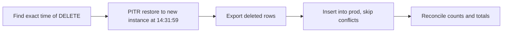
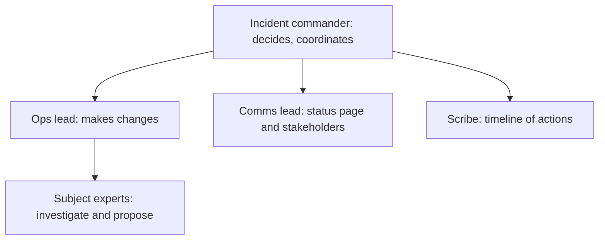

# Real-World Interview — Incident Troubleshooting

<!-- DEVOPS-SHACK:HEADER -->
<p align="center">
  <a href="https://www.youtube.com/@devopsshack"></a>
  <a href="https://www.youtube.com/@shackverse"></a>
  <a href="https://devopsshack.com"></a>
  <a href="https://www.instagram.com/devopsshack"></a>
  <a href="https://github.com/jaiswaladi246/DevOps-Cloud-Interview-Preparation-by-DevOps-Shack"></a>
</p>
<p align="center"><sub>Part of <b><a href="https://github.com/jaiswaladi246/DevOps-Cloud-Interview-Preparation-by-DevOps-Shack">DevOps &amp; Cloud Interview Preparation</a></b> — created by <b><a href="https://www.youtube.com/@devopsshack">DevOps Shack</a></b>. Free to learn from; please credit DevOps Shack when sharing.</sub></p>
<!-- /DEVOPS-SHACK:HEADER -->

> Realistic on-call incidents with exact symptoms and error text, crossing every layer from DNS to the database · 200 questions · 🟢 Beginner 🟡 Intermediate 🔴 Advanced

[⬅ Back to Real-World Interview](./README.md) · [🏠 Home](../README.md)

## Table of contents
- [Site down](#site-down) — Q1–Q20
- [Latency](#latency) — Q21–Q40
- [5xx errors](#5xx-errors) — Q41–Q60
- [DNS, TLS and certificates](#dns-tls-and-certificates) — Q61–Q80
- [Disk, memory and CPU](#disk-memory-and-cpu) — Q81–Q100
- [Kubernetes cluster-level](#kubernetes-cluster-level) — Q101–Q120
- [Pipeline outages](#pipeline-outages) — Q121–Q140
- [Cloud provider issues](#cloud-provider-issues) — Q141–Q160
- [Data loss and corruption](#data-loss-and-corruption) — Q161–Q180
- [Postmortems and comms](#postmortems-and-comms) — Q181–Q200

### Incident-response flow we follow in production



> **How to answer these in an interview.** Interviewers want to hear the order you work in, not a list of every tool you know. Start from what the user sees, walk down the stack one layer at a time, say the exact command you'd run, mitigate before you chase root cause, and finish with how you'd stop it happening again.

---

## Site down

<!-- DEVOPS-SHACK:SECTION -->
> 🎥 **Learn this hands-on with DevOps Shack** → [YouTube @devopsshack](https://www.youtube.com/@devopsshack) · [Hindi @shackverse](https://www.youtube.com/@shackverse) · [Courses at devopsshack.com](https://devopsshack.com)

### Q1. Every user reports "This site can't be reached — ERR_NAME_NOT_RESOLVED" for your domain. 🟢

<details>
<summary><b>Answer</b></summary>

**Likely causes →** Domain registration expired, nameservers changed at the registrar, the A/ALIAS record deleted (often by a Terraform or DNS-as-code change), or the hosted zone itself removed.

**Diagnose →**
```bash
dig +short app.example.com
dig NS example.com +trace          # where does delegation break?
whois example.com | grep -i -E 'expir|name server'
```

**Fix →** Restore the record or the NS delegation at the registrar. Renew the domain if it lapsed. Expect recovery to follow the negative-cache TTL (SOA minimum), so lower it when you can.

**Prevent →** Auto-renew plus registrar lock, DNS records managed in code with plan review, and a synthetic check that resolves the domain from outside your network every minute.

</details>

### Q2. Right after a deploy, nginx returns "502 Bad Gateway" on every page. 🟢

<details>
<summary><b>Answer</b></summary>

**Likely causes →** The new app version crashes on start, listens on a different port than nginx's `proxy_pass`, binds to `127.0.0.1` inside a container, or hasn't finished booting.

**Diagnose →**
```bash
tail -n 50 /var/log/nginx/error.log   # "connect() failed (111: Connection refused) while connecting to upstream"
ss -ltnp | grep 8080
curl -v http://127.0.0.1:8080/healthz
journalctl -u myapp -n 100 --no-pager
```

**Fix →** Roll back first, then fix the port or bind address (`0.0.0.0`), or the startup crash.

**Prevent →** Health-checked deploys that refuse to switch traffic until the new version answers, and a smoke test in the pipeline that hits a real endpoint.

</details>

### Q3. ALB returns "503 Service Temporarily Unavailable" and the target group shows 0 healthy targets. 🟢

<details>
<summary><b>Answer</b></summary>

**Likely causes →** All targets fail health checks (app down, wrong health check path/port, security group blocks the ALB), or the target group is empty because the ASG/Service deregistered everything.

**Diagnose →**
```bash
aws elbv2 describe-target-health --target-group-arn $TG \
  --query 'TargetHealthDescriptions[].[Target.Id,TargetHealth.State,TargetHealth.Reason,TargetHealth.Description]'
```
Reasons like `Target.ResponseCodeMismatch`, `Target.Timeout` or `Target.FailedHealthChecks` point to the next layer.

**Fix →** Fix whatever the reason says: restart or roll back the app, correct the path, or allow the ALB security group on the target port.

**Prevent →** Alarm on `HealthyHostCount < N`, keep health checks on a cheap endpoint, and keep minimum capacity above zero.

</details>

### Q4. `curl https://app.example.com` hangs and ends with "Connection timed out" on port 443. 🟢

<details>
<summary><b>Answer</b></summary>

**Likely causes →** A timeout (not "refused") means packets are being dropped: security group or NACL change, LB deleted or in the wrong subnets, route table lost its internet gateway route, or DNS pointing at a dead IP.

**Diagnose →**
```bash
dig +short app.example.com            # is this the LB you expect?
nc -vz -w 5 app.example.com 443
aws ec2 describe-security-groups --group-ids $SG --query 'SecurityGroups[].IpPermissions'
traceroute -T -p 443 app.example.com
```

**Fix →** Restore the inbound 443 rule or route, or point DNS back at the live LB.

**Prevent →** Network changes only through IaC with review, VPC Flow Logs enabled, and external synthetics that tell you within a minute.

</details>

### Q5. After a Helm upgrade, the ingress returns "default backend - 404" for your domain. 🟡

<details>
<summary><b>Answer</b></summary>

**Likely causes →** The Ingress host or path no longer matches (typo, values change), `ingressClassName` missing so the controller ignores it, or the Ingress points to a Service name that changed in the chart.

**Diagnose →**
```bash
kubectl get ingress -A
kubectl describe ingress web -n prod     # check Rules, Backends, and "<error: endpoints not found>"
kubectl get ingressclass
kubectl logs -n ingress-nginx deploy/ingress-nginx-controller | grep -i web
```

**Fix →** `helm rollback web <rev>` to restore traffic, then correct host, class or backend service name.

**Prevent →** Render and diff manifests in CI (`helm diff upgrade`), and run a post-deploy synthetic that requests the real hostname.

</details>

### Q6. All pods are Running and Ready, but the Service has no endpoints and traffic fails. 🟡

<details>
<summary><b>Answer</b></summary>

**Likely causes →** Service `selector` doesn't match pod labels (a label renamed in the Deployment), wrong namespace, or `targetPort` pointing to a port name that doesn't exist.

**Diagnose →**
```bash
kubectl get endpointslices -n prod -l kubernetes.io/service-name=web
kubectl get svc web -n prod -o jsonpath='{.spec.selector}'; echo
kubectl get pods -n prod --show-labels
```

**Fix →** Align the selector and labels, or fix `targetPort`. Endpoints appear within seconds.

**Prevent →** Treat selectors as immutable contracts, lint charts with a test that asserts endpoints exist after install, and alarm on Services with zero ready endpoints.

</details>

### Q7. The site is down only for users in one country or region; everyone else is fine. 🟡

<details>
<summary><b>Answer</b></summary>

**Likely causes →** A CDN PoP problem, a regional ISP routing or DNS resolver issue, geo-routing policy sending them to an unhealthy region, or a WAF/geo-block rule.

**Diagnose →**
```bash
dig @8.8.8.8 app.example.com; dig @1.1.1.1 app.example.com
curl -sI https://app.example.com | grep -i -E 'x-cache|cf-ray|x-amz-cf-pop'
```
Ask an affected user for a `traceroute` and the CDN request ID. Check synthetic probes in that region and Route 53 geolocation/latency records.

**Fix →** Fail that region's routing over to a healthy origin, remove the bad WAF rule, or open a ticket with the CDN with PoP IDs.

**Prevent →** Multi-region synthetics, health-checked geo records with a default fallback, and a status page that separates regions.

</details>

### Q8. The homepage loads, but every page that needs data shows "Error establishing a database connection". 🟢

<details>
<summary><b>Answer</b></summary>

**Likely causes →** DB down or failing over, credentials rotated, connection limit reached, or a security group/NACL change between app and DB.

**Diagnose →**
```bash
nc -vz db.internal 5432
psql "host=db.internal user=app dbname=app" -c 'select 1'
aws rds describe-events --source-type db-instance --duration 60
```

**Fix →** Restore connectivity or credentials. If the DB is overloaded, restart the noisy client rather than the DB.

**Prevent →** Alert on DB connections and availability, rotate secrets with dual-credential overlap, and show a friendly degraded page instead of a raw error.

</details>

### Q9. Pods go into CrashLoopBackOff after a config change; logs show `KeyError: 'DATABASE_URL'`. 🟢

<details>
<summary><b>Answer</b></summary>

**Likely causes →** The env var was removed or renamed in the ConfigMap/Secret, the Secret key changed, or the pod references a Secret in another namespace.

**Diagnose →**
```bash
kubectl logs deploy/api -n prod --previous
kubectl describe pod -n prod -l app=api | grep -A5 -i -E 'environment|events'
kubectl get secret api-secrets -n prod -o jsonpath='{.data}' | jq 'keys'
```

**Fix →** `kubectl rollout undo deploy/api -n prod`, then restore the key.

**Prevent →** Validate required config at startup with a clear message, keep config in the same PR as code, and mark env refs with `optional: false` (the default) so missing keys fail at pod creation, not runtime.

</details>

### Q10. You just enabled the Cloudflare proxy and users get "Error 521: Web server is down" or "Error 525: SSL handshake failed". 🟡

<details>
<summary><b>Answer</b></summary>

**Likely causes →** 521: origin refuses connections from Cloudflare IPs (firewall allows only old IPs or blocks them). 525: SSL mode is "Full" or "Full (strict)" but the origin has no valid cert on 443 or the SNI doesn't match.

**Diagnose →**
```bash
curl -vk --resolve app.example.com:443:<origin-ip> https://app.example.com
openssl s_client -connect <origin-ip>:443 -servername app.example.com </dev/null | head -20
```

**Fix →** Allow Cloudflare's IP ranges on the origin, install a valid or Cloudflare Origin CA cert, and match SSL mode to what the origin supports.

**Prevent →** Change proxy and SSL modes in a maintenance window with a direct-to-origin test first, and keep the origin allowlist automated from Cloudflare's published IP list.

</details>

### Q11. After changing the health check path, the ALB shows "Health checks failed with these codes: [404]" for every target. 🟡

<details>
<summary><b>Answer</b></summary>

**Likely causes →** The new path doesn't exist on the deployed version yet, the app serves it only on a different host header, or the matcher expects 200 while the endpoint returns 301/302.

**Diagnose →**
```bash
aws elbv2 describe-target-groups --target-group-arns $TG \
  --query 'TargetGroups[].[HealthCheckPath,HealthCheckPort,Matcher]'
curl -s -o /dev/null -w '%{http_code}\n' http://<target-ip>:8080/healthz
```

**Fix →** Revert the path, or set the matcher to the real code (for example `200-399`). Ship the health endpoint before switching the LB to it.

**Prevent →** Health check config lives with the app's chart/IaC and is deployed in the same change, and every service exposes a standard `/healthz`.

</details>

### Q12. `/healthz` returns 200, but users see a blank white page; the browser console shows `403` on `main.3f9a.js` from CloudFront. 🟡

<details>
<summary><b>Answer</b></summary>

**Likely causes →** The frontend deploy uploaded `index.html` referencing new hashed bundles, but the bundles weren't uploaded, were deleted by `aws s3 sync --delete`, or the bucket policy/OAC blocks them. S3 returns 403 for missing objects when the caller lacks `s3:ListBucket`.

**Diagnose →**
```bash
curl -sI https://app.example.com/static/js/main.3f9a.js
aws s3 ls s3://web-bucket/static/js/ | grep 3f9a
```

**Fix →** Re-upload the assets or redeploy the previous build, then invalidate `/index.html` only.

**Prevent →** Upload assets first and `index.html` last, keep the previous build's assets for a few releases, and give `index.html` a short cache TTL.

</details>

### Q13. A new WAF rule went live and legitimate users get "403 Forbidden" with a request ID. 🟡

<details>
<summary><b>Answer</b></summary>

**Likely causes →** An over-broad managed rule (SQLi/XSS) matching normal JSON bodies, a rate rule set too low behind a shared NAT/corporate IP, or a geo rule blocking a real market.

**Diagnose →**
```bash
aws wafv2 get-sampled-requests --web-acl-arn $ACL --rule-metric-name <rule> \
  --scope REGIONAL --time-window StartTime=$(date -d '-15 min' +%s),EndTime=$(date +%s) --max-items 50
```
Check WAF logs for `terminatingRuleId` against the request ID the user gave you.

**Fix →** Switch the rule to Count mode, or add a scoped exclusion for that path.

**Prevent →** Every new WAF rule runs in Count mode for a few days with dashboards before switching to Block.

</details>

### Q14. A 30-second database blip turns into a 20-minute full outage because every pod became NotReady at the same time. 🔴

<details>
<summary><b>Answer</b></summary>

**Likely causes →** Readiness probes check the database (a deep health check). When the DB blipped, every pod failed readiness, all endpoints were removed, and the ingress returned 503 even for pages that don't need the DB. Liveness probes doing the same thing restart pods and add a thundering herd of reconnects.

**Diagnose →**
```bash
kubectl get events -n prod --field-selector reason=Unhealthy | head
kubectl get deploy api -n prod -o jsonpath='{.spec.template.spec.containers[0].readinessProbe}'
```

**Fix →** Make liveness check only the process. Make readiness check only what the pod itself needs to serve (not shared dependencies), and handle DB errors per request with a degraded response.

**Prevent →** Health check design review: shared dependencies never in liveness, rarely in readiness. Add connection-retry backoff with jitter.

</details>

### Q15. A routine `terraform apply` replaced a security group and the site went down for 4 minutes. 🟡

<details>
<summary><b>Answer</b></summary>

**Likely causes →** A change to an immutable attribute (`name`, `description`, `vpc_id`) forces `-/+ destroy and then create replacement`. The ENIs lost the old group before the new one attached, or inline rules and `aws_security_group_rule` resources fought each other.

**Diagnose →** Read the plan output in the CI log for `must be replaced` and `# forces replacement`. Check CloudTrail for `DeleteSecurityGroup` and `RevokeSecurityGroupIngress` at the outage time.

**Fix →** Re-apply the rules (or roll back the code), confirm targets are healthy.

**Prevent →**
```hcl
lifecycle { create_before_destroy = true }
```
Use `name_prefix` instead of `name`, fail CI on any replacement of network resources without explicit approval, and use `aws_vpc_security_group_ingress_rule` resources instead of inline rules.

</details>

### Q16. The site goes down for a minute every few minutes; pods restart with "Liveness probe failed: Get "http://10.0.3.17:8080/healthz": context deadline exceeded". 🟡

<details>
<summary><b>Answer</b></summary>

**Likely causes →** Under load, the app is too slow to answer the probe within `timeoutSeconds` (default 1s), so kubelet kills healthy-but-busy pods, which pushes more load onto the rest. Also common: GC pauses or CPU throttling.

**Diagnose →**
```bash
kubectl get pods -n prod -o wide              # RESTARTS climbing
kubectl describe pod api-xxx -n prod | grep -A3 Liveness
kubectl top pods -n prod
```

**Fix →** Raise `timeoutSeconds` and `failureThreshold`, serve `/healthz` from a lightweight thread, and add replicas or CPU.

**Prevent →** Use a `startupProbe` for slow boots, keep liveness lenient, and alert on restart rate.

</details>

### Q17. After a node pool upgrade, all pods are Pending with "0/6 nodes are available: 6 node(s) had untolerated taint {dedicated: app}". 🔴

<details>
<summary><b>Answer</b></summary>

**Likely causes →** The new node group was created with a taint (or a different label) that the workloads don't tolerate, and the old pool was drained before anyone checked that pods could reschedule.

**Diagnose →**
```bash
kubectl get nodes -o custom-columns=NAME:.metadata.name,TAINTS:.spec.taints
kubectl describe pod web-xxx -n prod | sed -n '/Events/,$p'
```

**Fix →** Fastest path: remove the taint (`kubectl taint nodes -l eks.amazonaws.com/nodegroup=ng-new dedicated=app:NoSchedule-`) or scale the old node group back up. Then align taints, tolerations and nodeSelectors in code.

**Prevent →** Blue/green node pools: bring up the new pool, cordon (not drain) the old one, verify a canary pod schedules, then drain with PDBs in place.

</details>

### Q18. A config push took the whole site down globally within 90 seconds. 🔴

<details>
<summary><b>Answer</b></summary>

**Likely causes →** A global config system (feature flags, WAF rules, routing config) pushed to every region at once with no staging or validation. A malformed value crashed every consumer simultaneously.

**Diagnose →** Correlate the outage start with the config system's audit log. Look for identical crash signatures across all regions in the same minute, which rules out infrastructure.

**Fix →** Revert the config through the fastest path available (often a break-glass CLI, not the UI). Restart consumers if they cached the bad value.

**Prevent →** Treat config as code: schema validation in CI, staged rollout (one region, then 10%, then all) with automatic halt on error rate, and consumers that keep the last known good config when a new one fails to parse.

</details>

### Q19. You try to roll back an outage, but the old pods fail with "ImagePullBackOff: manifest unknown". 🔴

<details>
<summary><b>Answer</b></summary>

**Likely causes →** An ECR lifecycle policy or registry cleanup deleted the previous image tag, or the rollback references a mutable tag like `latest` that now points at the broken build.

**Diagnose →**
```bash
kubectl describe pod api-xxx -n prod | grep -i -A2 failed
aws ecr describe-images --repository-name api --image-ids imageTag=v1.41.2
```

**Fix →** Rebuild the last good commit and push it (a pipeline re-run on the old SHA), or pull the image from a replica registry or a node's local cache (`crictl images`) and push it back.

**Prevent →** Deploy by immutable tag or digest, enable ECR tag immutability, and write lifecycle rules that keep at least the last 20 production-tagged images.

</details>

### Q20. Half of requests fail with 504 and only targets in us-east-1b are unhealthy. 🔴

<details>
<summary><b>Answer</b></summary>

**Likely causes →** Something AZ-local: the NAT gateway in that AZ failed (targets can't reach a dependency), a subnet route table changed, an AZ-scoped dependency (cache node, DB replica) is down, or the AZ itself is impaired.

**Diagnose →**
```bash
aws elbv2 describe-target-health --target-group-arn $TG --output table
aws ec2 describe-route-tables --filters Name=association.subnet-id,Values=$SUBNET_1B
aws cloudwatch get-metric-statistics --namespace AWS/NATGateway --metric-name ErrorPortAllocation ...
```

**Fix →** Shift traffic away from the AZ: ALB zonal shift (ARC), scale the ASG in other AZs, or deregister 1b targets. Fix the route or NAT afterwards.

**Prevent →** One NAT gateway per AZ with AZ-local routes, capacity to lose one AZ (N+1), and zonal health dashboards.

</details>

---

## Latency

<!-- DEVOPS-SHACK:SECTION -->
> 🎥 **Learn this hands-on with DevOps Shack** → [YouTube @devopsshack](https://www.youtube.com/@devopsshack) · [Hindi @shackverse](https://www.youtube.com/@shackverse) · [Courses at devopsshack.com](https://devopsshack.com)

### Q21. p99 latency jumped from 200 ms to 3 s right after a deploy; error rate is flat. 🟢

<details>
<summary><b>Answer</b></summary>

**Likely causes →** A new slow query or missing index, a new synchronous call to another service, disabled caching, or a debug log level left on.

**Diagnose →** Compare the deploy marker on the latency graph with traces from before and after. In APM, sort spans by duration and diff the slowest endpoint.
```bash
git log --oneline v1.40.0..v1.41.0
kubectl rollout history deploy/api -n prod
```

**Fix →** Roll back first (`kubectl rollout undo`), then reproduce in staging with prod-like data.

**Prevent →** Canary deploys gated on p99 latency, not just error rate, and a performance test on the critical paths in CI.

</details>

### Q22. The API is slow, the database shows 100% CPU, and the slow query log is full of one query doing a sequential scan. 🟢

<details>
<summary><b>Answer</b></summary>

**Likely causes →** A missing index on a filter column, a query changed to wrap the indexed column in a function, or a table that grew past the point where a seq scan was cheap.

**Diagnose →**
```sql
SELECT query, calls, mean_exec_time FROM pg_stat_statements ORDER BY total_exec_time DESC LIMIT 5;
EXPLAIN (ANALYZE, BUFFERS) SELECT * FROM orders WHERE customer_id = 42;
```

**Fix →**
```sql
CREATE INDEX CONCURRENTLY idx_orders_customer ON orders (customer_id);
```
`CONCURRENTLY` avoids locking writes on a live table.

**Prevent →** Run `EXPLAIN` in code review for new queries, track `pg_stat_statements` top queries on a dashboard, and alert on DB CPU above 80%.

</details>

### Q23. A JVM service has latency spikes every 30–60 seconds; GC logs show "Pause Full (G1 Compaction Pause)" taking 4 seconds. 🟡

<details>
<summary><b>Answer</b></summary>

**Likely causes →** Heap too small for the live set, a memory leak filling old gen, humongous allocations, or `-Xmx` set close to the container limit so the JVM fights for memory.

**Diagnose →**
```bash
jcmd <pid> GC.heap_info
jstat -gcutil <pid> 1000 10
jcmd <pid> GC.heap_dump /tmp/heap.hprof    # analyze in Eclipse MAT
```

**Fix →** Size heap with `-XX:MaxRAMPercentage=75` instead of a hard `-Xmx`, fix the leak, or move to a low-pause collector (ZGC with `-XX:+UseZGC`) for latency-sensitive services.

**Prevent →** Export GC pause metrics (Micrometer/JMX) and alert on pause time and old-gen occupancy after GC.

</details>

### Q24. The first request after idle takes 5 seconds; Lambda logs show "Init Duration: 4512.33 ms". 🟢

<details>
<summary><b>Answer</b></summary>

**Likely causes →** Cold starts: a large deployment package, heavy framework initialization, a VPC-attached function initializing, or loading secrets synchronously at init.

**Diagnose →** Query CloudWatch Logs Insights:
```
filter @type = "REPORT" | stats avg(@initDuration), count(@initDuration) by bin(5m)
```

**Fix →** Trim dependencies, lazy-load heavy clients, use Provisioned Concurrency for latency-critical functions, or SnapStart for Java.

**Prevent →** Track cold start rate and init duration per function, and set a package size budget in CI.

</details>

### Q25. Latency grows with traffic and logs show "QueuePool limit of size 5 overflow 10 reached, connection timed out, timeout 30.00". 🟡

<details>
<summary><b>Answer</b></summary>

**Likely causes →** The app's DB connection pool is too small for its concurrency, connections leak (not returned), or slow queries hold connections longer than expected.

**Diagnose →**
```sql
SELECT state, count(*) FROM pg_stat_activity WHERE datname='app' GROUP BY state;
-- many "idle in transaction" = leaked or long transactions
```

**Fix →** Fix leaks and long transactions first. Then size the pool (`pool_size`, `max_overflow`) so `replicas × pool` stays below the DB's `max_connections`, or add PgBouncer/RDS Proxy.

**Prevent →** Export pool metrics (in-use, waiters, wait time), and set `idle_in_transaction_session_timeout` on the DB.

</details>

### Q26. A container uses only 40% of its CPU limit on average, yet latency is high; `container_cpu_cfs_throttled_periods_total` keeps rising. 🔴

<details>
<summary><b>Answer</b></summary>

**Likely causes →** CFS quota throttling: the limit is enforced per 100 ms period, so bursty, multi-threaded work hits the quota early in the period and stalls for the rest of it. Averages hide this. Runtimes that size thread pools from host cores make it worse.

**Diagnose →**
```promql
rate(container_cpu_cfs_throttled_periods_total{pod=~"api.*"}[5m])
  / rate(container_cpu_cfs_periods_total{pod=~"api.*"}[5m])
```
More than 5–10% throttled periods on a latency-sensitive service is a problem.

**Fix →** Raise or remove the CPU limit (keep requests accurate), and set runtime thread counts to match (`GOMAXPROCS` via automaxprocs, `-XX:ActiveProcessorCount`).

**Prevent →** Dashboard throttling ratio per workload and review CPU limits for latency-critical services.

</details>

### Q27. Users in Asia see 800 ms time-to-first-byte while US users see 80 ms. 🟢

<details>
<summary><b>Answer</b></summary>

**Likely causes →** Everything is served from one US region with no CDN, so every request pays transpacific round trips plus TLS handshakes.

**Diagnose →**
```bash
curl -o /dev/null -s -w 'dns:%{time_namelookup} connect:%{time_connect} tls:%{time_appconnect} ttfb:%{time_starttransfer}\n' https://app.example.com
```
Run it from a probe in Asia; high connect and TLS times confirm distance.

**Fix →** Put static assets and cacheable API responses behind a CDN, terminate TLS at the edge, and keep connections to the origin warm.

**Prevent →** Synthetic probes from each major market, and a multi-region read path when traffic justifies it.

</details>

### Q28. Latency rose by 30–50 ms per hop after injecting Istio sidecars, and some calls now hit "upstream request timeout". 🟡

<details>
<summary><b>Answer</b></summary>

**Likely causes →** Sidecars under-provisioned (CPU throttled Envoy), mTLS handshakes on short-lived connections, a default 15s route timeout lower than slow endpoints need, or retries stacked on app retries.

**Diagnose →**
```bash
kubectl top pod api-xxx -n prod --containers
istioctl proxy-config routes deploy/api -n prod -o json | jq '.. | .timeout? // empty'
kubectl logs api-xxx -c istio-proxy -n prod | grep -E ' (504|503) '
```

**Fix →** Give `istio-proxy` adequate CPU requests, set explicit `timeout` in VirtualServices, and keep retries in one layer only.

**Prevent →** Load test with the mesh enabled before rollout and dashboard Envoy upstream latency separately from app latency.

</details>

### Q29. Redis latency spikes to hundreds of milliseconds and `SLOWLOG GET` shows `KEYS user:*`. 🟡

<details>
<summary><b>Answer</b></summary>

**Likely causes →** Redis is single-threaded for commands. `KEYS`, large `SMEMBERS`/`HGETALL`, or big `DEL`s block every other client while they run.

**Diagnose →**
```bash
redis-cli SLOWLOG GET 10
redis-cli --bigkeys
redis-cli INFO commandstats | sort -t= -k3 -nr | head
```

**Fix →** Replace `KEYS` with `SCAN` and a cursor, use `UNLINK` instead of `DEL` for big keys, and split huge keys.

**Prevent →** Disable dangerous commands (`rename-command KEYS ""` or ACLs in Redis 6+), and alert on slowlog length and p99 command latency.

</details>

### Q30. In Kubernetes, some outbound requests take exactly 5 seconds longer than they should. 🔴

<details>
<summary><b>Answer</b></summary>

**Likely causes →** DNS: with `ndots:5`, a lookup for `api.stripe.com` tries every search domain first. Parallel A and AAAA queries over UDP from the same socket can also race in conntrack and drop one, so the resolver waits its 5s timeout before retrying.

**Diagnose →**
```bash
kubectl exec -it api-xxx -- cat /etc/resolv.conf
kubectl exec -it api-xxx -- sh -c 'time getent hosts api.stripe.com'
conntrack -S | grep insert_failed    # on the node
```

**Fix →** Use FQDNs with a trailing dot, lower `ndots` via `dnsConfig.options`, add `single-request-reopen` (glibc), and deploy NodeLocal DNSCache.

**Prevent →** Monitor CoreDNS latency and errors, and run NodeLocal DNSCache as a default cluster add-on.

</details>

### Q31. A payments dependency slows down and within minutes every service that calls it, and every service that calls those, is timing out. 🔴

<details>
<summary><b>Answer</b></summary>

**Likely causes →** No timeouts or long default timeouts, so request threads pile up waiting. Retries at every layer multiply load on the struggling dependency (3 retries × 3 layers = 27× traffic). Thread or connection pools exhaust and healthy endpoints in the same service stall too.

**Diagnose →** Look at traces: long spans all ending at the same downstream. Check thread pool saturation, in-flight requests, and the retry counter metrics per client.

**Fix →** Shed load: enable the circuit breaker or feature flag that skips the dependency, reduce retries to zero temporarily, and scale the dependency if it can take it.

**Prevent →** Explicit timeouts on every client (shorter than the caller's own timeout), retries only at one layer with exponential backoff and jitter plus a retry budget, circuit breakers, and bulkheads (separate pools per dependency).

</details>

### Q32. Overall latency is fine, but one pod's p99 is 10× higher than its siblings. 🟡

<details>
<summary><b>Answer</b></summary>

**Likely causes →** A noisy neighbour on the same node, the node itself degraded (disk, network, throttled burstable instance), a pod with a cold cache, or uneven load balancing pinning heavy clients to that pod.

**Diagnose →**
```bash
kubectl get pod api-7f9 -n prod -o wide       # which node?
kubectl top pods -A --sort-by=cpu | head     # who else is on that node?
kubectl describe node <node> | sed -n '/Allocated resources/,/Events/p'
```

**Fix →** Delete the pod so it reschedules, or cordon and drain the bad node.

**Prevent →** Accurate requests so the scheduler doesn't overpack nodes, topology spread constraints, and per-pod latency dashboards (not only service-wide).

</details>

### Q33. A page takes 4 seconds to load; the APM trace shows 300 identical `SELECT ... WHERE id = ?` queries in one request. 🟢

<details>
<summary><b>Answer</b></summary>

**Likely causes →** The N+1 query problem: the ORM loads a list, then lazily loads a relation per row.

**Diagnose →** In the trace, group spans by SQL statement and count them. Locally, enable ORM query logging and hit the endpoint.

**Fix →** Eager-load the relation (`select_related`/`prefetch_related` in Django, `includes` in Rails, `JOIN FETCH` in JPA), or batch with `WHERE id IN (...)`.

**Prevent →** Add a test that asserts the query count for key endpoints, and an APM alert for requests with more than N DB calls.

</details>

### Q34. Latency spikes at the top of every hour and recovers after about two minutes. 🟡

<details>
<summary><b>Answer</b></summary>

**Likely causes →** Scheduled work: cron jobs or batch reports hitting the same DB, cache entries all set with a 1-hour TTL expiring together (stampede), log rotation, or backups/snapshots.

**Diagnose →**
```bash
kubectl get cronjobs -A -o custom-columns=NAME:.metadata.name,SCHEDULE:.spec.schedule | grep -E '^\S+\s+0 '
```
Overlay DB CPU, cache hit ratio and job start times on the same graph.

**Fix →** Move heavy jobs to a read replica and off the hour, and add jitter to cache TTLs.

**Prevent →** Use jittered schedules (e.g. `17 * * * *`), request coalescing or "early refresh" for hot cache keys, and a shared calendar of batch jobs.

</details>

### Q35. Disk-heavy services slowed down gradually over a day; CloudWatch shows `BurstBalance` at 0 on a gp2 volume. 🟡

<details>
<summary><b>Answer</b></summary>

**Likely causes →** gp2 volumes earn IOPS from size (3 IOPS/GiB) and burst to 3,000 using credits. Sustained load drained the credits and the volume fell to its baseline.

**Diagnose →**
```bash
aws cloudwatch get-metric-statistics --namespace AWS/EBS --metric-name BurstBalance \
  --dimensions Name=VolumeId,Value=$VOL --statistics Minimum --period 300 \
  --start-time $(date -u -d '-1 day' +%FT%TZ) --end-time $(date -u +%FT%TZ)
iostat -x 1 5     # high await, %util near 100
```

**Fix →** Migrate the volume to gp3 online (`aws ec2 modify-volume --volume-type gp3 --iops 6000`), which gives baseline 3,000 IOPS without credits.

**Prevent →** Standardize on gp3, and alarm on `BurstBalance < 20` for any remaining gp2 volumes.

</details>

### Q36. Cross-AZ calls show random latency spikes; `mtr` shows 2% packet loss between two subnets. 🔴

<details>
<summary><b>Answer</b></summary>

**Likely causes →** Packet loss forces TCP retransmissions (initial RTO is around 200 ms–1 s), which shows up as long-tail latency. Causes include an instance hitting its network allowance (PPS or bandwidth), a degraded host, conntrack drops, or a provider network issue.

**Diagnose →**
```bash
mtr -rwzc 200 10.0.2.15
nstat -az | grep -i retrans
ethtool -S eth0 | grep -E 'allowance_exceeded'   # ENA: bw_in/bw_out/pps/conntrack
```

**Fix →** If `*_allowance_exceeded` counters grow, move to a larger or network-optimized instance type. If one host is bad, replace the instance. Otherwise open a provider case with the mtr output.

**Prevent →** Export ENA allowance counters and TCP retransmit rate as metrics, and keep chatty services AZ-local.

</details>

### Q37. After turning on TLS between internal services, p50 latency doubled. 🟡

<details>
<summary><b>Answer</b></summary>

**Likely causes →** Clients open a new connection per request, so every call now pays a full TCP plus TLS handshake (one or two extra round trips plus crypto). Missing session resumption makes it worse.

**Diagnose →**
```bash
ss -tan state time-wait | wc -l      # huge count = no connection reuse
curl -w 'tls:%{time_appconnect}\n' -o /dev/null -s https://orders.internal/health
```

**Fix →** Reuse connections: shared HTTP client with keep-alive and a pooled transport, HTTP/2 where possible, and TLS 1.3 (one-round-trip handshake).

**Prevent →** Create HTTP clients once per process (not per request), and monitor new connections per second per service.

</details>

### Q38. Postgres queries that used to take 5 ms now take 800 ms with the same plan shape; the table hasn't grown much. 🔴

<details>
<summary><b>Answer</b></summary>

**Likely causes →** Table and index bloat from dead tuples because autovacuum can't keep up or is blocked by a long-running transaction (or an abandoned replication slot) holding back `xmin`. Stale statistics can also flip row estimates.

**Diagnose →**
```sql
SELECT relname, n_live_tup, n_dead_tup, last_autovacuum FROM pg_stat_user_tables ORDER BY n_dead_tup DESC LIMIT 5;
SELECT pid, now()-xact_start AS age, state, query FROM pg_stat_activity ORDER BY xact_start NULLS LAST LIMIT 5;
SELECT slot_name, active FROM pg_replication_slots;
```

**Fix →** Kill the long transaction or drop the dead slot, then `VACUUM (VERBOSE, ANALYZE) orders;`. Use `pg_repack` for heavy bloat without long locks.

**Prevent →** Tune per-table autovacuum thresholds for hot tables, set `idle_in_transaction_session_timeout`, and alert on oldest transaction age and dead tuple ratio.

</details>

### Q39. The ALB's `TargetResponseTime` p99 is 2 s, but the app's own metrics say p99 is 150 ms. Where is the time going? 🟡

<details>
<summary><b>Answer</b></summary>

**Likely causes →** The time is spent between the LB and your handler: requests queued in the app server's accept backlog or worker pool before your timer starts, a sidecar or reverse proxy in front of the app, or CPU throttling stalling the process.

**Diagnose →** Compare timestamps across layers: ALB access logs (`target_processing_time`), nginx `$request_time` vs `$upstream_response_time`, and app span start. Check worker saturation (gunicorn/puma busy workers) and throttling.

**Fix →** Add workers or replicas, and move the app's timer to the outermost middleware so it measures queue time too.

**Prevent →** Measure latency at every hop and export a request-queue-time metric (for example from the `X-Request-Start` header).

</details>

### Q40. Customers say "the app is slow" but every server dashboard is green. How do you tell if it's client-side or server-side? 🟢

<details>
<summary><b>Answer</b></summary>

**Likely causes →** Frontend weight (huge JS bundles, render blocking), a third-party script, slow client networks, or a CDN issue your server metrics can't see.

**Diagnose →** Check Real User Monitoring (Core Web Vitals: LCP, INP) split by country, browser and device. Compare with synthetic checks from a few regions. Run Lighthouse or the browser waterfall on the reported page.

**Fix →** Fix what the waterfall shows: lazy-load scripts, compress and cache assets, remove slow third-party tags.

**Prevent →** Keep RUM next to server metrics on the same dashboard, and set a frontend performance budget in CI.

</details>

---

## 5xx errors

<!-- DEVOPS-SHACK:SECTION -->
> 🎥 **Learn this hands-on with DevOps Shack** → [YouTube @devopsshack](https://www.youtube.com/@devopsshack) · [Hindi @shackverse](https://www.youtube.com/@shackverse) · [Courses at devopsshack.com](https://devopsshack.com)

### Q41. Right after a release, 500s spike to 8% and logs show `java.lang.NullPointerException` in a new code path. 🟢

<details>
<summary><b>Answer</b></summary>

**Likely causes →** A code bug exposed by production data that tests didn't cover (null fields, old records missing a new column).

**Diagnose →**
```bash
kubectl logs -n prod -l app=api --since=10m | grep -c NullPointerException
kubectl rollout history deploy/api -n prod
```
Group errors by endpoint in your error tracker (Sentry and similar) to confirm it's one code path.

**Fix →** `kubectl rollout undo deploy/api -n prod` immediately. Fix forward only if rollback is impossible (e.g. an irreversible migration).

**Prevent →** Canary releases with automatic rollback on error rate, and tests seeded with anonymized production-shaped data.

</details>

### Q42. Long-running report exports fail with "504 Gateway Time-out" from the ALB at exactly 60 seconds. 🟢

<details>
<summary><b>Answer</b></summary>

**Likely causes →** The ALB idle timeout (default 60 s) closes the connection because no bytes flowed while the report was generated.

**Diagnose →** ALB access logs show `elb_status_code=504` with `target_processing_time=-1` and request durations clustered at 60 s.

**Fix →** Short term: raise the idle timeout (`aws elbv2 modify-load-balancer-attributes --attributes Key=idle_timeout.timeout_seconds,Value=300`). Right fix: make it asynchronous. Return `202 Accepted` with a job ID, generate the report in a worker, and let the client poll or get a download link.

**Prevent →** Any request expected to exceed a few seconds goes through a job queue by design.

</details>

### Q43. nginx logs "upstream prematurely closed connection while reading response header from upstream" and users get 502. 🟡

<details>
<summary><b>Answer</b></summary>

**Likely causes →** The backend closed the connection before sending a response: the worker crashed or was OOM-killed mid-request, the app server's worker timeout (gunicorn default 30 s) killed a slow request, or the backend closed an idle keep-alive connection nginx was reusing.

**Diagnose →**
```bash
grep -E 'WORKER TIMEOUT|Booting worker' /var/log/app/gunicorn.log
dmesg -T | grep -i 'killed process'
kubectl get pods -n prod -o wide | grep -v ' 0 '   # restarts
```

**Fix →** Fix the slow endpoint or raise the worker timeout above the longest legit request. If OOM, fix memory. For keep-alive, set nginx `keepalive_timeout` to the upstream lower than the backend's.

**Prevent →** Align timeouts across layers (client > LB > proxy > app), and alert on worker restarts.

</details>

### Q44. Every deploy causes 10–20 seconds of 502s from the ALB, even with a rolling update. 🟡

<details>
<summary><b>Answer</b></summary>

**Likely causes →** Kubernetes sends SIGTERM and removes the endpoint at the same time, but the ALB (via the AWS Load Balancer Controller) takes several seconds to deregister the target. Meanwhile the app has already exited, so in-flight and new requests hit a dead pod.

**Diagnose →** ALB access logs during the deploy show 502 with `target_status_code=-` for pods that were terminating.

**Fix →**
```yaml
lifecycle:
  preStop:
    exec: { command: ["sleep", "20"] }
terminationGracePeriodSeconds: 45
```
Also make the app drain on SIGTERM, and tune the target group's `deregistration_delay.timeout_seconds`.

**Prevent →** Enable pod readiness gates with the AWS Load Balancer Controller so new pods receive traffic only after the ALB marks them healthy, and run a load test during a deploy in staging.

</details>

### Q45. A Node.js service behind an ALB returns a steady trickle of 502s under normal load, with no app errors at all. 🔴

<details>
<summary><b>Answer</b></summary>

**Likely causes →** A keep-alive race. Node's `server.keepAliveTimeout` defaults to 5 s; the ALB keeps idle connections for 60 s. Node closes an idle socket just as the ALB sends a new request on it, and the ALB returns 502.

**Diagnose →** ALB logs show 502 with `target_processing_time` near zero and `error_reason` such as `TargetResponseError` or a connection reset, while the app logs nothing for those requests.

**Fix →**
```js
server.keepAliveTimeout = 65_000;   // greater than ALB idle timeout
server.headersTimeout  = 66_000;   // must exceed keepAliveTimeout
```
Same rule for gunicorn (`--keep-alive`), nginx and others: the backend's keep-alive must be longer than the LB's idle timeout.

**Prevent →** A standard service template with these values set, and a dashboard that splits `HTTPCode_ELB_5XX` from `HTTPCode_Target_5XX`.

</details>

### Q46. Through Istio, clients get "503 upstream connect error or disconnect/reset before headers. reset reason: connection failure". 🟡

<details>
<summary><b>Answer</b></summary>

**Likely causes →** Envoy couldn't connect to the destination pod: the pod is gone but Envoy's endpoint list is stale, mTLS mode mismatch (STRICT on server, client without sidecar), the app listens on localhost only, or the port name/protocol is wrong.

**Diagnose →**
```bash
istioctl proxy-config endpoints deploy/frontend -n prod | grep orders
istioctl analyze -n prod
kubectl get peerauthentication -A
kubectl logs deploy/frontend -c istio-proxy -n prod | grep ' 503 ' | head
```
The response flags in Envoy access logs (`UF`, `URX`, `UH`) tell you which failure it was.

**Fix →** Align mTLS policy, have the app bind `0.0.0.0`, fix port naming (`http-`, `grpc-`), and add a modest retry on `connect-failure` in the VirtualService.

**Prevent →** Run `istioctl analyze` in CI, and roll mTLS STRICT out per namespace with PERMISSIVE first.

</details>

### Q47. API Gateway returns "502 Bad Gateway" and the logs say "Execution failed due to configuration error: Malformed Lambda proxy response". 🟢

<details>
<summary><b>Answer</b></summary>

**Likely causes →** With proxy integration, the Lambda must return an object with `statusCode` (number), optional `headers`, and `body` as a string. Returning a raw object, a non-string body, or throwing an unhandled error produces this.

**Diagnose →** Enable execution logging on the stage, then check the Lambda's own CloudWatch logs for the returned payload or exception.

**Fix →**
```python
return {"statusCode": 200, "headers": {"Content-Type": "application/json"}, "body": json.dumps(result)}
```
Wrap the handler so exceptions return a proper 500 response.

**Prevent →** Integration tests that invoke the function through API Gateway in staging, not just the handler in isolation.

</details>

### Q48. Users see bursts of 502s every few hours; at the same time pods show `Last State: Terminated, Reason: OOMKilled, Exit Code: 137`. 🟡

<details>
<summary><b>Answer</b></summary>

**Likely causes →** The container exceeds its memory limit and the kernel kills it mid-request. Every in-flight request on that pod fails. Usual triggers: a leak, a large payload loaded fully into memory, or a limit set too low.

**Diagnose →**
```bash
kubectl get pods -n prod -o jsonpath='{range .items[*]}{.metadata.name}{" "}{.status.containerStatuses[0].lastState.terminated.reason}{"\n"}{end}' | grep OOM
```
Graph `container_memory_working_set_bytes` against the limit: a steady climb means a leak, a sudden spike means a big request.

**Fix →** Raise the limit to stop the bleeding, then fix the leak or stream large payloads instead of buffering them.

**Prevent →** Alert when working set exceeds 85–90% of the limit, and load test with large payloads.

</details>

### Q49. During a canary, the new version's error rate is 3% versus 0.1% on stable. How do you catch and stop this automatically? 🟡

<details>
<summary><b>Answer</b></summary>

**Likely causes →** A regression that only real traffic triggers. The problem is detection speed: without per-version metrics, 3% on 10% of traffic looks like a 0.3% blip overall.

**Diagnose →** Split request metrics by version label:
```promql
sum(rate(http_requests_total{code=~"5..",version="v2"}[5m])) / sum(rate(http_requests_total{version="v2"}[5m]))
```

**Fix →** Shift canary weight back to 0 (`kubectl argo rollouts abort api`, or set the weight to 0 in your mesh or LB).

**Prevent →** Progressive delivery with an analysis template (Argo Rollouts, Flagger) that compares canary vs stable error rate and latency at each step and aborts automatically.

</details>

### Q50. 500s appear under load and logs show "accept4: too many open files" or "EMFILE". 🟡

<details>
<summary><b>Answer</b></summary>

**Likely causes →** The process hit its file descriptor limit (often the default 1024): too many sockets because of no connection reuse, leaked file handles, or a genuine traffic increase.

**Diagnose →**
```bash
cat /proc/$(pgrep -f myapp)/limits | grep 'open files'
ls /proc/$(pgrep -f myapp)/fd | wc -l
ss -s
```

**Fix →** Raise the limit (`LimitNOFILE=65535` in the systemd unit, or the container runtime's ulimit), and fix leaks or missing connection pooling.

**Prevent →** Export `process_open_fds / process_max_fds` and alert at 80%.

</details>

### Q51. The app returns 500s and logs show "FATAL: sorry, too many clients already" from Postgres. 🟢

<details>
<summary><b>Answer</b></summary>

**Likely causes →** Total connections from all app replicas exceeded `max_connections`. Common after scaling out replicas, after an HPA event, or when connections leak.

**Diagnose →**
```sql
SHOW max_connections;
SELECT usename, application_name, state, count(*) FROM pg_stat_activity GROUP BY 1,2,3 ORDER BY 4 DESC;
```

**Fix →** Terminate idle leaked connections (`pg_terminate_backend`), reduce per-pod pool size, and stop scaling further until fixed.

**Prevent →** Put PgBouncer (transaction pooling) or RDS Proxy in front, calculate `max replicas × pool size` against the limit, and alert on connection usage at 80%.

</details>

### Q52. Right after a scheduled secret rotation, 500s spike with "password authentication failed for user app". 🟢

<details>
<summary><b>Answer</b></summary>

**Likely causes →** The DB password changed but running pods still use the old value. Kubernetes doesn't restart pods when a Secret used as env vars changes, and some apps cache credentials at startup.

**Diagnose →** Check the rotation event time in Secrets Manager or Vault, and compare it with pod start times and the error start time.

**Fix →** `kubectl rollout restart deploy/api -n prod` to pick up the new secret. If the new password itself is wrong, revert to the previous secret version (`AWSPREVIOUS`).

**Prevent →** Rotate with two users or two valid passwords (alternating users strategy), reload secrets without restarting (mounted files, External Secrets Operator plus Reloader), and test rotation in staging.

</details>

### Q53. When the HPA scales down, ingress-nginx logs "no live upstreams while connecting to upstream" and users get 503. 🟡

<details>
<summary><b>Answer</b></summary>

**Likely causes →** Pods are removed before ingress-nginx updates its upstream list, or a scale-down removed so many pods at once that the remaining ones were briefly overloaded and failed readiness.

**Diagnose →**
```bash
kubectl logs -n ingress-nginx deploy/ingress-nginx-controller | grep 'no live upstreams'
kubectl describe hpa api -n prod | sed -n '/Events/,$p'
```

**Fix →** Add a `preStop` sleep and graceful shutdown, and slow down scale-down.

**Prevent →**
```yaml
behavior:
  scaleDown:
    stabilizationWindowSeconds: 300
    policies: [{ type: Percent, value: 10, periodSeconds: 60 }]
```

</details>

### Q54. Checkout returns 500 for everyone because the third-party payment API is returning 503. 🟡

<details>
<summary><b>Answer</b></summary>

**Likely causes →** A hard synchronous dependency on a vendor with no fallback, and errors propagated straight to users.

**Diagnose →** Check the vendor status page, and your outbound metrics: error rate and latency per external host. Confirm with a direct `curl` to their health endpoint.

**Fix →** Open the circuit breaker so you fail fast, and show a clear "payment temporarily unavailable" message. If you have a secondary provider, route to it. For some flows, accept the order and queue payment capture for retry.

**Prevent →** Circuit breakers and timeouts per vendor, a secondary provider for critical paths, and an alert on vendor error rate that pages before customers notice.

</details>

### Q55. After scaling a gRPC service from 4 to 12 pods, `DEADLINE_EXCEEDED` errors increase and the new pods sit idle. 🔴

<details>
<summary><b>Answer</b></summary>

**Likely causes →** gRPC uses long-lived HTTP/2 connections. A Kubernetes ClusterIP Service balances per connection (L4), so existing clients stay pinned to the original 4 pods, which are overloaded, while new pods get nothing.

**Diagnose →** Per-pod request rate shows a wildly uneven split. `kubectl top pods` confirms the old pods are hot.

**Fix →** Use L7 balancing: a service mesh or Envoy, client-side round-robin with a headless Service (`clusterIP: None`) and `dns:///` resolver, or server-side `MaxConnectionAge` so clients reconnect and spread out.

**Prevent →** Make L7-aware load balancing the default for gRPC, and dashboard per-pod RPS skew.

</details>

### Q56. Random connection failures and 5xx across many services on one node; `dmesg` shows "nf_conntrack: table full, dropping packet". 🔴

<details>
<summary><b>Answer</b></summary>

**Likely causes →** The node's connection tracking table is full. Every new connection (including DNS over UDP) is dropped. Triggers: lots of short-lived connections, a connection-leaking client, or a DDoS.

**Diagnose →**
```bash
cat /proc/sys/net/netfilter/nf_conntrack_count /proc/sys/net/netfilter/nf_conntrack_max
conntrack -L 2>/dev/null | awk '{print $1,$4}' | sort | uniq -c | sort -nr | head
```

**Fix →** Raise `net.netfilter.nf_conntrack_max` (kube-proxy's `conntrack.maxPerCore` on Kubernetes), and find the client creating connections without reuse.

**Prevent →** Alert on conntrack usage above 75%, use connection pooling, and consider NodeLocal DNSCache to cut UDP conntrack entries.

</details>

### Q57. 5xx errors grow slowly over several days and vanish after every deploy or restart. 🟡

<details>
<summary><b>Answer</b></summary>

**Likely causes →** A resource leak: memory, file descriptors, threads, or connections. Restarts mask it. The memory graph looks like a sawtooth that resets at each deploy.

**Diagnose →** Graph memory, open FDs, goroutines/threads and DB connections per pod over a week. Take heap snapshots a few hours apart and diff them (`pprof`, `jmap`, Node `--heapsnapshot-signal`).

**Fix →** Find and fix the leak. As a stopgap, a scheduled rolling restart is acceptable, but log it as tech debt.

**Prevent →** Long-running soak tests in staging and alerts on growth rate, not only absolute thresholds.

</details>

### Q58. nginx returns 502 for some users only, with "upstream sent too big header while reading response header from upstream". 🟡

<details>
<summary><b>Answer</b></summary>

**Likely causes →** The backend's response headers exceed nginx's proxy buffer, usually a large `Set-Cookie` (session data stored in the cookie) or a big auth header. Only users with large sessions hit it.

**Diagnose →**
```bash
grep 'too big header' /var/log/nginx/error.log | tail
curl -s -D - -o /dev/null https://app.example.com/dashboard -H "Cookie: $USER_COOKIE" | wc -c
```

**Fix →**
```nginx
proxy_buffer_size 16k;
proxy_buffers 8 16k;
```
On ingress-nginx, set `nginx.ingress.kubernetes.io/proxy-buffer-size: "16k"`.

**Prevent →** Keep sessions server-side and cookies small.

</details>

### Q59. Someone flushed Redis to fix stale data; seconds later the DB hit 100% CPU and the site threw 5xx for 15 minutes. 🔴

<details>
<summary><b>Answer</b></summary>

**Likely causes →** Cache stampede (thundering herd): every request missed the cache at once and went to the DB, which was sized for a 95% hit rate.

**Diagnose →** Cache hit ratio dropped to near zero exactly when DB QPS and CPU spiked.

**Fix →** Shed load: rate-limit at the edge, temporarily serve stale or static responses, and warm the hottest keys from a script. Scale read replicas if available.

**Prevent →** Never `FLUSHALL` in production; invalidate specific keys instead. Use request coalescing (single-flight) so one request refills each key, add TTL jitter, and plan DB capacity for a cold-cache scenario.

</details>

### Q60. 500s affect only a few specific customers; everyone else is fine. 🔴

<details>
<summary><b>Answer</b></summary>

**Likely causes →** Data-dependent bugs: a record with an unexpected value (null, unicode, very large list), a tenant on a different shard or plan, a feature flag enabled for those tenants, or a poison message that keeps failing.

**Diagnose →** Filter error logs by tenant ID and endpoint. Pull the failing request's trace and the exact record it loaded. Check feature flag targeting and shard mapping for those tenants.

**Fix →** Turn off the flag for those tenants, or patch the bad data (with a backup first). Move poison messages to a dead-letter queue.

**Prevent →** Structured logs with tenant ID on every line, alerts on per-tenant error rate, and input validation at write time.

</details>

---

## DNS, TLS and certificates

<!-- DEVOPS-SHACK:SECTION -->
> 🎥 **Learn this hands-on with DevOps Shack** → [YouTube @devopsshack](https://www.youtube.com/@devopsshack) · [Hindi @shackverse](https://www.youtube.com/@shackverse) · [Courses at devopsshack.com](https://devopsshack.com)

### Q61. Monday morning every browser shows "NET::ERR_CERT_DATE_INVALID" for app.example.com; the cert is from Let's Encrypt via cert-manager. 🟢

<details>
<summary><b>Answer</b></summary>

**Likely causes →** The certificate expired because renewal silently failed. Let's Encrypt certs live 90 days and cert-manager renews at around 30 days left, so the renewal had been failing for weeks: a broken HTTP-01 path, a DNS-01 credential that expired, or a rate limit.

**Diagnose →**
```bash
echo | openssl s_client -connect app.example.com:443 -servername app.example.com 2>/dev/null | openssl x509 -noout -dates
kubectl get certificate,certificaterequest,order,challenge -A
kubectl describe certificate app-tls -n prod
kubectl logs -n cert-manager deploy/cert-manager | grep -i error | tail
```

**Fix →** Fix the challenge path or credentials, then force a reissue with `cmctl renew app-tls -n prod`. If issuance will take too long, upload a manually issued cert as the TLS Secret to stop the bleeding.

**Prevent →** Alert on `certmanager_certificate_expiration_timestamp_seconds - time() < 14*24*3600` and run an external blackbox probe that checks days-to-expiry from outside the cluster.

</details>

### Q62. You changed the A record for api.example.com to a new load balancer an hour ago, but some users still reach the old server. 🟢

<details>
<summary><b>Answer</b></summary>

**Likely causes →** Resolvers cache the old record until its TTL runs out. If the TTL was 86400, some users will see the old IP for up to a day. Long-lived clients (JVMs, mobile apps, keep-alive connections) can hold the old IP even longer.

**Diagnose →**
```bash
dig +noall +answer api.example.com @8.8.8.8
dig +noall +answer api.example.com @ns-123.awsdns-15.com   # authoritative answer
dig +noall +answer api.example.com @1.1.1.1                 # remaining TTL in column 2
```

**Fix →** Keep the old server running and serving (or proxying to the new one) until the old TTL has fully expired. You cannot purge other people's resolver caches.

**Prevent →** Lower the TTL to 60–300 seconds a day before any planned cutover, then raise it again afterwards. For load balancers, use Route 53 ALIAS records so the target can change without you editing IPs.

</details>

### Q63. A cert-manager Certificate is stuck at "Issuing"; the Challenge says "Waiting for HTTP-01 challenge propagation: wrong status code '404', expected '200'". 🟡

<details>
<summary><b>Answer</b></summary>

**Likely causes →** Let's Encrypt (and cert-manager's self-check) cannot fetch `/.well-known/acme-challenge/<token>`. Common reasons: the solver Ingress uses the wrong `ingressClassName`, a redirect or auth rule on the main Ingress intercepts the path, DNS for the host doesn't point at this ingress yet, or a CDN/WAF in front blocks it.

**Diagnose →**
```bash
kubectl get challenge -n prod -o wide
kubectl get ingress -n prod | grep cm-acme-http-solver
curl -v http://app.example.com/.well-known/acme-challenge/test
dig +short app.example.com
```

**Fix →** Set the correct class on the Issuer (`solvers[].http01.ingress.ingressClassName: nginx`), exempt `/.well-known/acme-challenge/` from forced auth, and make sure DNS resolves to this ingress. If a CDN sits in front, switch to a DNS-01 solver.

**Prevent →** Use DNS-01 for anything behind a CDN or private network, and alert on Certificates that are not `Ready` for more than an hour.

</details>

### Q64. After switching to a slim base image, the service fails every outbound HTTPS call with "x509: certificate signed by unknown authority". 🟢

<details>
<summary><b>Answer</b></summary>

**Likely causes →** The new image has no CA bundle. `scratch`, some `distroless` variants and minimal Alpine builds don't ship `/etc/ssl/certs/ca-certificates.crt`, so the TLS client can't verify any public certificate.

**Diagnose →**
```bash
kubectl exec deploy/api -- ls /etc/ssl/certs/ 2>&1 | head
kubectl exec deploy/api -- wget -qO- https://api.stripe.com 2>&1 | head -3
```

**Fix →** Install or copy the bundle:
```dockerfile
FROM alpine:3.20 AS certs
RUN apk add --no-cache ca-certificates
FROM scratch
COPY --from=certs /etc/ssl/certs/ca-certificates.crt /etc/ssl/certs/
```
For internal CAs, add your corporate root to the bundle too, never set `InsecureSkipVerify`.

**Prevent →** A smoke test in CI that makes one real outbound HTTPS call from the built image before it can be promoted.

</details>

### Q65. Browsers load the site fine, but Android apps and `curl` from servers fail with "unable to verify the first certificate" or "unable to get local issuer certificate". 🟡

<details>
<summary><b>Answer</b></summary>

**Likely causes →** The server sends only the leaf certificate, not the intermediate chain. Desktop browsers hide this by fetching missing intermediates (AIA) or using cached ones; most non-browser clients don't.

**Diagnose →**
```bash
openssl s_client -connect app.example.com:443 -servername app.example.com -showcerts </dev/null 2>/dev/null | grep -E 's:|i:'
```
If you see only one `s:`/`i:` pair, the chain is missing.

**Fix →** Serve the full chain: on nginx use `fullchain.pem` (leaf + intermediates) in `ssl_certificate`; on AWS import the certificate with the chain field filled in; on Kubernetes put the full chain in `tls.crt`.

**Prevent →** Add a chain check to your blackbox probe (`openssl verify` against the system bundle) and to the cert-rotation runbook.

</details>

### Q66. `https://example.com` works, but `https://www.example.com` shows "NET::ERR_CERT_COMMON_NAME_INVALID". 🟢

<details>
<summary><b>Answer</b></summary>

**Likely causes →** The certificate's Subject Alternative Names cover `example.com` only. Browsers ignore the CN and check only SANs, so `www` doesn't match. A wildcard `*.example.com` also doesn't cover the bare apex.

**Diagnose →**
```bash
echo | openssl s_client -connect www.example.com:443 -servername www.example.com 2>/dev/null | openssl x509 -noout -ext subjectAltName
```

**Fix →** Reissue with both names, for example in cert-manager:
```yaml
spec:
  dnsNames:
    - example.com
    - www.example.com
```
Then redirect `www` to the apex (or the other way round) so you have one canonical host.

**Prevent →** Keep the hostname list in one place (the Ingress or Certificate spec) and probe every public hostname, not just the main one.

</details>

### Q67. Pods across the cluster log "dial udp 10.96.0.10:53: i/o timeout" and "getaddrinfo EAI_AGAIN" during peak traffic. 🟡

<details>
<summary><b>Answer</b></summary>

**Likely causes →** CoreDNS is overloaded or being throttled: only two replicas for hundreds of nodes, a tight CPU limit, OOMKills, or a flood of queries caused by `ndots:5` expanding every external name into several search-domain lookups.

**Diagnose →**
```bash
kubectl -n kube-system get pods -l k8s-app=kube-dns -o wide
kubectl -n kube-system top pods -l k8s-app=kube-dns
kubectl -n kube-system logs -l k8s-app=kube-dns --tail=50
kubectl exec deploy/api -- cat /etc/resolv.conf
```
Check `coredns_dns_requests_total` and `coredns_forward_request_duration_seconds` in Prometheus.

**Fix →** Scale CoreDNS (or enable the `cluster-proportional-autoscaler`), remove its CPU limit, and deploy NodeLocal DNSCache so most queries never leave the node. Use FQDNs with a trailing dot or `dnsConfig.options: [{name: ndots, value: "2"}]` for chatty services.

**Prevent →** Alert on CoreDNS error rate and latency, and size DNS for peak, not average.

</details>

### Q68. You moved DNS from one provider to another. Most users are fine, but some ISPs and Google Public DNS return SERVFAIL for your domain. 🔴

<details>
<summary><b>Answer</b></summary>

**Likely causes →** DNSSEC breakage. The registrar still publishes a DS record for the old provider's signing key, but the new provider either isn't signing or signs with a different key. Validating resolvers (8.8.8.8, 1.1.1.1, many ISPs) reject the answers; non-validating ones still work, which is why it looks partial.

**Diagnose →**
```bash
dig example.com @8.8.8.8 +dnssec        # SERVFAIL
dig example.com @8.8.8.8 +cd            # works with checking disabled -> DNSSEC
dig DS example.com @a.gtld-servers.net +short
dig DNSKEY example.com @<new-ns> +short
```
Tools like DNSViz show exactly where the chain breaks.

**Fix →** Fastest safe fix: remove the DS record at the registrar (goes back to unsigned). Then enable signing at the new provider and add the new DS once the DNSKEY is published.

**Prevent →** For provider migrations, follow the documented order: disable DNSSEC and wait out the DS TTL, migrate, then re-enable. Monitor with a validating resolver.

</details>

### Q69. A new ACM certificate has been "Pending validation" for six hours, and the ALB listener can't use it. 🟡

<details>
<summary><b>Answer</b></summary>

**Likely causes →** ACM can't see the DNS validation CNAME. It was created in the wrong hosted zone (a private zone, or a zone the domain doesn't delegate to), it has a typo or doubled domain suffix, or the domain has a CAA record that doesn't allow `amazon.com`.

**Diagnose →**
```bash
aws acm describe-certificate --certificate-arn $ARN \
  --query 'Certificate.DomainValidationOptions[].ResourceRecord'
dig +short _a1b2c3.app.example.com CNAME @8.8.8.8
dig +short CAA example.com
dig +short NS example.com
```

**Fix →** Create the exact CNAME in the public zone that's actually authoritative, add `0 issue "amazon.com"` to CAA if you use CAA, and wait for ACM to re-check (it does so automatically).

**Prevent →** Create the cert and its validation record together in Terraform (`aws_acm_certificate_validation`), so the apply fails loudly instead of hanging in the console.

</details>

### Q70. EC2 instances in a newly created VPC can't resolve `db.internal.example.com`; instances in the old VPC can. 🟡

<details>
<summary><b>Answer</b></summary>

**Likely causes →** The Route 53 private hosted zone is associated only with the old VPC, or the new VPC has `enableDnsSupport`/`enableDnsHostnames` turned off. If the zone lives in another account, the cross-account association was never authorized.

**Diagnose →**
```bash
aws route53 get-hosted-zone --id $ZONE_ID --query 'VPCs'
aws ec2 describe-vpc-attribute --vpc-id $VPC --attribute enableDnsSupport
dig db.internal.example.com @169.254.169.253
```

**Fix →**
```bash
aws route53 associate-vpc-with-hosted-zone --hosted-zone-id $ZONE_ID \
  --vpc VPCRegion=ap-south-1,VPCId=$NEW_VPC
```
Turn on both DNS attributes on the VPC. For cross-account, run `create-vpc-association-authorization` in the zone's account first.

**Prevent →** Make zone association part of the VPC Terraform module, or use Route 53 Resolver rules shared through RAM so every new VPC gets internal DNS automatically.

</details>

### Q71. Route 53 rejects your change with "RRSet of type CNAME with DNS name example.com. is not permitted at apex in zone example.com." 🟢

<details>
<summary><b>Answer</b></summary>

**Likely causes →** DNS rules forbid a CNAME at the zone apex, because the apex must also carry SOA and NS records and a CNAME can't coexist with other records.

**Diagnose →** You're trying to point `example.com` at a hostname like an ALB or CloudFront distribution (`my-alb-123.ap-south-1.elb.amazonaws.com`).

**Fix →** Use a Route 53 ALIAS A/AAAA record that targets the ALB or CloudFront distribution:
```hcl
resource "aws_route53_record" "apex" {
  zone_id = var.zone_id
  name    = "example.com"
  type    = "A"
  alias {
    name                   = aws_lb.app.dns_name
    zone_id                = aws_lb.app.zone_id
    evaluate_target_health = true
  }
}
```
Other providers have equivalents (Cloudflare CNAME flattening, ANAME).

**Prevent →** Standardise on ALIAS records for anything that points at AWS-managed endpoints, apex or not.

</details>

### Q72. After rotating the internal CA, service-to-service calls fail with "remote error: tls: bad certificate" for some callers but not others. 🟡

<details>
<summary><b>Answer</b></summary>

**Likely causes →** A hard cut-over of the CA. Services that picked up new certs signed by the new CA are talking to services whose trust bundle still contains only the old CA (and the reverse). In mTLS both sides verify, so either side can reject.

**Diagnose →**
```bash
openssl s_client -connect orders:8443 -cert client.crt -key client.key -CAfile ca.crt </dev/null 2>&1 | grep -E 'Verify return|alert'
openssl x509 -in /etc/tls/tls.crt -noout -issuer -enddate
```
Compare the issuer of each workload's cert with the CAs in each workload's trust bundle.

**Fix →** Put both old and new CA certificates in every trust bundle, roll that out everywhere, and only then reissue leaf certs from the new CA. Remove the old CA after every leaf has rotated.

**Prevent →** Treat CA rotation as a three-phase rollout (add trust, rotate leaves, remove old trust). Tools like cert-manager trust-manager or a mesh's built-in CA automate the overlap.

</details>

### Q73. A Java service started failing calls to a partner API with "PKIX path building failed: unable to find valid certification path to requested target". 🔴

<details>
<summary><b>Answer</b></summary>

**Likely causes →** The partner rotated to a certificate from a CA that isn't in the JVM truststore you use: an old JDK `cacerts`, a custom truststore baked into the image with only the old CA, or a pinned certificate in code.

**Diagnose →**
```bash
openssl s_client -connect api.partner.com:443 -servername api.partner.com -showcerts </dev/null | grep 'i:'
keytool -list -cacerts -storepass changeit | grep -i "<new root name>"
java -Djavax.net.debug=ssl:handshake -jar app.jar 2>&1 | grep -i 'certificate_unknown'
```
Check whether the app passes `-Djavax.net.ssl.trustStore=` to a custom file.

**Fix →** Add the partner's new root to the truststore you actually use (`keytool -importcert -alias partner-root -file root.pem -keystore truststore.jks`), or move to the JDK's updated `cacerts`. Roll pods so the JVM reloads it.

**Prevent →** Avoid custom truststores that replace the default; append to it instead. Keep base JDK images current, and ask partners for CA-change notices.

</details>

### Q74. After switching the ALB to a TLS 1.3-only security policy, a chunk of traffic fails with "ERR_SSL_VERSION_OR_CIPHER_MISMATCH" or "handshake failure". 🟡

<details>
<summary><b>Answer</b></summary>

**Likely causes →** Some clients only speak TLS 1.2 (older Android, Java 8 integrations, embedded devices, partner systems). With no protocol or cipher in common, the handshake fails before HTTP.

**Diagnose →**
```bash
openssl s_client -connect app.example.com:443 -tls1_2 </dev/null 2>&1 | grep -E 'Protocol|alert'
aws elbv2 describe-listeners --load-balancer-arn $ALB --query 'Listeners[].SslPolicy'
```
ALB access logs record `ssl_protocol` and `ssl_cipher`; count TLS 1.2 traffic before the change.

**Fix →** Roll back to a policy that allows TLS 1.2 with strong ciphers, such as `ELBSecurityPolicy-TLS13-1-2-2021-06`.

**Prevent →** Before tightening TLS, measure client protocol usage from access logs, contact the heavy legacy callers, and change policy behind a separate listener or hostname first.

</details>

### Q75. Users get a certificate warning, and the browser shows the cert is "Kubernetes Ingress Controller Fake Certificate". 🟢

<details>
<summary><b>Answer</b></summary>

**Likely causes →** ingress-nginx couldn't find a valid TLS secret for that host, so it served its built-in default cert. Usually the Secret named in `spec.tls[].secretName` doesn't exist, is in a different namespace, is malformed, or the host in `tls.hosts` doesn't match the rule.

**Diagnose →**
```bash
kubectl get ingress app -n prod -o jsonpath='{.spec.tls}'
kubectl get secret app-tls -n prod
kubectl -n ingress-nginx logs deploy/ingress-nginx-controller | grep -i 'ssl certificate\|secret'
```

**Fix →** Create the Secret in the same namespace as the Ingress (type `kubernetes.io/tls`, with `tls.crt` and `tls.key`) and make `tls.hosts` match the rule hosts exactly.

**Prevent →** Let cert-manager create the Secret via the Ingress annotation, and alert on the controller's `nginx_ingress_controller_ssl_expire_time_seconds` metric.

</details>

### Q76. Security reports that `promo.example.com` is serving a crypto-scam page you never published. 🔴

<details>
<summary><b>Answer</b></summary>

**Likely causes →** Subdomain takeover. A DNS record still points at a resource you deleted (an S3 website bucket, an Azure App Service, a Heroku app, a CloudFront distribution) and someone else claimed that name on the provider.

**Diagnose →**
```bash
dig +short promo.example.com CNAME
curl -sI http://promo.example.com | head
```
A CNAME to `promo-bucket.s3-website.ap-south-1.amazonaws.com` or `promo.azurewebsites.net` that you don't own confirms it.

**Fix →** Delete the dangling DNS record immediately. Treat it as a security incident: check whether the page harvested credentials or cookies scoped to `.example.com`, and rotate sessions if needed.

**Prevent →** Delete DNS records in the same change that deletes the resource (same Terraform module), use ALIAS records to AWS resources where possible, and run a scheduled scan that flags DNS records pointing at non-existent cloud resources.

</details>

### Q77. Only pods on one node fail TLS with "x509: certificate has expired or is not yet valid", even though the cert is valid. 🟡

<details>
<summary><b>Answer</b></summary>

**Likely causes →** Clock skew on that node. If the system clock is minutes or hours off, a fresh cert looks "not yet valid" and an old one looks expired. NTP/chrony stopped or the node can't reach its time source.

**Diagnose →**
```bash
kubectl debug node/ip-10-0-3-17 -it --image=busybox -- date -u
date -u   # compare with a healthy machine
chronyc tracking      # on the node: look at "System time" offset
timedatectl status
```

**Fix →** Restart `chronyd` and force a step with `chronyc makestep`, or cordon, drain and replace the node. On AWS point chrony at `169.254.169.123` (Amazon Time Sync).

**Prevent →** Export `node_timex_offset_seconds` from node-exporter and alert when the absolute offset is above 0.5 seconds.

</details>

### Q78. Overnight, old IoT devices and an Ubuntu 16.04 batch server stopped connecting to your API, while modern clients are fine. Nothing changed on your side. 🔴

<details>
<summary><b>Answer</b></summary>

**Likely causes →** A root or cross-signed certificate in your chain expired, and old clients can't build the alternate path. The classic example is the September 2021 expiry of Let's Encrypt's DST Root CA X3: OpenSSL 1.0.x clients failed even though ISRG Root X1 was valid, because they stopped at the expired cross-sign.

**Diagnose →**
```bash
openssl s_client -connect api.example.com:443 -servername api.example.com -showcerts </dev/null | grep -E 's:|i:'
openssl version   # on the failing client
```
Check the expiry of every cert in the chain, not only the leaf.

**Fix →** Serve a chain that old clients can validate (for example a shorter chain, or a different CA), or update the clients' CA bundles and OpenSSL. For devices you can't update, give them a separate endpoint with a compatible chain.

**Prevent →** Track root and intermediate expiry dates, test new chains against your oldest supported clients, and inventory device firmware that pins CA bundles.

</details>

### Q79. After a database was migrated to a new host behind the same DNS name, one Java service keeps connecting to the old IP until it's restarted. 🟡

<details>
<summary><b>Answer</b></summary>

**Likely causes →** The application caches DNS too long. The JVM caches lookups per `networkaddress.cache.ttl` (forever when a SecurityManager is installed, 30 seconds by default otherwise, but frameworks and connection pools often resolve once and keep the address). Long-lived pooled connections also never re-resolve.

**Diagnose →**
```bash
kubectl exec deploy/billing -- getent hosts db.internal.example.com
kubectl exec deploy/billing -- ss -tnp | grep 5432      # which IP it's really connected to
```
Check `java.security` for `networkaddress.cache.ttl` and the pool's max connection lifetime.

**Fix →** Restart the service now. Then set `networkaddress.cache.ttl=30` and a pool `maxLifetime` (HikariCP default 30 minutes) so connections recycle and re-resolve.

**Prevent →** Include "who caches this DNS name?" in every migration plan, and keep the old endpoint alive (or redirecting) until all clients have moved.

</details>

### Q80. You moved `status.example.com` to a vendor that serves only HTTP, and browsers now refuse with "You cannot visit status.example.com right now because the website uses HSTS." 🔴

<details>
<summary><b>Answer</b></summary>

**Likely causes →** The apex sends `Strict-Transport-Security: max-age=31536000; includeSubDomains; preload`. Browsers that have seen it (or ship it in the preload list) will only use HTTPS for every subdomain and won't let users click through certificate errors.

**Diagnose →**
```bash
curl -sI https://example.com | grep -i strict-transport
```
Check whether the domain is on the HSTS preload list (hstspreload.org).

**Fix →** Give the subdomain a valid HTTPS endpoint, for example put a CDN with a managed certificate in front of the vendor. You can't remove HSTS from users' browsers quickly; even removing the header only helps after `max-age` passes, and preload removal takes months.

**Prevent →** Treat `includeSubDomains; preload` as a one-way door: before enabling it, confirm every current and future subdomain can serve valid HTTPS.

</details>

---

## Disk, memory and CPU

<!-- DEVOPS-SHACK:SECTION -->
> 🎥 **Learn this hands-on with DevOps Shack** → [YouTube @devopsshack](https://www.youtube.com/@devopsshack) · [Hindi @shackverse](https://www.youtube.com/@shackverse) · [Courses at devopsshack.com](https://devopsshack.com)

### Q81. The app fails to write with "No space left on device", but `df -h` shows the volume is only 40% used. 🟢

<details>
<summary><b>Answer</b></summary>

**Likely causes →** The filesystem ran out of inodes, not bytes. Millions of tiny files (session files, cache shards, mail queue, unpruned build artifacts) use up every inode while the space stays free.

**Diagnose →**
```bash
df -i /var
sudo find /var -xdev -type f | cut -d/ -f2-4 | sort | uniq -c | sort -nr | head
```

**Fix →** Delete or archive the small files (for a huge directory, `find /var/lib/php/sessions -type f -mmin +1440 -delete` is faster than `rm *`). Fix the app or cron job that creates them.

**Prevent →** Alert on inode usage, not only disk usage (`node_filesystem_files_free / node_filesystem_files < 0.1`). For ext4 volumes that hold many small files, create them with a higher inode ratio (`mkfs.ext4 -i 4096`) or use XFS, which allocates inodes dynamically.

</details>

### Q82. `df -h` says `/` is 100% full, but `du -sh /*` only adds up to 30% of the disk. 🟢

<details>
<summary><b>Answer</b></summary>

**Likely causes →** A process still holds a deleted file open. Someone ran `rm` on a huge log, but the process keeps writing to the file handle, so the blocks are not freed until the process closes it.

**Diagnose →**
```bash
sudo lsof +L1 | sort -k7 -nr | head
# or
sudo find /proc/*/fd -ls 2>/dev/null | grep '(deleted)'
```

**Fix →** Restart or reload the process holding the file (`systemctl reload nginx`), or truncate it through its file descriptor without restarting: `: > /proc/<pid>/fd/<fd>`.

**Prevent →** Rotate logs with logrotate and a proper `postrotate` signal (or `copytruncate` for apps that can't reopen files), and never `rm` an active log; truncate it instead.

</details>

### Q83. A server shows load average 40 on 8 cores, but `top` shows CPU 60% idle and the app is crawling. 🟢

<details>
<summary><b>Answer</b></summary>

**Likely causes →** Load average on Linux counts processes in uninterruptible sleep (state `D`), usually blocked on disk or NFS I/O, not only runnable processes. The CPU is idle because everything is waiting on storage.

**Diagnose →**
```bash
vmstat 1 5            # high "wa" and "b" columns
iostat -xz 1 3        # %util near 100, high await on one device
ps -eo state,pid,cmd | awk '$1=="D"'
sudo iotop -oPa
```

**Fix →** Find the I/O hog (a backup, a runaway log, a big query) and stop or throttle it (`ionice -c3`). If it's an unreachable NFS mount, fix or lazily unmount it.

**Prevent →** Move heavy batch I/O off the request-serving volume, provision enough IOPS, and alert on `node_disk_io_time_seconds_total` and I/O wait.

</details>

### Q84. Pods are being evicted with "The node was low on resource: ephemeral-storage. Container app was using 18Gi, which exceeds its request of 0." 🟡

<details>
<summary><b>Answer</b></summary>

**Likely causes →** Containers write lots of data to their writable layer or `emptyDir`: logs written to files inside the container, temp files from uploads or image processing, or a cache. When the node's root disk crosses the kubelet eviction threshold (`nodefs.available<10%` by default), kubelet evicts the biggest users.

**Diagnose →**
```bash
kubectl get events -A --field-selector reason=Evicted
kubectl describe node <node> | grep -A5 Conditions
kubectl debug node/<node> -it --image=busybox -- du -sh /host/var/lib/containerd /host/var/log/pods
```

**Fix →** Log to stdout instead of files, move scratch data to an `emptyDir` with `sizeLimit`, and set ephemeral-storage requests and limits:
```yaml
resources:
  requests: { ephemeral-storage: "2Gi" }
  limits:   { ephemeral-storage: "4Gi" }
```

**Prevent →** Larger node root volumes, ephemeral-storage limits in your default LimitRange, and alerts on node `DiskPressure`.

</details>

### Q85. CI build agents running Docker fail with "no space left on device" while pulling images; `/var/lib/docker` is 95% full. 🟡

<details>
<summary><b>Answer</b></summary>

**Likely causes →** Docker never cleans up on its own: old images, stopped containers, dangling layers, unused volumes and BuildKit cache pile up with every build.

**Diagnose →**
```bash
docker system df -v | head -40
du -sh /var/lib/docker/* | sort -h
```

**Fix →**
```bash
docker container prune -f
docker image prune -a -f --filter "until=72h"
docker builder prune -f --keep-storage 20GB
docker volume prune -f
```

**Prevent →** Run the prune as a nightly systemd timer or cron on every agent, put `/var/lib/docker` on its own volume so a full disk doesn't kill the OS, and prefer ephemeral agents that are recreated per job.

</details>

### Q86. Postgres on a VM died overnight; `dmesg` shows "Out of memory: Killed process 2314 (postgres) total-vm:..., anon-rss:...". 🟡

<details>
<summary><b>Answer</b></summary>

**Likely causes →** The kernel OOM killer picked Postgres because it was the biggest process when the box ran out of memory. Usual triggers: `work_mem` too high multiplied by many concurrent sorts, another process (a backup, a monitoring agent) eating RAM on the same VM, or no swap headroom.

**Diagnose →**
```bash
dmesg -T | grep -iE 'out of memory|killed process'
journalctl -k --since "-12h" | grep -i oom
grep -E 'shared_buffers|work_mem|max_connections' /etc/postgresql/*/main/postgresql.conf
```
Correlate the timestamp with cron jobs and the connection count.

**Fix →** Restart Postgres and check recovery finished cleanly. Lower `work_mem` or `max_connections` (put PgBouncer in front), and move the co-located memory hog elsewhere.

**Prevent →** Set `vm.overcommit_memory=2` as the Postgres docs recommend for dedicated DB hosts, protect the postmaster with `OOMScoreAdjust=-1000` in its systemd unit, and alert on available memory below 10%.

</details>

### Q87. A Java pod keeps getting OOMKilled at its 2Gi limit, even though `-Xmx2g` is set and the heap graph never reaches 2 GB. 🟡

<details>
<summary><b>Answer</b></summary>

**Likely causes →** The heap is only part of JVM memory. Metaspace, thread stacks, code cache, direct buffers (Netty), and GC structures sit on top of `-Xmx`. A 2 GB heap in a 2 Gi container guarantees the cgroup limit is crossed.

**Diagnose →**
```bash
kubectl describe pod billing-7d9 | grep -A3 'Last State'
kubectl exec billing-7d9 -- jcmd 1 VM.native_memory summary   # needs -XX:NativeMemoryTracking=summary
```

**Fix →** Size the heap as a fraction of the container limit instead of a fixed `-Xmx`:
```bash
JAVA_TOOL_OPTIONS="-XX:MaxRAMPercentage=70 -XX:MaxDirectMemorySize=256m"
```
Leave 25–30% of the limit for non-heap memory, or raise the limit.

**Prevent →** Standardise JVM flags in the base image, and alert on container working set above 90% of the limit before the kill happens.

</details>

### Q88. Several nodes flip to `NotReady` with `MemoryPressure=True`, kubelet evicts pods in waves, and the sum of pod memory requests on those nodes is only 50%. 🔴

<details>
<summary><b>Answer</b></summary>

**Likely causes →** Pods use far more than they request. With low requests and high (or no) limits, the scheduler packs nodes on paper while real usage overcommits the node. If `kube-reserved`/`system-reserved` aren't set, kubelet and containerd starve too and the node goes `NotReady`.

**Diagnose →**
```bash
kubectl top pods -A --sort-by=memory | head -20
kubectl describe node <node> | grep -A8 'Allocated resources'
kubectl get pods -A -o json | jq -r '.items[] | select(.status.qosClass=="BestEffort") | .metadata.namespace+"/"+.metadata.name'
```

**Fix →** Raise memory requests to real p95 usage and set memory limit equal to request for critical services (Guaranteed QoS). Cordon the hot nodes and spread the worst offenders out.

**Prevent →** Configure `kubeReserved`, `systemReserved` and `evictionHard` in the kubelet config, enforce defaults with a LimitRange, and use VPA in recommendation mode to keep requests honest.

</details>

### Q89. One VM sits at 100% CPU and the app on it is slow. How do you find what's actually burning the CPU? 🟢

<details>
<summary><b>Answer</b></summary>

**Likely causes →** A hot loop, a regex or JSON parse on huge input, a GC storm, a crypto-miner on a compromised box, or simply more traffic than the box can handle.

**Diagnose →** Narrow from process to thread to function:
```bash
top -c                         # which process; check us vs sy vs st
pidstat -u -p <pid> 1 5
top -H -p <pid>                # which thread
sudo perf top -p <pid>         # which function (native)
py-spy top --pid <pid>         # Python
jcmd <pid> Thread.print        # Java: match hot thread id in hex (nid)
```
An unknown process name or binary in `/tmp` means treat it as a security incident.

**Fix →** Roll back if a deploy introduced it, scale out if it's real load, or kill and fix the runaway job.

**Prevent →** Per-process CPU metrics (process-exporter), continuous profiling (Pyroscope, Parca), and CPU alerts based on saturation, not single spikes.

</details>

### Q90. A t3.large app server became slow in the afternoon; `top` shows `st` (steal) at 35% and CloudWatch `CPUCreditBalance` is 0. 🟡

<details>
<summary><b>Answer</b></summary>

**Likely causes →** Burstable instances earn CPU credits below a baseline (30% per vCPU for t3.large) and spend them above it. Once credits run out in `standard` mode, the instance is held to baseline, which shows up as steal time and a slow app.

**Diagnose →**
```bash
aws cloudwatch get-metric-statistics --namespace AWS/EC2 --metric-name CPUCreditBalance \
  --dimensions Name=InstanceId,Value=$ID --start-time $(date -u -d '-12 hours' +%FT%TZ) \
  --end-time $(date -u +%FT%TZ) --period 300 --statistics Minimum
aws ec2 describe-instance-credit-specifications --instance-ids $ID
```

**Fix →** Immediate: switch to unlimited mode (`aws ec2 modify-instance-credit-specification --instance-credit-specifications InstanceId=$ID,CpuCredits=unlimited`). If the workload is constantly above baseline, move to a fixed-performance family (m7i, c7g).

**Prevent →** Alert on `CPUCreditBalance` trending down, and don't use T-family instances for steady production load.

</details>

### Q91. Latency on a memcached-plus-app box spikes randomly; `vmstat 1` shows non-zero `si` and `so` every second. 🟡

<details>
<summary><b>Answer</b></summary>

**Likely causes →** The box is swapping: the working set no longer fits in RAM, so the kernel constantly pages memory in and out to disk. Each page fault on a request path costs milliseconds.

**Diagnose →**
```bash
vmstat 1 5          # si/so > 0 continuously = thrashing
free -m
for f in /proc/*/status; do awk '/^Name|^VmSwap/{printf $2" "}END{print ""}' $f; done 2>/dev/null | sort -k2 -nr | head
```

**Fix →** Reduce memory use (lower cache size, fewer workers) or move to a larger instance. Restarting the swapped process brings its pages back into RAM, but it's temporary.

**Prevent →** Size memory with headroom, set `vm.swappiness=10` (or no swap on latency-sensitive hosts, with proper memory limits), and alert on swap-in rate, not only swap used.

</details>

### Q92. `/var/log/app/app.log` is 180 GB even though logrotate is configured daily, and the disk is about to fill. 🟡

<details>
<summary><b>Answer</b></summary>

**Likely causes →** Logrotate isn't running or isn't working: the cron/timer is disabled, the config has a syntax error so the whole file is skipped, or rotation happens but the app keeps writing to the renamed file because nobody signals it to reopen.

**Diagnose →**
```bash
systemctl status logrotate.timer
sudo logrotate -d /etc/logrotate.d/app      # dry run shows errors
cat /var/lib/logrotate/status | grep app
ls -lh /var/log/app/
```

**Fix →** Truncate the live file to free space now (`: > /var/log/app/app.log`), fix the config, and run `logrotate -f /etc/logrotate.d/app`. Example:
```
/var/log/app/*.log {
  daily
  rotate 7
  compress
  missingok
  maxsize 1G
  copytruncate
}
```

**Prevent →** Ship logs to a central system and keep only a few days locally, add `maxsize` so rotation triggers on size, and investigate why the app is logging so much (debug level left on in production).

</details>

### Q93. A Node.js pod crashes with "FATAL ERROR: Reached heap limit Allocation failed - JavaScript heap out of memory" under load, but the container limit is 4Gi and usage was 1.5Gi. 🔴

<details>
<summary><b>Answer</b></summary>

**Likely causes →** V8's old-space limit, not the container, ran out. Depending on the Node version and how it detects memory, the default heap ceiling can be well below the container limit. Under load a large response, an unbounded in-memory cache, or a leak pushes the heap past it.

**Diagnose →**
```bash
kubectl exec api-6f9 -- node -e 'console.log(v8.getHeapStatistics().heap_size_limit/1024/1024)'
kubectl logs api-6f9 --previous | grep -B5 'heap limit'
```
Take heap snapshots (`node --heapsnapshot-signal=SIGUSR2`) at low and high load and compare retained objects.

**Fix →** Set the heap explicitly relative to the container limit (`NODE_OPTIONS=--max-old-space-size=3072` for a 4Gi limit) and fix the unbounded allocation (stream large responses, cap caches with LRU).

**Prevent →** Set `--max-old-space-size` in the base image from the memory limit, export `nodejs_heap_size_used_bytes`, and load-test with realistic payload sizes.

</details>

### Q94. Prometheus restarts every few minutes with OOMKilled, and the TSDB head series count jumped from 2M to 30M after a deploy. 🔴

<details>
<summary><b>Answer</b></summary>

**Likely causes →** A cardinality explosion: a new metric label with unbounded values such as `user_id`, `request_id`, full URL path, or pod-specific IDs. Every unique combination is a new series, and Prometheus keeps the head block in memory.

**Diagnose →**
```bash
curl -s localhost:9090/api/v1/status/tsdb | jq '.data.seriesCountByMetricName[:10], .data.labelValueCountByLabelName[:10]'
```
Or in PromQL (once it stays up): `topk(10, count by (__name__)({__name__=~".+"}))`.

**Fix →** Drop the bad label or metric at scrape time while the app is fixed:
```yaml
metric_relabel_configs:
  - regex: user_id
    action: labeldrop
  - source_labels: [__name__]
    regex: debug_cache_entry_info
    action: drop
```
Restart with more memory if needed to replay the WAL.

**Prevent →** Set `sample_limit` per scrape job, review new metrics in code review (no IDs as labels), and alert on `prometheus_tsdb_head_series` growth.

</details>

### Q95. An EC2 instance's root volume is at 99% and you can't take downtime. How do you grow it? 🟢

<details>
<summary><b>Answer</b></summary>

**Likely causes →** The volume was sized too small for logs, data or packages. EBS volumes can be grown online without a reboot.

**Diagnose →**
```bash
df -hT /
lsblk
```

**Fix →**
```bash
aws ec2 modify-volume --volume-id vol-0abc --size 100
aws ec2 describe-volumes-modifications --volume-ids vol-0abc   # wait for "optimizing" or "completed"
sudo growpart /dev/nvme0n1 1
sudo resize2fs /dev/nvme0n1p1      # ext4
# or
sudo xfs_growfs -d /               # xfs
```
If the disk is completely full, `growpart` may fail to write its temp file; free a little space first (old journal logs: `journalctl --vacuum-size=200M`).

**Prevent →** Alert at 80% disk with a growth-rate forecast (`predict_linear(node_filesystem_avail_bytes[6h], 24*3600) < 0`), and keep data and logs on separate volumes.

</details>

### Q96. RDS Postgres free storage dropped from 400 GB to 5 GB over a weekend; table sizes didn't change. 🔴

<details>
<summary><b>Answer</b></summary>

**Likely causes →** WAL is piling up because something is holding it. Most often an inactive logical replication slot (a CDC tool like Debezium or DMS that was stopped) prevents WAL from being recycled. Long-running transactions and temp files from huge sorts are other suspects.

**Diagnose →**
```sql
SELECT slot_name, active, pg_size_pretty(pg_wal_lsn_diff(pg_current_wal_lsn(), restart_lsn)) AS retained
FROM pg_replication_slots ORDER BY 3 DESC;
SELECT pid, now() - xact_start AS age, state, query FROM pg_stat_activity ORDER BY age DESC NULLS LAST LIMIT 5;
```
CloudWatch `TransactionLogsDiskUsage` and `OldestReplicationSlotLag` confirm it.

**Fix →** Restart the consumer if it's still needed; otherwise drop the slot: `SELECT pg_drop_replication_slot('debezium_orders');`. Enable storage autoscaling as a safety net while you clean up.

**Prevent →** Alert on replication slot lag and `FreeStorageSpace`, set `max_slot_wal_keep_size` so one dead slot can't fill the disk, and include "drop the slot" in the CDC decommission checklist.

</details>

### Q97. A pod restarts with `Last State: Terminated, Reason: Error, Exit Code: 137`, but it's not marked OOMKilled. 🟡

<details>
<summary><b>Answer</b></summary>

**Likely causes →** 137 means SIGKILL (128 + 9), but not from the OOM killer. Usually the container didn't exit within `terminationGracePeriodSeconds` after SIGTERM (it ignores SIGTERM, or PID 1 is a shell that doesn't forward signals), so kubelet killed it. A liveness probe failure leads to the same path.

**Diagnose →**
```bash
kubectl describe pod worker-5c8 | grep -E -A6 'Last State|Liveness'
kubectl get events --field-selector involvedObject.name=worker-5c8
kubectl exec worker-5c8 -- ps -o pid,comm 1
```

**Fix →** Make the app handle SIGTERM and finish in-flight work quickly. Use `exec` in entrypoint scripts (`exec java -jar app.jar`) or `tini` as PID 1 so signals reach the app. Raise `terminationGracePeriodSeconds` if shutdown legitimately takes longer.

**Prevent →** Test graceful shutdown in CI (`docker stop` should take seconds, not hit the 10-second kill), and keep liveness probes lenient.

</details>

### Q98. A high-traffic proxy server drops packets; `top` shows one core at 100% in `si` (softirq) while the other 15 cores are idle. 🔴

<details>
<summary><b>Answer</b></summary>

**Likely causes →** All network interrupts and softirq processing land on one CPU. The NIC has a single queue, or multi-queue interrupts are all pinned to CPU 0, or irqbalance is off, so one core becomes the bottleneck.

**Diagnose →**
```bash
mpstat -P ALL 1 3                     # one CPU high in %soft
grep -E 'eth0|ens5' /proc/interrupts  # one column counting up
ethtool -l ens5                       # combined queues in use vs max
cat /proc/net/softnet_stat            # 2nd column = drops
```

**Fix →** Enable all hardware queues (`ethtool -L ens5 combined 8`), start `irqbalance` or pin IRQs across cores, and enable RPS on single-queue NICs (`echo ffff > /sys/class/net/ens5/queues/rx-0/rps_cpus`). On AWS, use instance types with ENA and enough queues.

**Prevent →** Benchmark network-heavy nodes before production and alert on softnet drops (`node_softnet_dropped_total`).

</details>

### Q99. Builds and cron jobs on a server start failing with "fork: retry: Resource temporarily unavailable" while memory and CPU are fine. 🟡

<details>
<summary><b>Answer</b></summary>

**Likely causes →** The process or thread limit was reached: the user's `ulimit -u`, systemd's `TasksMax` for the service, the container's `pids.max`, or the global `kernel.pid_max`. A thread leak or a fork bomb in a script is usually behind it.

**Diagnose →**
```bash
ps -eLf | wc -l                              # total threads
ps -eLf | awk '{print $1}' | sort | uniq -c | sort -nr | head
ulimit -u
systemctl show myapp -p TasksMax -p TasksCurrent
cat /sys/fs/cgroup/pids.max /sys/fs/cgroup/pids.current 2>/dev/null
```

**Fix →** Kill the leaking process, then raise the limit if the workload genuinely needs more (`TasksMax=8192` in the unit, `LimitNPROC` or `/etc/security/limits.d/`). Fix the thread leak in the app.

**Prevent →** Set sensible PID limits per container (kubelet `podPidsLimit`) so one bad pod can't exhaust the node, and alert on thread count growth.

</details>

### Q100. A Postgres StatefulSet pod crashed with "could not extend file "base/16384/2619": No space left on device". The PVC is 50Gi. 🟢

<details>
<summary><b>Answer</b></summary>

**Likely causes →** The persistent volume filled up: data growth, WAL build-up, or bloat from tables that are never vacuumed.

**Diagnose →**
```bash
kubectl exec pg-0 -- df -h /var/lib/postgresql/data
kubectl get pvc data-pg-0 -o jsonpath='{.spec.resources.requests.storage}'
kubectl get storageclass gp3 -o jsonpath='{.allowVolumeExpansion}'
```

**Fix →** If the StorageClass has `allowVolumeExpansion: true`, edit the PVC size and the CSI driver grows the volume and filesystem online:
```bash
kubectl patch pvc data-pg-0 -p '{"spec":{"resources":{"requests":{"storage":"100Gi"}}}}'
kubectl get pvc data-pg-0 -w
```
Also update `volumeClaimTemplates` in your source of truth so new replicas match (the StatefulSet field itself is immutable; re-create the StatefulSet object with `--cascade=orphan` if needed).

**Prevent →** Alert on `kubelet_volume_stats_available_bytes / kubelet_volume_stats_capacity_bytes < 0.2` and only use StorageClasses that allow expansion for databases.

</details>

---

## Kubernetes cluster-level

<!-- DEVOPS-SHACK:SECTION -->
> 🎥 **Learn this hands-on with DevOps Shack** → [YouTube @devopsshack](https://www.youtube.com/@devopsshack) · [Hindi @shackverse](https://www.youtube.com/@shackverse) · [Courses at devopsshack.com](https://devopsshack.com)

### Q101. Every `kubectl` command fails with "The connection to the server 10.0.1.10:6443 was refused - did you specify the right host or port?" 🟢

<details>
<summary><b>Answer</b></summary>

**Likely causes →** Either kubectl points at the wrong endpoint (wrong context, stale kubeconfig after the cluster was recreated) or the API server really is down. On self-managed clusters the kube-apiserver static pod may be crash-looping because etcd is down, a certificate expired, or the control-plane disk is full.

**Diagnose →**
```bash
kubectl config current-context
kubectl config view --minify | grep server
nc -vz 10.0.1.10 6443
# on the control-plane node
sudo crictl ps -a | grep -E 'kube-apiserver|etcd'
sudo crictl logs $(sudo crictl ps -a --name kube-apiserver -q | head -1) 2>&1 | tail
df -h /var/lib/etcd
```

**Fix →** Switch to the right context (`kubectl config use-context prod`) or regenerate kubeconfig (`aws eks update-kubeconfig --name prod`). On kubeadm clusters fix whatever the apiserver logs complain about (etcd, certs, disk); kubelet restarts the static pod automatically.

**Prevent →** Use a managed control plane where possible, run 3 control-plane nodes, and monitor the API server endpoint with a blackbox probe.

</details>

### Q102. A new deployment's pods stay Pending with "0/5 nodes are available: 5 Insufficient cpu. preemption: 0/5 nodes are available: 5 No preemption victims found for incoming pod." 🟢

<details>
<summary><b>Answer</b></summary>

**Likely causes →** The scheduler places pods by requests, not real usage. The pod asks for more CPU than any node has left unrequested, or more than a whole node offers (a 6-CPU request on 4-vCPU nodes), and there's no autoscaler or it's at its maximum.

**Diagnose →**
```bash
kubectl describe pod web-7c9-abcde | tail -5
kubectl describe nodes | grep -A6 'Allocated resources'
kubectl get deploy web -o jsonpath='{.spec.template.spec.containers[*].resources}'
```

**Fix →** Lower the request to what the app really uses, add nodes (or raise the autoscaler max), or use a larger instance type for that workload.

**Prevent →** Set requests from measured usage (VPA recommendations), run Cluster Autoscaler or Karpenter, and alert on pods Pending longer than five minutes.

</details>

### Q103. Pods are Pending, but Cluster Autoscaler won't add nodes; the pod events say "pod didn't trigger scale-up: 2 node(s) didn't match Pod's node affinity/selector, 1 max node group size reached". 🟡

<details>
<summary><b>Answer</b></summary>

**Likely causes →** Cluster Autoscaler only scales node groups whose template could fit the pod. Here one group is at its max, and the other groups don't match the pod's `nodeSelector`/affinity (or lack the toleration for their taints, or are in the wrong AZ for a zonal volume).

**Diagnose →**
```bash
kubectl describe pod <pod> | grep -A3 'Events'
kubectl -n kube-system logs deploy/cluster-autoscaler | grep -iE 'scale-up|max size|NotTriggerScaleUp' | tail
kubectl get configmap cluster-autoscaler-status -n kube-system -o yaml
aws autoscaling describe-auto-scaling-groups --query 'AutoScalingGroups[].[AutoScalingGroupName,DesiredCapacity,MaxSize]'
```

**Fix →** Raise the max size of the matching group, or fix the selector/tolerations so the pod fits a group that can grow. For node groups that scale from zero, tag the ASG with its labels and taints (`k8s.io/cluster-autoscaler/node-template/label/...`) so CA knows what the nodes will look like.

**Prevent →** Alert on `cluster_autoscaler_unschedulable_pods_count` and on node groups at max size; Karpenter avoids much of this by choosing instance types per pod.

</details>

### Q104. A node goes NotReady and kubelet logs "PLEG is not healthy: pleg was last seen active 3m10s ago; threshold is 3m0s". 🟡

<details>
<summary><b>Answer</b></summary>

**Likely causes →** The kubelet's Pod Lifecycle Event Generator couldn't list containers from the runtime in time. The container runtime is hung or overloaded: too many containers on the node, a stuck container that won't stop, disk I/O saturation, or a runtime bug.

**Diagnose →**
```bash
kubectl describe node <node> | grep -A10 Conditions
# on the node
sudo journalctl -u kubelet --since "-15m" | grep -i pleg
sudo crictl ps -a | wc -l
time sudo crictl ps
sudo systemctl status containerd
iostat -xz 1 3
```

**Fix →** Cordon and drain the node; restarting `containerd` and `kubelet` usually brings it back, but on a cloud cluster replacing the node is faster and cleaner.

**Prevent →** Keep `maxPods` reasonable, give nodes enough disk IOPS for container churn, keep the runtime patched, and enable node auto-repair (EKS node monitoring agent or GKE auto-repair).

</details>

### Q105. After a node was terminated, its pods have shown `Terminating` for two hours and their replacements aren't being created. 🟡

<details>
<summary><b>Answer</b></summary>

**Likely causes →** No kubelet is left to confirm the containers stopped, so the API keeps the pod objects. Deployments usually replace them anyway, but StatefulSet pods with the same name (`db-0`) can't be recreated until the old object is gone. A Node object that still exists also blocks cleanup.

**Diagnose →**
```bash
kubectl get pods -A -o wide | grep Terminating
kubectl get node <dead-node>
kubectl get pod db-0 -o jsonpath='{.metadata.finalizers}'
```

**Fix →** First confirm the node is really gone (otherwise two copies of a StatefulSet pod could write the same data). Then delete the Node object, or force delete the pods:
```bash
kubectl delete node ip-10-0-3-17.ec2.internal
kubectl delete pod db-0 --grace-period=0 --force
```

**Prevent →** Make sure the cloud controller manager removes Node objects for terminated instances, and use the `node.kubernetes.io/out-of-service` taint for non-graceful node shutdown on bare metal.

</details>

### Q106. You deleted a namespace an hour ago and it's still `Terminating`. 🟡

<details>
<summary><b>Answer</b></summary>

**Likely causes →** Some object inside still has a finalizer whose controller is gone (for example a custom resource from an uninstalled operator), or the namespace controller can't list a resource type because an APIService is unavailable (often `v1beta1.metrics.k8s.io` when metrics-server is down).

**Diagnose →**
```bash
kubectl get ns old-team -o jsonpath='{.status.conditions}' | jq
kubectl get apiservice | grep False
kubectl api-resources --verbs=list --namespaced -o name | xargs -n1 kubectl get -n old-team --ignore-not-found --show-kind
```

**Fix →** Fix the broken APIService (repair metrics-server or delete the stale APIService). For orphaned custom resources, reinstall the operator so it can clean up, or remove the finalizer from each stuck object:
```bash
kubectl patch mycrd/thing -n old-team --type=merge -p '{"metadata":{"finalizers":null}}'
```
Removing finalizers skips cleanup of external resources (load balancers, cloud volumes), so check those manually.

**Prevent →** Delete custom resources before uninstalling their operators, and alert on unavailable APIServices.

</details>

### Q107. API writes start failing cluster-wide with "etcdserver: mvcc: database space exceeded". Deploys, scaling and even leader election stop working. 🔴

<details>
<summary><b>Answer</b></summary>

**Likely causes →** etcd hit its backend quota (2 GiB by default, 8 GiB recommended max) and raised a `NOSPACE` alarm, making the cluster read-only. Triggers: no compaction or defragmentation, or a controller writing huge numbers of objects or revisions (event floods, giant ConfigMaps, a CRD controller in a hot loop).

**Diagnose →**
```bash
ETCDCTL_API=3 etcdctl --endpoints=$EP --cacert=ca.crt --cert=etcd.crt --key=etcd.key endpoint status -w table
etcdctl alarm list
etcdctl get / --prefix --keys-only | cut -d/ -f3 | sort | uniq -c | sort -nr | head
```

**Fix →** Take a snapshot first, then compact, defragment each member one at a time, and clear the alarm:
```bash
etcdctl snapshot save /backup/etcd-$(date +%F).db
rev=$(etcdctl endpoint status -w json | jq '.[0].Status.header.revision')
etcdctl compact $rev
etcdctl defrag --endpoints=$EP1   # repeat per member
etcdctl alarm disarm
```
Then stop whatever was flooding writes.

**Prevent →** Keep the apiserver's automatic compaction on, schedule defrag, alert on `etcd_mvcc_db_total_size_in_bytes` above 70% of `--quota-backend-bytes`, and cap event TTLs. On managed clusters, open a ticket and find the object flood.

</details>

### Q108. No one can deploy anything; every create or update fails with `failed calling webhook "validate.policy.example.com": Post "https://policy-svc.policy.svc:443/validate?timeout=10s": context deadline exceeded`. 🔴

<details>
<summary><b>Answer</b></summary>

**Likely causes →** A validating or mutating admission webhook is down (its pods crashed, were evicted, or are blocked by a NetworkPolicy) and is registered with `failurePolicy: Fail` and a broad scope. The API server must call it for every matching request, so everything is blocked, possibly including the webhook's own pods trying to come back.

**Diagnose →**
```bash
kubectl get validatingwebhookconfigurations,mutatingwebhookconfigurations
kubectl get validatingwebhookconfiguration policy -o jsonpath='{.webhooks[*].failurePolicy} {.webhooks[*].namespaceSelector}'
kubectl -n policy get pods,endpoints
```

**Fix →** Restore the webhook service if you can. If not, unblock the cluster by switching it to `Ignore` or deleting the configuration temporarily:
```bash
kubectl patch validatingwebhookconfiguration policy --type=json \
  -p='[{"op":"replace","path":"/webhooks/0/failurePolicy","value":"Ignore"}]'
```
Put it back once the webhook pods are healthy.

**Prevent →** Exclude `kube-system` and the webhook's own namespace with a `namespaceSelector`, run at least 2–3 webhook replicas with a PDB, keep `timeoutSeconds` low, and alert on `apiserver_admission_webhook_rejection_count` and webhook latency.

</details>

### Q109. Pods fail with `ImagePullBackOff` and events show "toomanyrequests: You have reached your pull rate limit." 🟢

<details>
<summary><b>Answer</b></summary>

**Likely causes →** Docker Hub rate limits anonymous and free-tier pulls per IP. All nodes behind one NAT gateway share a single public IP, so a scale-up or node rotation burns the limit in minutes.

**Diagnose →**
```bash
kubectl describe pod <pod> | grep -A3 Failed
kubectl get pods -A -o jsonpath='{..image}' | tr ' ' '\n' | grep -v '\.' | sort -u   # images with no registry host = docker.io
```

**Fix →** Short term, add authenticated pulls with an `imagePullSecret` for a paid Docker account. Proper fix: mirror the images into your own registry (ECR, Artifact Registry, Harbor) and update the manifests, or configure an ECR pull-through cache.

**Prevent →** Policy (Kyverno/Gatekeeper) that only allows images from your own registry, and pin images by digest so you know exactly what's mirrored.

</details>

### Q110. On EKS, new pods stay in `ContainerCreating` with "failed to assign an IP address to container" and aws-node logs show "InsufficientFreeAddressesInSubnet". 🟡

<details>
<summary><b>Answer</b></summary>

**Likely causes →** The Amazon VPC CNI gives every pod a real VPC IP. The node subnets have run out of free addresses, or the node hit its ENI/IP-per-instance limit. Warm IP pools (`WARM_ENI_TARGET`) can reserve many addresses that no pod uses.

**Diagnose →**
```bash
aws ec2 describe-subnets --subnet-ids $SUBNETS --query 'Subnets[].[SubnetId,CidrBlock,AvailableIpAddressCount]' -o table
kubectl -n kube-system logs ds/aws-node -c aws-node | grep -i insufficient | tail
kubectl -n kube-system get ds aws-node -o jsonpath='{.spec.template.spec.containers[0].env}' | jq
```

**Fix →** Lower warm pool targets (`WARM_IP_TARGET=2`, `MINIMUM_IP_TARGET`), enable prefix delegation (`ENABLE_PREFIX_DELEGATION=true`) for more pods per node, and add subnets from a secondary CIDR (for example `100.64.0.0/16`) with custom networking.

**Prevent →** Plan pod IP space when designing the VPC (large /19 or bigger node subnets), and alert on `AvailableIpAddressCount` per subnet.

</details>

### Q111. Right after a Kubernetes upgrade, `helm upgrade` fails with "unable to recognize "": no matches for kind "HorizontalPodAutoscaler" in version "autoscaling/v2beta2"". 🟡

<details>
<summary><b>Answer</b></summary>

**Likely causes →** The new Kubernetes version removed a deprecated API (`autoscaling/v2beta2` was removed in 1.26; `policy/v1beta1` PodDisruptionBudget in 1.25). The chart still renders the old apiVersion, and Helm's stored release manifest also references it, which can block upgrades even after you fix the chart.

**Diagnose →**
```bash
helm template ./chart | grep -n 'apiVersion: autoscaling/v2beta2'
kubectl api-versions | grep autoscaling
helm get manifest web -n prod | grep apiVersion | sort | uniq -c
```
Tools like `pluto` or `kubent` list every deprecated API in charts and live releases.

**Fix →** Update the templates to `autoscaling/v2` (and adjust the field changes). If Helm still fails because the stored release references the removed API, use the `helm-mapkubeapis` plugin to rewrite the release metadata, then upgrade.

**Prevent →** Run `pluto detect-helm` / `kubent` in CI before every cluster upgrade, and upgrade staging first with the same charts.

</details>

### Q112. A node upgrade is stuck; `kubectl drain` loops on "error when evicting pods/"api-6d9-x2k" (will retry after 5s): Cannot evict pod as it would violate the pod's disruption budget." 🟡

<details>
<summary><b>Answer</b></summary>

**Likely causes →** The PodDisruptionBudget allows zero voluntary disruptions. Typical cases: a single-replica Deployment with `minAvailable: 1`, `maxUnavailable: 0`, or replicas that are already unhealthy so the budget has no room.

**Diagnose →**
```bash
kubectl get pdb -A
kubectl get pdb api -n prod -o jsonpath='{.status}' | jq   # disruptionsAllowed: 0
kubectl get deploy api -n prod
```

**Fix →** Scale the Deployment up so one pod can move (`kubectl scale deploy api --replicas=3`), fix unhealthy replicas, or relax the PDB to `maxUnavailable: 1`. Don't use `--disable-eviction` on production workloads unless you accept the outage.

**Prevent →** Lint PDBs in CI (no PDB that allows zero disruptions with replicas ≤ minAvailable), run critical services with at least 2–3 replicas, and set `unhealthyPodEvictionPolicy: AlwaysAllow` so crash-looping pods don't block drains.

</details>

### Q113. On a kubeadm cluster, `kubectl` suddenly fails with "Unable to connect to the server: x509: certificate has expired or is not yet valid", exactly one year after the cluster was built. 🔴

<details>
<summary><b>Answer</b></summary>

**Likely causes →** kubeadm issues control-plane certificates (apiserver, kubelet client, front-proxy, etcd, admin.conf) valid for one year. They renew automatically only during `kubeadm upgrade`, so a cluster that was never upgraded expires all at once.

**Diagnose →**
```bash
sudo kubeadm certs check-expiration
sudo openssl x509 -in /etc/kubernetes/pki/apiserver.crt -noout -enddate
```

**Fix →** On each control-plane node:
```bash
sudo kubeadm certs renew all
# restart static pods: move manifests out, wait ~20s, move them back
sudo mkdir -p /tmp/manifests && sudo mv /etc/kubernetes/manifests/*.yaml /tmp/manifests/
sleep 20 && sudo mv /tmp/manifests/*.yaml /etc/kubernetes/manifests/
sudo cp /etc/kubernetes/admin.conf ~/.kube/config
```
Check kubelet client certs too (`/var/lib/kubelet/pki`) and enable `rotateCertificates: true`.

**Prevent →** Upgrade the cluster at least yearly (which renews the certs), monitor cert expiry with an exporter, and calendar the renewal.

</details>

### Q114. Someone applied a default-deny NetworkPolicy in `prod`; now every pod fails to call other services with "getaddrinfo ENOTFOUND orders" even though the allow rules look right. 🟢

<details>
<summary><b>Answer</b></summary>

**Likely causes →** The default-deny blocks egress too, including DNS to CoreDNS in `kube-system`. Your allow rules permit traffic to the service, but the name can't be resolved first.

**Diagnose →**
```bash
kubectl get networkpolicy -n prod
kubectl exec deploy/api -n prod -- nslookup orders
kubectl exec deploy/api -n prod -- nc -vz 10.96.0.10 53
```

**Fix →** Add an egress rule allowing DNS:
```yaml
apiVersion: networking.k8s.io/v1
kind: NetworkPolicy
metadata: { name: allow-dns, namespace: prod }
spec:
  podSelector: {}
  policyTypes: [Egress]
  egress:
    - to:
        - namespaceSelector:
            matchLabels: { kubernetes.io/metadata.name: kube-system }
          podSelector:
            matchLabels: { k8s-app: kube-dns }
      ports:
        - { protocol: UDP, port: 53 }
        - { protocol: TCP, port: 53 }
```

**Prevent →** Ship default-deny and allow-DNS together as one bundle, and test policies in staging with a connectivity check.

</details>

### Q115. In a cluster with 6,000 Services, endpoint changes take minutes to apply; during rollouts traffic hits pods that are already gone, and kube-proxy CPU spikes on every node. 🔴

<details>
<summary><b>Answer</b></summary>

**Likely causes →** kube-proxy in iptables mode rewrites very large rule sets on each change, and rule evaluation is linear. At thousands of Services and tens of thousands of endpoints, each sync takes seconds to minutes, so the dataplane lags behind the API.

**Diagnose →**
```bash
kubectl -n kube-system get cm kube-proxy -o yaml | grep mode
kubectl debug node/<node> -it --image=nicolaka/netshoot -- sh -c 'iptables-save | wc -l'
```
Watch `kubeproxy_sync_proxy_rules_duration_seconds` and `kubeproxy_network_programming_duration_seconds`.

**Fix →** Move to a dataplane that scales: kube-proxy `nftables` mode (GA in 1.33) or IPVS, or replace kube-proxy with Cilium eBPF. Tune `iptables.minSyncPeriod` meanwhile to batch updates.

**Prevent →** Track Service and endpoint counts as a capacity metric, clean up unused Services, and make the dataplane decision before the cluster hits that scale.

</details>

### Q116. A new PVC stays `Pending` for 20 minutes; `kubectl describe` shows "no persistent volumes available for this claim and no storage class is set". 🟢

<details>
<summary><b>Answer</b></summary>

**Likely causes →** The PVC has no `storageClassName` and the cluster has no default StorageClass, so nothing provisions a volume. A related case is "waiting for first consumer to be created before binding", which is normal for `WaitForFirstConsumer` classes until a pod uses the claim. Another is a missing CSI driver (on EKS 1.23+ you need the EBS CSI driver add-on).

**Diagnose →**
```bash
kubectl describe pvc data -n prod | tail -5
kubectl get storageclass
kubectl get pods -n kube-system | grep -i csi
```

**Fix →** Set `storageClassName: gp3` on the PVC, or mark a default class:
```bash
kubectl patch storageclass gp3 -p '{"metadata":{"annotations":{"storageclass.kubernetes.io/is-default-class":"true"}}}'
```
Install the CSI driver and its IAM role if missing.

**Prevent →** Make the default StorageClass and CSI driver part of the cluster bootstrap, and always set `storageClassName` explicitly in charts.

</details>

### Q117. After a node failure, the rescheduled database pod is stuck in `ContainerCreating` with "Multi-Attach error for volume "pvc-1a2b" Volume is already exclusively attached to one node and can't be attached to another". 🟡

<details>
<summary><b>Answer</b></summary>

**Likely causes →** EBS (and most block volumes) are `ReadWriteOnce` and can attach to one instance at a time. The old node died uncleanly, so the attach-detach controller still thinks the volume is attached there and waits (about 6 minutes) before force-detaching.

**Diagnose →**
```bash
kubectl describe pod pg-0 | grep -A3 Multi-Attach
kubectl get volumeattachment | grep pvc-1a2b
aws ec2 describe-volumes --volume-ids vol-0abc --query 'Volumes[0].Attachments'
```

**Fix →** If the old node is really gone, delete its Node object and the stale `VolumeAttachment`; the volume detaches and attaches to the new node. If the instance is still running but broken, stop it first so you don't risk two writers.

**Prevent →** Use the `out-of-service` taint for faster failover, keep databases on replicated setups (operators, RDS) rather than relying on a single volume moving, and keep pods with zonal volumes pinned to the same AZ.

</details>

### Q118. `kubectl get hpa` shows `TARGETS <unknown>/70%` and the HPA never scales, even under heavy load. 🟢

<details>
<summary><b>Answer</b></summary>

**Likely causes →** The HPA can't read metrics: metrics-server isn't installed or is failing (often a kubelet TLS error), or the pods have no CPU request, so a percentage target can't be calculated.

**Diagnose →**
```bash
kubectl describe hpa web | grep -A5 Conditions
kubectl get apiservice v1beta1.metrics.k8s.io
kubectl top pods
kubectl -n kube-system logs deploy/metrics-server | tail
kubectl get deploy web -o jsonpath='{.spec.template.spec.containers[*].resources.requests}'
```

**Fix →** Install or repair metrics-server, and set CPU requests on every container in the pod (including sidecars).

**Prevent →** Include metrics-server in the cluster baseline, require resource requests via policy, and alert on HPAs whose `ScalingActive` condition is False.

</details>

### Q119. A spot capacity event reclaimed a third of the nodes within two minutes and the checkout service dropped to zero ready pods. 🔴

<details>
<summary><b>Answer</b></summary>

**Likely causes →** All checkout replicas ran on spot nodes of the same instance type in the same pools, so one reclaim took all of them. Without a handler, the 2-minute interruption notice wasn't used to drain, and with no PDB or topology spread nothing stopped the replicas from being co-located.

**Diagnose →**
```bash
kubectl get pods -l app=checkout -o wide
kubectl get nodes -L karpenter.sh/capacity-type,node.kubernetes.io/instance-type,topology.kubernetes.io/zone
kubectl get events -A | grep -iE 'spot|interrupt|terminat' | tail
```

**Fix →** Scale checkout up on on-demand capacity now (a node affinity for `capacity-type=on-demand` on critical services).

**Prevent →** Run a baseline of critical replicas on on-demand, spread replicas with `topologySpreadConstraints` across zones and nodes, diversify spot across many instance types, handle interruption notices (Karpenter interruption queue or AWS Node Termination Handler), and set PDBs so drains happen one pod at a time.

</details>

### Q120. You rotated a database password in a Kubernetes Secret, but pods keep using the old one and auth errors start once the old password is revoked. 🟡

<details>
<summary><b>Answer</b></summary>

**Likely causes →** Secrets used as environment variables are read only when the container starts. Mounted Secret volumes do update (after a kubelet sync delay), but not when mounted with `subPath`, and many apps read the file once at startup anyway.

**Diagnose →**
```bash
kubectl get deploy api -o jsonpath='{.spec.template.spec.containers[0].env}' | jq '.[] | select(.valueFrom.secretKeyRef)'
kubectl exec deploy/api -- printenv DB_PASSWORD | sha256sum
kubectl get secret db -o jsonpath='{.data.password}' | base64 -d | sha256sum
```

**Fix →** Roll the pods so they pick up the new value: `kubectl rollout restart deploy/api`.

**Prevent →** Rotate in two phases (add new credential, roll pods, then revoke old). Automate restarts on Secret change with a checksum annotation in the Helm template or a controller like Stakater Reloader, or have the app reload credentials from a mounted file or Secrets Manager.

</details>

---

## Pipeline outages

<!-- DEVOPS-SHACK:SECTION -->
> 🎥 **Learn this hands-on with DevOps Shack** → [YouTube @devopsshack](https://www.youtube.com/@devopsshack) · [Hindi @shackverse](https://www.youtube.com/@shackverse) · [Courses at devopsshack.com](https://devopsshack.com)

### Q121. Every GitHub Actions job in the org sits at "Waiting for a runner to pick up this job..." for 30 minutes. 🟢

<details>
<summary><b>Answer</b></summary>

**Likely causes →** No runner matches the job's `runs-on` labels: self-hosted runners are offline (host down, token expired, runner version too old to connect), the label was renamed, the runner group isn't shared with this repo, or every runner is busy. For GitHub-hosted runners, check the GitHub status page or the org's concurrency limit.

**Diagnose →**
```bash
gh api orgs/$ORG/actions/runners --jq '.runners[] | [.name,.status,.busy,([.labels[].name]|join(","))] | @tsv'
gh api orgs/$ORG/actions/runner-groups --jq '.runner_groups[] | [.name,.visibility] | @tsv'
journalctl -u 'actions.runner.*' --since "-1h" | tail   # on a self-hosted host
```

**Fix →** Bring runners back (restart the service, re-register with a new token, update the runner binary) or fix the label mismatch. For urgent deploys, temporarily point the job at `ubuntu-latest` if it doesn't need private network access.

**Prevent →** Run self-hosted runners as an autoscaled fleet (Actions Runner Controller), alert when queued time exceeds five minutes, and keep runner images auto-updating.

</details>

### Q122. Jenkins builds on one agent fail with "java.io.IOException: No space left on device" while checking out code. 🟢

<details>
<summary><b>Answer</b></summary>

**Likely causes →** Old workspaces, Docker images and build artifacts filled the agent's disk. Jenkins keeps each job's workspace until it's deleted, and Docker layers from builds pile up.

**Diagnose →**
```bash
df -h /var/lib/jenkins /home/jenkins
du -sh /home/jenkins/workspace/* | sort -h | tail
docker system df
```

**Fix →** Clean up the biggest workspaces and prune Docker, then retry. Take the agent offline while you clean so it doesn't pick up new builds.

**Prevent →** Add `cleanWs()` in a `post { always { ... } }` block, keep build history short with `buildDiscarder(logRotator(numToKeepStr: '20'))`, set the agent's disk-space monitor threshold so Jenkins marks it offline before it fills, and prefer ephemeral container or cloud agents.

</details>

### Q123. A deploy workflow that worked yesterday fails at `aws-actions/configure-aws-credentials` with "Not authorized to perform sts:AssumeRoleWithWebIdentity". 🟡

<details>
<summary><b>Answer</b></summary>

**Likely causes →** The OIDC token's claims no longer match the IAM role's trust policy. Common triggers: the job now uses a GitHub `environment` (so `sub` becomes `repo:org/app:environment:prod` instead of `ref:refs/heads/main`), the repo was renamed or transferred, the workflow runs from a tag or PR, or `permissions: id-token: write` was removed.

**Diagnose →**
```bash
aws iam get-role --role-name gha-deploy --query 'Role.AssumeRolePolicyDocument.Statement[].Condition'
```
In the workflow, print the claims safely (the token is short-lived but still don't log it in full; decode only `sub`, `aud`, `ref`). CloudTrail logs the failed `AssumeRoleWithWebIdentity` with the exact subject.

**Fix →** Update the trust condition to the subject the job actually sends:
```json
"StringEquals": { "token.actions.githubusercontent.com:aud": "sts.amazonaws.com" },
"StringLike":   { "token.actions.githubusercontent.com:sub": "repo:acme/app:environment:prod" }
```
and make sure the job has `permissions: { id-token: write, contents: read }`.

**Prevent →** Manage trust policies in Terraform next to the workflow conventions, and keep the condition specific (repo plus environment or branch), never `repo:acme/*`.

</details>

### Q124. Every pipeline in the company fails at the dependency step with "npm ERR! 503 Service Unavailable" (or PyPI/Maven timeouts) because an upstream registry is having an outage. 🟡

<details>
<summary><b>Answer</b></summary>

**Likely causes →** Builds pull dependencies straight from public registries on every run, so a third-party outage becomes your outage, and you can't ship a hotfix.

**Diagnose →** Check the registry's status page and confirm from a laptop (`npm ping`, `curl -I https://registry.npmjs.org/`). Confirm only external fetches fail and internal steps pass.

**Fix →** If you have a cache or proxy (Artifactory, Nexus, CodeArtifact, GitHub Packages), point builds at it. Otherwise, restore from the CI dependency cache (`actions/cache` keyed on the lockfile) and run installs in offline mode (`npm ci --prefer-offline`, `pip install --no-index --find-links`).

**Prevent →** Route all dependency fetches through an internal pull-through proxy that keeps copies, commit lockfiles, and make the hotfix path depend only on infrastructure you control.

</details>

### Q125. `terraform apply` in CI fails with "Error acquiring the state lock: ConditionalCheckFailedException" and shows a lock from a pipeline run that was cancelled two hours ago. 🟢

<details>
<summary><b>Answer</b></summary>

**Likely causes →** A run was killed (cancelled job, runner died, timeout) before Terraform released its lock in the backend, so the lock entry is orphaned.

**Diagnose →** The error prints the lock ID, who holds it and when. Confirm nothing is actually running: check CI for in-progress jobs on the same workspace and ask in the team channel.

**Fix →** Only once you're sure no apply is running:
```bash
terraform force-unlock <LOCK_ID>
```
Then run `terraform plan` to check whether the interrupted apply left partial changes.

**Prevent →** Serialize Terraform jobs per workspace (`concurrency:` group in GitHub Actions, `disableConcurrentBuilds()` in Jenkins), give runs enough timeout, and handle SIGTERM gracefully (Terraform releases the lock on a clean interrupt).

</details>

### Q126. Argo CD shows the `payments` app permanently `OutOfSync` and self-heal keeps fighting: replicas jump between 3 and 12 every few minutes. 🟡

<details>
<summary><b>Answer</b></summary>

**Likely causes →** Two controllers own the same field. The manifest in Git sets `replicas: 3`, the HPA scales to 12, and Argo CD's self-heal resets it to 3, which the HPA undoes again. The same pattern happens with mutating webhooks or operators that add fields.

**Diagnose →**
```bash
argocd app diff payments
kubectl get hpa -n payments
argocd app get payments -o json | jq '.status.resources[] | select(.status=="OutOfSync")'
```

**Fix →** Remove `replicas` from the Deployment manifest when an HPA manages it, or tell Argo CD to ignore the field:
```yaml
spec:
  ignoreDifferences:
    - group: apps
      kind: Deployment
      jsonPointers: [/spec/replicas]
  syncPolicy:
    syncOptions: [RespectIgnoreDifferences=true]
```

**Prevent →** A rule in chart reviews: if an HPA exists, the template doesn't render `replicas`.

</details>

### Q127. After GitHub moved `ubuntu-latest` to a new Ubuntu release, 30% of pipelines started failing with missing tools or changed versions. 🟡

<details>
<summary><b>Answer</b></summary>

**Likely causes →** `ubuntu-latest` is a moving label. A new image changes preinstalled tool versions (Python, Node, Docker Compose, OpenSSL), removes some packages, and changes default paths, so builds that relied on whatever happened to be installed break.

**Diagnose →** Compare the "Runner Image" section in the logs of a passing and failing run; read the runner-images release notes for removed software.

**Fix →** Pin to the previous image (`runs-on: ubuntu-22.04`) to unblock, then fix the pipelines and move forward deliberately.

**Prevent →** Pin runner images explicitly, install the tools and versions you need with setup actions (`actions/setup-python` with a version), or build your own runner/container image so the environment is defined in code.

</details>

### Q128. You learn that a popular third-party GitHub Action used in your workflows was compromised and printed CI secrets into public build logs. 🔴

<details>
<summary><b>Answer</b></summary>

**Likely causes →** Supply-chain attack: the attacker moved an existing version tag (for example `v4`) to a malicious commit. Every workflow referencing the action by tag ran the new code with access to the job's secrets. This is what happened with `tj-actions/changed-files` in March 2025.

**Diagnose →**
```bash
gh search code --owner $ORG 'uses: tj-actions/changed-files' --json repository,path
gh run list -R $ORG/app --created ">=2025-03-14" --json databaseId,headBranch,conclusion
```
Search affected run logs for encoded secret blobs, and check cloud audit logs for use of the exposed credentials.

**Fix →** Remove or pin the action to a known-good commit SHA, rotate every secret those workflows could reach (cloud keys, registry tokens, `GITHUB_TOKEN` scopes, npm tokens), delete affected logs, and review audit logs for misuse.

**Prevent →** Pin third-party actions by full commit SHA (Dependabot can update them), allow-list actions at the org level, give `GITHUB_TOKEN` minimal `permissions:`, and use OIDC instead of long-lived cloud keys.

</details>

### Q129. The Jenkins UI returns 503 and then "Jenkins is going to shut down"; the controller log shows `java.lang.OutOfMemoryError: Java heap space`. 🟡

<details>
<summary><b>Answer</b></summary>

**Likely causes →** The controller is overloaded: builds run on the built-in node, thousands of retained builds and huge console logs are loaded into memory, or a plugin leaks memory. Heap is often still at a default that's too small.

**Diagnose →**
```bash
grep -i 'outofmemory' /var/log/jenkins/jenkins.log | tail
ls /var/lib/jenkins/jobs | wc -l
du -sh /var/lib/jenkins/jobs/*/builds | sort -h | tail
jcmd $(pgrep -f jenkins.war) GC.heap_info
```

**Fix →** Restart with a larger heap (`JAVA_OPTS=-Xmx4g -XX:+UseG1GC -XX:+HeapDumpOnOutOfMemoryError`), set the built-in node's executors to 0 so builds only run on agents, and discard old builds.

**Prevent →** Treat the controller as a scheduler only, keep build retention short, review plugins, back up `JENKINS_HOME`, and monitor heap via the Prometheus metrics plugin.

</details>

### Q130. A Docker image build in GitHub Actions dies with "Error: Process completed with exit code 137." 🟢

<details>
<summary><b>Answer</b></summary>

**Likely causes →** The runner ran out of memory and the kernel killed the process (137 = SIGKILL). Common culprits: webpack/TypeScript builds, Gradle daemons, parallel test runners, or `docker build` with many layers on a small runner.

**Diagnose →** Re-run with debug logging and print memory in a step (`free -m`, `cat /sys/fs/cgroup/memory.max`). Note which step dies.

**Fix →** Reduce parallelism (`--max-workers=2`, `-Dorg.gradle.workers.max=2`), cap tool memory (`NODE_OPTIONS=--max-old-space-size=4096`), or use a larger runner.

**Prevent →** Track build memory over time, split huge builds, and use multi-stage Docker builds so heavy compilers don't share memory with test runs.

</details>

### Q131. A Helm deploy step fails after 5 minutes with "Error: UPGRADE FAILED: context deadline exceeded" and the pipeline marks prod as broken. 🟡

<details>
<summary><b>Answer</b></summary>

**Likely causes →** With `--wait`, Helm waits for resources to become ready within `--timeout` (default 5m). The new pods never became Ready: failing readiness probes, `ImagePullBackOff`, `CrashLoopBackOff`, Pending for lack of capacity, or a Job hook that hangs.

**Diagnose →**
```bash
helm history web -n prod | tail -3
kubectl rollout status deploy/web -n prod
kubectl get pods -n prod -l app.kubernetes.io/instance=web
kubectl describe pod <new-pod> | tail -15
```

**Fix →** Fix the underlying pod problem, or roll back (`helm rollback web <last-good-revision> -n prod`). Use `--rollback-on-failure` (Helm 4; called `--atomic` in Helm 3) so a failed upgrade reverts automatically.

**Prevent →** Make readiness probes meaningful, deploy to staging with the same chart first, and set `--timeout` to match real startup time instead of hiding slow starts.

</details>

### Q132. A long build fails at the final step with "denied: Your authorization token has expired. Reauthenticate and try again." when pushing to ECR. 🟡

<details>
<summary><b>Answer</b></summary>

**Likely causes →** ECR login tokens last 12 hours. Either the pipeline logged in at the very start of a long job, the agent reuses a stored `~/.docker/config.json` from an old login, or the OIDC/assumed-role session (often 1 hour) expired before the push.

**Diagnose →** Check when `docker login` / `aws ecr get-login-password` ran relative to the push, and check the session duration of the assumed role.

**Fix →** Log in right before pushing:
```bash
aws ecr get-login-password --region ap-south-1 | docker login --username AWS --password-stdin 123456789012.dkr.ecr.ap-south-1.amazonaws.com
docker push 123456789012.dkr.ecr.ap-south-1.amazonaws.com/app:$GIT_SHA
```
Increase `role-duration-seconds` if the job needs longer than an hour.

**Prevent →** Use the `amazon-ecr-credential-helper` so Docker fetches tokens on demand, and keep auth as the last step before push.

</details>

### Q133. During a SEV1 you have a one-line fix, but the pipeline takes 85 minutes and the integration test stage is red for an unrelated flaky test. 🔴

<details>
<summary><b>Answer</b></summary>

**Likely causes →** The only path to production is the full pipeline, with no fast lane and no way to ship a reviewed hotfix without waiting for every slow or flaky gate.

**Diagnose →** Is rollback possible instead? A rollback to the last good artifact usually needs no build and is the fastest mitigation. Is the failing test truly unrelated (also failing on main)?

**Fix →** Prefer rollback or a feature-flag kill switch first. If you must roll forward, use the documented break-glass path: an expedited pipeline that builds, runs unit tests and security scans, and deploys with a canary, with approval from the incident commander logged in the ticket.

**Prevent →** Build that hotfix path before you need it, keep the normal pipeline under 15–20 minutes (parallel stages, test impact analysis), quarantine flaky tests automatically, and practise rollback so it's boring.

</details>

### Q134. Checkout fails in CI with "git@github.com: Permission denied (publickey). fatal: Could not read from remote repository." for a submodule. 🟢

<details>
<summary><b>Answer</b></summary>

**Likely causes →** The job's credentials can read the main repo but not the submodule. `GITHUB_TOKEN` is scoped to the current repository, and an SSH deploy key works for one repo only. The submodule URL may also be SSH while the runner only has an HTTPS token.

**Diagnose →**
```bash
cat .gitmodules
git config --get-regexp 'url\..*insteadOf'
```

**Fix →** Give checkout a credential with access to both, such as a GitHub App installation token or a fine-grained PAT, and use HTTPS URLs:
```yaml
- uses: actions/checkout@v4
  with:
    submodules: recursive
    token: ${{ steps.app-token.outputs.token }}
```

**Prevent →** Use relative or HTTPS submodule URLs and GitHub App tokens (short-lived) rather than personal keys tied to someone's account.

</details>

### Q135. Pipelines that call the GitHub API start failing with "API rate limit exceeded for installation ID 12345678". 🟡

<details>
<summary><b>Answer</b></summary>

**Likely causes →** Many jobs share one GitHub App installation or token, and something is polling the API heavily: a loop waiting for a check to finish, tooling listing all repos, or a Renovate/Dependabot run across hundreds of repos.

**Diagnose →**
```bash
gh api rate_limit --jq '.resources.core'
```
Find which workflows make the most calls by checking logs around the failure time and the `x-ratelimit-remaining` header in tool debug output.

**Fix →** Replace polling with webhooks or `workflow_run` triggers, add backoff on 403/429 responses, cache API results within a job, and split heavy automation across separate GitHub Apps.

**Prevent →** Track rate-limit headroom as a metric for your automation tokens, and review scripts that call the API inside loops.

</details>

### Q136. After a repo restructure, Argo CD automatically deleted the production `orders` Deployment and its Service. 🔴

<details>
<summary><b>Answer</b></summary>

**Likely causes →** An Application with `syncPolicy.automated.prune: true` pointed at a path that moved or became empty. Argo CD saw the resources were no longer in Git and pruned them. An ApplicationSet generator that stopped matching a directory can delete the whole Application the same way.

**Diagnose →**
```bash
argocd app history orders
argocd app get orders -o json | jq '.spec.source'
git log --stat -3 -- apps/orders/
```

**Fix →** Revert the Git change so the manifests are back at the expected path; Argo CD recreates them. Or sync manually from the previous revision. Then check what state was lost (PVCs, load balancer DNS names that changed).

**Prevent →** Protect critical resources with `argocd.argoproj.io/sync-options: Prune=false` or `Delete=false`, set `preserveResourcesOnDeletion: true` on ApplicationSets, require review on path changes, and use `allowEmpty: false` (the default) so an empty path doesn't prune everything.

</details>

### Q137. The nightly `terraform plan` in CI says "# aws_db_instance.main must be replaced" after a provider upgrade, and auto-apply is enabled. 🔴

<details>
<summary><b>Answer</b></summary>

**Likely causes →** A change to a field that forces replacement: a provider default changed, someone edited the DB outside Terraform, a module input like `identifier`, `engine` or `storage_encrypted` changed, or a computed value now differs. Replace means destroy then create: an empty database.

**Diagnose →**
```bash
terraform plan -out=tfplan
terraform show -json tfplan | jq '.resource_changes[] | select(.change.actions|index("delete")) | {address, reason: .action_reason, paths: .change.replace_paths}'
```
The plan output marks the attribute with `# forces replacement`.

**Fix →** Stop auto-apply immediately. Pin the previous provider version, or make config match reality (set the attribute explicitly, or `ignore_changes` it if it's managed elsewhere).

**Prevent →** `lifecycle { prevent_destroy = true }` on stateful resources, `deletion_protection = true` on RDS, a CI policy (OPA/conftest on the plan JSON) that blocks any plan deleting databases or buckets, and human approval for production applies.

</details>

### Q138. A Docker build that worked yesterday fails with "COPY failed: file not found in build context or excluded by .dockerignore: stat config/app.yaml: file does not exist". 🟢

<details>
<summary><b>Answer</b></summary>

**Likely causes →** A recent change added a pattern to `.dockerignore` that excludes the file (a broad `config/` or `*.yaml`), the file moved, or the build runs from a different directory so the context isn't what the Dockerfile expects.

**Diagnose →**
```bash
git log -3 -p -- .dockerignore
cat .dockerignore
docker build --progress=plain -f Dockerfile . 2>&1 | grep -i 'transferring context'
```

**Fix →** Narrow the ignore rule or add an exception (`!config/app.yaml`), or fix the build context path in the pipeline (`docker build -f docker/Dockerfile .`).

**Prevent →** Keep the Dockerfile and its context next to each other and build the image in PR checks, so ignore-file changes are caught before merge.

</details>

### Q139. Two PRs merged a minute apart; both deploy jobs ran and the older commit finished last, so production now runs the older version. 🔴

<details>
<summary><b>Answer</b></summary>

**Likely causes →** No concurrency control on the deploy workflow. The runs raced, and the one that took longer (cache miss, slower runner) applied last, silently rolling back the newer change.

**Diagnose →**
```bash
gh run list --workflow deploy.yml --limit 5 --json headSha,createdAt,updatedAt,conclusion
kubectl get deploy api -o jsonpath='{.spec.template.spec.containers[0].image}'
```

**Fix →** Redeploy the latest commit on main.

**Prevent →** Serialize deploys per environment:
```yaml
concurrency:
  group: deploy-prod
  cancel-in-progress: false
```
Add a guard that refuses to deploy a commit older than what's running (compare against the deployed SHA), or move to GitOps where Git order decides what runs.

</details>

### Q140. After upgrading the cluster, the deploy job fails with "error: exec plugin: invalid apiVersion "client.authentication.k8s.io/v1alpha1"". 🟡

<details>
<summary><b>Answer</b></summary>

**Likely causes →** The kubeconfig on the runner was generated by an old AWS CLI or tool that writes `v1alpha1` for the exec credential plugin. Newer kubectl versions removed `v1alpha1`, so authentication fails before any API call.

**Diagnose →**
```bash
kubectl version --client
grep -A3 'exec:' ~/.kube/config
aws --version
```

**Fix →** Upgrade the AWS CLI and regenerate the kubeconfig (`aws eks update-kubeconfig --name prod --region ap-south-1`), which writes `client.authentication.k8s.io/v1beta1`. Pin kubectl and CLI versions in the runner image.

**Prevent →** Build CI images with pinned, tested versions of kubectl, Helm and cloud CLIs, and update them as part of the cluster upgrade checklist.

</details>

---

## Cloud provider issues

<!-- DEVOPS-SHACK:SECTION -->
> 🎥 **Learn this hands-on with DevOps Shack** → [YouTube @devopsshack](https://www.youtube.com/@devopsshack) · [Hindi @shackverse](https://www.youtube.com/@shackverse) · [Courses at devopsshack.com](https://devopsshack.com)

### Q141. A deploy script and several services start failing with "An error occurred (ThrottlingException) when calling the DescribeInstances operation: Rate exceeded". 🟢

<details>
<summary><b>Answer</b></summary>

**Likely causes →** AWS API rate limits are per account and region, shared by everything in it. A tight polling loop, a big parallel rollout, or a controller in a retry storm (autoscaler, CNI, external-dns) uses up the budget and every other caller gets throttled too.

**Diagnose →** In CloudTrail, find who is calling the most:
```bash
aws cloudtrail lookup-events --lookup-attributes AttributeKey=EventName,AttributeValue=DescribeInstances \
  --start-time $(date -u -d '-30 min' +%FT%TZ) --max-results 50 \
  --query 'Events[].Username' | sort | uniq -c | sort -nr
```
CloudTrail Lake or Athena over CloudTrail logs give better counts per principal.

**Fix →** Stop or slow the noisy caller. Make clients retry with exponential backoff and jitter (`AWS_RETRY_MODE=adaptive`, `AWS_MAX_ATTEMPTS=10`).

**Prevent →** Cache describe calls, use events (EventBridge) instead of polling, and separate heavy automation into its own account.

</details>

### Q142. The Auto Scaling group can't launch new instances during a traffic spike; activity history says "We currently do not have sufficient c6i.4xlarge capacity in the Availability Zone you requested." 🟢

<details>
<summary><b>Answer</b></summary>

**Likely causes →** `InsufficientInstanceCapacity`: AWS doesn't have spare capacity of that exact instance type in that AZ right now. It's common for popular sizes during regional demand peaks, and the ASG is pinned to one type.

**Diagnose →**
```bash
aws autoscaling describe-scaling-activities --auto-scaling-group-name web --max-items 5 \
  --query 'Activities[].StatusMessage'
```

**Fix →** Allow more instance types and AZs in the ASG with a mixed instances policy (c6i, c6a, c7i, m6i of similar size) so it can launch whatever is available.

**Prevent →** Always configure several instance types and all AZs, use On-Demand Capacity Reservations for must-have capacity (big launch days), and use Karpenter on EKS to choose from many instance types.

</details>

### Q143. Scaling out fails with "You have requested more vCPU capacity than your current vCPU limit of 256 allows for the instance bucket that the specified instance type belongs to." 🟢

<details>
<summary><b>Answer</b></summary>

**Likely causes →** The account's EC2 On-Demand vCPU service quota for that instance family group (Standard A, C, D, H, I, M, R, T, Z) is reached. New accounts and new regions start with low quotas.

**Diagnose →**
```bash
aws service-quotas get-service-quota --service-code ec2 --quota-code L-1216C47A   # Running On-Demand Standard instances
aws ec2 describe-instances --filters Name=instance-state-name,Values=running \
  --query 'Reservations[].Instances[].InstanceType' | sort | uniq -c
```

**Fix →** Request an increase (`aws service-quotas request-service-quota-increase --service-code ec2 --quota-code L-1216C47A --desired-value 512`), and free capacity by terminating idle instances while you wait.

**Prevent →** Monitor quota usage with CloudWatch `AWS/Usage` metrics and alarms at 80%, and raise quotas in every region you might fail over to, ahead of time.

</details>

### Q144. The AWS Health Dashboard reports increased error rates in `use1-az4`, and your ALB targets in that AZ are timing out intermittently. 🟡

<details>
<summary><b>Answer</b></summary>

**Likely causes →** A partial AZ impairment: the instances may still pass health checks while networking or EBS in that AZ is degraded, so the load balancer keeps sending them traffic.

**Diagnose →** Compare error rate and latency per AZ (ALB metrics by `AvailabilityZone`, per-AZ dashboards). Check the account's AWS Health events for affected resources.

**Fix →** Move traffic away from the AZ without waiting for health checks:
```bash
aws arc-zonal-shift start-zonal-shift --resource-identifier $ALB_ARN \
  --away-from use1-az4 --expires-in 2h --comment "AZ impairment"
```
Remove the AZ's subnets from the ASG or Karpenter node pools so new capacity lands elsewhere, and fail RDS over if its primary is there.

**Prevent →** Run at N+1 across three AZs so losing one doesn't overload the rest, enable zonal autoshift, and practise zonal shifts on game days.

</details>

### Q145. Services in private subnets randomly fail outbound calls to a partner API; CloudWatch shows `ErrorPortAllocation` rising on the NAT gateway. 🔴

<details>
<summary><b>Answer</b></summary>

**Likely causes →** NAT gateway source-port exhaustion. A NAT gateway IP supports about 55,000 simultaneous connections to one destination IP and port. Many pods opening new short-lived connections to the same partner endpoint (no keep-alive, no pooling) run out of ports.

**Diagnose →**
```bash
aws cloudwatch get-metric-statistics --namespace AWS/NATGateway --metric-name ErrorPortAllocation \
  --dimensions Name=NatGatewayId,Value=$NAT --statistics Sum --period 60 \
  --start-time $(date -u -d '-1 hour' +%FT%TZ) --end-time $(date -u +%FT%TZ)
```
Also check `ActiveConnectionCount` and `ConnectionAttemptCount`, and VPC Flow Logs for top destinations.

**Fix →** Reuse connections (HTTP keep-alive, connection pools), and add secondary IPs to the NAT gateway (each adds another ~55k ports per destination), or spread traffic across more NAT gateways.

**Prevent →** Alarm on `ErrorPortAllocation > 0`, use VPC endpoints for AWS services so they bypass NAT, and review clients that open a new connection per request.

</details>

### Q146. A data pipeline writing millions of small objects to S3 starts failing with "503 Slow Down: Please reduce your request rate." 🟡

<details>
<summary><b>Answer</b></summary>

**Likely causes →** S3 scales per prefix (about 3,500 PUT/COPY/POST/DELETE and 5,500 GET/HEAD per second per partitioned prefix). A sudden jump in traffic to one prefix, such as `logs/2026-11-09/`, exceeds what S3 has partitioned so far.

**Diagnose →** Enable S3 request metrics or check CloudTrail data events for the prefix that's hot, and look at the request rate curve.

**Fix →** Retry with exponential backoff (SDKs do this; make sure retries are on), spread writes across more prefixes (for example `logs/<hash>/2026-11-09/`), and batch small objects into larger files.

**Prevent →** Design key layouts with high-cardinality prefixes for heavy writes, ramp traffic up gradually so S3 can repartition, and avoid millions of tiny objects (they also cost more).

</details>

### Q147. A Lambda-based API starts returning 429 "Rate Exceeded" and logs show `TooManyRequestsException` during a marketing campaign. 🟡

<details>
<summary><b>Answer</b></summary>

**Likely causes →** Lambda hit its concurrency limit: the account's regional limit (1,000 by default), or the function's reserved concurrency. Another function with large reserved concurrency can also starve the unreserved pool your API depends on.

**Diagnose →**
```bash
aws lambda get-account-settings --query 'AccountLimit'
aws lambda get-function-concurrency --function-name api
aws cloudwatch get-metric-statistics --namespace AWS/Lambda --metric-name ConcurrentExecutions \
  --statistics Maximum --period 60 --start-time $(date -u -d '-1 hour' +%FT%TZ) --end-time $(date -u +%FT%TZ)
```
Check the `Throttles` metric per function.

**Fix →** Raise reserved concurrency for the API function, lower it for background functions, and request an account limit increase. Reduce duration (it multiplies concurrency: RPS × seconds).

**Prevent →** Alarm on `Throttles > 0` and on account concurrency above 80%, set API Gateway throttling to protect downstream, and use provisioned concurrency for predictable peaks.

</details>

### Q148. A major AWS us-east-1 incident is under way. Your app runs fully in eu-west-1, yet logins and deploys are failing there too. 🔴

<details>
<summary><b>Answer</b></summary>

**Likely causes →** Hidden dependencies on us-east-1: STS calls to the global endpoint, IAM changes (IAM's control plane lives in us-east-1), Route 53 and CloudFront control-plane changes, ACM certs for CloudFront, a third-party SaaS (auth provider, CI, feature flags) that runs in us-east-1, or your own tooling that defaults to `us-east-1`.

**Diagnose →** Map which calls are failing (SDK errors, endpoints in logs). Check `AWS_REGION` defaults and whether STS uses `sts.amazonaws.com` instead of `sts.eu-west-1.amazonaws.com`. Check vendor status pages.

**Fix →** Avoid control-plane changes during the event (don't create IAM roles, don't edit DNS, don't redeploy unless needed). Switch SDKs to regional STS (`AWS_STS_REGIONAL_ENDPOINTS=regional`, default in current SDKs) and bypass non-critical SaaS dependencies with feature flags.

**Prevent →** Design for static stability: the data plane should keep running without any control-plane call. Inventory cross-region and third-party dependencies, and run a game day that blocks us-east-1 endpoints.

</details>

### Q149. A new Lambda deploy fails with "AccessDeniedException: User: arn:aws:sts::1234:assumed-role/deployer/ci is not authorized to perform: lambda:UpdateFunctionCode ... with an explicit deny in a service control policy". 🟡

<details>
<summary><b>Answer</b></summary>

**Likely causes →** An organization SCP denies the action, regardless of what the IAM role allows. Typical SCPs block regions outside an allow list, require specific tags, or deny changes unless done by an approved role. The message names "service control policy", so editing the role won't help.

**Diagnose →**
```bash
aws organizations list-policies-for-target --target-id $ACCOUNT_ID --filter SERVICE_CONTROL_POLICY
aws organizations describe-policy --policy-id p-abc123 --query 'Policy.Content' --output text | jq
```
Check the conditions against the request: region, role ARN pattern, tags, MFA.

**Fix →** Meet the policy's condition (deploy in an allowed region, use the approved role name, add required tags), or ask the platform team to adjust the SCP through their change process.

**Prevent →** Publish SCP guardrails and test new pipelines in a sandbox account under the same OU, so policy surprises show up before production.

</details>

### Q150. After an Aurora failover, writes fail for 10 minutes with "ERROR: cannot execute INSERT in a read-only transaction", even though the cluster shows a healthy new writer. 🟡

<details>
<summary><b>Answer</b></summary>

**Likely causes →** The app is still connected to the old writer, which came back as a reader. Its pool keeps those connections, or the client cached the old IP behind the cluster endpoint. Pointing writes at an instance endpoint or the reader endpoint by mistake causes the same error.

**Diagnose →**
```bash
aws rds describe-db-clusters --db-cluster-identifier prod --query 'DBClusters[0].DBClusterMembers'
dig +short prod.cluster-abc123.ap-south-1.rds.amazonaws.com
```
Check the app's connection string and pool settings.

**Fix →** Recycle the connection pools (rolling restart). Make sure writes use the cluster (writer) endpoint.

**Prevent →** Configure the pool to drop connections on read-only errors and set a short `maxLifetime`, use a failover-aware driver (AWS Advanced JDBC Wrapper) or RDS Proxy, keep JVM DNS TTL low, and test failover regularly with `aws rds failover-db-cluster`.

</details>

### Q151. One EC2 instance stops responding to SSH and the console shows "Instance reachability check failed" while the system check passes. 🟢

<details>
<summary><b>Answer</b></summary>

**Likely causes →** The problem is inside the instance's OS: a kernel panic, a full root disk, exhausted memory, a broken network configuration after an update, or a bad `fstab` entry blocking boot. (A failed system status check would point to AWS hardware.)

**Diagnose →**
```bash
aws ec2 describe-instance-status --instance-ids $ID
aws ec2 get-console-output --instance-id $ID --latest --output text | tail -50
aws ec2 get-console-screenshot --instance-id $ID
```

**Fix →** Reboot first. If it doesn't come back, use EC2 Serial Console to fix it, or stop the instance, attach the root volume to a rescue instance, repair (`fstab`, disk space), and reattach. For instances in an ASG, terminating and letting the ASG replace it is fastest.

**Prevent →** Treat instances as replaceable (ASG with health checks), alarm on `StatusCheckFailed_Instance`, and keep `nofail` on non-root `fstab` entries.

</details>

### Q152. All services that read encrypted S3 objects and secrets fail with "KMSInvalidStateException: arn:aws:kms:...:key/... is pending deletion." 🔴

<details>
<summary><b>Answer</b></summary>

**Likely causes →** Someone scheduled the customer-managed KMS key for deletion (a cleanup script, or Terraform destroying a resource that owned the key). While pending deletion, the key can't be used, so every decrypt fails. Once the waiting period (7–30 days) ends, the data encrypted with it is gone for good.

**Diagnose →**
```bash
aws kms describe-key --key-id $KEY --query 'KeyMetadata.[KeyState,DeletionDate]'
aws cloudtrail lookup-events --lookup-attributes AttributeKey=EventName,AttributeValue=ScheduleKeyDeletion
```

**Fix →** Cancel the deletion and re-enable the key right away:
```bash
aws kms cancel-key-deletion --key-id $KEY
aws kms enable-key --key-id $KEY
```
Then remove it from whatever will try to delete it again (Terraform state, cleanup job).

**Prevent →** Deny `kms:ScheduleKeyDeletion` for all but a break-glass role via SCP or key policy, alarm on the CloudTrail event, use the 30-day waiting period, and keep `prevent_destroy` on key resources.

</details>

### Q153. After someone cleaned up IAM, `kubectl` returns "error: You must be logged in to the server (Unauthorized)" for the whole team, and new EKS nodes can't join. 🟡

<details>
<summary><b>Answer</b></summary>

**Likely causes →** Mappings from IAM to Kubernetes were removed: entries in the `aws-auth` ConfigMap (for nodes and users) were overwritten, or EKS access entries were deleted, or the IAM role names in the mapping changed. Nodes whose role isn't mapped can't register.

**Diagnose →**
```bash
aws sts get-caller-identity
aws eks list-access-entries --cluster-name prod
aws eks describe-cluster --name prod --query 'cluster.accessConfig'
kubectl -n kube-system get cm aws-auth -o yaml   # from a principal that still has access
```

**Fix →** The IAM principal that created the cluster (or any access entry with cluster admin) can restore access. Re-create the access entries for the node role (type `EC2_LINUX`) and for the admin roles with `AmazonEKSClusterAdminPolicy`:
```bash
aws eks create-access-entry --cluster-name prod --principal-arn $NODE_ROLE_ARN --type EC2_LINUX
aws eks create-access-entry --cluster-name prod --principal-arn $ADMIN_ROLE_ARN
aws eks associate-access-policy --cluster-name prod --principal-arn $ADMIN_ROLE_ARN \
  --policy-arn arn:aws:eks::aws:cluster-access-policy/AmazonEKSClusterAdminPolicy --access-scope type=cluster
```

**Prevent →** Manage access entries in Terraform (move off `aws-auth`), keep a documented break-glass admin role, and never hand-edit the ConfigMap in production.

</details>

### Q154. You stopped and started an EC2 instance for maintenance, and now the site at its DNS name doesn't load. 🟢

<details>
<summary><b>Answer</b></summary>

**Likely causes →** The instance had an auto-assigned public IPv4 address, which changes on every stop/start. DNS still points at the old IP, which may now belong to someone else.

**Diagnose →**
```bash
dig +short app.example.com
aws ec2 describe-instances --instance-ids $ID --query 'Reservations[0].Instances[0].PublicIpAddress'
```

**Fix →** Allocate an Elastic IP, associate it with the instance, and update the DNS record:
```bash
aws ec2 allocate-address --domain vpc
aws ec2 associate-address --instance-id $ID --allocation-id eipalloc-0abc
```

**Prevent →** Put public services behind a load balancer and point DNS at it with an ALIAS record, so instance IPs never matter.

</details>

### Q155. Order writes to DynamoDB fail with "ProvisionedThroughputExceededException" even though the table's consumed capacity graph is at only 30% of provisioned. 🟡

<details>
<summary><b>Answer</b></summary>

**Likely causes →** A hot partition. Capacity is spread across partitions, and each partition has a ceiling (around 3,000 RCU and 1,000 WCU). One popular partition key value (a single tenant, a "status=pending" key, today's date) takes most of the traffic and throttles while the table average looks fine. A GSI with a low-cardinality key can throttle and back-pressure the base table too.

**Diagnose →** Enable CloudWatch Contributor Insights for DynamoDB to see the most-accessed and most-throttled keys. Check `WriteThrottleEvents` on the table and each GSI.

**Fix →** Spread the hot key (add a random or computed suffix and read across shards), fix the GSI key design, and switch to on-demand mode to absorb spikes while you redesign.

**Prevent →** Choose high-cardinality partition keys, load-test with realistic key distributions, and alarm on throttle events per table and index.

</details>

### Q156. During a DR test you take the primary region down, but Route 53 never fails over to the secondary. 🔴

<details>
<summary><b>Answer</b></summary>

**Likely causes →** The failover record's health check doesn't measure what matters: it checks a static page served by CloudFront or a load balancer that stays up, it checks the secondary instead of the primary, `evaluate_target_health` is off on the ALIAS, or the health check has inverted or calculated settings that never go unhealthy.

**Diagnose →**
```bash
aws route53 list-resource-record-sets --hosted-zone-id $ZONE --query "ResourceRecordSets[?Name=='api.example.com.']"
aws route53 get-health-check-status --health-check-id $HC
aws route53 get-health-check --health-check-id $HC --query 'HealthCheck.HealthCheckConfig'
```

**Fix →** Point the health check at a deep endpoint in the primary region that checks real dependencies (`/healthz/ready` that touches the DB), and attach it to the primary failover record.

**Prevent →** Test failover on a schedule, use Route 53 ARC routing controls for a manual, reliable switch that doesn't depend on control-plane changes during a crisis, and keep secondary capacity and data replication verified.

</details>

### Q157. An order worker processes the same SQS message three or four times, creating duplicate shipments. 🟡

<details>
<summary><b>Answer</b></summary>

**Likely causes →** Processing takes longer than the queue's visibility timeout, so the message becomes visible again and another worker picks it up before the first deletes it. Standard queues also deliver at least once by design.

**Diagnose →**
```bash
aws sqs get-queue-attributes --queue-url $Q --attribute-names VisibilityTimeout RedrivePolicy
```
Compare with p99 processing time in worker logs, and look at the `ApproximateReceiveCount` attribute on messages.

**Fix →** Set the visibility timeout well above worst-case processing (for Lambda triggers, at least six times the function timeout), extend it during long work with `ChangeMessageVisibility`, and add a DLQ with `maxReceiveCount`.

**Prevent →** Make consumers idempotent: record processed message IDs (or a business key) with a conditional write and skip duplicates. Use FIFO with deduplication if strict once-per-key processing is required.

</details>

### Q158. Every Tuesday around 02:00 UTC the Redis-backed session service drops all sessions and errors spike for a minute. 🟡

<details>
<summary><b>Answer</b></summary>

**Likely causes →** A managed-service maintenance window: ElastiCache (or RDS) applies patches and fails over or restarts nodes. If the cluster has a single node, or the client doesn't handle failover, sessions vanish and connections reset.

**Diagnose →**
```bash
aws elasticache describe-events --source-type cache-cluster --duration 10080
aws elasticache describe-replication-groups --replication-group-id sessions \
  --query 'ReplicationGroups[0].[AutomaticFailover,MultiAZ,NodeGroups[0].NodeGroupMembers]'
aws elasticache describe-cache-clusters --query 'CacheClusters[].PreferredMaintenanceWindow'
```

**Fix →** Move the maintenance window to the lowest-traffic period, enable Multi-AZ with automatic failover and at least one replica, and make the client reconnect and retry.

**Prevent →** Treat maintenance windows as known events on the on-call calendar, subscribe to service events via EventBridge, and test client behaviour during failover (`aws elasticache test-failover`).

</details>

### Q159. Scripts and Terraform runs fail on your laptop with "ExpiredToken: The security token included in the request is expired." 🟢

<details>
<summary><b>Answer</b></summary>

**Likely causes →** Temporary credentials (from IAM Identity Center/SSO, `assume-role`, or MFA sessions) have a fixed lifetime and have expired. Old exported `AWS_SESSION_TOKEN` variables in the shell override a fresh profile.

**Diagnose →**
```bash
aws sts get-caller-identity
env | grep ^AWS_
aws configure list
```

**Fix →** Refresh the session (`aws sso login --profile prod`) and unset stale environment variables (`unset AWS_ACCESS_KEY_ID AWS_SECRET_ACCESS_KEY AWS_SESSION_TOKEN`).

**Prevent →** Use named SSO profiles with automatic refresh, set a role session duration that fits the work, and never paste long-lived keys into shells or CI.

</details>

### Q160. After a network team change, services in VPC A can no longer reach the database in VPC B over the Transit Gateway; security groups are unchanged. 🔴

<details>
<summary><b>Answer</b></summary>

**Likely causes →** Routing broke somewhere along the path: a TGW route table association or propagation was removed, a VPC subnet route to the TGW was replaced, return traffic takes a different path (asymmetric routing through an inspection VPC or firewall), or a newly attached VPC with an overlapping CIDR is attracting the traffic.

**Diagnose →**
```bash
aws ec2 describe-route-tables --filters Name=vpc-id,Values=$VPC_A --query 'RouteTables[].Routes'
aws ec2 search-transit-gateway-routes --transit-gateway-route-table-id $TGW_RT \
  --filters Name=type,Values=static,propagated
```
Run Reachability Analyzer from the app ENI to the DB ENI; it shows the exact hop where the path breaks. VPC Flow Logs with `REJECT` or no return packets show asymmetry.

**Fix →** Restore the missing route, association or propagation, and fix the return path so both directions traverse the same inspection point.

**Prevent →** Manage TGW and routing in Terraform with review, keep a global IPAM to prevent overlapping CIDRs, and run Reachability Analyzer checks for critical paths after every network change.

</details>

---

## Data loss and corruption

<!-- DEVOPS-SHACK:SECTION -->
> 🎥 **Learn this hands-on with DevOps Shack** → [YouTube @devopsshack](https://www.youtube.com/@devopsshack) · [Hindi @shackverse](https://www.youtube.com/@shackverse) · [Courses at devopsshack.com](https://devopsshack.com)

### Q161. An engineer ran `DELETE FROM orders;` on the production Postgres (forgot the `WHERE`) at 14:32. 🟢

<details>
<summary><b>Answer</b></summary>

**Likely causes →** A manual write against production with no guardrails: direct psql access, autocommit on, no peer review.

**Diagnose →** Pin the exact time of the statement from the DB logs (`log_statement = 'mod'`) or CloudTrail/pgaudit, and work out which tables were touched and what writes happened after it.

**Fix →** Don't restore over the live database. Restore a copy to just before the mistake and copy the missing rows back:



```bash
aws rds restore-db-instance-to-point-in-time --source-db-instance-identifier prod \
  --target-db-instance-identifier prod-pitr-1431 --restore-time 2026-11-09T14:31:59Z
pg_dump -h prod-pitr-1431... -t orders --data-only -Fc -f orders.dump
```

**Prevent →** No routine human write access to production. Use reviewed migration or runbook scripts, `BEGIN;` before any manual change, and test PITR restores regularly.

</details>

### Q162. A cleanup script deleted every object under `s3://acme-invoices/2025/`. Versioning is enabled. 🟢

<details>
<summary><b>Answer</b></summary>

**Likely causes →** With versioning on, a plain delete doesn't remove data; it adds a delete marker on top of each object. The previous versions are still there.

**Diagnose →**
```bash
aws s3api list-object-versions --bucket acme-invoices --prefix 2025/ \
  --query 'DeleteMarkers[?IsLatest==`true`].[Key,VersionId]' --output text | head
```

**Fix →** Remove the delete markers so the previous versions become current again:
```bash
aws s3api list-object-versions --bucket acme-invoices --prefix 2025/ \
  --query 'DeleteMarkers[?IsLatest==`true`].[Key,VersionId]' --output text |
while read -r key ver; do
  aws s3api delete-object --bucket acme-invoices --key "$key" --version-id "$ver"
done
```
For millions of objects, use S3 Batch Operations with an inventory report.

**Prevent →** Keep versioning on with a lifecycle rule for noncurrent versions (for example 30 days), enable MFA delete or Object Lock for critical buckets, and scope cleanup scripts' IAM to the prefixes they really own.

</details>

### Q163. You need to restore last night's MySQL backup and discover the dump files for the past three months are 20 KB each. 🟡

<details>
<summary><b>Answer</b></summary>

**Likely causes →** The backup job "succeeded" with nothing in it: the dump command failed (auth error, wrong host) but the script didn't use `set -o pipefail`, so `mysqldump | gzip` returned gzip's exit code 0. Nobody alerted on size and nobody ever tested a restore.

**Diagnose →**
```bash
ls -lh /backups/mysql/ | tail
zcat /backups/mysql/2026-11-08.sql.gz | head -20
grep -i error /var/log/backup.log | tail
```

**Fix →** Use whatever else exists: RDS automated snapshots or PITR, replicas, binlogs, volume snapshots. Fix the script now and take a fresh full backup immediately.
```bash
set -euo pipefail
mysqldump --single-transaction --routines --triggers -h "$DB" app | gzip > "$OUT"
```

**Prevent →** A backup is only real once it's been restored. Run an automated weekly restore into a scratch instance with a row-count check, and alert on backup size changes greater than ±20%.

</details>

### Q164. Users update their profile, the page reloads, and they see the old values; a minute later the new values show up. 🟡

<details>
<summary><b>Answer</b></summary>

**Likely causes →** Reads go to a replica that lags behind the primary. The write succeeded, but the read right after it hits a replica that hasn't applied it yet. A cache that's populated before the write commits gives the same symptom.

**Diagnose →**
```sql
-- on the Postgres primary
SELECT client_addr, state, replay_lag FROM pg_stat_replication;
```
For MySQL, `SHOW REPLICA STATUS\G` and check `Seconds_Behind_Source`. On RDS, look at the `ReplicaLag` metric. Correlate lag spikes with the complaints.

**Fix →** Route reads that follow a user's own write to the primary for a short window (read-your-writes), or use the session's last write LSN to choose a replica that has caught up. Reduce lag by fixing heavy queries on the replica and long transactions on the primary.

**Prevent →** Alarm on replica lag, decide per endpoint whether stale reads are acceptable, and invalidate caches after commit, not before.

</details>

### Q165. A network partition between data centres lasted 4 minutes; afterwards you find both sites accepted writes as primary, and the same order IDs exist with different contents. 🔴

<details>
<summary><b>Answer</b></summary>

**Likely causes →** Split brain. The failover mechanism promoted the standby without a quorum or fencing, while the old primary kept accepting writes from local clients. Two divergent histories now exist.

**Diagnose →** Stop writes to one side immediately. Find the divergence point (the last replicated LSN or GTID) and list every row written on each side after it.

**Fix →** Pick one side as the source of truth (usually the one that served most traffic), take a full backup of both, then rebuild the other side from the winner. Reconcile the conflicting writes from the loser's backup by hand or with scripts, with the business owners deciding on conflicts (refunds, duplicate orders).

**Prevent →** Use a consensus-based failover (Patroni with etcd, or a managed service) with fencing (STONITH or revoking the old primary's network access), require a majority quorum (three sites, or a witness), and never auto-promote without being able to demote the old primary.

</details>

### Q166. A deploy ran a migration that dropped the `phone` column; old pods still running during the rolling update threw 500s, and a background job wrote nulls into a new table. 🟡

<details>
<summary><b>Answer</b></summary>

**Likely causes →** A destructive schema change shipped in the same release as the code that stopped using it. During a rollout old and new code run together, so the old version broke, and rollback is no longer possible because the column and its data are gone.

**Diagnose →** Check migration history (`SELECT * FROM schema_migrations ORDER BY version DESC LIMIT 5;` or Flyway/Liquibase history) and the error logs of old-version pods.

**Fix →** Finish or pause the rollout so only new code runs. Restore the column's data from a PITR copy into a side table if it's still needed.

**Prevent →** Expand and contract: add new things first, deploy code that no longer reads the old column, and drop it in a later release once nothing uses it. Lint migrations in CI to block `DROP COLUMN` / `DROP TABLE` without an explicit approval.

</details>

### Q167. Someone ran `helm uninstall` on the production Postgres release; the PVC was deleted and the StorageClass has `reclaimPolicy: Delete`. 🟢

<details>
<summary><b>Answer</b></summary>

**Likely causes →** With `reclaimPolicy: Delete`, deleting the PVC deletes the PV and the underlying EBS volume. The data is gone from the cluster; only snapshots or backups can bring it back.

**Diagnose →**
```bash
kubectl get pv | grep postgres
aws ec2 describe-volumes --filters Name=tag:kubernetes.io/created-for/pvc/name,Values=data-pg-0
aws ec2 describe-snapshots --owner-ids self --filters Name=tag:app,Values=postgres --query 'Snapshots[].[SnapshotId,StartTime]'
```

**Fix →** Restore from the latest snapshot (create a volume, a static PV pointing at it, and a PVC that binds to it) or from a logical backup or WAL archive (pgBackRest, WAL-G, Velero). Then reinstall the release using that claim.

**Prevent →** Use `reclaimPolicy: Retain` for stateful data, take scheduled snapshots (Velero, AWS Backup, EBS snapshot policies), add `helm.sh/resource-policy: keep` to PVCs in charts, and restrict who can uninstall in production namespaces.

</details>

### Q168. A consumer's offsets were reset to `latest` during a redeploy, and two hours of Kafka events were never processed. 🟡

<details>
<summary><b>Answer</b></summary>

**Likely causes →** The consumer group changed (a new `group.id`) or its committed offsets expired (`offsets.retention.minutes`, default 7 days) while it was down, so `auto.offset.reset=latest` started from the end and skipped everything in between.

**Diagnose →**
```bash
kafka-consumer-groups.sh --bootstrap-server $BS --describe --group orders-consumer
kafka-consumer-groups.sh --bootstrap-server $BS --list | grep orders
```
Find the timestamp of the last processed event in the consumer's logs or output data.

**Fix →** If the messages are still within topic retention, stop the consumer and rewind to that time:
```bash
kafka-consumer-groups.sh --bootstrap-server $BS --group orders-consumer --topic orders \
  --reset-offsets --to-datetime 2026-11-09T10:00:00.000 --execute
```
Make sure processing is idempotent before replaying, since some events will be seen twice.

**Prevent →** Keep `group.id` stable in config, choose `auto.offset.reset=earliest` for consumers that must not lose data, and alert on consumer lag and on groups disappearing.

</details>

### Q169. An attacker with stolen admin credentials deleted production databases and then deleted the backups in the same account. 🔴

<details>
<summary><b>Answer</b></summary>

**Likely causes →** Backups were reachable with the same credentials as production: same account, same IAM permissions, no immutability. Whoever owns prod also owns the backups.

**Diagnose →** Treat it as a security incident first. Find the principal in CloudTrail (`DeleteDBInstance`, `DeleteDBSnapshot`, `DeleteRecoveryPoint`, `DeleteObject`), scope what else it touched, and revoke it.

**Fix →** Contain: disable the credentials, revoke sessions, and lock down the account. Then recover from anything outside the attacker's reach: cross-account or cross-region copies, AWS Backup vaults with Vault Lock, S3 Object Lock in compliance mode, offline exports.

**Prevent →** Keep backups in a separate account with a different set of admins, use AWS Backup Vault Lock or S3 Object Lock so recovery points can't be deleted before retention ends, protect deletion APIs with SCPs, and require MFA and short-lived credentials for admins.

</details>

### Q170. After migrating a MySQL database to a new server, customer names show up as "José" and "Müller" in the app. 🟡

<details>
<summary><b>Answer</b></summary>

**Likely causes →** Character set mismatch, usually double encoding. UTF-8 bytes were read as `latin1` during the dump or import (or the client connection charset differs from the column charset), then stored again as UTF-8.

**Diagnose →**
```sql
SHOW VARIABLES LIKE 'character_set%';
SHOW CREATE TABLE customers\G
SELECT name, HEX(name) FROM customers WHERE id = 42;   -- C383C2A9 instead of C3A9 means double encoded
```

**Fix →** Stop writes to affected tables, re-dump from the old server with the correct charset (`mysqldump --default-character-set=utf8mb4`), and re-import. For rows already corrupted, convert them back with `CONVERT(CAST(CONVERT(name USING latin1) AS BINARY) USING utf8mb4)` after testing on a copy.

**Prevent →** Use `utf8mb4` everywhere (server, database, tables, connections), set the charset explicitly in dumps and connection strings, and include non-ASCII sample rows in migration checks.

</details>

### Q171. After restoring a Postgres database from a logical backup, inserts fail with "ERROR: duplicate key value violates unique constraint "orders_pkey" DETAIL: Key (id)=(1043) already exists." 🟡

<details>
<summary><b>Answer</b></summary>

**Likely causes →** The data was restored but the sequences behind the `id` columns weren't (or were restored to an older value), so `nextval()` returns IDs that already exist. Common with table-only dumps or hand-built copy scripts.

**Diagnose →**
```sql
SELECT max(id) FROM orders;
SELECT last_value FROM orders_id_seq;
```

**Fix →** Move each sequence past its table's maximum:
```sql
SELECT setval(pg_get_serial_sequence('orders','id'), (SELECT COALESCE(max(id),1) FROM orders));
```
Script it for all tables with serial or identity columns.

**Prevent →** Restore with full `pg_dump`/`pg_restore` (sequences included), add a post-restore check that compares sequence values to table maximums, and consider UUIDs or identity columns managed by the restore tool.

</details>

### Q172. Queries against one table fail with "ERROR: invalid page in block 48213 of relation base/16384/24576". 🔴

<details>
<summary><b>Answer</b></summary>

**Likely causes →** Physical corruption on disk: a storage or controller fault, a crash with `fsync` disabled, a bad volume restore, or a filesystem bug. Postgres page checksums detected it.

**Diagnose →**
```sql
SELECT relname FROM pg_class WHERE relfilenode = 24576;
SHOW data_checksums;
```
```bash
pg_amcheck --all --heapallindexed -d app
dmesg -T | grep -iE 'i/o error|ext4|xfs'
```
Check whether replicas have the same problem (physical replicas can copy corruption; logical ones usually don't).

**Fix →** Fail over to a healthy replica if it's clean, or restore from backup plus WAL to just before the corruption. Only as a last resort, to save what's left, use `zero_damaged_pages = on` on a copy and dump the readable rows; that permanently drops the damaged pages.

**Prevent →** Enable data checksums, never run with `fsync = off`, run `pg_amcheck` regularly, and keep tested backups with WAL archiving.

</details>

### Q173. The Elasticsearch cluster is RED after one data node died, and searches on the `logs-2026.11` index return errors. 🟡

<details>
<summary><b>Answer</b></summary>

**Likely causes →** Some primary shards have no copy left. The index had `number_of_replicas: 0`, or the replica lived on the same node, so losing the node lost the shard.

**Diagnose →**
```bash
curl -s localhost:9200/_cluster/health?pretty
curl -s 'localhost:9200/_cat/shards?v&h=index,shard,prirep,state,unassigned.reason' | grep UNASSIGNED
curl -s localhost:9200/_cluster/allocation/explain?pretty
```

**Fix →** Bring the node back if its disk survived; the shards recover. If the data is lost, restore the affected indices from a snapshot (`POST _snapshot/repo/snap/_restore`). As a last resort, `allocate_empty_primary` makes the cluster green again with that shard's data gone.

**Prevent →** At least one replica for any index you care about, shard allocation awareness across zones, and snapshot lifecycle management (SLM) to S3.

</details>

### Q174. Redis restarted after a node reboot and every shopping cart and queued job is gone. 🟢

<details>
<summary><b>Answer</b></summary>

**Likely causes →** Redis was used as a primary data store with persistence turned off (no RDB snapshots, no AOF), so everything lived only in memory.

**Diagnose →**
```bash
redis-cli CONFIG GET save
redis-cli CONFIG GET appendonly
redis-cli INFO persistence | grep -E 'rdb_last_save_time|aof_enabled'
```

**Fix →** The lost data can't be recovered from Redis. Rebuild what you can from the source of truth (orders in the DB, events in a log). Turn on persistence now.

**Prevent →** Decide explicitly whether data in Redis is a cache (fine to lose) or state (must persist). For state, enable AOF (`appendonly yes`, `appendfsync everysec`) plus RDB snapshots, run replicas, or move durable data such as job queues to a system built for it (a database, SQS, Kafka).

</details>

### Q175. A payment provider timeout triggered client retries, and 340 customers were charged twice for one order. 🟡

<details>
<summary><b>Answer</b></summary>

**Likely causes →** Non-idempotent writes plus retries. The first request actually succeeded at the provider, but the response timed out, so the client (or a gateway or SDK retry policy) sent it again and created a second charge.

**Diagnose →** Join orders to provider charges by order ID and find orders with more than one successful charge; check gateway and SDK retry configuration and timeouts.

**Fix →** Refund the duplicates using the provider's API in a reviewed script, and tell affected customers.

**Prevent →** Send an idempotency key with every payment request (most payment APIs support an `Idempotency-Key` header), enforce uniqueness on your side (unique constraint on order ID plus charge type), retry only idempotent operations, and set client timeouts longer than the provider's typical latency.

</details>

### Q176. Postgres stops accepting writes with "ERROR: database is not accepting commands to avoid wraparound data loss in database "app"". 🔴

<details>
<summary><b>Answer</b></summary>

**Likely causes →** Transaction ID wraparound protection. Postgres uses 32-bit transaction IDs and needs `VACUUM` to freeze old rows. Autovacuum fell behind (blocked by a long-running transaction, an abandoned replication slot or prepared transaction, or throttled too much on a huge table) until the database was close to the limit.

**Diagnose →**
```sql
SELECT datname, age(datfrozenxid) FROM pg_database ORDER BY 2 DESC;
SELECT relname, age(relfrozenxid) FROM pg_class WHERE relkind='r' ORDER BY 2 DESC LIMIT 10;
SELECT pid, xact_start, state FROM pg_stat_activity WHERE backend_xid IS NOT NULL OR backend_xmin IS NOT NULL ORDER BY xact_start;
SELECT * FROM pg_prepared_xacts;
```

**Fix →** Remove whatever holds back the xmin (end old transactions, drop stale slots, roll back orphaned prepared transactions), then run `VACUUM (FREEZE, VERBOSE)` on the oldest tables. Recent Postgres versions allow this in normal mode; older ones need single-user mode. It can take hours on big tables.

**Prevent →** Alert when `age(datfrozenxid)` passes 500 million, tune autovacuum for large tables (`autovacuum_vacuum_cost_limit`, per-table settings), and kill idle-in-transaction sessions with `idle_in_transaction_session_timeout`.

</details>

### Q177. Someone ran `git push --force` to `main` and a day of other people's commits disappeared from the remote. 🟢

<details>
<summary><b>Answer</b></summary>

**Likely causes →** A force push replaced the remote branch with a local branch that didn't contain the newer commits. Branch protection wasn't on.

**Diagnose →** Find the commit `main` pointed at before the push: GitHub's activity view or the push event in the audit log, or any teammate's local clone (`git reflog show origin/main`), or the CI logs of the last build.

**Fix →**
```bash
git fetch origin
git push --force-with-lease origin <lost-sha>:main
```
Coordinate in the team channel so nobody pushes in the meantime, and ask people to rebase onto the restored `main`.

**Prevent →** Protect `main`: block force pushes and deletions, require PRs and status checks. Use `--force-with-lease` instead of `--force` on personal branches.

</details>

### Q178. Someone ran `kubectl delete namespace payments` in production by mistake. 🟡

<details>
<summary><b>Answer</b></summary>

**Likely causes →** A broad RBAC role and the wrong kube context. Deleting the namespace deletes everything in it: Deployments, Services, Secrets, ConfigMaps and PVCs (and their volumes if `reclaimPolicy: Delete`). Cloud load balancers created by Services are deleted too, and they'll come back with new DNS names.

**Diagnose →** List what was in the namespace from Git (GitOps repo), Velero backups, or the audit log. Check whether the PVs were retained (`kubectl get pv | grep payments`).

**Fix →** Recreate from the source of truth: re-sync the Argo CD/Flux app, or `velero restore create --from-backup daily-2026-11-09 --include-namespaces payments`. Re-bind retained PVs, recreate Secrets from the secret manager, and update DNS if load balancer hostnames changed.

**Prevent →** No delete rights on namespaces for humans in prod, separate kube contexts with visible prompts (`kube-ps1`), GitOps as the only deploy path, scheduled Velero backups, and an admission policy that blocks deleting labelled critical namespaces.

</details>

### Q179. A month-end report finds that invoice PDFs older than 30 days are missing from S3. 🟢

<details>
<summary><b>Answer</b></summary>

**Likely causes →** An S3 lifecycle rule with an expiration action applies to the wrong prefix or the whole bucket, for example a rule meant for `tmp/` that was created with an empty filter.

**Diagnose →**
```bash
aws s3api get-bucket-lifecycle-configuration --bucket acme-docs
aws s3api list-object-versions --bucket acme-docs --prefix invoices/ --max-items 5
```
CloudTrail shows who created or changed the lifecycle rule (`PutBucketLifecycleConfiguration`).

**Fix →** Fix or remove the rule right away. If versioning was on, previous versions may still exist (until a noncurrent-version expiration removes them); restore them. Otherwise restore from backups or replicas, or regenerate the PDFs from source data.

**Prevent →** Lifecycle rules in Terraform with review, always scoped by prefix or tag, versioning plus replication for business records, and S3 Inventory reports to watch object counts.

</details>

### Q180. Three weeks after a release, finance notices that a bug has been writing wrong tax amounts to about 2% of orders ever since. 🔴

<details>
<summary><b>Answer</b></summary>

**Likely causes →** Silent logical corruption: the system kept working and nothing alerted, so bad data mixed with good data for weeks. Restoring a backup would throw away three weeks of valid orders, and backups may not even go back that far.

**Diagnose →** Find the release that introduced it, the exact start and end time, and a query that identifies the affected rows (recompute the tax from line items and compare). Check downstream copies too: the warehouse, invoices already sent, accounting exports.

**Fix →** Fix the bug and deploy first. Then repair the data with a reviewed backfill script that recomputes the correct values for affected rows, runs in batches, and logs before/after values. Work with finance and legal on corrected invoices and customer communication.

**Prevent →** Data quality checks that compare derived values with their inputs, reconciliation jobs against external systems (payments, accounting), audit columns (who and which version wrote each row), and backups or event logs retained long enough to rebuild from.

</details>

---

## Postmortems and comms

<!-- DEVOPS-SHACK:SECTION -->
> 🎥 **Learn this hands-on with DevOps Shack** → [YouTube @devopsshack](https://www.youtube.com/@devopsshack) · [Hindi @shackverse](https://www.youtube.com/@shackverse) · [Courses at devopsshack.com](https://devopsshack.com)

### Q181. Customers are posting on social media that checkout is broken 15 minutes before any of your alerts fire. 🟢

<details>
<summary><b>Answer</b></summary>

**Likely causes →** Monitoring watches resources (CPU, pod status) instead of what users experience. Checkout can fail in ways that leave every server green: a JavaScript error, a payment provider issue, a broken flow behind a feature flag.

**Diagnose →** Confirm the report yourself (run the checkout flow), declare the incident, then check which signal would have caught it: the error rate on the checkout API, the order rate compared with the same time last week, or a synthetic check.

**Fix →** Handle the incident first. Afterwards, add alerts on user-facing symptoms: SLO burn-rate alerts on success rate and latency for key journeys, a synthetic checkout every minute, and an anomaly alert on orders per minute.

**Prevent →** Make "how did we find out?" a standard postmortem question, and track time-to-detect. If customers detect it first, that's an action item every time.

</details>

### Q182. Thirty minutes into a full outage, the public status page still says "All Systems Operational" and support is flooded. 🟢

<details>
<summary><b>Answer</b></summary>

**Likely causes →** Nobody owns external communication during incidents, or the status page is updated only after engineers are sure of the cause.

**Diagnose →** In the moment: who has access to the status page, and has the incident commander assigned a communications lead?

**Fix →** Post right away, even without a root cause:
```
Investigating – We're seeing errors when customers try to log in and check out.
Our engineers are investigating. Next update in 30 minutes or sooner.
```
Then update on the promised schedule, even if the update is "still investigating".

**Prevent →** Make the first status update a checklist step for any customer-facing incident (target: within 10–15 minutes of declaring it), give a comms role clear ownership, prepare templates, and consider tying synthetic monitors to automatic "investigating" notices.

</details>

### Q183. During a SEV1, 15 engineers are in the incident channel, three of them are making changes to production at the same time, and nobody knows what has been tried. 🟡

<details>
<summary><b>Answer</b></summary>

**Likely causes →** No incident command structure. Without a single decision-maker, people act in parallel, changes overlap, and it becomes impossible to tell which action helped or hurt.

**Diagnose →** Ask: "Who is incident commander?" If nobody answers, take the role or assign it.

**Fix →** Establish roles and a single thread of change:



Freeze all changes except those the IC approves, announce each change in the channel before making it, and move side discussions to threads.

**Prevent →** Document incident roles, train people as ICs through drills, and use an incident bot (incident.io, PagerDuty, FireHydrant) that sets up roles, the channel and the timeline automatically.

</details>

### Q184. On-call received 210 pages last week; on Saturday they muted their phone for an hour and missed a real outage. 🟡

<details>
<summary><b>Answer</b></summary>

**Likely causes →** Alert fatigue. Most pages are noise: flapping thresholds, duplicate alerts for the same symptom, cause-based alerts (CPU at 80%) that need no action, or pages for non-production environments.

**Diagnose →** Export last month's pages and group them by alert name: how many were actionable, how many auto-resolved within five minutes, how many fired for the same incident.

**Fix →** Delete or downgrade alerts nobody acts on to tickets or dashboards, add `for:` durations and hysteresis to stop flapping, group related alerts in Alertmanager (`group_by`, inhibition rules), and page only on user-facing symptoms and SLO burn rates.

**Prevent →** A weekly on-call review of every page, a target such as fewer than two pages per on-call shift, and the rule that every page must have a runbook and a clear action.

</details>

### Q185. You've just declared an incident and have no idea of the cause yet. What goes into the first update to stakeholders? 🟢

<details>
<summary><b>Answer</b></summary>

**Likely causes →** The common mistake is waiting until you know the cause, which leaves leadership and support guessing and sending you direct messages.

**Diagnose →** Collect only what you know for sure: what users see, since when, how many are affected (roughly), and what you're doing now.

**Fix →** Send a short, factual update within the first 10 minutes:
```
SEV1 – Checkout errors
Impact: ~30% of checkout attempts failing since 14:05 UTC (web and app).
Status: Investigating. Recent deploy at 13:58 being rolled back as a precaution.
IC: Priya. Comms: Raj. Channel: #inc-2026-11-09-checkout
Next update: 14:40 UTC
```

**Prevent →** Keep a template like this in the incident tooling, always state the next update time, and avoid guessing at causes in early updates.

</details>

### Q186. In the postmortem meeting, people keep saying "Ankit ran the wrong command" and Ankit has gone silent. 🟡

<details>
<summary><b>Answer</b></summary>

**Likely causes →** A blame culture. Focusing on the person means nobody will speak up honestly next time, and the real causes (why the command was possible, why it was easy to run against prod, why nothing caught it) stay unfixed.

**Diagnose →** Notice language like "should have", "careless", "didn't follow the process". These signal the review is going after a person instead of the system.

**Fix →** As facilitator, reset the room: the review is blameless and the question is how the system let a reasonable engineer make this mistake. Ask questions like "What did you expect the command to do? What information did you have?" and look for the missing guardrails.

**Prevent →** A written blameless postmortem policy, a template that asks for contributing factors rather than a culprit, and leadership that visibly thanks people for being candid.

</details>

### Q187. The same queue-backlog outage has happened three times this year; each postmortem had good action items, but none were completed. 🟡

<details>
<summary><b>Answer</b></summary>

**Likely causes →** Action items had no owner, no due date, or no place in the team's planning. They lived in a document instead of the backlog, so feature work always won.

**Diagnose →** Pull the action items from the three postmortems and check: ticket created? owner? priority? status?

**Fix →** Put every open item in the team backlog with an owner and date, and get a manager to commit capacity. Raise the repeat incident with leadership as a reliability risk with a cost (hours of downtime, customer impact).

**Prevent →** Track postmortem action items as a metric (open count, percent overdue), review them weekly in an ops review, tag repeat incidents explicitly, and use an error budget policy so missed reliability work blocks feature work.

</details>

### Q188. Your API errors trace back to a SaaS identity provider; the vendor's support says "no issue on our side" and three of your teams each think another team owns the problem. 🔴

<details>
<summary><b>Answer</b></summary>

**Likely causes →** Unclear ownership of a shared dependency and no escalation path with the vendor. Each team sees a slice; nobody brings the evidence together.

**Diagnose →** The IC assigns one owner for the vendor thread. Gather hard evidence: timestamps, request IDs, error responses, and latency to the vendor endpoints from several regions, compared with the baseline. Check whether only some tenants, regions or token types are affected.

**Fix →** Escalate to the vendor using your contract's support tier (severity level, technical account manager), sharing the evidence packet. In parallel, mitigate on your side: extend token lifetimes or cache validations, fail open for low-risk paths if policy allows, or switch to a backup login method.

**Prevent →** Keep a dependency catalogue with owners, vendor escalation contacts and support tiers. Monitor third-party endpoints with your own synthetic checks, and design fallbacks for critical vendors.

</details>

### Q189. It's 3 a.m.; you rolled back and the site is healthy, but you don't yet know why the release broke. Do you keep digging? 🟢

<details>
<summary><b>Answer</b></summary>

**Likely causes →** The incident is mitigated, not resolved. Pushing on tired often causes a second incident, while stopping without notes loses evidence.

**Diagnose →** Confirm recovery is stable (error rate and latency normal for 15–30 minutes), and check whether there's still customer impact, such as failed orders that need replay.

**Fix →** Save the evidence (logs, the bad release's SHA, dashboards, a heap dump if relevant), write a short handoff in the incident channel (what happened, what was done, what's still unknown), mark the incident "mitigated", block the bad release from redeploying, and go to sleep. Root cause analysis continues in working hours.

**Prevent →** Make "mitigated" and "resolved" separate incident states, and keep a handoff template so the next shift or the morning team can continue without waking you.

</details>

### Q190. Half the room says an incident is SEV1 and the other half says SEV3, and the argument is delaying the response. 🟢

<details>
<summary><b>Answer</b></summary>

**Likely causes →** Severity levels aren't defined by measurable impact, so they're decided by feeling.

**Diagnose →** Ask the impact questions: how many users or what share of revenue is affected, is there data loss or a security exposure, is there a workaround?

**Fix →** When unsure, pick the higher severity; you can downgrade later at no cost. Keep working while the label is sorted out.

**Prevent →** Publish a severity matrix with examples:

| Severity | Example impact |
|---|---|
| SEV1 | Core flow (login, checkout) down for most users, data loss, or security breach |
| SEV2 | Major feature degraded or a significant subset of users affected |
| SEV3 | Minor feature broken, workaround exists, no SLA risk |

Link each level to who gets paged and how often to update stakeholders.

</details>

### Q191. During an outage, a VP keeps asking in the incident channel "What's the ETA?" every five minutes and engineers stop to answer. 🟡

<details>
<summary><b>Answer</b></summary>

**Likely causes →** No separate stakeholder channel and no regular update rhythm, so leadership pulls information from the people fixing the problem.

**Diagnose →** Is there a comms lead? Is there a stakeholder channel? When was the last update?

**Fix →** The IC or comms lead replies once: "Updates every 20 minutes in #inc-updates; next one at 15:20." Move leadership to that channel. Give honest ETAs: "We don't have an ETA yet. We're rolling back now and will know in 10 minutes whether that fixes it."

**Prevent →** A standard two-channel model (working channel and updates channel), a published update cadence per severity, and a short briefing for leadership on how incidents run.

</details>

### Q192. One four-hour incident burned 80% of the service's monthly error budget, and product wants to ship a big feature next week. 🔴

<details>
<summary><b>Answer</b></summary>

**Likely causes →** The reliability target and feature pace are now in conflict, and without an agreed error budget policy it turns into a negotiation of opinions.

**Diagnose →** Check the numbers: SLO (for example 99.9% monthly is about 43 minutes), budget consumed, remaining days in the window, and whether the root cause is fixed or could recur.

**Fix →** Apply the error budget policy: with most of the budget gone, freeze risky changes for this service, prioritise the postmortem action items, and allow the feature only with extra safeguards (feature flag off by default, canary, fast rollback). Escalate to the agreed decision-maker if product disagrees.

**Prevent →** Agree the error budget policy in writing with product and engineering leadership before incidents happen, review budget burn weekly, and alert on burn rate so you see budget loss in time.

</details>

### Q193. While writing the postmortem, nobody can agree when the incident started; Grafana, app logs and the vendor report use different timezones. 🟡

<details>
<summary><b>Answer</b></summary>

**Likely causes →** Mixed timezones and no timeline kept during the incident, so the reconstruction relies on memory and screenshots.

**Diagnose →** Normalise everything to UTC: Grafana dashboard time, log timestamps, deploy events, alert times, chat messages. Find the first anomaly in metrics, not the first alert.

**Fix →** Build the timeline in UTC with source links for each entry: first user impact, detection, declaration, key actions, mitigation, resolution. These give you time to detect, time to mitigate and total duration.

**Prevent →** Use UTC on all servers, logs and dashboards by default, have a scribe or incident bot record actions with timestamps during the incident, and annotate dashboards automatically with deploys and feature flag changes.

</details>

### Q194. During an incident you discover that a misconfigured bucket exposed customer invoices publicly for six days. 🔴

<details>
<summary><b>Answer</b></summary>

**Likely causes →** A public access setting or bucket policy change, often by automation or during debugging, without Block Public Access enforced at the account level.

**Diagnose →** Close the exposure first, then work out scope: which objects, from when to when, and whether anyone actually downloaded them (S3 server access logs, CloudTrail data events, CDN logs). Preserve all logs.

**Fix →** Block access immediately (`aws s3api put-public-access-block --bucket acme-invoices --public-access-block-configuration BlockPublicAcls=true,IgnorePublicAcls=true,BlockPublicPolicy=true,RestrictPublicBuckets=true`). Bring in security, legal and privacy right away; this is now a data incident. Regulations may set deadlines (GDPR requires notifying the authority within 72 hours of becoming aware of a reportable breach). Legal decides on customer and regulator notifications; engineers provide facts.

**Prevent →** Account-level S3 Block Public Access enforced by SCP, AWS Config rules and alerts for public buckets, and a security incident runbook that defines when legal gets involved.

</details>

### Q195. The rollback fixed the errors and the team wants to close the incident right away. What has to happen before you mark it resolved? 🟢

<details>
<summary><b>Answer</b></summary>

**Likely causes →** Closing too early misses lingering damage: stuck jobs, failed orders, stale caches, customers who still see errors, or a second wave when traffic peaks again.

**Diagnose →** Check user-facing metrics (success rate, latency) are back to baseline for a stable period, queues have drained, and no customer reports are still coming in.

**Fix →** Before resolving: confirm recovery on dashboards, replay or reconcile anything that failed during the incident, post a final status page update, tell support what to say to customers, block the bad change from going out again, and schedule the postmortem with an owner.

**Prevent →** A short resolution checklist built into the incident tool so these steps aren't skipped at the end of a long night.

</details>

### Q196. A draft postmortem lists the root cause as "human error: engineer applied the wrong Terraform workspace". Why is that not good enough? 🟡

<details>
<summary><b>Answer</b></summary>

**Likely causes →** "Human error" is where an investigation stops, not what it finds. People will always make mistakes; the question is why the system made this one easy and didn't catch it.

**Diagnose →** Keep asking why: why was the prod workspace selectable from a laptop? Why did the plan not clearly show it targeted prod? Why did nothing require review? Why did the change affect so much at once?

**Fix →** Rewrite the analysis as contributing factors, each with an action item: applies run only from CI with approval, workspace or account named in the plan output and prompt, separate credentials for prod, smaller blast radius per state file.

**Prevent →** A postmortem template with a "contributing factors" section instead of a single root cause, and reviewers who send back drafts that end at a person.

</details>

### Q197. After a three-hour outage, your biggest customers ask for a written RCA. How do you write it? 🔴

<details>
<summary><b>Answer</b></summary>

**Likely causes →** Customers need to trust you again. They want to know what happened, how it affected them, and why it won't happen again, not internal details or excuses.

**Diagnose →** Start from the internal postmortem, and agree with legal and leadership what can be shared (security details, vendor names, contractual SLA credits).

**Fix →** Keep it short and plain:
1. Summary: what happened and the impact, in one paragraph with exact UTC start and end times.
2. Customer impact: which features, which regions, what share of requests.
3. Root cause and contributing factors, in plain language.
4. What we did to restore service.
5. What we're changing, with dates.
6. An apology without hedging, plus any SLA credit information.

Publish within the time you promised (often 3–7 business days) and send it from a named leader.

**Prevent →** A public RCA template, a list of who must approve it, and a commitment in your incident policy to publish RCAs for major incidents.

</details>

### Q198. An alert fired at 2 a.m., but its runbook link returned 404 and the on-call engineer had never worked on that service. 🟡

<details>
<summary><b>Answer</b></summary>

**Likely causes →** Runbooks are maintained apart from alerts and go stale, and the rotation covers services people haven't been onboarded to.

**Diagnose →** Check how many alerts have a working `runbook_url`, and which services in the rotation have no documented owner or escalation path.

**Fix →** In the moment, escalate to the service owner using the secondary escalation policy rather than guessing. Afterwards, write the runbook from what was learned: what the alert means, how to check impact, first mitigation steps, and who to escalate to.

**Prevent →** Keep runbooks in the same repo as the alert rules, require `runbook_url` in every alert's annotations (lint it in CI), check links automatically, and hold on-call onboarding sessions plus shadow shifts for each service in the rotation.

</details>

### Q199. A quarterly game day shows that database failover takes 25 minutes instead of the 5 minutes in the DR plan, and a key runbook step no longer works. 🔴

<details>
<summary><b>Answer</b></summary>

**Likely causes →** The DR plan drifted from reality. Infrastructure changed (new services, new DNS names, credentials, larger data) without the plan or automation being updated. This is exactly what game days are for.

**Diagnose →** Break the 25 minutes down by step: detection, decision, promotion, DNS and connection-string changes, app reconnection, verification. Identify which steps are manual and which failed.

**Fix →** Treat each finding as a postmortem action item with an owner: automate the slow manual steps (a single failover command or Route 53 ARC routing control), fix the broken step, and update the documented RTO to the real number until it's improved.

**Prevent →** Run failover tests on a regular schedule, ideally in production with a controlled blast radius, measure RTO and RPO each time as a tracked metric, and require DR plan updates as part of changes to critical infrastructure.

</details>

### Q200. Two months after a major outage, leadership asks, "Are we actually safer now?" How do you answer with evidence? 🟡

<details>
<summary><b>Answer</b></summary>

**Likely causes →** Without measurement, the honest answer is "we think so". Leadership needs data, not a list of tickets closed.

**Diagnose →** Collect: completion rate of the postmortem action items, whether the same failure mode has come back, trends in time to detect and time to mitigate, SLO attainment and error budget burn since the incident, and results from game days that test the specific failure.

**Fix →** Present a one-page summary: what failed, what we changed (with status), what we tested to prove it works (for example "failover drill on 2 Nov: 4 minutes, target 5"), how the metrics have moved, and what risk is still open with a date to close it.

**Prevent →** Make this standard: a monthly reliability review covering action-item status, repeat incidents, MTTD/MTTR and SLOs, so the answer to "are we safer?" is always ready.

</details>

<!-- DEVOPS-SHACK:FOOTER -->
---

<div align="center">

### 🚀 Made with ❤️ by [DevOps Shack](https://www.youtube.com/@devopsshack)

**Learn DevOps, DevSecOps, Cloud and Kubernetes the practical way.**

[▶️ YouTube — DevOps Shack](https://www.youtube.com/@devopsshack) · [▶️ Hindi — @shackverse](https://www.youtube.com/@shackverse) · [🎓 devopsshack.com](https://devopsshack.com) · [📸 Instagram @devopsshack](https://www.instagram.com/devopsshack)

[🏠 Back to Home](../README.md) · [⭐ Star the original repo](https://github.com/jaiswaladi246/DevOps-Cloud-Interview-Preparation-by-DevOps-Shack)

<sub>© DevOps Shack · Licensed CC BY-NC-SA 4.0 · If you found this copy anywhere other than <a href="https://github.com/jaiswaladi246/DevOps-Cloud-Interview-Preparation-by-DevOps-Shack">github.com/jaiswaladi246</a>, the original and latest version is maintained by DevOps Shack.</sub>

</div>
<!-- /DEVOPS-SHACK:FOOTER -->
