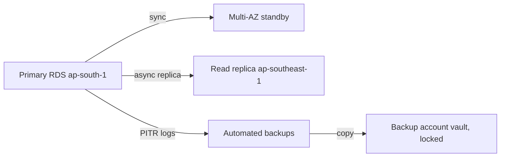
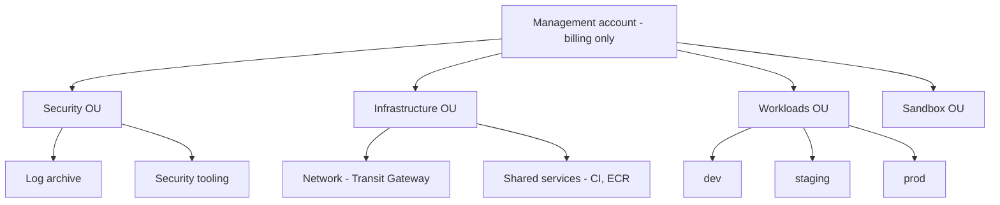
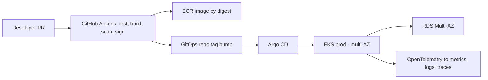

# Real-World Interview — Production Scenarios

<!-- DEVOPS-SHACK:HEADER -->
<p align="center">
  <a href="https://www.youtube.com/@devopsshack"></a>
  <a href="https://www.youtube.com/@shackverse"></a>
  <a href="https://devopsshack.com"></a>
  <a href="https://www.instagram.com/devopsshack"></a>
  <a href="https://github.com/jaiswaladi246/DevOps-Cloud-Interview-Preparation-by-DevOps-Shack"></a>
</p>
<p align="center"><sub>Part of <b><a href="https://github.com/jaiswaladi246/DevOps-Cloud-Interview-Preparation-by-DevOps-Shack">DevOps &amp; Cloud Interview Preparation</a></b> — created by <b><a href="https://www.youtube.com/@devopsshack">DevOps Shack</a></b>. Free to learn from; please credit DevOps Shack when sharing.</sub></p>
<!-- /DEVOPS-SHACK:HEADER -->

> Cross-tool, end-to-end DevOps situations interviewers actually ask: deploys gone wrong, migrations, cost spikes, leaked secrets, database rollbacks and pipelines at scale · 200 questions · 🟢 Beginner 🟡 Intermediate 🔴 Advanced

[⬅ Back to Real-World Interview](./README.md) · [🏠 Home](../README.md)

## Table of contents
- [Deployments and releases](#deployments-and-releases) — Q1–Q25
- [Scaling and performance](#scaling-and-performance) — Q26–Q48
- [Migrations](#migrations) — Q49–Q70
- [Cost](#cost) — Q71–Q88
- [Security incidents](#security-incidents) — Q89–Q112
- [Data and databases](#data-and-databases) — Q113–Q132
- [Multi-env and multi-account](#multi-env-and-multi-account) — Q133–Q150
- [Pipelines at scale](#pipelines-at-scale) — Q151–Q170
- [Outages and incident response](#outages-and-incident-response) — Q171–Q188
- [Team and process](#team-and-process) — Q189–Q200

> **How to answer a scenario.** Interviewers are not grading the "right" answer. They are grading your order of operations: stop the bleeding first, then gather evidence, then fix, then prevent. Say out loud what you would check and why, name the real commands, and always finish with what you would change so it never happens again.

---

## Deployments and releases

<!-- DEVOPS-SHACK:SECTION -->
> 🎥 **Learn this hands-on with DevOps Shack** → [YouTube @devopsshack](https://www.youtube.com/@devopsshack) · [Hindi @shackverse](https://www.youtube.com/@shackverse) · [Courses at devopsshack.com](https://devopsshack.com)

### Q1. A deploy went out and p99 latency doubled. Walk me through it. 🟡

<details>
<summary><b>Answer</b></summary>

**Situation read →** A latency regression that lines up with a deploy is guilty until proven innocent. Users are hurting now, so mitigation comes before root cause.

**What I'd do →**
1. Confirm the correlation: overlay the deploy marker on the p99 graph in Grafana and check whether only the new pods are slow.
```bash
kubectl rollout history deployment/checkout -n prod
kubectl get pods -n prod -l app=checkout -o wide --sort-by=.metadata.creationTimestamp
```
2. If it lines up, roll back first and debug second.
```bash
kubectl rollout undo deployment/checkout -n prod
kubectl rollout status deployment/checkout -n prod
```
3. With users safe, diff the two releases: `git log v1.41..v1.42 --oneline`, the image, the Helm values, and resource requests or limits (a lowered CPU limit causes throttling that shows up as p99 latency).
4. Look at traces for the slow span (new DB query, new downstream call, missing cache) and check `container_cpu_cfs_throttled_periods_total` for throttling.
5. Reproduce in staging with a load test, fix, and redeploy behind a canary.

**Why →** Rollback is cheap and reversible. Debugging live while p99 is doubled burns error budget for no gain.

**Interview tip →** Say "roll back first, root-cause second" in the first 30 seconds; that is what they are listening for.

</details>

### Q2. You deployed a new version and half the pods are in CrashLoopBackOff. What do you do? 🟢

<details>
<summary><b>Answer</b></summary>

**Situation read →** A rolling update with a sane `maxUnavailable` keeps old pods serving, so this is usually a stalled rollout, not a full outage. Check that first.

**What I'd do →**
1. Check whether traffic is still served by old pods, and pause the rollout so it stops replacing healthy ones.
```bash
kubectl rollout status deployment/api -n prod
kubectl rollout pause deployment/api -n prod
```
2. Read why the new pods die.
```bash
kubectl logs deploy/api -n prod --previous
kubectl describe pod <new-pod> -n prod | sed -n '/Last State/,/Events/p'
```
3. Typical culprits: missing env var or secret, failed DB connection, wrong command, `OOMKilled` (exit 137), or a liveness probe that fires before the app is ready.
4. If the fix isn't obvious in five minutes: `kubectl rollout undo deployment/api -n prod`.
5. Fix in Git, push through the pipeline, never hot-edit the live Deployment.

**Why →** Pausing preserves the remaining healthy capacity; `--previous` shows the logs of the crashed container, not the new attempt.

**Interview tip →** Mention exit codes: 1 is an app error, 137 is OOMKilled or SIGKILL, 143 is SIGTERM.

</details>

### Q3. A release passed every test in staging but broke in production. How do you investigate? 🟡

<details>
<summary><b>Answer</b></summary>

**Situation read →** "Worked in staging" means staging differs from prod somewhere. The job is to find the difference fast, after mitigating.

**What I'd do →**
1. Roll back or toggle off the feature flag to stop the impact.
2. Diff the environments systematically:
```bash
helm get values api -n staging > stg.yaml
helm get values api -n prod > prd.yaml
diff stg.yaml prd.yaml
kubectl get cm,secret -n prod -l app=api -o yaml | grep -v resourceVersion
```
3. Check the usual suspects: data volume (a query fine on 10k rows dies on 50M), real traffic patterns, config and feature flags, IAM permissions only granted in staging, network policies, and third-party endpoints pointing at sandboxes.
4. Pull prod logs and traces for the failing requests and compare with staging.
5. Add the missing coverage: a prod-like dataset in staging, or a canary step in prod.

**Why →** Most "prod-only" bugs are config, data scale or permissions, not code.

**Interview tip →** Admit staging will never equal prod, which is why canaries and feature flags exist.

</details>

### Q4. How would you design a zero-downtime deployment for a stateless API on Kubernetes? 🟢

<details>
<summary><b>Answer</b></summary>

**Situation read →** Zero downtime needs four things together: a rolling strategy that never drops capacity, accurate readiness, graceful shutdown, and enough replicas.

**What I'd do →**
1. Rolling update that adds before removing:
```yaml
strategy:
  type: RollingUpdate
  rollingUpdate:
    maxSurge: 25%
    maxUnavailable: 0
```
2. A readiness probe that checks the app can actually serve (DB pool ready), separate from liveness.
3. Graceful shutdown: the app handles SIGTERM, plus a short `preStop` sleep so the endpoint is removed from the load balancer before the process stops.
```yaml
lifecycle:
  preStop:
    exec:
      command: ["sleep", "10"]
terminationGracePeriodSeconds: 40
```
4. A PodDisruptionBudget and at least 3 replicas spread across zones.
5. Backward-compatible API and DB changes so old and new versions can run side by side.

**Why →** Without the `preStop` delay, kube-proxy and the ALB can still send requests to a pod that has already received SIGTERM, giving a burst of 502s on every deploy.

**Interview tip →** Mention the 502 burst on deploys; it shows you have actually seen this in production.

</details>

### Q5. Every deploy causes a short spike of 502 errors from the ALB. Why, and how do you fix it? 🟡

<details>
<summary><b>Answer</b></summary>

**Situation read →** Classic race between pod termination and target deregistration. The pod stops accepting connections while the ALB still routes to it.

**What I'd do →**
1. Confirm: 502s align with pod terminations, and the ALB access logs show `target_status_code` of `-` (connection closed).
2. Add a `preStop` sleep longer than the deregistration propagation, and make sure `terminationGracePeriodSeconds` exceeds it.
3. Tune the target group deregistration delay to match, via the AWS Load Balancer Controller annotation:
```yaml
alb.ingress.kubernetes.io/target-group-attributes: deregistration_delay.timeout_seconds=30
```
4. With IP-mode targets, enable pod readiness gates so new pods only count as ready once the ALB marks them healthy:
```bash
kubectl label namespace prod elbv2.k8s.aws/pod-readiness-gate-inject=enabled
```
5. Check the app's keep-alive timeout is longer than the ALB idle timeout (60s default), otherwise the app closes idle connections the ALB still reuses.

**Why →** Each fix closes one window: preStop for shutdown, readiness gates for startup, keep-alive for idle connections.

**Interview tip →** The keep-alive mismatch is the detail that separates people who have debugged this from people who have read about it.

</details>

### Q6. How would you set up a canary release, and what decides whether it gets promoted? 🟡

<details>
<summary><b>Answer</b></summary>

**Situation read →** A canary is only as good as its promotion criteria. Shifting 5% of traffic without automated analysis is just a slow rollout.

**What I'd do →**
1. Use Argo Rollouts (or Flagger) with weighted steps:
```yaml
strategy:
  canary:
    steps:
      - setWeight: 5
      - pause: {duration: 10m}
      - analysis: {templates: [{templateName: success-rate}]}
      - setWeight: 25
      - pause: {duration: 10m}
      - setWeight: 100
```
2. Define an AnalysisTemplate querying Prometheus: error rate of the canary below 1%, p99 below the stable version plus 10%.
3. Compare canary against stable, not against a fixed number, so normal daily traffic changes don't cause false failures.
4. Auto-abort on failure; Argo shifts traffic back to stable.
5. Watch business metrics too (checkout completions), not only HTTP codes.

**Why →** Automated analysis removes the human staring at dashboards and makes rollback instant.

**Interview tip →** Say what metric would block promotion; "we watched it" is not an answer.

</details>

### Q7. Blue-green or canary? How do you choose for a specific service? 🟢

<details>
<summary><b>Answer</b></summary>

**Situation read →** Both reduce risk; they trade cost and speed of switch against how gradually you get exposure.

**What I'd do →**
1. Blue-green when: you need an instant, all-or-nothing switch and instant rollback, you can afford double capacity briefly, or the release must be verified as a whole (smoke tests on green before the switch).
2. Canary when: traffic is high enough to get a statistically useful signal from 1–5%, and you want to limit blast radius gradually.
3. Neither works cleanly with a non-backward-compatible DB change, since both versions run at the same time; fix that with expand-and-contract.
4. For low-traffic internal services, a rolling update plus good probes is usually enough.

**Why →** A canary at 5% of 10 requests per minute tells you nothing; blue-green is simpler there.

**Interview tip →** Mention traffic volume as the deciding factor for canaries.

</details>

### Q8. A developer wants to deploy to production on Friday at 5 PM. How do you handle it? 🟢

<details>
<summary><b>Answer</b></summary>

**Situation read →** The issue isn't Friday, it's risk and recovery capacity. If deploys are small, automated and reversible, the day matters less.

**What I'd do →**
1. Ask what's in it, how big the diff is, and whether it can be rolled back in one command.
2. Check whether someone who understands the change will be around to watch metrics for the next hour, and who is on call.
3. If it's a small change behind a feature flag with automated rollback: it can go.
4. If it includes a DB migration, an infra change, or a new dependency: wait until Monday morning.
5. Long term, fix the reason Friday feels scary: smaller releases, canaries, auto-rollback.

**Why →** A blanket freeze hides weak deploy safety instead of fixing it.

**Interview tip →** Show judgment rather than a rule: "it depends on blast radius and rollback time".

</details>

### Q9. A rollback doesn't fix the problem. What now? 🔴

<details>
<summary><b>Answer</b></summary>

**Situation read →** If the old version is also broken, the cause isn't only in the code you just shipped. Something changed underneath: data, config, schema, dependency or infrastructure.

**What I'd do →**
1. Verify the rollback really happened: the running image digest matches the old release.
```bash
kubectl get pods -n prod -l app=api -o jsonpath='{.items[*].status.containerStatuses[*].imageID}'
```
2. List everything that changed in the window, not only app deploys: Terraform applies, ConfigMap or secret edits, DB migrations, node AMI updates, cert renewals, upstream provider status pages, CloudTrail events.
```bash
aws cloudtrail lookup-events --start-time 2026-11-09T09:00:00Z --max-results 50
```
3. Check one-way changes: a DB migration that ran forward, a cache filled with data in a new format, messages in a queue the old version can't parse.
4. Check dependencies: DNS, a third-party API, an expired certificate.
5. Escalate and declare an incident if it isn't converging; bring in the DB owner and the developer.

**Why →** Rollback only reverses the artifact. State changes are not reversed by redeploying old code.

**Interview tip →** Saying "rollbacks don't undo state" shows senior thinking.

</details>

### Q10. How do you make sure a deploy is safe to roll back? 🟡

<details>
<summary><b>Answer</b></summary>

**Situation read →** Rollback safety is designed in before release, not discovered during an incident.

**What I'd do →**
1. Immutable, versioned artifacts: images tagged with the Git SHA and referenced by digest, so "previous version" is exact.
2. Config versioned alongside code (Helm values in Git, GitOps), so rolling back the app also rolls back its config.
3. DB changes follow expand-and-contract: the new schema works with the old code, so rolling back code is always safe.
4. Feature flags for risky behaviour, so "rollback" can be a toggle.
5. Test the rollback path: run `helm rollback` or the Argo revert in staging as part of release.
```bash
helm history api -n staging
helm rollback api 41 -n staging --wait
```
6. Message and cache format changes must be readable by both versions.

**Why →** A rollback that has never been tested is a hope, not a plan.

**Interview tip →** Name expand-and-contract explicitly.

</details>

### Q11. A Helm upgrade failed halfway and now `helm upgrade` says "another operation is in progress". What do you do? 🟡

<details>
<summary><b>Answer</b></summary>

**Situation read →** The release is stuck in `pending-upgrade`, usually because the CI job was killed or timed out mid-upgrade.

**What I'd do →**
1. Check the release state:
```bash
helm history api -n prod --max 5
helm status api -n prod
```
2. Confirm nothing is actually still running (no other pipeline job holding it).
3. Roll back to the last `deployed` revision, which clears the pending state:
```bash
helm rollback api <last-good-revision> -n prod --wait
```
4. Then rerun the upgrade with `--atomic --timeout 10m` so future failures roll back automatically rather than leaving a stuck release.
5. Add pipeline concurrency control so two deploys to the same release can never overlap.

**Why →** Deleting the Helm release secret by hand works but is a last resort; rollback is the supported path.

**Interview tip →** Mention `--atomic`; it prevents this exact situation.

</details>

### Q12. Argo CD shows the application as "OutOfSync" right after a successful deploy and keeps re-syncing. Why? 🟡

<details>
<summary><b>Answer</b></summary>

**Situation read →** Something in the cluster keeps mutating a field that Git defines differently, so Argo sees permanent drift.

**What I'd do →**
1. Look at the diff:
```bash
argocd app diff checkout
```
2. Common causes: an HPA changing `spec.replicas` while Git sets `replicas: 3`; a mutating webhook injecting sidecars or labels; a controller adding defaults; a CRD whose fields normalise differently.
3. Fix the source: remove `replicas` from the manifest when an HPA owns it.
4. For legitimate external mutations, tell Argo to ignore them:
```yaml
spec:
  ignoreDifferences:
    - group: apps
      kind: Deployment
      jsonPointers:
        - /spec/replicas
```
5. Check that nobody is `kubectl edit`-ing live resources; self-heal will fight them.

**Why →** A sync loop hides real drift in noise and can reset scaling during traffic peaks.

**Interview tip →** The HPA-versus-replicas conflict is the most common answer; lead with it.

</details>

### Q13. A feature flag change took down production even though no code was deployed. How do you handle it and prevent it? 🟡

<details>
<summary><b>Answer</b></summary>

**Situation read →** A flag flip is a production change. If it bypasses review, monitoring and rollout steps, it's an unreviewed deploy.

**What I'd do →**
1. Revert the flag immediately; that's the fastest rollback you'll ever have.
2. Check the flag service audit log for who changed what and when.
3. Find why the code path was broken: never tested with the flag on, or tested only on a small cohort.
4. Prevent: require approval for prod flag changes, roll flags out by percentage (1% → 10% → 50%), and send flag changes to the same channel and Grafana annotations as deploys.
5. Clean up stale flags; old flags are untested code paths waiting to bite.

**Why →** Most "nothing changed" incidents are config or flag changes that weren't tracked as changes.

**Interview tip →** Say "every change is a deploy, including config and flags".

</details>

### Q14. How do you deploy a change that needs both a new API version and a new frontend at the same time? 🔴

<details>
<summary><b>Answer</b></summary>

**Situation read →** You almost never can deploy two components atomically. Design so the order doesn't matter.

**What I'd do →**
1. Make the backend backward compatible: add the new field or endpoint while keeping the old one. Deploy backend first.
2. Deploy the frontend that uses the new API. Old cached frontends in browsers still work against the old contract.
3. Gate the new user-facing behaviour behind a flag so it turns on when both sides are live.
4. After traffic to the old endpoint drops to zero (check access logs or metrics), remove it in a later release.
5. For mobile clients, keep old API versions alive much longer, since users don't update.

**Why →** Browsers, CDNs and mobile apps cache old clients for days. "Deploy both together" is a myth.

**Interview tip →** Mention CDN-cached JavaScript; it is why the frontend can't assume a fresh backend contract.

</details>

### Q15. A new release works but CPU usage per pod jumped 3x. What's your approach? 🟡

<details>
<summary><b>Answer</b></summary>

**Situation read →** Not an outage yet, but it will become a cost and capacity problem, and an HPA will scale out and hide it.

**What I'd do →**
1. Confirm it's the release: compare CPU per request (not total CPU) before and after.
```promql
sum(rate(container_cpu_usage_seconds_total{namespace="prod",container="api"}[5m]))
/ sum(rate(http_requests_total{namespace="prod",service="api"}[5m]))
```
2. Check whether the HPA scaled out and the node autoscaler added nodes; cost is already climbing.
3. Profile a pod: language profilers (pprof, py-spy, async-profiler) or a continuous profiler like Pyroscope.
4. Common causes: logging at debug level, a regex in a hot path, serialization changes, a dependency bump, a tight retry loop.
5. Decide with the team: roll back now, or accept for a day while a fix ships.

**Why →** Normalising by request rate separates "more traffic" from "less efficient code".

**Interview tip →** Note that autoscaling can mask a regression as a bill increase.

</details>

### Q16. How do you deploy the same app to 50 customer-dedicated environments safely? 🔴

<details>
<summary><b>Answer</b></summary>

**Situation read →** Fifty environments means fifty blast radii. Treat them as waves, not one deploy.

**What I'd do →**
1. Group tenants into rings: internal/demo tenants, then a small set of low-risk customers, then the rest, with large or regulated customers last.
2. Use GitOps with an Argo CD ApplicationSet that generates an app per tenant, and promote by updating the version in each ring's values file.
3. Gate each wave on health: error rates and synthetic checks for the previous ring must stay green for a soak period.
4. Automate halting: if any tenant in a wave fails, stop the rollout and alert.
5. Keep tenant-specific config in data (values files), not in code branches, so all tenants run the same artifact.

**Why →** Rings limit damage to a few tenants and give you a real-world canary before hitting big customers.

**Interview tip →** Use the word "rings" or "waves" and mention ApplicationSet.

</details>

### Q17. Your deployment pipeline is green but users report the old version is still live. What happened? 🟢

<details>
<summary><b>Answer</b></summary>

**Situation read →** The pipeline reported success but the running thing didn't change. Usually caching or tagging.

**What I'd do →**
1. Check what's actually running:
```bash
kubectl get deploy web -n prod -o jsonpath='{.spec.template.spec.containers[0].image}'
```
2. If the image tag is `latest` or reused, Kubernetes saw no spec change and didn't roll pods; or nodes used a cached image with `imagePullPolicy: IfNotPresent`.
3. For frontends, check the CDN: CloudFront still serving the old `index.html`. Invalidate it:
```bash
aws cloudfront create-invalidation --distribution-id E123ABC --paths "/index.html"
```
4. Check browser caching headers: `index.html` should be `no-cache`; hashed assets can be cached forever.
5. Fix the root cause: unique immutable tags (Git SHA), and a post-deploy check that queries `/version`.

**Why →** A deploy isn't done until you verify the running version, not the pipeline status.

**Interview tip →** "Never deploy `latest` to production" is an easy point to score.

</details>

### Q18. A deploy needs a config change in three places: Terraform, a Kubernetes ConfigMap and AWS SSM. How do you sequence it? 🟡

<details>
<summary><b>Answer</b></summary>

**Situation read →** Multi-system changes fail in the gaps between systems. Order them so every intermediate state works.

**What I'd do →**
1. Infrastructure first: `terraform plan` and `apply` for the new resource (a new queue or bucket) that the app will need. Existing code ignores it.
2. Add the new parameter to SSM and the ConfigMap with defaults that keep current behaviour.
```bash
aws ssm put-parameter --name /prod/api/queue_url --type String --value "https://sqs..." --overwrite
```
3. Deploy the app version that reads the new config.
4. Flip the behaviour (flag or config value) once everything is in place.
5. Clean up old config in a later change.
6. Ideally collapse this into one pipeline: Terraform outputs feed Helm values, so nobody does it by hand.

**Why →** Each step is independently safe and reversible; no window where the app expects something that doesn't exist.

**Interview tip →** Say "additive first, switch later, clean up last".

</details>

### Q19. Kubernetes pods restart every few hours after a new release, with exit code 137. What's going on? 🟢

<details>
<summary><b>Answer</b></summary>

**Situation read →** Exit 137 is SIGKILL, almost always OOMKilled. Restarts every few hours point to a memory leak or a too-low limit after the release.

**What I'd do →**
1. Confirm:
```bash
kubectl describe pod api-xyz -n prod | grep -A3 "Last State"
# Reason: OOMKilled
```
2. Plot `container_memory_working_set_bytes` for the pod: a steady climb is a leak; a sudden spike is a big request or batch.
3. Compare with the previous release; if the memory profile changed, it's a regression.
4. Short term: raise the limit or roll back. For JVMs check `-XX:MaxRAMPercentage`, since the heap may not respect container limits as configured.
5. Long term: heap profiles, then fix the leak.

**Why →** Raising the limit only buys time on a leak; it will still OOM, just later.

**Interview tip →** Distinguish container OOMKill (limit hit) from node-pressure eviction (status `Evicted`).

</details>

### Q20. How do you handle a hotfix when main already contains unreleased features? 🟢

<details>
<summary><b>Answer</b></summary>

**Situation read →** You need to ship one fix without shipping everything else that's on main.

**What I'd do →**
1. With trunk-based development and flags: unfinished features are off, so just merge the fix to main and deploy normally.
2. Without flags: branch from the production tag, cherry-pick the fix, build and deploy that.
```bash
git checkout -b hotfix/1.42.1 v1.42.0
git cherry-pick <fix-sha>
git tag v1.42.1 && git push origin hotfix/1.42.1 --tags
```
3. Make sure the fix also lands on main so the next release doesn't regress.
4. The hotfix still goes through CI tests and the pipeline; "hotfix" doesn't mean "skip checks".

**Why →** Cherry-picking from the release tag ships exactly one change on top of known-good code.

**Interview tip →** Mention merging the fix back to main; forgetting this causes the bug to return.

</details>

### Q21. An Ansible playbook run during a deploy failed on 3 of 20 servers. What state is the fleet in and what do you do? 🟡

<details>
<summary><b>Answer</b></summary>

**Situation read →** You have a mixed fleet: some servers on the new version, some partially changed. Mixed is dangerous if the versions are incompatible.

**What I'd do →**
1. Read the play recap and the failed tasks; Ansible writes failed hosts to a retry file if `retry_files_enabled` is on, otherwise copy them from the recap.
2. Take the 3 failed hosts out of the load balancer.
3. Fix the cause (disk full, package repo timeout, a service that didn't start) and rerun only on them:
```bash
ansible-playbook deploy.yml --limit @deploy.retry
# or
ansible-playbook deploy.yml --limit web07,web12,web15
```
4. Idempotent playbooks make the rerun safe; that's the payoff of writing them properly.
5. Next time, use `serial: 5` with `max_fail_percentage: 10` so a failure stops the rollout early instead of hitting the whole fleet.

**Why →** `serial` turns a fleet-wide deploy into batches, which is a rolling update for VMs.

**Interview tip →** Mention `serial` and `max_fail_percentage`.

</details>

### Q22. You need to ship a release that changes a message format on a Kafka topic used by four consumers. How? 🔴

<details>
<summary><b>Answer</b></summary>

**Situation read →** Producers and consumers deploy independently; a breaking message change can crash consumers or poison the topic.

**What I'd do →**
1. Use a schema registry (Avro or Protobuf) with compatibility mode set to `BACKWARD` or `FULL`, so incompatible schemas are rejected at registration.
2. Make the change additive: new optional fields with defaults. Never rename or change field types in place.
3. Upgrade consumers first so they can read both old and new formats, then upgrade the producer.
4. For a true breaking change, publish to a new topic (`orders.v2`), dual-write for a period, migrate consumers, then retire the old topic.
5. Monitor consumer lag and dead-letter queues during rollout.

**Why →** Old messages stay in the topic for the retention period; consumers must handle both formats long after the deploy.

**Interview tip →** "Consumers first, producer second" is the key ordering.

</details>

### Q23. How would you implement automatic rollback in a pipeline that deploys to ECS? 🟡

<details>
<summary><b>Answer</b></summary>

**Situation read →** ECS has built-in mechanisms; you need to turn them on and connect them to real health signals.

**What I'd do →**
1. Enable the deployment circuit breaker so failed task launches trigger automatic rollback:
```bash
aws ecs update-service --cluster prod --service api \
  --deployment-configuration "deploymentCircuitBreaker={enable=true,rollback=true},minimumHealthyPercent=100,maximumPercent=200"
```
2. Add CloudWatch alarms (5xx rate, p99 latency) to the deployment configuration as alarm-based rollback, so a healthy-but-wrong release rolls back too.
3. Or use CodeDeploy blue/green for ECS with test listeners and alarm-based rollback on traffic shift.
4. Make the pipeline wait for the service to stabilise and fail the job if not:
```bash
aws ecs wait services-stable --cluster prod --services api
```

**Why →** The circuit breaker catches tasks that won't start; alarms catch tasks that start but misbehave.

**Interview tip →** Distinguish "won't start" from "starts but is broken"; you need a mechanism for both.

</details>

### Q24. A deploy succeeded but a downstream team says your API change broke them. How do you handle it? 🟢

<details>
<summary><b>Answer</b></summary>

**Situation read →** You broke a contract. Restore service for them first, then fix the process that let it through.

**What I'd do →**
1. Roll back or restore the old behaviour (flag, versioned endpoint) to unblock them.
2. Get the exact failing request and response from their logs or yours.
3. Identify what changed: removed field, changed type, new required parameter, changed status code.
4. Reintroduce the change in a backward-compatible way, or version the API (`/v2`).
5. Prevent: contract tests (Pact) or OpenAPI diff checks in CI that fail on breaking changes.
```bash
oasdiff breaking old-openapi.yaml new-openapi.yaml --fail-on ERR
```

**Why →** Consumers shouldn't discover your breaking changes in production; CI should.

**Interview tip →** Mention contract testing or OpenAPI diffing as the prevention.

</details>

### Q25. A release needs a new IAM permission. The deploy went out but the feature fails with AccessDenied. What's the fix and the lesson? 🟢

<details>
<summary><b>Answer</b></summary>

**Situation read →** The code shipped before the permission it depends on. A sequencing problem between app and infra pipelines.

**What I'd do →**
1. Confirm from the logs: `AccessDeniedException: User: arn:aws:sts::...:assumed-role/api-irsa/... is not authorized to perform: sqs:SendMessage`.
2. Add the permission in Terraform to the pod's IRSA or Pod Identity role, review the plan, apply.
3. Pods pick up new IAM policy without restart, since credentials are fetched per call, though IAM changes can take a few seconds to propagate.
4. Lesson: infra changes ship before the app that needs them. Either keep the IAM policy in the same repo and pipeline as the service, or make the app pipeline check that the infra version is applied first.

**Why →** The permission is part of the release; treating it as separate guarantees this outage again.

**Interview tip →** Quote the error format; it shows you have read real AccessDenied messages.

</details>

---

## Scaling and performance

<!-- DEVOPS-SHACK:SECTION -->
> 🎥 **Learn this hands-on with DevOps Shack** → [YouTube @devopsshack](https://www.youtube.com/@devopsshack) · [Hindi @shackverse](https://www.youtube.com/@shackverse) · [Courses at devopsshack.com](https://devopsshack.com)

### Q26. Traffic is expected to 10x for a sale next week. How do you prepare the platform? 🟡

<details>
<summary><b>Answer</b></summary>

**Situation read →** You know it's coming, so this is capacity planning plus load testing, not firefighting.

**What I'd do →**
1. Get a number: expected peak RPS, and which flows (browse, checkout) carry it.
2. Load test the whole path at 1.5x the expected peak with k6 or Locust against a prod-like environment. Find the first bottleneck; it's usually the database, not the pods.
3. Pre-scale: raise HPA `minReplicas`, raise node group minimums or Karpenter limits, and pre-warm anything that scales slowly (ALBs can be pre-warmed via AWS support, RDS read replicas take time to create).
4. Check quotas: EC2 vCPU limits, Lambda concurrency, IP addresses in subnets, NAT gateway throughput.
5. Freeze risky changes, prepare runbooks for degradation (disable recommendations, queue orders), and put the right people on call.

**Why →** Autoscaling reacts in minutes; a flash sale spikes in seconds. Pre-scaling covers the gap.

**Interview tip →** Mention service quotas and subnet IP exhaustion; most candidates forget them.

</details>

### Q27. The HPA is configured but pods don't scale even though the app is slow. Why? 🟢

<details>
<summary><b>Answer</b></summary>

**Situation read →** Either the HPA can't read metrics, or the metric it scales on isn't the one that's saturated.

**What I'd do →**
1. Check the HPA status:
```bash
kubectl get hpa api -n prod
kubectl describe hpa api -n prod
```
2. If targets show `<unknown>`: metrics-server isn't running or pods have no CPU requests set (CPU utilisation is a percentage of requests).
3. If CPU is low but the app is slow: the bottleneck is elsewhere (DB, I/O, thread pool, downstream calls). Scaling on CPU won't help; scale on RPS or queue depth with KEDA or a custom metric, or fix the bottleneck.
4. If it's at `maxReplicas`: raise it, and check pending pods for cluster capacity.
5. Check `behavior` settings; a long stabilisation window delays scale-up.

**Why →** HPA only scales on what you tell it. CPU-based scaling for an I/O-bound service never triggers.

**Interview tip →** "No requests set means no CPU-based HPA" is the quick win.

</details>

### Q28. Pods are Pending during a traffic spike because the cluster is out of capacity. What do you do now and long term? 🟡

<details>
<summary><b>Answer</b></summary>

**Situation read →** The HPA did its job; the node layer didn't keep up.

**What I'd do →**
1. See why:
```bash
kubectl get pods -n prod --field-selector=status.phase=Pending
kubectl describe pod <pending> -n prod | tail -5
# 0/12 nodes are available: 12 Insufficient cpu.
```
2. Check the node autoscaler logs (Karpenter or Cluster Autoscaler): hitting its limits, ASG max size, EC2 vCPU quota, `InsufficientInstanceCapacity` for one instance type, or no free IPs in the subnet.
3. Immediate: raise the limit, or allow more instance types in the Karpenter NodePool.
4. Long term: keep headroom with low-priority placeholder pods (overprovisioning) that get preempted when real pods need space, and diversify instance types.
5. Right-size requests; inflated requests waste capacity and trigger this sooner.

**Why →** New nodes take 1–3 minutes; overprovisioning makes scale-up feel instant.

**Interview tip →** Mention placeholder pods with a negative PriorityClass for headroom.

</details>

### Q29. The database CPU is at 95% and the API is timing out. What's your approach? 🟡

<details>
<summary><b>Answer</b></summary>

**Situation read →** The DB is the shared bottleneck; scaling app pods will make it worse by adding connections and queries.

**What I'd do →**
1. Find the expensive queries: RDS Performance Insights top SQL, or in Postgres:
```sql
SELECT query, calls, mean_exec_time, total_exec_time
FROM pg_stat_statements ORDER BY total_exec_time DESC LIMIT 10;
```
2. Check for a recent deploy that added a query or dropped an index.
3. Quick wins: kill runaway queries (`pg_terminate_backend`), add a missing index (`CREATE INDEX CONCURRENTLY`), cap the app's HPA so it stops piling on connections.
4. Shed load: disable non-critical features, move reads to a replica, add caching for hot reads.
5. Short-term scale-up of the instance class if needed (Multi-AZ makes this a brief failover).

**Why →** In most DB CPU incidents one or two queries cause most of the load; fix those before buying hardware.

**Interview tip →** Say "scaling app pods can make a DB problem worse".

</details>

### Q30. "Too many connections" errors from Postgres after scaling the app out. How do you fix it? 🟡

<details>
<summary><b>Answer</b></summary>

**Situation read →** Each pod opens its own pool. 50 pods × 20 connections = 1,000, beyond `max_connections`.

**What I'd do →**
1. Confirm the math:
```sql
SELECT count(*), state FROM pg_stat_activity GROUP BY state;
SHOW max_connections;
```
2. Immediately: reduce the per-pod pool size, or cap HPA `maxReplicas`.
3. Proper fix: put a pooler in front, RDS Proxy on AWS or PgBouncer in transaction mode, so thousands of client connections share a small number of server connections.
4. Kill idle-in-transaction sessions and set `idle_in_transaction_session_timeout`.
5. Add an alert on connections at 80% of max.

**Why →** Postgres connections are processes with real memory cost; raising `max_connections` endlessly hurts the DB.

**Interview tip →** Do the multiplication out loud; it shows you understand the root cause.

</details>

### Q31. Latency is fine on average but p99 is terrible. Where do you look? 🔴

<details>
<summary><b>Answer</b></summary>

**Situation read →** Averages hide tails. A bad p99 means a minority of requests hit something slow: a specific path, a noisy pod, GC, throttling, or a cold cache.

**What I'd do →**
1. Break p99 down by route, pod and node:
```promql
histogram_quantile(0.99, sum by (le, pod) (rate(http_request_duration_seconds_bucket{service="api"}[5m])))
```
2. If one pod or node is the outlier: noisy neighbour, a node with high steal time, or a pod on a bad AZ path. Cordon and drain to test.
3. If spread evenly: check CPU throttling (`container_cpu_cfs_throttled_periods_total`), GC pauses, connection pool waits, and retries to slow dependencies.
4. Pull the slowest traces in Tempo or Jaeger and see which span dominates.
5. Check fan-out: a request that calls 10 services is as slow as the slowest one, so tail latency compounds.

**Why →** CPU limits cause throttling within 100ms CFS periods, which shows up almost entirely in the tail.

**Interview tip →** Mention CFS throttling; many teams remove CPU limits (keeping requests) for latency-sensitive services because of it.

</details>

### Q32. One pod in a deployment is much slower than the others. How do you investigate? 🟢

<details>
<summary><b>Answer</b></summary>

**Situation read →** Same image, same config, different behaviour: the difference is the node, the data it's handling, or its own internal state.

**What I'd do →**
1. Find where it runs and compare with healthy pods:
```bash
kubectl get pod api-7f9 -n prod -o wide
kubectl top pod -n prod -l app=api
kubectl top node <node>
```
2. Check the node: CPU steal, disk pressure, other heavy pods, network errors.
3. Check the pod: memory near limit (GC thrash), restarts, stuck threads, a hot key or sticky session sending it more traffic.
4. Delete the pod to see if a fresh one on another node is fine; if yes, cordon the node and investigate it.
5. If it recurs randomly, add anti-affinity or topology spread so pods don't stack on a single node.

**Why →** Isolating pod versus node narrows the search fast.

**Interview tip →** Say you'd capture evidence (logs, a thread dump) before deleting the pod.

</details>

### Q33. An SQS queue backlog is growing and messages are hours old. What do you do? 🟡

<details>
<summary><b>Answer</b></summary>

**Situation read →** Consumers are slower than producers. Either consumers are failing, too few, or something they depend on is slow.

**What I'd do →**
1. Check queue metrics: `ApproximateNumberOfMessagesVisible`, `ApproximateAgeOfOldestMessage`, and whether messages go to the DLQ.
2. Check consumers: are they running, erroring, or stuck on poison messages that keep returning after the visibility timeout?
3. Scale consumers on queue depth with KEDA:
```yaml
triggers:
  - type: aws-sqs-queue
    metadata:
      queueURL: https://sqs.ap-south-1.amazonaws.com/123456789012/orders
      queueLength: "100"
      awsRegion: ap-south-1
```
4. Make sure the downstream (DB, API) can take the extra throughput; scaling consumers can overload it.
5. Set a `maxReceiveCount` redrive policy so poison messages go to a DLQ instead of blocking.

**Why →** Scaling on queue depth matches capacity to work; scaling on CPU doesn't.

**Interview tip →** Mention poison messages and visibility timeout; they cause backlogs with no capacity issue at all.

</details>

### Q34. How do you find the actual bottleneck in a slow multi-service request? 🟡

<details>
<summary><b>Answer</b></summary>

**Situation read →** Guessing per service wastes hours. Distributed tracing shows the critical path directly.

**What I'd do →**
1. Pick a slow trace by trace ID from logs, or filter traces by duration in Tempo or Jaeger.
2. Read the waterfall: which span is longest, and are calls sequential when they could be parallel?
3. Look for N+1 patterns: 200 tiny DB spans in one request.
4. Correlate the slow span with that service's metrics (CPU, pool waits) and logs, using the trace ID.
5. If tracing doesn't exist, add OpenTelemetry auto-instrumentation; it's the fastest path to visibility in most languages.

**Why →** In a call chain, total latency is the critical path. Tracing shows it; per-service dashboards don't.

**Interview tip →** Name the N+1 query pattern; it's one of the most common causes.

</details>

### Q35. Your Redis cache went down and the database fell over right after. Explain and fix. 🔴

<details>
<summary><b>Answer</b></summary>

**Situation read →** Cache stampede. The DB was sized for cache-miss traffic only; losing the cache sent 100% of reads to it.

**What I'd do →**
1. Restore the cache (failover to the ElastiCache replica, or restart).
2. Protect the DB while the cache warms: rate-limit at the edge, shed non-critical traffic, temporarily cap app replicas.
3. Prevent stampedes: request coalescing (one request repopulates a key while others wait), jittered TTLs so keys don't expire together, and stale-while-revalidate.
4. Make the cache HA: ElastiCache with Multi-AZ and automatic failover.
5. Load test the "cache empty" scenario so you know the DB's real limit.

**Why →** Once the cache carries most reads, it is part of your capacity. Its failure mode must be designed, not discovered.

**Interview tip →** Say "the cache is part of capacity planning" and mention jittered TTLs.

</details>

### Q36. A Java service on Kubernetes is slow for the first minute after every deploy. Why, and what helps? 🟡

<details>
<summary><b>Answer</b></summary>

**Situation read →** JVM warm-up: class loading, JIT compilation and empty caches. New pods get full traffic as soon as they pass readiness.

**What I'd do →**
1. Use a `startupProbe` so slow startup isn't killed by liveness, and make readiness reflect real readiness.
2. Warm up before ready: hit key endpoints internally on startup, or pre-load caches, then report ready.
3. Give CPU headroom at startup; low CPU limits make JIT painfully slow. Consider no CPU limit, or startup CPU boost tooling.
4. Ramp traffic gradually: ALB slow start on target groups.
```yaml
alb.ingress.kubernetes.io/target-group-attributes: slow_start.duration_seconds=60
```
5. Longer term, consider CDS/AppCDS or GraalVM native image for faster startup.

**Why →** Readiness answers "can it serve?" not "can it serve fast?". Slow start bridges the gap.

**Interview tip →** ALB slow start is a concrete, lesser-known setting worth naming.

</details>

### Q37. Disk on a Linux app server keeps filling up overnight. How do you find and fix it? 🟢

<details>
<summary><b>Answer</b></summary>

**Situation read →** Something writes faster than it's cleaned up: logs, temp files, core dumps, or deleted files still held open.

**What I'd do →**
1. Find what's big:
```bash
df -h
sudo du -xh / --max-depth=2 2>/dev/null | sort -rh | head -20
```
2. If `df` shows full but `du` doesn't add up, a deleted file is still open:
```bash
sudo lsof +L1
```
Restart the process holding it, or truncate via `/proc/<pid>/fd/<n>`.
3. Check usual suspects: `/var/log`, the journal (`journalctl --disk-usage`), Docker images and volumes (`docker system df`).
4. Fix: logrotate with `compress` and `maxsize`, `SystemMaxUse=` in journald, `docker system prune` on a schedule, and ship logs off the box.
5. Alert at 80% disk with a predictive rule (`predict_linear` on `node_filesystem_avail_bytes`).

**Why →** `lsof +L1` catches the case where deleting the log didn't free space.

**Interview tip →** The deleted-but-open file is a favourite follow-up; mention it before they ask.

</details>

### Q38. API Gateway plus Lambda is throwing 429 and 502 errors under load. What's happening? 🟡

<details>
<summary><b>Answer</b></summary>

**Situation read →** 429s are throttling (API Gateway or Lambda concurrency); 502s are usually Lambda errors or timeouts surfacing through the gateway.

**What I'd do →**
1. Check Lambda `Throttles`, `ConcurrentExecutions`, `Errors` and `Duration` in CloudWatch.
2. If concurrency is maxed: the account limit (1,000 default per region) is shared by all functions. Request an increase, and set reserved concurrency so one function can't starve others.
3. Check API Gateway stage and usage-plan throttling limits.
4. For 502s: look for timeouts and malformed responses in Lambda logs (a proxy integration must return `statusCode` and `body`).
5. Reduce duration: cold starts (provisioned concurrency), slow downstream calls, and DB connection storms (use RDS Proxy).

**Why →** Lambda concurrency is roughly RPS × duration; halving duration halves the concurrency you need.

**Interview tip →** Quote the formula concurrency = requests per second × average duration.

</details>

### Q39. Nodes in the cluster show high CPU but pods report low usage. How do you explain it? 🔴

<details>
<summary><b>Answer</b></summary>

**Situation read →** Something outside your app containers is consuming CPU: system daemons, sidecars, the kubelet, or the hypervisor.

**What I'd do →**
1. On the node, see what is actually busy:
```bash
top -o %CPU
# check %st (steal) and %sy (system)
```
2. High steal (`%st`): noisy neighbours on burstable instances or exhausted T-series CPU credits. Move to non-burstable types.
3. High system time: heavy networking (lots of iptables rules with kube-proxy in iptables mode), conntrack churn, or disk I/O.
4. Daemonsets and sidecars: log shippers, security agents and service-mesh proxies can be significant. Check `kubectl top pod -A --containers` on that node.
5. Reserve resources for system components with kubelet `systemReserved` and `kubeReserved` so pods can't starve them.

**Why →** Kubernetes only accounts for containers; node-level overhead must be measured separately.

**Interview tip →** T3 CPU credits are a real cause of "random" slowness; mention them.

</details>

### Q40. How would you load test a service before launch, and what do you report? 🟢

<details>
<summary><b>Answer</b></summary>

**Situation read →** A load test answers: at what throughput do we break, and what breaks first?

**What I'd do →**
1. Define realistic scenarios from production traffic (the mix of endpoints, think time, payload sizes), not a single endpoint hammered.
2. Run against a prod-like environment with prod-like data size, using k6:
```bash
k6 run --vus 200 --duration 15m checkout.js
```
3. Ramp in stages and watch p95/p99, error rate, and saturation of each tier (pods, DB, cache, queue).
4. Find the knee: the point where latency rises sharply. That is real capacity, not the point where errors start.
5. Report: max sustainable RPS at the SLO, first bottleneck, cost per tier, and recommended pre-scale settings.

**Why →** Teams that test one endpoint at full speed get numbers that never match real traffic.

**Interview tip →** "Find the knee, not the crash" sounds senior and is correct.

</details>

### Q41. After enabling a service mesh, latency went up by 15ms per hop. Is that acceptable and what can you do? 🔴

<details>
<summary><b>Answer</b></summary>

**Situation read →** Sidecar proxies add two extra hops per call. A few ms is expected; 15ms per hop suggests misconfiguration or starved proxies.

**What I'd do →**
1. Measure precisely: compare proxy-reported upstream time with app time to isolate proxy overhead.
2. Check sidecar resources: CPU-throttled Envoy proxies add latency. Give them proper requests.
3. Check mTLS handshakes on every request (connection reuse disabled) and access logging at high volume.
4. Reduce config size with `Sidecar` resources in Istio so each proxy only knows about the services it calls.
5. Consider ambient mode (ztunnel) or Cilium's sidecar-less approach if per-hop overhead matters for deep call chains.

**Why →** Overhead multiplies with call depth; 15ms × 6 hops is 90ms on a user request.

**Interview tip →** Ask "what do we need the mesh for?" A mesh adopted only for mTLS might be replaceable by something cheaper.

</details>

### Q42. A batch job that used to take 1 hour now takes 6. Nothing in its code changed. What do you check? 🟡

<details>
<summary><b>Answer</b></summary>

**Situation read →** If the code didn't change, the input, the environment or the dependencies did.

**What I'd do →**
1. Data volume: did the input grow (table size, files to process)?
2. Database: table bloat, missing vacuum or stale statistics, an index dropped, lock contention with a new daytime workload.
3. Infrastructure: instance type changed, Spot node interruptions restarting it, EBS volume out of gp2 burst credits, or a lower CPU limit.
4. Network: now crossing AZs or going through a NAT gateway instead of a VPC endpoint to S3.
5. Instrument the job's phases to see which one grew, then fix that phase.
```bash
kubectl get job nightly-etl -n batch -o yaml | grep -A5 resources
```

**Why →** gp2 burst credits and table bloat both cause gradual, "nothing changed" slowdowns.

**Interview tip →** Asking "what else changed?" methodically is the skill being tested.

</details>

### Q43. Pods get throttled even though average CPU usage is far below the limit. Why? 🔴

<details>
<summary><b>Answer</b></summary>

**Situation read →** CPU limits are enforced per 100ms CFS period. A multi-threaded app can burn its whole quota in the first 20ms and then wait 80ms, while the 1-minute average looks low.

**What I'd do →**
1. Confirm with the throttling ratio:
```promql
rate(container_cpu_cfs_throttled_periods_total{container="api"}[5m])
/ rate(container_cpu_cfs_periods_total{container="api"}[5m])
```
2. Check thread count against the limit: 16 threads on a 1-CPU limit will throttle in bursts.
3. Options: raise the limit, remove the CPU limit while keeping requests (common for latency-sensitive services), or cap runtime threads (`GOMAXPROCS`, JVM `ActiveProcessorCount`).
4. Keep memory limits; memory is not compressible, CPU is.

**Why →** Averages don't show sub-second bursts, but users feel them as tail latency.

**Interview tip →** Explaining the 100ms CFS period is what makes this answer convincing.

</details>

### Q44. Your app servers need sticky sessions, which breaks autoscaling. How do you fix it? 🟢

<details>
<summary><b>Answer</b></summary>

**Situation read →** State held in the app's memory ties users to one instance. Scaling in drops sessions, scaling out doesn't rebalance.

**What I'd do →**
1. Move session state out of the process: Redis or ElastiCache, or stateless JWT tokens.
2. Remove stickiness from the load balancer once sessions are external.
3. If it can't be removed yet, use ALB duration-based stickiness with a short duration and connection draining, and accept some rebalancing cost.
4. Test: kill a pod mid-session and confirm the user stays logged in.

**Why →** Stateless app tiers are what make horizontal scaling and zero-downtime deploys work.

**Interview tip →** Say "externalise the state" before discussing load balancer settings.

</details>

### Q45. A service makes many outbound calls and you're seeing intermittent connection timeouts through the NAT gateway. What's the cause? 🔴

<details>
<summary><b>Answer</b></summary>

**Situation read →** A NAT gateway supports up to 55,000 simultaneous connections to a single destination IP and port. High fan-out to one endpoint exhausts source ports.

**What I'd do →**
1. Check the NAT gateway metric `ErrorPortAllocation` and `ConnectionAttemptCount` versus `ConnectionEstablishedCount` in CloudWatch.
2. Fix in the app: reuse connections with keep-alive and pooling instead of a new TCP connection per call.
3. If the destination is AWS (S3, DynamoDB, ECR), use VPC endpoints so traffic skips the NAT entirely; this also cuts cost.
4. Spread load across more NAT gateways (one per AZ) or add secondary IPs to the NAT gateway for more ports.
5. Check `TIME_WAIT` buildup on the pods: `ss -s`.

**Why →** Port exhaustion looks like random timeouts and is invisible in app metrics.

**Interview tip →** `ErrorPortAllocation` is the exact metric name; use it.

</details>

### Q46. How do you decide between vertical and horizontal scaling for a service? 🟢

<details>
<summary><b>Answer</b></summary>

**Situation read →** It depends on whether the workload can be split across instances.

**What I'd do →**
1. Stateless web and API tiers: horizontal. More pods behind a load balancer, autoscaled by HPA.
2. Single-writer stateful systems (a primary DB): vertical first, then read replicas, then sharding as a last resort.
3. Workloads that need lots of memory per unit (big in-memory models, caches): vertical, or shard by key.
4. Use VPA in recommendation mode to right-size requests, and HPA to handle load changes. Don't let both act on CPU for the same deployment.

**Why →** Horizontal scaling also gives redundancy; vertical scaling has a ceiling and often needs a restart.

**Interview tip →** Mention the VPA and HPA conflict on the same metric.

</details>

### Q47. DNS resolution inside the cluster is slow and causing timeouts. How do you debug it? 🟡

<details>
<summary><b>Answer</b></summary>

**Situation read →** CoreDNS overload or the `ndots:5` default causing several lookups per external name.

**What I'd do →**
1. Test from a pod:
```bash
kubectl run dnstest --rm -it --image=busybox:1.36 -- nslookup api.example.com
kubectl -n kube-system logs -l k8s-app=kube-dns --tail=50
```
2. Check CoreDNS CPU, replicas and errors; scale it (or use the autoscaler) for cluster size.
3. `ndots:5` makes `api.example.com` try several search-domain suffixes first. Use fully qualified names with a trailing dot, or set `dnsConfig.options` `ndots: "2"` for apps that mostly call external names.
4. Deploy NodeLocal DNSCache to cut latency and conntrack races.
5. On EC2, check the per-ENI limit of 1,024 packets per second to the VPC resolver.

**Why →** Every external lookup can turn into five queries with default `ndots`, multiplying DNS load.

**Interview tip →** `ndots:5` and NodeLocal DNSCache are the two specifics interviewers look for.

</details>

### Q48. Management asks: "How many users can our platform handle?" How do you answer properly? 🔴

<details>
<summary><b>Answer</b></summary>

**Situation read →** "Users" is not a capacity unit. Translate it into request rate and resource usage, then measure.

**What I'd do →**
1. Convert users to load: concurrent users × requests per user per minute, from analytics and access logs.
2. Find the per-request cost of each tier (CPU per request, DB queries per request) from production metrics.
3. Load test to find the first bottleneck and its limit at the SLO.
4. Report as: "at current architecture we can serve N RPS at p99 < 300ms; that's about X concurrent users at today's behaviour. The DB primary is the first limit; next step costs Y."
5. Add a capacity dashboard tracking headroom per tier so this answer stays current.

**Why →** A number with assumptions and the first bottleneck is useful; a single number is not.

**Interview tip →** Always name the first bottleneck and what it costs to move it.

</details>

---

## Migrations

<!-- DEVOPS-SHACK:SECTION -->
> 🎥 **Learn this hands-on with DevOps Shack** → [YouTube @devopsshack](https://www.youtube.com/@devopsshack) · [Hindi @shackverse](https://www.youtube.com/@shackverse) · [Courses at devopsshack.com](https://devopsshack.com)

### Q49. Migrate an application from EC2 to EKS with zero downtime. Walk me through it. 🔴

<details>
<summary><b>Answer</b></summary>

**Situation read →** Run old and new side by side, shift traffic gradually with a fast rollback path, and only then retire EC2.

**What I'd do →**
1. Containerise: Dockerfile, externalise config and secrets (SSM or Secrets Manager via External Secrets), make the app stateless, and send logs to stdout.
2. Build the EKS platform with Terraform: cluster, node groups or Karpenter, AWS Load Balancer Controller, IRSA or Pod Identity roles matching the old instance profile permissions.
3. Deploy to EKS against the same database and dependencies, and test via a separate hostname.
4. Shift traffic with weighted routing: Route 53 weighted records or ALB weighted target groups, 5% → 25% → 50% → 100%.
```bash
aws route53 change-resource-record-sets --hosted-zone-id Z123 --change-batch file://weights-25.json
```
5. Compare error rates and latency between the two at each step; roll back by setting the weight to 0.
6. Keep EC2 warm for a week after 100%, then decommission.

**Why →** Weighted routing gives gradual exposure and instant rollback without a big-bang cutover.

**Interview tip →** Mention security groups and IAM: pods need the same network access to RDS and the same permissions as the old instances.

</details>

### Q50. Migrate a database from on-prem MySQL to Amazon RDS with minimal downtime. How? 🔴

<details>
<summary><b>Answer</b></summary>

**Situation read →** Copy the bulk while live, keep it in sync with replication, then do a short, rehearsed cutover.

**What I'd do →**
1. Set up connectivity (VPN or Direct Connect), and size RDS with the right engine version and parameter group.
2. Initial load plus ongoing change data capture: AWS DMS full load with CDC, or native MySQL replication from a dump with binlog coordinates.
3. Validate: row counts, checksums on key tables, DMS validation, and app tests against RDS read-only.
4. Cutover plan: lower DNS TTL in advance, stop writes (maintenance mode), wait for replication lag to hit zero, point the app at RDS, verify, reopen writes.
5. Keep reverse replication or the old DB untouched for a rollback window.
6. Rehearse the cutover in staging at least once and time it.

**Why →** The downtime equals the cutover only, minutes rather than hours of dump-and-restore.

**Interview tip →** Say "rehearse the cutover and have a rollback plan"; that's the senior signal.

</details>

### Q51. You need to move Terraform state from local files to an S3 backend. How? 🟢

<details>
<summary><b>Answer</b></summary>

**Situation read →** Simple but risky: get it wrong and Terraform thinks nothing exists and tries to recreate everything.

**What I'd do →**
1. Create the S3 bucket with versioning and encryption, ideally from a separate bootstrap config.
2. Add the backend block:
```hcl
terraform {
  backend "s3" {
    bucket       = "acme-tf-state"
    key          = "prod/network/terraform.tfstate"
    region       = "ap-south-1"
    encrypt      = true
    use_lockfile = true
  }
}
```
3. Run `terraform init -migrate-state` and answer yes to copy the state.
4. Verify with `terraform plan`: it should report no changes.
5. Delete the local state file (keep a backup copy) and make sure `*.tfstate` is in `.gitignore`.

**Why →** `use_lockfile` uses S3-native locking (Terraform 1.10+), so a DynamoDB lock table is no longer required.

**Interview tip →** "Plan shows no changes" is the verification step; say it.

</details>

### Q52. Migrate CI from Jenkins to GitHub Actions for 80 repositories. How do you plan it? 🟡

<details>
<summary><b>Answer</b></summary>

**Situation read →** A migration across many teams succeeds through templates and waves, not by hand-rewriting 80 Jenkinsfiles.

**What I'd do →**
1. Inventory: group Jenkinsfiles by pattern (Java service, Node frontend, Terraform). Usually 4–6 patterns cover most repos.
2. Build reusable workflows per pattern in a central repo, with OIDC to AWS instead of stored keys.
```yaml
jobs:
  build:
    uses: acme/ci-templates/.github/workflows/java-service.yml@v2
    secrets: inherit
```
3. Handle the hard parts: self-hosted runners for private network access (Actions Runner Controller on EKS), secrets migration, and artifact storage.
4. Pilot with 2–3 friendly teams, then migrate in waves, running both systems in parallel for a week per repo.
5. Make Jenkins read-only per repo after cutover, then decommission.

**Why →** Templates make 80 repos into 5 migrations plus configuration.

**Interview tip →** Mention running both in parallel briefly so teams trust the new pipeline.

</details>

### Q53. Upgrade an EKS cluster from 1.30 to 1.31 in production. What's your process? 🟡

<details>
<summary><b>Answer</b></summary>

**Situation read →** Control plane upgrades are one minor version at a time and can't be rolled back. Preparation is everything.

**What I'd do →**
1. Read the Kubernetes and EKS release notes for removed APIs. Scan manifests and live objects:
```bash
pluto detect-helm -o wide
kubent
```
2. Check add-on compatibility: VPC CNI, CoreDNS, kube-proxy, the Load Balancer Controller, Karpenter, ingress, cert-manager.
3. Upgrade staging first and run the full test suite.
4. Upgrade the control plane (Terraform version bump or `aws eks update-cluster-version`), then managed add-ons, then nodes: new node groups or Karpenter drift replaces nodes, respecting PDBs.
5. Watch for pods stuck on drains because of strict PDBs.

**Why →** Control plane rollback is impossible, so removed-API detection must happen before, not after.

**Interview tip →** "You can't downgrade the control plane" is the key fact.

</details>

### Q54. Move from a monolith to microservices. What's the DevOps side of the migration? 🔴

<details>
<summary><b>Answer</b></summary>

**Situation read →** The infrastructure work, not just code splitting, decides whether this succeeds. Each new service needs a pipeline, observability, and an owner.

**What I'd do →**
1. Build the paved road first: a service template with Dockerfile, CI pipeline, Helm chart, dashboards, alerts and on-call wiring, so creating service number 10 is as cheap as number 1.
2. Strangler fig: put a routing layer (ingress or API gateway) in front of the monolith and route specific paths to new services one at a time.
3. Distributed tracing before the second service ships; debugging without it gets impossible fast.
4. Plan data ownership: each service owns its data; avoid two services writing the same tables.
5. Start with a service that has clear boundaries and low risk, measure, then continue.

**Why →** Without a paved road, every service becomes a snowflake and operational cost explodes.

**Interview tip →** Question whether microservices are needed at all; a well-run modular monolith is often the right answer.

</details>

### Q55. Migrate secrets from environment variables in a Git repo to AWS Secrets Manager. How? 🟢

<details>
<summary><b>Answer</b></summary>

**Situation read →** Two goals: get secrets out of Git, and assume they're compromised because they were in Git.

**What I'd do →**
1. Create the secrets in Secrets Manager (via Terraform with values supplied out of band, or the CLI).
```bash
aws secretsmanager create-secret --name prod/api/db --secret-string '{"username":"app","password":"..."}'
```
2. Deliver to apps: External Secrets Operator on Kubernetes syncing into native Secrets, or the Secrets Store CSI driver.
3. Grant read access per app with IRSA or Pod Identity, scoped to that app's secret ARNs.
4. Rotate every secret that lived in Git; history still contains them.
5. Remove from the repo, add gitleaks to pre-commit and CI so they don't come back.

**Why →** Moving a leaked secret into a vault doesn't un-leak it; rotation is mandatory.

**Interview tip →** Say "rotate them all" before the interviewer has to ask.

</details>

### Q56. Migrate from one AWS region to another (ap-south-1 to eu-west-1) for compliance. What's your plan? 🔴

<details>
<summary><b>Answer</b></summary>

**Situation read →** A region move is a full rebuild plus a data move. IaC quality decides whether it takes weeks or months.

**What I'd do →**
1. Inventory everything in the source region, including manual resources (use AWS Config or Resource Explorer). Import untracked resources into Terraform.
2. Check service and instance-type availability and quotas in the target region.
3. Deploy the infrastructure in the target region from the same Terraform modules with region-specific variables. Replicate AMIs and ECR images (ECR replication rules).
4. Data: S3 Cross-Region Replication, RDS cross-region read replica then promote, DynamoDB global tables, EBS snapshot copy.
5. Cut over with DNS (low TTL), verify, keep the source read-only for a rollback window.
6. Check region-specific details: KMS keys are regional, ACM certificates are regional (except CloudFront's in us-east-1), and hard-coded ARNs.

**Why →** KMS and ACM being regional catch many teams by surprise mid-migration.

**Interview tip →** Mention hard-coded region strings and ARNs in code; they always exist.

</details>

### Q57. Migrate from Docker Compose on a single VM to Kubernetes. What changes? 🟢

<details>
<summary><b>Answer</b></summary>

**Situation read →** Compose assumes one host; Kubernetes assumes pods can move anywhere at any time.

**What I'd do →**
1. Translate services to Deployments and Services (Kompose can give a starting point, but hand-tune the result).
2. Replace bind mounts and local volumes: config to ConfigMaps and Secrets, data to PersistentVolumes or, better, managed services (RDS instead of a Postgres container).
3. Replace `depends_on` with readiness probes and retry logic in the app.
4. Add resource requests and limits, health probes, and multiple replicas.
5. Ingress replaces published ports; set up TLS with cert-manager.
6. Move logs to stdout and ship them with a node-level agent.

**Why →** Compose's implicit assumptions (shared disk, fixed IPs, startup order) break in Kubernetes.

**Interview tip →** "Don't migrate the database container, move it to a managed service" is the practical advice.

</details>

### Q58. Migrate from a self-managed Prometheus to a managed or long-term storage setup. What do you consider? 🟡

<details>
<summary><b>Answer</b></summary>

**Situation read →** Usually triggered by retention limits, HA gaps or multi-cluster views. Pick the backend, then migrate without losing alerting.

**What I'd do →**
1. Requirements: retention, query across clusters, cost per active series, and who runs it.
2. Options: Amazon Managed Service for Prometheus, Grafana Cloud, or self-hosted Thanos or Mimir with S3 storage.
3. Add `remote_write` from existing Prometheus instances; both run in parallel.
```yaml
remote_write:
  - url: https://aps-workspaces.ap-south-1.amazonaws.com/workspaces/ws-abc/api/v1/remote_write
    sigv4:
      region: ap-south-1
```
4. Migrate recording and alerting rules, point Grafana at the new datasource, and compare alert behaviour for a week.
5. Reduce cardinality before migrating; managed services bill per sample or series.

**Why →** Running both in parallel catches missing rules and label differences before you rely on the new system.

**Interview tip →** Mention cardinality as a cost driver.

</details>

### Q59. Migrate an S3 bucket with 500 TB of data to another account. How? 🟡

<details>
<summary><b>Answer</b></summary>

**Situation read →** At this size, the tool and the cost matter: `aws s3 sync` from a laptop is not the answer.

**What I'd do →**
1. Set up the destination bucket with encryption, versioning and a bucket policy allowing the source account role.
2. For existing objects: S3 Batch Replication or S3 Batch Operations copy. For ongoing changes: a replication rule with ownership override to the destination account.
3. KMS: grant the replication role decrypt on the source key and encrypt on the destination key.
4. Validate with S3 Inventory reports on both sides comparing counts and sizes.
5. Switch apps to the new bucket name, then keep the old one read-only for a while.
6. Consider storage class during the copy (Intelligent-Tiering) and transfer cost if crossing regions.

**Why →** Batch Replication is managed, resumable and tracked, unlike a long-running sync.

**Interview tip →** Mention object ownership and KMS; cross-account copies fail on them most often.

</details>

### Q60. Move from long-lived IAM user access keys to SSO and roles for 60 engineers. How? 🟡

<details>
<summary><b>Answer</b></summary>

**Situation read →** Security win, but people's scripts and tools depend on keys. Plan for the breakage.

**What I'd do →**
1. Set up IAM Identity Center connected to the identity provider (Okta, Entra ID, Google), with permission sets per role (ReadOnly, Developer, Admin) mapped to groups.
2. Engineers use `aws configure sso` and `aws sso login`; profiles replace static keys.
3. Find active keys and their last use:
```bash
aws iam generate-credential-report
aws iam get-credential-report --query Content --output text | base64 -d
```
4. Migrate CI to OIDC roles, and workloads to instance profiles or IRSA.
5. Deactivate keys first (reversible), wait two weeks, then delete. Add an SCP or Config rule to block new IAM user keys.

**Why →** Deactivate-then-delete gives a safe window to find forgotten dependencies.

**Interview tip →** The credential report's `access_key_last_used` field is the evidence for this work.

</details>

### Q61. Migrate from Ingress NGINX to the Gateway API. Why and how? 🔴

<details>
<summary><b>Answer</b></summary>

**Situation read →** The Ingress NGINX controller has been retired by Kubernetes SIG Network (no further fixes after March 2026), and the Gateway API is the successor with clearer role separation and richer routing.

**What I'd do →**
1. Pick an implementation: Envoy Gateway, Istio, Cilium, NGINX Gateway Fabric, or the AWS Load Balancer Controller's Gateway API support.
2. Translate Ingress objects with `ingress2gateway`, then fix annotations by hand; NGINX-specific annotations (rewrites, auth snippets) don't map automatically.
3. Platform team owns `GatewayClass` and `Gateway`; app teams own `HTTPRoute`.
4. Run both controllers in parallel with different load balancers; test via a separate hostname.
5. Shift DNS per hostname, watch errors, keep the old controller until everything has moved.

**Why →** Parallel run plus per-hostname DNS cutover keeps rollback trivial.

**Interview tip →** Mention annotation translation as the real work; the object mapping is the easy part.

</details>

### Q62. You're migrating a cron job from an EC2 crontab to Kubernetes. What can go wrong? 🟢

<details>
<summary><b>Answer</b></summary>

**Situation read →** Crontab on one VM guarantees one runner and local disk. Kubernetes CronJobs don't give you either by default.

**What I'd do →**
1. Set `concurrencyPolicy: Forbid` so a slow run doesn't overlap with the next.
2. Set `startingDeadlineSeconds` and accept that missed schedules (controller down) may not run.
3. Make the job idempotent: Kubernetes may run it more than once in rare cases.
4. Timezone: set `timeZone: "Asia/Kolkata"` in the spec instead of relying on node time.
5. Replace local file paths with S3 or a PVC, and the old mail-on-output with logs plus an alert on failed jobs.
```yaml
spec:
  schedule: "30 2 * * *"
  timeZone: "Asia/Kolkata"
  concurrencyPolicy: Forbid
  successfulJobsHistoryLimit: 3
  failedJobsHistoryLimit: 3
```

**Why →** Overlapping or double runs of a billing job are a real incident.

**Interview tip →** Mention idempotency; CronJobs are at-least-once in edge cases.

</details>

### Q63. Migrate an app from one Kubernetes cluster to a new cluster. How do you keep it safe? 🟡

<details>
<summary><b>Answer</b></summary>

**Situation read →** Blue-green at the cluster level: build the new one, deploy everything, shift traffic, drain the old.

**What I'd do →**
1. Build the new cluster from the same Terraform and bootstrap add-ons with GitOps, so it matches the old one exactly.
2. Register it with Argo CD and deploy the same apps (an ApplicationSet with a cluster generator makes this one line).
3. Handle stateful pieces: PVs via Velero backup and restore, or better, move state to managed services first.
4. Shift traffic with weighted DNS or a global load balancer, service by service.
5. Watch dependencies that whitelist IPs: the new cluster's NAT IPs may need adding to partner firewalls or RDS security groups.

**Why →** Cluster-level blue-green also makes major Kubernetes upgrades safer than in-place.

**Interview tip →** NAT egress IP changes are the gotcha that breaks third-party integrations.

</details>

### Q64. Migrate a legacy app with config files baked into the VM image to an immutable deployment model. Where do you start? 🟡

<details>
<summary><b>Answer</b></summary>

**Situation read →** Immutable means the artifact never changes after build; config comes from outside at runtime.

**What I'd do →**
1. Find all config on the box: diff a running server against a clean image, and check `/etc`, app directories and environment files. Ansible facts or `rpm -Va`/`debsums` help spot changed files.
2. Split into code (goes in the image), config (environment-specific, goes to SSM, Secrets Manager or ConfigMaps) and data (goes to managed storage).
3. Build the image in CI with Packer or Docker; no SSH-and-edit after.
4. Deploy by replacing instances (ASG instance refresh) rather than patching them.
```bash
aws autoscaling start-instance-refresh --auto-scaling-group-name legacy-app --preferences MinHealthyPercentage=90
```
5. Remove SSH access once you trust it; use SSM Session Manager for break-glass.

**Why →** If a server can be edited by hand, it eventually will be, and drift follows.

**Interview tip →** "Replace, don't patch" summarises immutable infrastructure.

</details>

### Q65. Move a team from Terraform 0.13 / old provider versions to current versions. How do you avoid breaking things? 🔴

<details>
<summary><b>Answer</b></summary>

**Situation read →** Big jumps in Terraform and provider versions change state formats and resource schemas. Go step by step and read the upgrade guides.

**What I'd do →**
1. Upgrade Terraform core in steps through 1.x (state format upgrades are one way), running `plan` at each step to confirm no changes.
2. Pin providers with `required_providers` and commit `.terraform.lock.hcl`.
3. Upgrade the AWS provider one major at a time, following the upgrade guide (for example, v4 split `aws_s3_bucket` into separate resources; v5 and v6 removed deprecated arguments).
4. Refactor with `moved` blocks or `import` blocks instead of letting Terraform destroy and recreate.
```hcl
moved {
  from = aws_s3_bucket.logs
  to   = module.logging.aws_s3_bucket.this
}
```
5. Back up state before each step; S3 versioning gives you this.

**Why →** A clean "no changes" plan after every step is the only proof the upgrade is safe.

**Interview tip →** Mention `moved` and `import` blocks; they replace error-prone `terraform state mv` commands.

</details>

### Q66. Migrate application logs from a self-hosted ELK stack to Grafana Loki. How do you do it without losing logs? 🟡

<details>
<summary><b>Answer</b></summary>

**Situation read →** ELK is usually being replaced because of cost and operational load (JVM heap, shard tuning). The risk is a gap in logs during the switch, and dashboards and alerts that silently stop working.

**What I'd do →**
1. Inventory what depends on Elasticsearch: Kibana dashboards, saved searches, alert rules, and anyone querying the API directly.
2. Dual-ship first. Point the collector (Fluent Bit, Vector or Grafana Alloy) at both outputs so Loki fills up while ELK stays the source of truth.
```ini
[OUTPUT]
    Name   loki
    Match  kube.*
    Host   loki-gateway.monitoring.svc
    Port   80
    Labels job=fluent-bit, namespace=$kubernetes['namespace_name'], app=$kubernetes['labels']['app']
```
3. Design labels carefully: low cardinality only (namespace, app, env). Never put request IDs or user IDs in labels; Loki indexes labels, not content.
4. Rebuild the top dashboards and alerts in LogQL, and have each team sign off on theirs.
5. Run both for one full retention window, then stop shipping to ELK and keep a snapshot of the old indices in S3 for compliance.

**Why →** Dual-shipping removes the "gap" risk and lets you compare query results side by side before cutting over.

**Interview tip →** Say "Loki indexes labels, not log lines", and explain that high-cardinality labels are the most common way to break it.

</details>

### Q67. Your Kubernetes pulls from Docker Hub keep failing with "toomanyrequests: You have reached your pull rate limit". You decide to move images to ECR. How? 🟢

<details>
<summary><b>Answer</b></summary>

**Situation read →** All nodes behind one NAT IP share the anonymous Docker Hub pull limit, so a scale-out event or a node replacement can stop the cluster from starting pods.

**What I'd do →**
1. Quick relief: set up an ECR pull-through cache rule for Docker Hub, so the first pull is fetched and cached in your account.
```bash
aws ecr create-pull-through-cache-rule \
  --ecr-repository-prefix docker-hub \
  --upstream-registry-url registry-1.docker.io \
  --credential-arn arn:aws:secretsmanager:ap-south-1:111122223333:secret:ecr-pullthroughcache/dockerhub
```
2. Update image references from `nginx:1.27` to `111122223333.dkr.ecr.ap-south-1.amazonaws.com/docker-hub/library/nginx:1.27`.
3. For your own images, push to ECR from CI and enable scan-on-push and lifecycle policies.
4. Enforce it with an admission policy (Kyverno or Gatekeeper) that only allows images from your ECR registry.

**Why →** Images come from inside AWS (faster, no rate limit, no internet egress), and you control what's allowed to run.

**Interview tip →** Mention the shared NAT IP; it explains why the limit hits a whole cluster at once.

</details>

### Q68. Leadership wants to move workloads from x86 to AWS Graviton (arm64) to save cost. How do you plan it? 🟡

<details>
<summary><b>Answer</b></summary>

**Situation read →** Graviton is typically 20–40% better on price-performance, but every image must exist for arm64 and some native dependencies won't.

**What I'd do →**
1. Audit images: check base images and native libraries for arm64 support. Interpreted runtimes (Java, Python, Node, Go) usually just work; old C extensions and vendor agents are the blockers.
2. Build multi-arch images in CI:
```bash
docker buildx build --platform linux/amd64,linux/arm64 \
  -t 111122223333.dkr.ecr.ap-south-1.amazonaws.com/api:1.8.0 --push .
```
3. Add an arm64 node pool (Karpenter `kubernetes.io/arch: arm64` requirement) alongside x86.
4. Move services one at a time using node affinity; start with stateless, low-risk ones.
5. Compare latency, CPU and error rates for a week per service, then make arm64 the default in the Karpenter NodePool and allow both architectures so capacity is never blocked.

**Why →** Multi-arch images make the move reversible: if something misbehaves, you change scheduling, not the build.

**Interview tip →** Bring up `exec format error`; it's the exact error you get when an amd64-only image lands on an arm64 node.

</details>

### Q69. Today CI runs `kubectl apply` directly against production. You're asked to move to GitOps with Argo CD. How do you migrate? 🟡

<details>
<summary><b>Answer</b></summary>

**Situation read →** Push-based CI holds cluster credentials and leaves no single source of truth. The migration has to avoid Argo CD "fighting" with the existing pipeline.

**What I'd do →**
1. Create a config repo (or folder) holding rendered or Helm/Kustomize manifests per environment.
2. Install Argo CD and create Applications with auto-sync **off**; check the diff against what's live.
3. Fix the diffs: defaulted fields, HPA-managed `replicas` (use `ignoreDifferences`), and objects created by hand.
4. Change CI: build, push the image, then commit the new tag to the config repo instead of running `kubectl`.
```bash
cd gitops && yq -i '.image.tag = "'"$GIT_SHA"'"' apps/checkout/values-prod.yaml
git commit -am "checkout: deploy $GIT_SHA" && git push
```
5. Turn on auto-sync, then self-heal, service by service. Remove the CI cluster credentials last.

**Why →** Doing it per service, with sync off first, means nothing gets overwritten or pruned unexpectedly.

**Interview tip →** Mention removing CI's cluster-admin credentials; that's the security win interviewers look for.

</details>

### Q70. Move DNS for your main domain from the registrar's DNS to Route 53 without downtime. What's the order? 🟢

<details>
<summary><b>Answer</b></summary>

**Situation read →** The nameserver change is the risky step. If the new zone is missing a record (often MX or a TXT verification), email or SSO quietly breaks.

**What I'd do →**
1. Export every record from the current provider (zone file if available) and create the Route 53 hosted zone with identical records.
2. Verify the new zone directly before switching anything:
```bash
dig @ns-123.awsdns-45.com example.com MX +short
dig @ns-123.awsdns-45.com www.example.com +short
```
3. Lower TTLs on the old provider a day ahead.
4. Change the nameservers at the registrar to the four Route 53 NS records. The NS TTL at the TLD can be up to 48 hours, so both zones must stay identical during that time.
5. Watch email delivery, SSO and certificate validation records for a couple of days, then delete the old zone. Enable DNSSEC only after things have settled.

**Why →** Two identical zones during propagation mean it doesn't matter which one a resolver hits.

**Interview tip →** Say "dig against the new nameservers before switching"; it proves you test before cutover.

</details>

---

## Cost

<!-- DEVOPS-SHACK:SECTION -->
> 🎥 **Learn this hands-on with DevOps Shack** → [YouTube @devopsshack](https://www.youtube.com/@devopsshack) · [Hindi @shackverse](https://www.youtube.com/@shackverse) · [Courses at devopsshack.com](https://devopsshack.com)

### Q71. The AWS bill jumped 40% this month and finance wants an explanation by tomorrow. How do you find out why? 🟢

<details>
<summary><b>Answer</b></summary>

**Situation read →** Don't guess. Cost Explorer can show exactly which service, account, region and usage type grew.

**What I'd do →**
1. In Cost Explorer, compare this month with last month grouped by **Service**, then drill into the top mover by **Usage type** and **Linked account**.
```bash
aws ce get-cost-and-usage --time-period Start=2026-10-01,End=2026-11-01 \
  --granularity DAILY --metrics UnblendedCost \
  --group-by Type=DIMENSION,Key=SERVICE
```
2. Use the daily view to find the day it started, then match that day to deploys, Terraform applies and CloudTrail events.
3. Common culprits: NAT gateway data processing, CloudWatch Logs ingestion, a forgotten large instance or GPU, cross-AZ data transfer, or S3 request costs from a chatty job.
4. Report the cause, the fix, and the monthly saving once fixed.

**Why →** A daily, per-usage-type view turns "the bill is up" into one specific line item with a start date.

**Interview tip →** Grouping by **usage type**, not just service, is what separates a real answer from a vague one.

</details>

### Q72. The "NAT Gateway – data processed" line is $9,000 a month. How do you bring it down? 🟡

<details>
<summary><b>Answer</b></summary>

**Situation read →** NAT charges per GB processed. Most of that traffic is usually going to AWS services (S3, ECR, DynamoDB) or Docker Hub, and doesn't need to go through NAT at all.

**What I'd do →**
1. Find the talkers with VPC Flow Logs on the NAT ENI, aggregated by destination.
2. Add a free **gateway endpoint** for S3 and DynamoDB; route tables send that traffic directly.
```bash
aws ec2 create-vpc-endpoint --vpc-id vpc-0abc --service-name com.amazonaws.ap-south-1.s3 \
  --route-table-ids rtb-0priv1 rtb-0priv2
```
3. Add **interface endpoints** for heavy users like ECR (`ecr.api`, `ecr.dkr`), STS, CloudWatch Logs where volume justifies the hourly cost.
4. Cache container images in ECR (pull-through cache) instead of pulling from the internet on every node launch.
5. Make sure each AZ uses its own NAT gateway, so you don't also pay cross-AZ transfer.

**Why →** The S3 gateway endpoint alone often removes most of the bill, since image layers and backups are S3 traffic.

**Interview tip →** Know the difference: gateway endpoints (S3, DynamoDB) are free; interface endpoints cost per hour per AZ plus per GB.

</details>

### Q73. Cut EKS compute cost by 40% without hurting reliability. What's your plan? 🔴

<details>
<summary><b>Answer</b></summary>

**Situation read →** EKS waste comes from three places: inflated pod requests, poorly packed nodes, and paying on-demand prices for everything.

**What I'd do →**
1. **Right-size requests** using real usage (VPA in recommendation mode or Prometheus p95 over two weeks). Requests drive node count; inflated requests mean idle nodes.
2. **Bin-pack better** with Karpenter consolidation, so underused nodes are removed and pods are repacked.
```yaml
disruption:
  consolidationPolicy: WhenEmptyOrUnderutilized
  consolidateAfter: 5m
```
3. **Spot for stateless workloads** with diverse instance families, and on-demand for stateful and critical system pods.
4. **Graviton** where images support arm64.
5. **Savings Plans** (Compute) for the steady baseline that's left after the above.
6. Protect reliability: PodDisruptionBudgets, topology spread across AZs, and Karpenter disruption budgets so consolidation never removes too much at once.

**Why →** Do it in this order: right-size first, then commit. Buying Savings Plans before right-sizing locks in waste.

**Interview tip →** The order (right-size → pack → spot → commit) is the senior answer.

</details>

### Q74. Dev and test environments run 24/7 but are used only during office hours. How do you cut that cost? 🟢

<details>
<summary><b>Answer</b></summary>

**Situation read →** Office hours are about 50 of the 168 hours in a week. Non-prod running all the time pays for the other ~70%.

**What I'd do →**
1. Schedule scale-down: EKS node groups or Karpenter limits to zero at night, ASGs with scheduled actions, RDS stopped (max 7 days before auto-start, so re-stop it).
```bash
aws autoscaling put-scheduled-update-group-action --auto-scaling-group-name dev-app \
  --scheduled-action-name night-off --recurrence "30 14 * * 1-5" \
  --min-size 0 --max-size 0 --desired-capacity 0
```
(Recurrence is UTC: 14:30 UTC is 20:00 IST.)
2. Kubernetes workloads: tools like kube-downscaler scale Deployments to zero by annotation.
3. Tag everything with `env` and `owner` so the scheduler and reports know what to touch.
4. Give a self-service "wake up" button (a pipeline or Slack command) for late work.

**Why →** It's the easiest saving with almost no engineering risk.

**Interview tip →** Mention the RDS 7-day auto-start; it shows you've actually run this.

</details>

### Q75. CloudWatch Logs costs more than the EC2 fleet. What do you do? 🟡

<details>
<summary><b>Answer</b></summary>

**Situation read →** Logs ingestion is charged per GB ingested, and most of the bill is usually debug logs and a few chatty services.

**What I'd do →**
1. Find the biggest log groups by `IncomingBytes` in CloudWatch metrics.
2. Drop log levels to INFO in prod and remove noisy logs (health checks, per-request debug).
3. Set retention on every log group; the default is "never expire".
```bash
aws logs put-retention-policy --log-group-name /eks/prod/app --retention-in-days 30
```
4. Use the Infrequent Access log class for logs you rarely query.
5. For high-volume app logs, ship to S3 (via Firehose) or a cheaper backend like Loki, and keep CloudWatch for AWS service logs and alerts.
6. Add a Config rule or a CI check so new log groups must have retention.

**Why →** Ingestion is the cost driver, so reducing what you send beats reducing what you keep.

**Interview tip →** "Never expire is the default" is a detail interviewers like to hear.

</details>

### Q76. Finance asks you to buy commitments. Savings Plans or Reserved Instances, and how much? 🟡

<details>
<summary><b>Answer</b></summary>

**Situation read →** Commit only to your steady baseline, never your peak, and keep flexibility since your architecture will change.

**What I'd do →**
1. Look at hourly compute spend for the last 60–90 days; the lowest steady level is your baseline.
2. Prefer **Compute Savings Plans**: they apply across EC2, Fargate and Lambda, any family, region and size.
3. Use **EC2 Instance Savings Plans** or RIs only where the workload is very stable (bigger discount, less flexibility).
4. Use **RDS / ElastiCache / OpenSearch Reserved Instances** for databases; Savings Plans don't cover them.
5. Commit around 70–80% of baseline, 1-year no-upfront to start, and layer more quarterly instead of one big purchase.
6. Track utilisation and coverage in Cost Explorer monthly.

**Why →** Under-committing costs a little; over-committing wastes money every hour for a year.

**Interview tip →** Say Savings Plans don't cover RDS; many candidates get that wrong.

</details>

### Q77. You want to run production workloads on Spot. How do you do it safely? 🔴

<details>
<summary><b>Answer</b></summary>

**Situation read →** Spot gives up to 90% off but can be reclaimed with a 2-minute warning. Safe use is about spreading risk and handling interruptions gracefully.

**What I'd do →**
1. Only stateless, horizontally scaled services that tolerate losing a pod. Keep databases, Kafka and singletons on on-demand.
2. Diversify: many instance families and sizes across all AZs, so one pool being reclaimed doesn't hit everything.
```yaml
requirements:
  - key: karpenter.sh/capacity-type
    operator: In
    values: ["spot", "on-demand"]
  - key: karpenter.k8s.aws/instance-category
    operator: In
    values: ["c", "m", "r"]
```
3. Handle interruptions: Karpenter's interruption queue (or AWS Node Termination Handler) cordons and drains on the 2-minute notice.
4. Make pods shut down fast: honour SIGTERM, keep `terminationGracePeriodSeconds` under ~90s, and use PDBs.
5. Keep an on-demand base (for example 30%) so a mass reclaim never drops you below safe capacity.

**Why →** Diversity plus a fast, graceful drain is what makes Spot boring in production.

**Interview tip →** Mention the 2-minute notice and that your shutdown must fit inside it.

</details>

### Q78. S3 storage cost grows every month and nobody knows what's in the buckets. How do you get it under control? 🟢

<details>
<summary><b>Answer</b></summary>

**Situation read →** Data is never deleted, old versions pile up in versioned buckets, and nothing moves to cheaper storage classes.

**What I'd do →**
1. Use **S3 Storage Lens** to see the biggest buckets, growth, and non-current version bytes.
2. Add lifecycle rules: transition and expire based on the data's purpose.
```json
{
  "Rules": [{
    "ID": "logs-tiering",
    "Status": "Enabled",
    "Filter": { "Prefix": "logs/" },
    "Transitions": [{ "Days": 30, "StorageClass": "STANDARD_IA" },
                    { "Days": 90, "StorageClass": "GLACIER_IR" }],
    "Expiration": { "Days": 365 },
    "NoncurrentVersionExpiration": { "NoncurrentDays": 30 },
    "AbortIncompleteMultipartUpload": { "DaysAfterInitiation": 7 }
  }]
}
```
3. Use Intelligent-Tiering where access patterns are unknown.
4. Clean up incomplete multipart uploads; they're invisible in the console but billed.

**Why →** Lifecycle rules make cleanup automatic and permanent instead of a one-off.

**Interview tip →** Mention non-current versions and incomplete multipart uploads; they're the hidden storage.

</details>

### Q79. Cross-AZ data transfer is a top-five line item on the bill. Where does it come from and how do you reduce it? 🔴

<details>
<summary><b>Answer</b></summary>

**Situation read →** AWS charges for traffic between AZs in both directions. In Kubernetes, the default is that a request can go to any pod in any AZ, so chatty services multiply it.

**What I'd do →**
1. Find the sources with VPC Flow Logs, grouping by source and destination subnet (each subnet maps to an AZ).
2. Turn on topology-aware routing for in-cluster Services so traffic prefers same-zone endpoints:
```yaml
apiVersion: v1
kind: Service
metadata:
  name: orders
spec:
  trafficDistribution: PreferClose
```
3. Check the obvious ones: Kafka consumers reading from leaders in other AZs (use rack-aware fetching), replication traffic, and a single NAT gateway shared by all AZs.
4. Keep the ALB's cross-zone balancing in mind, and avoid sending logs or metrics to a collector in another AZ.
5. Don't trade away resilience: keep replicas in every AZ, only prefer locality.

**Why →** Locality-aware routing cuts the cost without removing multi-AZ availability.

**Interview tip →** Say "prefer local, don't pin local"; pinning hurts availability when one AZ is short of pods.

</details>

### Q80. Five teams share one EKS cluster and finance wants cost per team. How do you set up showback? 🟡

<details>
<summary><b>Answer</b></summary>

**Situation read →** The AWS bill shows nodes, not teams. You need to split node cost by what each team's pods requested.

**What I'd do →**
1. Standardise ownership: one namespace per team (or a required `team` label), enforced by Kyverno.
2. Run **OpenCost** or Kubecost to allocate node cost by requested CPU and memory (the greater of request or usage).
3. Turn on **split cost allocation data for EKS** in the AWS Billing console, so the CUR reports cost per pod and namespace.
4. Tag shared AWS resources (RDS, S3, queues) with `team` and activate it as a cost allocation tag.
5. Send each team a monthly report with their idle share (requested but unused), which is usually the eye-opener.

**Why →** Visibility changes behaviour; teams right-size once they see their own number.

**Interview tip →** Mention that allocation is by **requests**, which is why inflated requests show up as cost.

</details>

### Q81. You suspect there are hundreds of orphaned resources: unattached EBS volumes, old snapshots, idle load balancers, unused Elastic IPs. How do you clean up safely? 🟢

<details>
<summary><b>Answer</b></summary>

**Situation read →** Orphans cost money every month, but deleting the wrong snapshot can be unrecoverable. Find, tag, wait, then delete.

**What I'd do →**
1. Find them:
```bash
aws ec2 describe-volumes --filters Name=status,Values=available \
  --query 'Volumes[].{ID:VolumeId,GB:Size,Created:CreateTime}' --output table
aws ec2 describe-addresses --query 'Addresses[?AssociationId==null].PublicIp'
```
2. Check load balancers with zero healthy targets or no requests in 30 days (CloudWatch `RequestCount`).
3. Tag candidates with `cleanup-candidate=2026-11-09` and post the list to owners for a week.
4. For volumes, take a final snapshot before deleting; for snapshots, check they aren't backing an AMI that's still in use.
5. Automate: AWS Trusted Advisor or a scheduled script, plus Terraform-only creation so new orphans are rare.

**Why →** The tag-and-wait step catches the "we still need that" cases before they become incidents.

**Interview tip →** Note that public IPv4 addresses are charged hourly whether attached or not; that changed in 2024.

</details>

### Q82. Pods request 2 CPU and 4 GiB each but use 200m and 600 MiB. How do you right-size without causing OOMs? 🟡

<details>
<summary><b>Answer</b></summary>

**Situation read →** Teams over-request out of fear. Right-sizing must be based on real peaks, not averages, and must be rolled out carefully.

**What I'd do →**
1. Measure over at least two weeks, including peak traffic:
```promql
quantile_over_time(0.95, rate(container_cpu_usage_seconds_total{namespace="shop",container="api"}[5m])[14d:5m])
max_over_time(container_memory_working_set_bytes{namespace="shop",container="api"}[14d])
```
2. Set CPU request near p95 usage. Set memory request and limit from the max working set plus 20–30% headroom.
3. Use VPA in `Off` (recommendation) mode as a second opinion.
4. Roll out per service, watching OOMKilled counts, throttling and latency for a week.
5. Make it continuous: a monthly report of the biggest gaps between request and usage.

**Why →** Memory is incompressible, so it's sized on peak; CPU is compressible, so slight under-sizing only causes throttling.

**Interview tip →** Use `container_memory_working_set_bytes`; it's what the kubelet uses for eviction and OOM decisions.

</details>

### Q83. Your observability bill (Datadog or similar) is now higher than your AWS compute bill. What do you do? 🔴

<details>
<summary><b>Answer</b></summary>

**Situation read →** It's almost always custom metric cardinality, log volume and trace volume, each growing with no owner.

**What I'd do →**
1. Break the bill down by product (metrics, logs, APM, hosts) and find the top contributors in each.
2. **Metrics:** remove high-cardinality tags (user ID, pod name on long-lived series, full URL path) and drop unused metrics. Aggregate at the collector.
3. **Logs:** filter at the source (drop health checks and debug), and archive the rest to S3 instead of indexing everything.
4. **Traces:** tail-based sampling with the OpenTelemetry Collector: keep all errors and slow traces, sample the rest at a few percent.
```yaml
processors:
  tail_sampling:
    policies:
      - name: errors
        type: status_code
        status_code: { status_codes: [ERROR] }
      - name: slow
        type: latency
        latency: { threshold_ms: 1000 }
      - name: rest
        type: probabilistic
        probabilistic: { sampling_percentage: 5 }
```
5. Govern: per-team budgets and a review before new custom metrics go live.

**Why →** Putting an OTel Collector in the middle gives you control over volume and makes you less locked in to one vendor.

**Interview tip →** Say "cardinality is cost"; one bad label can create millions of series.

</details>

### Q84. Engineers launched a few p4d GPU instances "for testing" and forgot them for a month. How do you stop this happening again? 🟡

<details>
<summary><b>Answer</b></summary>

**Situation read →** You need guardrails that prevent it, and alerts that catch it fast when prevention fails.

**What I'd do →**
1. **Prevent:** an SCP that denies expensive instance types in non-prod accounts unless the request comes through an approved role.
```json
{
  "Effect": "Deny",
  "Action": "ec2:RunInstances",
  "Resource": "arn:aws:ec2:*:*:instance/*",
  "Condition": {
    "StringLike": { "ec2:InstanceType": ["p4*", "p5*", "x2*", "u-*"] },
    "ArnNotLike": { "aws:PrincipalArn": "arn:aws:iam::*:role/gpu-approved" }
  }
}
```
2. **Require tags** (`owner`, `expiry`) using tag policies or an SCP condition on `aws:RequestTag`.
3. **Detect:** AWS Budgets per account and Cost Anomaly Detection alerts to Slack.
4. **Clean up:** a nightly job that stops instances past their `expiry` tag, after warning the owner.

**Why →** Prevention handles most cases; anomaly alerts limit the damage to a day instead of a month.

**Interview tip →** Combine an SCP (preventive) with budgets and anomaly detection (detective); naming both layers is the strong answer.

</details>

### Q85. RDS is 35% of the bill. How do you reduce it without risking the data? 🟡

<details>
<summary><b>Answer</b></summary>

**Situation read →** Databases tend to be oversized "just in case" and never revisited, and their storage and backups add up too.

**What I'd do →**
1. Check utilisation: CPU, `FreeableMemory`, IOPS and connections over a month. Use Performance Insights to see whether load is real or caused by a few bad queries.
2. Fix expensive queries first; missing indexes often let you drop an instance size.
3. Right-size the instance class and move to Graviton (`db.r7g`/`db.r8g`).
4. Storage: move from io1/io2 to gp3 where provisioned IOPS aren't needed; gp3 lets you set IOPS separately from size.
5. Non-prod: smaller classes, single-AZ, stopped at night, or Aurora Serverless v2 that scales down.
6. Buy RDS Reserved Instances for the steady prod size once it's right-sized.
7. Review manual snapshot retention and cross-region copies.

**Why →** Query fixes come first because they reduce the need for every other kind of capacity.

**Interview tip →** Keep Multi-AZ in prod; never cut resilience to save money without saying so explicitly.

</details>

### Q86. The GitHub Actions bill doubled. How do you reduce CI cost? 🟡

<details>
<summary><b>Answer</b></summary>

**Situation read →** CI cost is minutes multiplied by runner price. Most waste is redundant runs, no caching and oversized runners.

**What I'd do →**
1. Find the expensive workflows (the billing usage report shows minutes by repo and workflow).
2. Cancel superseded runs on the same branch:
```yaml
concurrency:
  group: ${{ github.workflow }}-${{ github.ref }}
  cancel-in-progress: true
```
3. Add `paths` filters so docs-only changes don't run the full suite, and cache dependencies and Docker layers.
4. Use the right runner size: larger runners cost more per minute but can be cheaper overall if they finish much faster. Measure both.
5. Move heavy, steady workloads to self-hosted runners on Spot (Actions Runner Controller on EKS).
6. Avoid macOS and Windows runners unless needed; they cost several times more per minute.

**Why →** Cancel-in-progress and path filters alone usually remove a big share of minutes.

**Interview tip →** Mention that a larger runner can lower total cost; it shows you think in total spend, not price per minute.

</details>

### Q87. Set up cost guardrails for a new AWS organisation so nobody gets a surprise bill. What do you configure? 🟢

<details>
<summary><b>Answer</b></summary>

**Situation read →** You need alerts before the money is spent, not a report afterwards.

**What I'd do →**
1. **AWS Budgets** per account with alerts at 50%, 80% and 100% of forecast, sent to email and Slack (via SNS and AWS Chatbot).
```bash
aws budgets create-budget --account-id 111122223333 \
  --budget file://budget.json --notifications-with-subscribers file://alerts.json
```
2. **Cost Anomaly Detection** monitors per service and per linked account, alerting on unusual daily spend.
3. **Mandatory tags** (`team`, `env`, `service`) via tag policies, activated as cost allocation tags.
4. **SCPs** that block unused regions and very expensive instance types.
5. A monthly cost review with each team using their own tagged spend.

**Why →** Forecast-based alerts warn you early in the month, when you can still do something.

**Interview tip →** Say "forecasted" budget alerts, not only "actual"; actual alerts arrive after the money is gone.

</details>

### Q88. Product wants multi-region active-active "for reliability". How do you respond? 🔴

<details>
<summary><b>Answer</b></summary>

**Situation read →** Active-active roughly doubles infra cost and adds a lot of complexity, mostly in data. The right answer depends on the availability target and on what an outage costs.

**What I'd do →**
1. Ask for the target: what SLO, what RTO and RPO, and what one hour of downtime costs the business.
2. Show the options with rough cost:
   - Multi-AZ in one region (the default, covers most failures).
   - Pilot light or warm standby in a second region (RTO in minutes to an hour, ~10–40% extra).
   - Active-active (RTO near zero, ~2x cost plus data consistency work).
3. Point out the hard part: writes. Active-active needs a multi-region data layer (Aurora Global with write forwarding, DynamoDB global tables) and conflict handling.
4. Recommend the cheapest option that meets the target, and plan a DR drill to prove it.

**Why →** Reliability is a business decision with a price tag; a senior engineer makes the trade-off visible.

**Interview tip →** "What's the RTO/RPO and what does downtime cost?" is the question to ask before designing anything.

</details>

---

## Security incidents

<!-- DEVOPS-SHACK:SECTION -->
> 🎥 **Learn this hands-on with DevOps Shack** → [YouTube @devopsshack](https://www.youtube.com/@devopsshack) · [Hindi @shackverse](https://www.youtube.com/@shackverse) · [Courses at devopsshack.com](https://devopsshack.com)

### Q89. An AWS access key for a production IAM user was pushed to a public GitHub repo 20 minutes ago. What do you do in the first 30 minutes? 🔴

<details>
<summary><b>Answer</b></summary>

**Situation read →** Assume it's already been used; bots scrape GitHub within minutes. Contain first, investigate second, and deleting the commit is not containment.

**What I'd do →**
1. Deactivate the key immediately (don't delete yet; you want it for the investigation).
```bash
aws iam update-access-key --user-name ci-deployer --access-key-id AKIA... --status Inactive
```
2. Revoke anything the key could have created: check for new IAM users, keys, roles or policies, and attach a deny-all policy to the user.
3. Investigate in CloudTrail by access key ID, across **all regions** (attackers launch miners in regions you don't use).
```bash
aws cloudtrail lookup-events --lookup-attributes AttributeKey=AccessKeyId,AttributeValue=AKIA... \
  --max-results 50 --region us-east-1
```
4. Terminate unknown resources (EC2, Lambda, IAM entities), and check GuardDuty findings.
5. Rotate: issue a replacement credential, better a role via OIDC, and update consumers.
6. Clean Git history and contact AWS Support if the account was abused (they often waive fraudulent charges).

**Why →** Deactivation stops further use instantly; CloudTrail tells you what was already done.

**Interview tip →** Say "check all regions"; attackers deliberately use regions you don't watch.

</details>

### Q90. You find pods in your cluster running a crypto miner. What do you do? 🔴

<details>
<summary><b>Answer</b></summary>

**Situation read →** This is a compromise, not a performance issue. Keep evidence, contain without tipping off the attacker more than needed, and find the entry point, or they'll be back.

**What I'd do →**
1. Isolate: apply a deny-all NetworkPolicy to the pod's labels and cordon the node. Don't delete the pod yet.
```bash
kubectl cordon ip-10-0-3-17.ap-south-1.compute.internal
kubectl get pod miner-xyz -n default -o yaml > evidence/pod.yaml
```
2. Collect evidence: pod spec, image digest, logs, and a node snapshot (EBS) for forensics.
3. Find the entry point. Common ones: an exposed dashboard or kubelet, a leaked kubeconfig or CI token, a vulnerable public app, or a malicious image.
4. Check the audit log for who created the pod and which service account it used.
5. Rotate credentials the attacker could have touched (service account tokens, cloud credentials via IMDS, secrets in that namespace).
6. Replace the affected nodes rather than cleaning them.
7. Harden: Pod Security Standards `restricted`, only allow images from your registry, block IMDS from pods, and add runtime detection (Falco, GuardDuty EKS Runtime Monitoring).

**Why →** Deleting the pod without finding the entry point just restarts the cycle.

**Interview tip →** Mention the Kubernetes audit log to find who created the workload; it shows forensic thinking.

</details>

### Q91. A critical CVE is announced in a library you use. You have 200 images across 40 repos. How do you find and patch everything fast? 🟡

<details>
<summary><b>Answer</b></summary>

**Situation read →** The first question is "where are we exposed?" and you need an answer in minutes, not a week of grepping.

**What I'd do →**
1. Query SBOMs if you generate them (Syft in CI, stored with each image), or scan running images:
```bash
grype sbom:./sboms/checkout-1.8.0.json | grep CVE-2026-
trivy image --severity CRITICAL 111122223333.dkr.ecr.ap-south-1.amazonaws.com/checkout:1.8.0
```
2. List what's actually running, not just what's in the registry: `kubectl get pods -A -o jsonpath` for images, then map to SBOMs.
3. Prioritise: internet-facing and exploitable first.
4. Patch: Dependabot or Renovate PRs across repos; rebuild images on a patched base; deploy through the normal pipeline but fast-tracked.
5. Mitigate where you can't patch yet: WAF rule, disable the vulnerable feature, or a config flag.
6. Track until zero: a dashboard of affected images still running.

**Why →** SBOMs turn "are we affected?" from days into a query.

**Interview tip →** Distinguish "in the registry" from "running in production"; only the second is actual exposure.

</details>

### Q92. GuardDuty reports an EC2 instance talking to a known command-and-control IP. What do you do? 🔴

<details>
<summary><b>Answer</b></summary>

**Situation read →** Treat the instance as compromised. Isolate it, keep it for forensics, and find out what its role could reach.

**What I'd do →**
1. Isolate the network: swap its security groups for an empty "quarantine" SG (no inbound, no outbound). Existing tracked connections may survive briefly, so also add a NACL deny if needed.
```bash
aws ec2 modify-instance-attribute --instance-id i-0abc --groups sg-0quarantine
```
2. Detach it from the ASG and load balancer (with `--should-decrement-desired-capacity` off) so it isn't replaced and terminated before forensics.
3. Snapshot its EBS volumes and capture memory if you have the tooling.
4. Check the instance role in CloudTrail: what API calls did it make? Its credentials may have been stolen via IMDS and used elsewhere; revoke active sessions for that role.
5. Find the entry point (unpatched service, exposed port, stolen SSH key), fix it, and launch clean replacements from a known-good AMI.

**Why →** The instance role is the blast radius; stolen role credentials work from anywhere until they expire or are revoked.

**Interview tip →** Mention revoking role sessions (IAM "Revoke active sessions"), not just stopping the instance.

</details>

### Q93. You discover an S3 bucket with customer data has been public for three months. What now? 🟡

<details>
<summary><b>Answer</b></summary>

**Situation read →** Close it first, then work out whether anyone actually downloaded it. That answer decides whether this is a reportable breach.

**What I'd do →**
1. Block public access on the bucket immediately, then at the account level.
```bash
aws s3api put-public-access-block --bucket customer-exports \
  --public-access-block-configuration BlockPublicAcls=true,IgnorePublicAcls=true,BlockPublicPolicy=true,RestrictPublicBuckets=true
aws s3control put-public-access-block --account-id 111122223333 \
  --public-access-block-configuration BlockPublicAcls=true,IgnorePublicAcls=true,BlockPublicPolicy=true,RestrictPublicBuckets=true
```
2. Check access evidence: S3 server access logs or CloudTrail data events, if enabled. Look for `GetObject` from unknown IPs.
3. Bring in security, legal and privacy early; breach notification deadlines (like GDPR's 72 hours) start when you become aware.
4. Find out how it happened (bucket policy, ACL, a Terraform change) via CloudTrail.
5. Prevent: account-level Block Public Access in every account, an SCP stopping anyone from disabling it, and AWS Config or Security Hub rules alerting on public buckets.

**Why →** Account-level Block Public Access overrides bucket policies, so one change protects every bucket.

**Interview tip →** If data events weren't enabled, say so honestly; you may not be able to prove no one accessed it.

</details>

### Q94. An engineer left the company three weeks ago and you find their access key was used yesterday. How do you respond and fix the process? 🟢

<details>
<summary><b>Answer</b></summary>

**Situation read →** It's an incident (an unauthorised credential in use) and also a process failure in offboarding.

**What I'd do →**
1. Deactivate the key and disable the user now; check CloudTrail for what was done yesterday.
2. Sweep for other access: GitHub org membership, kubeconfigs, VPN, SSH keys on servers, CI tokens, SaaS consoles.
3. Rotate shared secrets they knew (break-glass passwords, shared tokens).
4. Fix the root cause: no long-lived IAM users. Use IAM Identity Center with the corporate IdP, so disabling them in the IdP removes AWS, GitHub and Kubernetes access in one step.
5. Add an automated monthly report of credentials unused for 90 days and accounts not linked to an active employee.

**Why →** SSO makes offboarding one action instead of a checklist that people forget.

**Interview tip →** Frame it as "the person isn't the problem, the process is".

</details>

### Q95. A secret was printed in plain text in a CI job log. What do you do? 🟢

<details>
<summary><b>Answer</b></summary>

**Situation read →** Anyone with read access to the repo or CI may have seen it. Rotate it; deleting the log isn't enough.

**What I'd do →**
1. Rotate the secret immediately at its source (DB password, API token, cloud key) and update the CI secret store.
2. Delete the job log (GitHub Actions lets you delete a workflow run's logs).
3. Check access logs for the secret's system for any unexpected use since it was printed.
4. Find why masking failed. Common reasons: the secret was transformed (base64, URL-encoded, part of a JSON blob), `set -x` echoed it, or a tool printed its config.
5. Prevent: register derived values for masking, avoid `set -x` around secrets, and prefer OIDC so there's no secret to print.
```bash
echo "::add-mask::$(echo -n "$TOKEN" | base64)"
```

**Why →** Masking only matches the exact string; any transformation slips through.

**Interview tip →** Say "rotate first, then clean up"; deleting the log first is the wrong order.

</details>

### Q96. A popular GitHub Action you use was compromised and now dumps secrets into workflow logs. What do you do? 🔴

<details>
<summary><b>Answer</b></summary>

**Situation read →** This is a supply-chain incident. Any workflow that ran the bad version may have leaked every secret it could see, and public repos' logs are readable by anyone.

**What I'd do →**
1. Find exposure: search the org for the action and list runs in the affected time window.
```bash
gh search code --owner acme "uses: some-org/changed-files" --limit 200
gh run list --repo acme/api --created ">=2026-11-01" --json databaseId,workflowName,createdAt
```
2. Stop using it: remove or pin it to a known-good commit SHA across all repos.
3. Rotate every secret available to those workflows (repo, environment and org secrets), starting with cloud and registry credentials.
4. Delete affected run logs and check the systems behind each secret for misuse.
5. Prevent:
   - Pin third-party actions to full commit SHAs, and let Dependabot update the pins.
   - Restrict allowed actions in org settings to verified creators and an allowlist.
   - Use OIDC for cloud access so there are no long-lived keys to steal.
   - Set `permissions:` to the minimum, with `contents: read` as the default.

**Why →** Tags can be moved to malicious commits; a SHA can't.

**Interview tip →** "Pin to SHA plus least-privilege `permissions:`" is the expected prevention answer.

</details>

### Q97. A pentest finds 300 workloads running as root, many with `privileged: true`. How do you remediate without breaking production? 🟡

<details>
<summary><b>Answer</b></summary>

**Situation read →** Turning on enforcement tomorrow would break deploys. Measure first, fix gradually, then enforce.

**What I'd do →**
1. Label namespaces with Pod Security Admission in **warn and audit** mode at `restricted`, so you see violations without blocking anything.
```bash
kubectl label ns shop pod-security.kubernetes.io/warn=restricted \
  pod-security.kubernetes.io/audit=restricted
```
2. Build a report of violations per team, and work out which privileged pods actually need it (CNI, CSI drivers, node agents). Those go in a dedicated system namespace with an exception.
3. Fix images: add a non-root `USER`, make writable paths explicit (`emptyDir`), drop all capabilities.
4. Give teams a secure default in the Helm chart or base Kustomize:
```yaml
securityContext:
  runAsNonRoot: true
  allowPrivilegeEscalation: false
  capabilities: { drop: ["ALL"] }
  seccompProfile: { type: RuntimeDefault }
```
5. Switch namespaces to `enforce` one by one as they go clean, and block new violations in CI with Kyverno or Conftest.

**Why →** Warn → fix → enforce avoids breaking production and stops the problem from growing.

**Interview tip →** Mention that some system components really do need privileges; blanket enforcement breaks the cluster.

</details>

### Q98. Twenty developers have cluster-admin on the production cluster. How do you tighten RBAC without blocking their work? 🟡

<details>
<summary><b>Answer</b></summary>

**Situation read →** Developers mostly need read access and debugging in prod. Writes should go through the pipeline.

**What I'd do →**
1. Check the audit logs to see what they actually do in prod over a month: mostly `get`, `logs`, `exec`, occasionally `rollout restart`.
2. Map groups from the IdP to Kubernetes RBAC (EKS access entries or aws-auth replacement), not individual users.
3. Default role: namespaced read-only plus logs. Give a narrower "operator" role for on-call (`rollout restart`, scale).
```yaml
kind: Role
rules:
  - apiGroups: [""]
    resources: ["pods", "pods/log", "services", "configmaps", "events"]
    verbs: ["get", "list", "watch"]
  - apiGroups: ["apps"]
    resources: ["deployments", "deployments/scale"]
    verbs: ["get", "list", "patch"]
```
4. Keep cluster-admin as break-glass only: time-limited, approved, and alerted on use.
5. Make GitOps the write path, so most people never need write access in prod.

**Why →** Basing roles on real usage avoids both over-granting and the angry "I can't do my job" tickets.

**Interview tip →** Note that `pods/exec` is effectively a write permission; treat it as privileged.

</details>

### Q99. CloudTrail shows a new IAM role with AdministratorAccess was created in prod at 2 AM by a user nobody recognises. What do you do? 🔴

<details>
<summary><b>Answer</b></summary>

**Situation read →** Probably persistence after a compromise: the attacker creates their own admin path so rotating the original key doesn't lock them out.

**What I'd do →**
1. Contain the new role: attach an explicit deny-all inline policy (faster and safer than deleting, and it keeps evidence), and revoke its active sessions.
2. Identify the creator from the CloudTrail event (`userIdentity`, source IP, access key). Disable that principal.
3. Pull the full trail for that principal and the new role: other roles, users, keys, trust policies updated to trust external accounts, Lambda functions, new regions used.
```bash
aws cloudtrail lookup-events --lookup-attributes AttributeKey=Username,AttributeValue=svc-legacy \
  --start-time 2026-11-08T00:00:00Z
```
4. Remove every persistence mechanism you find, then rotate the credentials that led in.
5. Prevent: SCPs limiting IAM changes in prod to the pipeline role, alerts (EventBridge) on `CreateRole`, `AttachRolePolicy` and `CreateAccessKey` in prod, and GuardDuty.

**Why →** Attackers create several backdoors; removing only one leaves them inside.

**Interview tip →** Look for trust policies pointing at external account IDs; it's a common hidden backdoor.

</details>

### Q100. An auditor asks: "Show me who changed production last Tuesday and who approved it." Can you answer? How should it work? 🟢

<details>
<summary><b>Answer</b></summary>

**Situation read →** If every change goes through Git and a pipeline, this is a five-minute query. If people click in the console, it's guesswork.

**What I'd do →**
1. **App and config changes:** the Git history of the GitOps repo shows the commit, the PR, the reviewer, and the pipeline run that deployed it.
2. **Infra changes:** Terraform applied only from CI, with the plan attached to the PR and an approval in a protected environment.
3. **Anything else:** CloudTrail (organisation trail to a locked S3 bucket in a log archive account) and the Kubernetes audit log.
```bash
gh pr list --repo acme/gitops --state merged --search "merged:2026-11-03" \
  --json number,title,author,mergedBy,reviews
```
4. Close the gaps: branch protection with required reviews, no direct prod access except break-glass, and alerts on console changes in prod.

**Why →** Auditors want a provable chain: request → review → approval → deploy → log.

**Interview tip →** Say "Git is our change log"; it connects GitOps to compliance, which interviewers like.

</details>

### Q101. The login endpoint is hit with millions of credential-stuffing requests from thousands of IPs. How do you protect it? 🟡

<details>
<summary><b>Answer</b></summary>

**Situation read →** It's distributed, so blocking single IPs won't work. You need layered rate limiting and bot detection at the edge, before traffic reaches the app.

**What I'd do →**
1. Put AWS WAF (or Cloudflare) in front with a rate-based rule scoped to the login path:
```json
{
  "Name": "login-rate-limit",
  "Priority": 1,
  "Action": { "Block": {} },
  "Statement": {
    "RateBasedStatement": {
      "Limit": 100, "AggregateKeyType": "IP", "EvaluationWindowSec": 300,
      "ScopeDownStatement": { "ByteMatchStatement": {
        "FieldToMatch": { "UriPath": {} }, "SearchString": "/api/login",
        "PositionalConstraint": "STARTS_WITH", "TextTransformations": [{ "Priority": 0, "Type": "NONE" }] } }
    }
  },
  "VisibilityConfig": { "SampledRequestsEnabled": true, "CloudWatchMetricsEnabled": true, "MetricName": "login-rate" }
}
```
2. Add the AWS managed rule groups for known bad IPs, and the Account Takeover Prevention (ATP) group for login pages.
3. Add a CAPTCHA or challenge action on suspicious requests instead of blocking real users.
4. In the app: per-account lockout with backoff, and MFA to make stolen passwords useless.
5. Watch for successful logins from the attack sources and force password resets for those accounts.

**Why →** Edge controls protect capacity; app controls protect accounts. You need both.

**Interview tip →** Separate "keep the service up" from "keep accounts safe"; they are two different goals.

</details>

### Q102. You find a database password baked into a Docker image layer that's in a public registry. What do you do? 🟡

<details>
<summary><b>Answer</b></summary>

**Situation read →** Removing it in a later layer doesn't help; every layer is downloadable. Anyone who pulled the image has the password.

**What I'd do →**
1. Rotate the password now and check database logs for logins from unknown sources.
2. Make the repository private or delete the affected tags.
3. Find how it got in: `ENV DB_PASSWORD=...`, a copied `.env` file, or `ARG` values (visible in `docker history`).
```bash
docker history --no-trunc myorg/api:1.4.0 | grep -i pass
```
4. Fix the build: add `.env` to `.dockerignore`, use BuildKit secret mounts for build-time secrets, and inject runtime secrets from Secrets Manager or Kubernetes Secrets.
5. Scan images for secrets in CI (Trivy has a secret scanner) and fail the build on findings.

**Why →** Image layers are permanent history; the only real fix is rotation.

**Interview tip →** Mention that `ARG` values appear in `docker history`; many people think they're safe.

</details>

### Q103. Security wants a guarantee that only images built by your CI can run in production. How do you implement it? 🔴

<details>
<summary><b>Answer</b></summary>

**Situation read →** Registry restrictions aren't enough, since anyone with push access can upload an image. You need cryptographic proof of where the image came from.

**What I'd do →**
1. Sign images in CI with Cosign keyless signing (GitHub OIDC identity, logged in the Sigstore transparency log).
```bash
cosign sign --yes 111122223333.dkr.ecr.ap-south-1.amazonaws.com/api@sha256:3f1c...
```
2. Optionally attach attestations: SBOM and SLSA provenance (`cosign attest`).
3. Enforce at admission with Kyverno (or Sigstore policy-controller): only images signed by your workflow identity are allowed.
```yaml
verifyImages:
  - imageReferences: ["111122223333.dkr.ecr.ap-south-1.amazonaws.com/*"]
    attestors:
      - entries:
          - keyless:
              subject: "https://github.com/acme/*/.github/workflows/release.yml@refs/heads/main"
              issuer: "https://token.actions.githubusercontent.com"
```
4. Deploy by digest, not tag, so what was verified is what runs.
5. Roll out in audit mode first, then enforce.

**Why →** The signature ties the image to a specific workflow on a specific branch, so a manually pushed image is rejected.

**Interview tip →** Mention verifying the **identity** (workflow and branch), not just "is it signed".

</details>

### Q104. A scan shows 40 EC2 instances with SSH (port 22) open to 0.0.0.0/0. How do you fix it properly? 🟢

<details>
<summary><b>Answer</b></summary>

**Situation read →** Removing the rule is quick. The real fix is giving people a better way in, or the rule comes back next week.

**What I'd do →**
1. List the offending security groups:
```bash
aws ec2 describe-security-groups \
  --filters Name=ip-permission.from-port,Values=22 Name=ip-permission.cidr,Values=0.0.0.0/0 \
  --query 'SecurityGroups[].[GroupId,GroupName]' --output table
```
2. Set up SSM Session Manager (SSM agent plus an instance role with `AmazonSSMManagedInstanceCore`), so access needs no open ports or SSH keys.
3. Remove the port 22 rules, in Terraform where possible.
4. Check auth logs (`/var/log/auth.log` or `secure`) on those boxes for successful logins from unknown IPs.
5. Prevent: AWS Config rule `restricted-ssh` with auto-remediation, and a policy check in Terraform CI (Checkov or tfsec).

**Why →** Session Manager also logs every session to S3 or CloudWatch, which SSH never did.

**Interview tip →** Lead with "replace SSH with Session Manager", not just "close the port".

</details>

### Q105. The security team says "Kubernetes Secrets are only base64". How do you respond and what do you change? 🟡

<details>
<summary><b>Answer</b></summary>

**Situation read →** They're right that base64 is encoding, not encryption. The real risks are etcd storage, who can read Secrets via RBAC, and Secrets sitting in Git.

**What I'd do →**
1. **At rest:** enable envelope encryption of Secrets with KMS (EKS supports this with a customer-managed key).
2. **Access:** restrict `get/list` on Secrets via RBAC; `list` returns values too, so it's not "just names".
3. **Source of truth:** keep secrets in AWS Secrets Manager or Vault, and sync them with External Secrets Operator. Never commit them to Git; if you must keep them in Git, use Sealed Secrets or SOPS.
4. **In pods:** mount as files rather than env vars where possible, so they don't leak in crash dumps or `env` output.
5. **Audit:** log Secret reads in the audit policy.

**Why →** Encryption at rest plus tight RBAC plus an external source covers storage, access and lifecycle.

**Interview tip →** Point out that `list` on secrets exposes values; it's a common RBAC mistake.

</details>

### Q106. You must rotate the database password used by 30 services without any downtime. How? 🟡

<details>
<summary><b>Answer</b></summary>

**Situation read →** If you change the password in one step, every service using the old one fails until it reloads. You need a period where both work.

**What I'd do →**
1. Use the **two-user (alternating) pattern**: `app_a` and `app_b` with identical grants. Services use one while the other is rotated.
2. Store credentials in Secrets Manager; rotation updates the inactive user, then flips the secret to it.
3. Services fetch the secret at runtime and reconnect on auth failure, or External Secrets refreshes the Kubernetes Secret and a reloader restarts pods with a rolling update.
```yaml
metadata:
  annotations:
    reloader.stakater.com/auto: "true"
```
4. The old user stays valid until the next rotation, so slow services still connect.
5. Better long term: IAM database authentication (RDS) with short-lived tokens, so there's no static password at all.

**Why →** Overlapping validity is the only way to rotate without a synchronised restart of 30 services.

**Interview tip →** Name the alternating-users strategy; it's the one AWS's managed rotation uses.

</details>

### Q107. SOC 2 auditors want evidence of change management for every production deploy. How do you provide it without slowing teams down? 🟡

<details>
<summary><b>Answer</b></summary>

**Situation read →** Auditors need evidence that changes are reviewed, tested, approved and traceable. A well-built pipeline produces that evidence automatically.

**What I'd do →**
1. Branch protection on main: required reviews (not the author), required status checks, no force pushes, and admins included.
2. Pipeline gates: tests and security scans must pass; production deploys use a protected environment with required reviewers.
3. Traceability: every deploy links commit → PR → pipeline run → artifact digest; tag releases.
4. Separation of duties: the person who writes the code can't approve their own prod deploy.
5. Keep evidence: export PR and deployment records periodically, and keep CloudTrail and audit logs for the required period.
6. Document an emergency change process (break-glass with a retro review within 24 hours).

**Why →** Automated controls are both faster and stronger evidence than a weekly change advisory board.

**Interview tip →** Say "the pipeline is the control"; it shows you can meet compliance without a ticket queue.

</details>

### Q108. How would you detect a container escape or suspicious behaviour inside running containers? 🔴

<details>
<summary><b>Answer</b></summary>

**Situation read →** Image scanning only covers what you shipped. Runtime detection watches what containers actually do: unexpected shells, writes to system paths, privilege changes.

**What I'd do →**
1. Deploy **Falco** as a DaemonSet (eBPF driver) or enable **GuardDuty EKS Runtime Monitoring**.
2. Start with high-signal rules: shell spawned in a container, write below `/etc` or `/usr/bin`, reading `/etc/shadow`, unexpected outbound connections, mounting the host filesystem.
```yaml
- rule: Shell in production container
  condition: spawned_process and container and proc.name in (bash, sh) and k8s.ns.name = "prod"
  output: "Shell in container (user=%user.name pod=%k8s.pod.name cmd=%proc.cmdline)"
  priority: WARNING
```
3. Route alerts with Falcosidekick to Slack and your SIEM; tune noisy rules for a couple of weeks.
4. Reduce what's possible: read-only root filesystem, drop capabilities, seccomp, no host mounts, no privileged pods.
5. Define the response: isolate the pod with a NetworkPolicy, snapshot, and replace the node.

**Why →** Prevention shrinks the attack surface; runtime detection catches what still gets through.

**Interview tip →** Mention tuning; untuned runtime alerts get ignored within a week.

</details>

### Q109. Your app had an SSRF bug. Could the attacker have stolen AWS credentials, and how do you prevent that? 🔴

<details>
<summary><b>Answer</b></summary>

**Situation read →** With IMDSv1, an SSRF to `http://169.254.169.254/latest/meta-data/iam/security-credentials/<role>` returns the instance role's credentials. That's exactly how the Capital One breach happened.

**What I'd do →**
1. Check if IMDSv1 was enabled on those instances, and look in CloudTrail for the role's credentials used from IPs outside your VPC (GuardDuty flags this as `InstanceCredentialExfiltration`).
2. Revoke active sessions for the role if there's any doubt.
3. Enforce IMDSv2 (session token required, which simple SSRF can't obtain) and a hop limit of 1 so containers can't reach it.
```bash
aws ec2 modify-instance-metadata-options --instance-id i-0abc \
  --http-tokens required --http-put-response-hop-limit 1
```
4. Set it as the account default and in launch templates; add an SCP requiring `ec2:MetadataHttpTokens = required`.
5. On EKS, give pods their own roles (IRSA or Pod Identity) and block pod access to node IMDS.
6. Fix the SSRF itself: allowlist outbound destinations.

**Why →** IMDSv2 turns the most common SSRF-to-credentials path into a dead end.

**Interview tip →** Explain why hop limit 1 matters: it stops containers from using the node's role.

</details>

### Q110. A developer pushed directly to main and it went to production without review. How do you stop that? 🟢

<details>
<summary><b>Answer</b></summary>

**Situation read →** The process allowed it, so fix the guardrail. Talk to the developer, but don't blame them.

**What I'd do →**
1. Turn on a branch ruleset (or branch protection) for `main`: require a PR, at least one approval, passing status checks, and no bypass for admins.
```bash
gh api -X PUT repos/acme/api/branches/main/protection --input protection.json
```
2. Add CODEOWNERS so changes to sensitive paths (infra, pipelines) need the right team's review.
3. Make the deploy job only run from merged PRs, and put production behind a protected environment.
4. Apply it org-wide with rulesets so new repos are covered automatically.
5. Review the change that went out, and revert it if needed.

**Why →** Organisation rulesets make the safe path the default for every repo.

**Interview tip →** Mention "include administrators"; protection that admins can bypass is often how this happens.

</details>

### Q111. The image scanner reports 1,200 vulnerabilities across your services. Where do you start? 🟡

<details>
<summary><b>Answer</b></summary>

**Situation read →** A raw count is meaningless. Most findings are in packages that aren't reachable or have no fix. Prioritise by real risk.

**What I'd do →**
1. Filter to what's fixable and serious: `--ignore-unfixed` and severity HIGH/CRITICAL.
```bash
trivy image --ignore-unfixed --severity HIGH,CRITICAL api:1.8.0
```
2. Rank by exploitability: CISA KEV list and EPSS score, and whether the service is internet-facing.
3. Fix at the base: one base image update often clears hundreds of OS package findings. Move to slim or distroless bases to remove packages you don't use.
4. Automate updates with Renovate or Dependabot and rebuild images weekly even without code changes.
5. Set a policy: CI blocks new criticals with a fix available; existing ones have an SLA (for example, critical in 7 days); exceptions are documented with VEX or `.trivyignore` plus an expiry.

**Why →** Base image hygiene and exploitability-based prioritisation shrink the list faster than fixing one by one.

**Interview tip →** Mention KEV or EPSS; it shows you prioritise by risk, not by count.

</details>

### Q112. A third-party vendor needs access to your AWS account to run their monitoring tool. How do you grant it? 🟢

<details>
<summary><b>Answer</b></summary>

**Situation read →** Never create an IAM user with keys for a vendor. Use a cross-account role they assume, with an external ID and least privilege.

**What I'd do →**
1. Create a role trusting the vendor's AWS account, requiring an external ID (protects against the confused deputy problem).
```json
{
  "Effect": "Allow",
  "Principal": { "AWS": "arn:aws:iam::999988887777:root" },
  "Action": "sts:AssumeRole",
  "Condition": { "StringEquals": { "sts:ExternalId": "acme-7f3e9c" } }
}
```
2. Attach only the permissions they need (often a read-only managed policy such as `ReadOnlyAccess` scoped down, or `SecurityAudit`).
3. Monitor their usage in CloudTrail and review it quarterly.
4. Document an off-boarding step: delete the role when the contract ends.

**Why →** Role assumption gives short-lived credentials you can revoke instantly, with no secret to leak.

**Interview tip →** Explain the external ID; it stops another customer of the same vendor from tricking them into accessing your account.

</details>

---

## Data and databases

<!-- DEVOPS-SHACK:SECTION -->
> 🎥 **Learn this hands-on with DevOps Shack** → [YouTube @devopsshack](https://www.youtube.com/@devopsshack) · [Hindi @shackverse](https://www.youtube.com/@shackverse) · [Courses at devopsshack.com](https://devopsshack.com)

### Q113. A release needs to rename a column that the running app reads and writes. How do you do it with zero downtime? 🟡

<details>
<summary><b>Answer</b></summary>

**Situation read →** During a rolling deploy, old and new versions run together. A plain rename breaks whichever version doesn't know the new name. Use expand and contract.

**What I'd do →**
1. **Expand:** add the new column (nullable), deploy code that writes to both and reads the old.
```sql
ALTER TABLE users ADD COLUMN email_address text;
```
2. **Backfill** in small batches to avoid long locks:
```sql
UPDATE users SET email_address = email WHERE id BETWEEN 1 AND 10000 AND email_address IS NULL;
```
3. **Switch reads** to the new column in the next release (still writing both).
4. **Contract:** stop writing the old column, and a release or two later drop it.

**Why →** Each step is backward compatible, so you can roll back the app at any point without a data fix.

**Interview tip →** Say "the database change must be compatible with both the old and new app version"; that's the core rule.

</details>

### Q114. How do you prove your database backups actually work? 🟡

<details>
<summary><b>Answer</b></summary>

**Situation read →** A backup you've never restored is a hope, not a backup. Proof means regular, automated restores with checks.

**What I'd do →**
1. Schedule a weekly job that restores the latest snapshot (or a point-in-time restore) into an isolated account or VPC.
```bash
aws rds restore-db-instance-to-point-in-time --source-db-instance-identifier prod-db \
  --target-db-instance-identifier restore-test-$(date +%Y%m%d) --use-latest-restorable-time \
  --db-subnet-group-name restore-test --no-publicly-accessible
```
2. Run checks: the instance comes up, row counts on key tables are close to prod, the latest record timestamp is within your RPO, and the app's smoke tests pass against it.
3. Record how long it took; that's your real RTO.
4. Alert on failure, then delete the test instance.
5. Do a full DR drill with people involved at least twice a year.

**Why →** Measured restore time and data freshness are the actual RTO and RPO; the targets on paper are not.

**Interview tip →** Say "the restore time we measured"; numbers make the answer credible.

</details>

### Q115. Design backups for an RDS PostgreSQL database with RPO of 5 minutes and RTO of 1 hour, including a region failure. 🔴

<details>
<summary><b>Answer</b></summary>

**Situation read →** Within the region, automated backups and Multi-AZ cover it. The region-failure case needs data already sitting in a second region.

**What I'd do →**
1. **AZ failure:** Multi-AZ (RPO about zero, failover in 1–2 minutes).
2. **Bad data or deletion:** automated backups with PITR (RPO ~5 minutes from transaction log uploads), retention 14–35 days.
3. **Region failure:** a cross-region read replica in the DR region (RPO seconds; promote it in minutes), or cross-region automated backup replication if a replica is too expensive (RPO minutes, RTO longer, because a restore takes time).
4. **Ransomware or account compromise:** copy snapshots to a separate backup account with AWS Backup Vault Lock.
5. **Make RTO real:** keep the DR region's infra in Terraform, ready to apply; DNS failover via Route 53; run a timed drill.



**Why →** Each layer covers a different failure: hardware, human error, region, and attacker.

**Interview tip →** Separate "high availability" (Multi-AZ) from "backup" (PITR); Multi-AZ replicates a `DROP TABLE` instantly.

</details>

### Q116. Your migrations run in an init container and two pods ran them at the same time during a deploy, leaving the schema half-applied. How do you fix the approach? 🟡

<details>
<summary><b>Answer</b></summary>

**Situation read →** Init containers run once per pod, so with 3 replicas you get 3 concurrent migration runs. Migrations need to run exactly once per release.

**What I'd do →**
1. Repair the schema first: check the migration tool's version table (`schema_migrations`, `flyway_schema_history`), fix or roll back the partial change manually, and mark the correct state.
2. Move migrations to a single **Kubernetes Job** that runs before the Deployment updates: an Argo CD `PreSync` hook or a Helm `pre-upgrade` hook.
```yaml
metadata:
  annotations:
    argocd.argoproj.io/hook: PreSync
    argocd.argoproj.io/hook-delete-policy: BeforeHookCreation
spec:
  backoffLimit: 0
```
3. Keep a database lock as a second safety net (Flyway, Liquibase and most tools take an advisory lock).
4. Make migrations transactional where the database allows it (PostgreSQL supports transactional DDL).
5. Write migrations to be backward compatible so the old pods keep working while the Job runs.

**Why →** One Job per release gives exactly-once execution and a clear pass or fail gate before rollout.

**Interview tip →** Mention `backoffLimit: 0`; you don't want a failed migration retried automatically.

</details>

### Q117. Upgrade RDS PostgreSQL from 13 to 17 with minimal downtime. How? 🔴

<details>
<summary><b>Answer</b></summary>

**Situation read →** An in-place major upgrade takes the database down for the whole upgrade. RDS Blue/Green Deployments let you upgrade a copy and switch over in about a minute.

**What I'd do →**
1. Check extensions and their versions for compatibility, and run the app's tests against PostgreSQL 17 in staging.
2. Create a Blue/Green deployment; the green environment is upgraded and kept in sync with logical replication.
```bash
aws rds create-blue-green-deployment --blue-green-deployment-name pg17-upgrade \
  --source arn:aws:rds:ap-south-1:111122223333:db:prod-db \
  --target-engine-version 17.4 --target-db-parameter-group-name pg17-prod
```
3. Prerequisites for logical replication: `rds.logical_replication = 1` and primary keys on replicated tables, and no DDL during the sync.
4. Run `ANALYZE` on green; planner statistics aren't carried over by a major upgrade.
5. Switch over in a low-traffic window; endpoints keep the same names, so apps just reconnect.
6. Keep blue for a few days as a fallback.

**Why →** Upgrade and validation happen on a copy; the user-facing downtime is only the switchover.

**Interview tip →** Mention running `ANALYZE` after a major upgrade; skipping it causes slow queries the next morning.

</details>

### Q118. You need to add an index and a column to a 500-million-row table that's written to constantly. How do you avoid locking it? 🔴

<details>
<summary><b>Answer</b></summary>

**Situation read →** Some DDL takes locks that block writes for the whole operation. On a big hot table that's an outage. Use the online variants.

**What I'd do →**
1. **PostgreSQL index:** build it concurrently (no write lock; can't run inside a transaction).
```sql
CREATE INDEX CONCURRENTLY idx_orders_customer ON orders (customer_id);
```
If it fails it leaves an `INVALID` index; drop it and retry.
2. **PostgreSQL column:** adding a nullable column, or one with a constant default, is metadata-only in PG 11+. Set `lock_timeout` so the brief lock never queues behind a long query and blocks everyone.
```sql
SET lock_timeout = '3s';
ALTER TABLE orders ADD COLUMN channel text;
```
3. **MySQL:** use `ALGORITHM=INSTANT` where supported, otherwise gh-ost or pt-online-schema-change, which copy into a shadow table and swap.
4. Run it off-peak, watch replication lag, and throttle if replicas fall behind.

**Why →** `lock_timeout` matters because a waiting ALTER blocks every query behind it, even if the ALTER itself is fast.

**Interview tip →** Explain the lock queue problem; it's the reason "instant" DDL still causes outages.

</details>

### Q119. Users see stale data right after saving because reads go to a replica with lag. How do you handle it? 🟡

<details>
<summary><b>Answer</b></summary>

**Situation read →** Asynchronous replicas are always slightly behind. The fix is choosing which reads need to be fresh, and making sure lag stays low.

**What I'd do →**
1. Measure lag: `ReplicaLag` in CloudWatch (RDS) or `AuroraReplicaLag`, and alert on it.
2. Find why it's high: big batch writes, long queries on the replica blocking replay, or an undersized replica.
3. Route "read-your-own-writes" reads to the primary: for example, for a few seconds after a user writes, or for the specific pages that show what was just saved.
4. Keep the replica for reporting, search and lists where a few seconds of staleness is fine.
5. On Aurora, replicas share storage, so lag is usually milliseconds, which may remove the problem.

**Why →** Not every read needs to be consistent; send only the ones that do to the primary.

**Interview tip →** Use the phrase "read-your-own-writes"; it names the exact consistency issue.

</details>

### Q120. A team wants to run PostgreSQL inside Kubernetes instead of RDS. What do you tell them? 🟡

<details>
<summary><b>Answer</b></summary>

**Situation read →** It's possible and done in production, but it moves backups, failover, upgrades and storage operations onto your team.

**What I'd do →**
1. Ask why: cost, portability across clouds, or needing extensions RDS doesn't support.
2. If yes, use a mature operator (CloudNativePG or Crunchy PGO), never a hand-written StatefulSet. It handles replication, failover, backups to S3 and PITR.
3. Requirements: dedicated nodes, PDBs, anti-affinity across AZs, gp3 volumes with enough IOPS, and tested restores.
4. Compare honestly: RDS costs more per hour but includes patching, Multi-AZ, PITR and support. Count the engineering hours too.
5. My default: managed database for core production data, Kubernetes Postgres for dev, preview environments, or where portability is a real requirement.

**Why →** The database is where mistakes are least reversible, so pay for operations unless there's a strong reason not to.

**Interview tip →** Give a balanced answer with conditions; "never" and "always" both sound junior.

</details>

### Q121. Someone deleted a Kubernetes namespace in production, including PVCs. How do you recover, and how should you prepare for this? 🟡

<details>
<summary><b>Answer</b></summary>

**Situation read →** GitOps can recreate the objects, but the data in the volumes depends on the reclaim policy and on backups.

**What I'd do →**
1. Check whether the PVs survived: with `reclaimPolicy: Retain` the PV and EBS volume still exist in `Released` state.
```bash
kubectl get pv | grep Released
```
2. If retained, clear the old `claimRef` on the PV and rebind it to a recreated PVC with the same name.
3. If not retained, restore from Velero (which snapshots volumes):
```bash
velero restore create --from-backup daily-20261109 --include-namespaces payments
```
4. Let Argo CD resync the rest (Deployments, Services, ConfigMaps).
5. Prepare: `Retain` for stateful StorageClasses, scheduled Velero backups with restore tests, RBAC so few people can delete namespaces, and an admission policy or Argo CD setting that blocks namespace deletion for critical ones.

**Why →** Objects are cheap to recreate from Git; data is not. Protect data separately.

**Interview tip →** Mention `reclaimPolicy: Retain`; the default `Delete` is how data disappears with the namespace.

</details>

### Q122. RDS free storage is dropping steadily and will run out in 5 days. What do you do? 🟢

<details>
<summary><b>Answer</b></summary>

**Situation read →** A full disk takes the database into `storage-full` state and it stops accepting writes. Buy time first, then find out what's growing.

**What I'd do →**
1. Enable storage autoscaling with a sensible maximum (or increase allocated storage; it's online for most engines).
```bash
aws rds modify-db-instance --db-instance-identifier prod-db --max-allocated-storage 2000 --apply-immediately
```
2. Find the growth: table and index sizes, and in PostgreSQL also dead tuples (bloat), WAL kept by an inactive replication slot, and temp files.
```sql
SELECT slot_name, active, pg_size_pretty(pg_wal_lsn_diff(pg_current_wal_lsn(), restart_lsn)) AS retained
FROM pg_replication_slots;
```
3. Fix the cause: drop the abandoned slot, tune autovacuum, archive old data, or set log retention.
4. Alert on `FreeStorageSpace` below 20% and on its rate of decrease.

**Why →** Note that RDS storage can only grow, not shrink, so fix the cause instead of adding space forever.

**Interview tip →** An inactive replication slot (often from a removed DMS task) is a classic hidden cause; mention it.

</details>

### Q123. How do you make sure nobody can accidentally destroy the production database with Terraform? 🟢

<details>
<summary><b>Answer</b></summary>

**Situation read →** One wrong `terraform destroy`, a renamed resource, or a forced replacement can delete it. Add layers so no single mistake can.

**What I'd do →**
1. Turn on the provider-level protection:
```hcl
resource "aws_db_instance" "prod" {
  deletion_protection       = true
  skip_final_snapshot       = false
  final_snapshot_identifier = "prod-db-final"
  lifecycle {
    prevent_destroy = true
  }
}
```
2. Keep the database in its own Terraform state, separate from app resources that change often.
3. Fail the pipeline if a plan contains a delete or replace of protected resources:
```bash
terraform show -json tfplan | jq -e '[.resource_changes[] | select(.change.actions | index("delete"))] | length == 0'
```
4. Only CI can apply to prod; humans can't.
5. Backups in a separate account, so even a full deletion is recoverable.

**Why →** `prevent_destroy` stops Terraform, `deletion_protection` stops the AWS API, separate backups survive both failing.

**Interview tip →** Note that `prevent_destroy` doesn't help if someone deletes the resource block from code; `deletion_protection` still does.

</details>

### Q124. Developers want production data in staging to reproduce bugs. How do you provide it safely? 🟡

<details>
<summary><b>Answer</b></summary>

**Situation read →** Copying raw prod data into a less-protected environment is a data breach waiting to happen and often a compliance violation.

**What I'd do →**
1. Build a masked copy pipeline: restore a snapshot into an isolated account, run masking, then share the masked snapshot with staging.
2. Mask with consistent rules: replace names, emails and phone numbers with realistic fake values; hash IDs consistently so joins still work; remove payment data entirely.
3. Use a tool (PostgreSQL Anonymizer, or a scripted transform in a Job) and keep the rules in Git and reviewed.
4. Verify: an automated check that fails if real-looking PII patterns remain.
5. Refresh weekly so staging stays realistic without anyone touching prod.

**Why →** Developers get realistic volume and shape of data; privacy and security teams get no real personal data outside prod.

**Interview tip →** Say "the masking happens before the data leaves the prod boundary".

</details>

### Q125. Kafka consumer lag is growing and the topic retention is 24 hours. You're close to losing messages. What do you do? 🟡

<details>
<summary><b>Answer</b></summary>

**Situation read →** If lag reaches the retention window, unread messages are deleted. Buy time first, then catch up.

**What I'd do →**
1. Check how close you are:
```bash
kafka-consumer-groups.sh --bootstrap-server b-1.kafka:9092 --describe --group order-processor
```
2. Buy time: increase topic retention temporarily (check broker disk first).
```bash
kafka-configs.sh --bootstrap-server b-1.kafka:9092 --alter --entity-type topics \
  --entity-name orders --add-config retention.ms=259200000
```
3. Scale consumers up to the partition count; more consumers than partitions sit idle.
4. Find why it's slow: a slow downstream (DB), a poison message causing retries, or a recent consumer change. Send poison messages to a dead-letter topic.
5. Long term: alert on lag (and on time lag, not just message count), autoscale with KEDA on lag, and size partitions for peak.

**Why →** Extending retention protects the data while you fix throughput.

**Interview tip →** Mention that consumers are capped by partition count; it's the classic scaling ceiling.

</details>

### Q126. A production RDS instance was created without encryption. Security wants it encrypted. How? 🟡

<details>
<summary><b>Answer</b></summary>

**Situation read →** You can't turn on encryption on an existing RDS instance. You have to create an encrypted copy and move to it, so plan it like a migration.

**What I'd do →**
1. Simple path (needs a downtime window): snapshot, copy the snapshot with a KMS key, restore from the encrypted copy.
```bash
aws rds create-db-snapshot --db-instance-identifier prod-db --db-snapshot-identifier prod-db-plain
aws rds copy-db-snapshot --source-db-snapshot-identifier prod-db-plain \
  --target-db-snapshot-identifier prod-db-enc --kms-key-id alias/rds-prod
aws rds restore-db-instance-from-db-snapshot --db-instance-identifier prod-db-v2 \
  --db-snapshot-identifier prod-db-enc
```
2. Minimal-downtime path: restore the encrypted copy, then keep it in sync with logical replication or DMS CDC from the old instance, and cut over.
3. Cut over by changing the endpoint the app uses (a Route 53 CNAME in front of RDS makes this a DNS change).
4. Prevent: an SCP or Config rule (`rds-storage-encrypted`) and Terraform defaults with `storage_encrypted = true`.

**Why →** Encryption is set at creation, so the only way is a new encrypted instance.

**Interview tip →** Use a customer-managed KMS key if you'll ever share snapshots across accounts; AWS-managed keys can't be shared.

</details>

### Q127. A team uses Redis as the primary store for user carts with no persistence. Is that a problem? 🟢

<details>
<summary><b>Answer</b></summary>

**Situation read →** Yes. A restart, failover or eviction loses every cart, and with `maxmemory-policy allkeys-lru` Redis can silently evict data when memory fills.

**What I'd do →**
1. Decide whether losing carts is acceptable. If not, Redis can't be the only copy as configured.
2. Short term: enable persistence (AOF with `appendfsync everysec`) or use ElastiCache with Multi-AZ and backups, and set `maxmemory-policy noeviction` so it errors instead of dropping data.
3. Better: keep carts in a durable store (DynamoDB or Postgres) and use Redis as a cache in front.
4. Alert on `evicted_keys` and memory use.
```bash
redis-cli INFO stats | grep evicted_keys
redis-cli CONFIG GET maxmemory-policy
```

**Why →** A cache is allowed to lose data; a system of record isn't.

**Interview tip →** Ask "what happens if this data disappears?" before choosing where it lives.

</details>

### Q128. Your cluster is fully managed by GitOps. Do you still need etcd or cluster backups? 🟡

<details>
<summary><b>Answer</b></summary>

**Situation read →** Git covers what you declared, not everything the cluster holds. On EKS you can't back up etcd yourself anyway; AWS runs it.

**What I'd do →**
1. List what Git doesn't have: PV data, Secrets created by controllers, cert-manager certificates, objects created at runtime by operators (CRs, Jobs), and anything someone applied by hand.
2. Use Velero for namespaced objects plus volume snapshots on a schedule.
3. Keep stateful data in managed services with their own backups where possible.
4. On self-managed clusters (kubeadm), also snapshot etcd regularly:
```bash
ETCDCTL_API=3 etcdctl snapshot save /backup/etcd-$(date +%F).db \
  --endpoints=https://127.0.0.1:2379 --cacert=/etc/kubernetes/pki/etcd/ca.crt \
  --cert=/etc/kubernetes/pki/etcd/server.crt --key=/etc/kubernetes/pki/etcd/server.key
```
5. Test a full rebuild: new cluster, bootstrap Argo CD, restore Velero, and time it.

**Why →** GitOps makes the cluster reproducible; backups make the data recoverable. They solve different problems.

**Interview tip →** Say "the rebuild drill is the real backup test", and give how long it took.

</details>

### Q129. How do you protect backups against ransomware or an attacker who gets admin in your AWS account? 🔴

<details>
<summary><b>Answer</b></summary>

**Situation read →** An attacker with admin rights in the production account can delete the backups stored there. Backups need to sit somewhere they can't reach, and be impossible to delete.

**What I'd do →**
1. Store backup copies in a **separate backup account** in AWS Organizations, with access limited to a small break-glass group.
2. Use **AWS Backup Vault Lock** in compliance mode (or S3 Object Lock in compliance mode): no one, not even root, can delete before retention ends.
```bash
aws backup put-backup-vault-lock-configuration --backup-vault-name prod-locked \
  --min-retention-days 30 --max-retention-days 365 --changeable-for-days 3
```
3. Copy cross-region as well as cross-account.
4. Use separate KMS keys in the backup account, so compromising prod keys doesn't help decrypt or destroy backups.
5. Add SCPs denying `backup:DeleteRecoveryPoint` and changes to vault policies from member accounts.
6. Restore-test from the backup account regularly.

**Why →** Immutability plus account isolation means one compromised account can't erase your way back.

**Interview tip →** Mention that compliance-mode lock can't be removed once the grace period passes; set retention carefully.

</details>

### Q130. After an RDS Multi-AZ failover, the database is healthy within 2 minutes but the Java app keeps failing for 20 minutes. Why, and how do you fix it? 🟡

<details>
<summary><b>Answer</b></summary>

**Situation read →** The failover changes which IP the RDS endpoint points to. The app is still talking to the old IP, either because of DNS caching or because of stale pooled connections.

**What I'd do →**
1. Check JVM DNS caching: with a security manager or certain settings it caches forever. Set a short TTL:
```properties
# $JAVA_HOME/conf/security/java.security
networkaddress.cache.ttl=5
```
2. Configure the connection pool to validate and recycle: HikariCP `maxLifetime` under a few minutes, `keepaliveTime`, and a connection timeout so broken connections fail fast.
3. Use a driver that understands failover (the AWS Advanced JDBC Wrapper) or put RDS Proxy in front, which keeps app connections and handles the switch.
4. Test it: trigger failover in staging and measure app recovery.
```bash
aws rds reboot-db-instance --db-instance-identifier staging-db --force-failover
```

**Why →** Database failover is only as fast as the client's ability to notice and reconnect.

**Interview tip →** Say "test failover with `--force-failover`"; most teams only find this during a real one.

</details>

### Q131. A GDPR deletion request arrives. The user's data is in Postgres, logs, S3 exports and backups. How do you handle it? 🔴

<details>
<summary><b>Answer</b></summary>

**Situation read →** Deletion has to cover every copy, within a deadline (one month under GDPR). Backups are the hard part, because you can't edit snapshots.

**What I'd do →**
1. Keep a data map: every system that stores personal data, owned and documented.
2. Primary stores: delete or anonymise via an automated workflow keyed by user ID, with an audit record of what was done.
3. Logs: don't log PII in the first place (mask emails and IPs at the collector), and keep retention short so old logs expire on their own.
4. S3 exports: lifecycle-expire them, and keep an index from user ID to object keys so they can be deleted.
5. Backups: the common accepted approach is to let them expire on their normal retention and keep a "deleted users" list that's re-applied if a backup is ever restored. Document this in the privacy policy.
6. An alternative for some data is crypto-shredding: encrypt each user's data with their own key and delete the key.

**Why →** Short retention and not logging PII make most of the problem go away before a request arrives.

**Interview tip →** Mention re-applying deletions after a restore; it shows you've thought about backups properly.

</details>

### Q132. Long-running analytics queries on the primary database slow down the customer-facing app. What do you do? 🟢

<details>
<summary><b>Answer</b></summary>

**Situation read →** Reporting and transactional workloads are competing for the same CPU, memory and I/O. Separate them.

**What I'd do →**
1. Confirm with Performance Insights or `pg_stat_activity` that the slow periods line up with the reporting queries.
```sql
SELECT pid, now() - query_start AS runtime, usename, left(query, 80)
FROM pg_stat_activity WHERE state = 'active' ORDER BY runtime DESC LIMIT 10;
```
2. Quick fix: point reporting tools at a read replica.
3. Protect the primary: a separate DB user for reporting with `statement_timeout`, and connection limits.
4. Long term: export data to a warehouse (Redshift, BigQuery, Snowflake) or S3 + Athena via CDC, so analytics never touch the OLTP database.

**Why →** Isolation means a bad report can slow a report, not checkout.

**Interview tip →** Note that heavy queries on a PostgreSQL replica can cause replica lag or cancelled queries; it's not a free lunch.

</details>

---

## Multi-env and multi-account

<!-- DEVOPS-SHACK:SECTION -->
> 🎥 **Learn this hands-on with DevOps Shack** → [YouTube @devopsshack](https://www.youtube.com/@devopsshack) · [Hindi @shackverse](https://www.youtube.com/@shackverse) · [Courses at devopsshack.com](https://devopsshack.com)

### Q133. Design the AWS account structure for a 50-engineer startup that's growing fast. 🟡

<details>
<summary><b>Answer</b></summary>

**Situation read →** One account for everything means no blast-radius limits, messy IAM and unclear costs. Separate accounts are the strongest isolation boundary AWS offers.

**What I'd do →**
1. Set up **AWS Organizations with Control Tower** (or Terraform-managed equivalents) and IAM Identity Center for SSO.
2. OU and account layout:

3. Apply SCPs per OU: deny unused regions, deny disabling CloudTrail and GuardDuty, deny leaving the org.
4. Org-wide CloudTrail to the log archive account, GuardDuty and Security Hub delegated to the security account.
5. Sandboxes with budgets and automatic cleanup for experiments.

**Why →** Account boundaries isolate failures, permissions and cost, and SCPs give guardrails no one inside an account can override.

**Interview tip →** Keep the management account for billing and org admin only, with no workloads; say that explicitly.

</details>

### Q134. How do you promote the same build from dev to staging to prod? 🟢

<details>
<summary><b>Answer</b></summary>

**Situation read →** Build once, deploy the same artifact everywhere. Rebuilding per environment means prod runs something you never tested.

**What I'd do →**
1. CI builds one image, tagged with the Git SHA, and records its digest.
2. Each environment differs only in config (values files, ConfigMaps, secrets), never in the image.
3. Promotion is changing the image tag or digest in the next environment's config, through a PR or a pipeline step after the previous environment's checks pass.
```bash
yq -i '.image.digest = "sha256:3f1c..."' envs/prod/values.yaml
```
4. If environments are in different accounts, replicate the image to each account's ECR or grant cross-account pull from a shared registry.

**Why →** The thing you tested in staging is byte-for-byte the thing that runs in prod.

**Interview tip →** Say "promote the digest, not the tag"; tags can be overwritten.

</details>

### Q135. Bugs keep passing staging and appearing in production. How do you make staging closer to prod? 🟡

<details>
<summary><b>Answer</b></summary>

**Situation read →** Staging usually differs in config, versions, data size and traffic. You can't copy everything, but you can remove the differences that matter.

**What I'd do →**
1. Look at the last ten escaped bugs and classify why staging missed them. That tells you which gap to fix first.
2. Same IaC modules for both, with only size and count as variables; no hand-built staging resources.
3. Same versions: database engine, Kubernetes, add-ons, and feature flag defaults.
4. Realistic data: a masked copy of prod for shape and volume.
5. Realistic traffic: replay or a load test before big releases.
6. Accept what's left: use canaries and feature flags in prod for the gaps staging will never close.

**Why →** Parity through shared code is cheap; full parity in size and traffic is expensive, so cover that gap with progressive delivery.

**Interview tip →** Start from the escaped bugs data; it shows you fix the real gaps, not imagined ones.

</details>

### Q136. How do you structure Terraform for dev, staging and prod? Workspaces, directories or Terragrunt? 🟡

<details>
<summary><b>Answer</b></summary>

**Situation read →** All three work. The choice comes down to how different the environments are and how much isolation you need between their state and credentials.

**What I'd do →**
1. Shared **modules** contain the logic; environments only call them with different inputs.
2. **Directory per environment** (my default): each has its own backend, state and provider config, so the prod state and role are clearly separate.
```text
infra/
  modules/eks/
  envs/dev/main.tf      # backend key dev/...
  envs/staging/main.tf
  envs/prod/main.tf
```
3. **Workspaces** are fine when environments are identical and live in the same account, but it's easy to apply in the wrong workspace, and the backend is shared.
4. **Terragrunt** helps when you have many accounts and regions and want to avoid repeating backend and provider blocks.
5. Whatever the layout, CI applies prod with a prod-only role, so a dev pipeline physically can't touch prod.

**Why →** Separate directories make the environment explicit in the path and in the pipeline, which prevents "wrong workspace" accidents.

**Interview tip →** Mention the risk of `terraform workspace select` mistakes; it shows real-world experience.

</details>

### Q137. Developers want a preview environment for every pull request. How would you build it? 🔴

<details>
<summary><b>Answer</b></summary>

**Situation read →** Previews speed up review, but without automatic cleanup and cost limits they become hundreds of forgotten environments.

**What I'd do →**
1. One namespace per PR in a shared non-prod cluster, created by an Argo CD ApplicationSet with the pull request generator.
```yaml
generators:
  - pullRequest:
      github:
        owner: acme
        repo: shop
        labels: ["preview"]
      requeueAfterSeconds: 300
template:
  metadata:
    name: 'shop-pr-{{number}}'
  spec:
    destination:
      namespace: 'pr-{{number}}'
```
2. Each preview gets a hostname like `pr-123.preview.acme.dev` via wildcard DNS and a wildcard certificate.
3. Dependencies: lightweight in-namespace databases with seed data, or shared staging backends for heavy services.
4. Lifecycle: deleted automatically when the PR closes (the generator removes the Application), and a TTL for stale ones.
5. Limits: ResourceQuota per namespace, Spot nodes, and scale to zero after inactivity.

**Why →** The pull request generator ties the environment's lifetime to the PR, so cleanup is automatic.

**Interview tip →** Lead with cleanup and cost; that's where preview environments usually fail.

</details>

### Q138. Helm values files or Kustomize overlays for per-environment config? 🟢

<details>
<summary><b>Answer</b></summary>

**Situation read →** Both handle environment differences. Helm templates and packages; Kustomize patches plain YAML. Pick based on who owns the manifests.

**What I'd do →**
1. **Helm** when you ship a reusable chart (platform-provided app chart, third-party software) and environments differ by values.
```bash
helm upgrade --install api ./chart -f values.yaml -f values-prod.yaml -n prod
```
2. **Kustomize** when each team owns plain YAML and environments differ by small patches (replicas, image, resources).
```yaml
# overlays/prod/kustomization.yaml
resources: ["../../base"]
images:
  - name: api
    newTag: "1.8.0"
patches:
  - path: replicas.yaml
```
3. Combining them is common too: Kustomize can render a Helm chart and patch the output, and Argo CD supports both.
4. Keep environment differences small and visible; if prod values files are 400 lines different from dev, that's a parity problem.

**Why →** Both work with GitOps; consistency across the organisation matters more than the tool.

**Interview tip →** Say you'd standardise on one per org; mixed approaches slow everyone down.

</details>

### Q139. CI runs in a shared tools account and must deploy to dev, staging and prod accounts. How do you set up access? 🟡

<details>
<summary><b>Answer</b></summary>

**Situation read →** Use role assumption across accounts. No access keys stored anywhere, and each target role allows only what that environment's deploy needs.

**What I'd do →**
1. CI authenticates to the tools account via OIDC (GitHub Actions to IAM), getting short-lived credentials.
2. Each target account has a `deployer` role whose trust policy allows only the CI role, and for prod, only from the `main` branch's environment.
```json
{
  "Effect": "Allow",
  "Principal": { "Federated": "arn:aws:iam::111122223333:oidc-provider/token.actions.githubusercontent.com" },
  "Action": "sts:AssumeRoleWithWebIdentity",
  "Condition": {
    "StringEquals": {
      "token.actions.githubusercontent.com:aud": "sts.amazonaws.com",
      "token.actions.githubusercontent.com:sub": "repo:acme/shop:environment:production"
    }
  }
}
```
3. Alternatively, trust OIDC directly in each account with the `sub` claim scoped per environment; this avoids role chaining.
4. Least privilege per role, and CloudTrail in each account records every deploy.

**Why →** Scoping trust by the OIDC `sub` claim means a feature branch can't assume the prod role.

**Interview tip →** Quote the `sub` claim condition; it's the detail that makes OIDC actually secure.

</details>

### Q140. Someone ran `terraform apply` with dev variables against the prod state. How do you make that impossible? 🟢

<details>
<summary><b>Answer</b></summary>

**Situation read →** Humans running Terraform locally with broad credentials will eventually hit the wrong environment. Remove the possibility, don't rely on care.

**What I'd do →**
1. Separate state and backend per environment (separate directories or accounts), not a variable switch.
2. Separate AWS accounts with separate roles; a dev role simply has no rights in prod.
3. Assert the account inside Terraform so a mismatch fails at plan:
```hcl
provider "aws" {
  region              = "ap-south-1"
  allowed_account_ids = ["444455556666"] # prod
}
```
4. Prod applies only from CI after a reviewed plan; humans get read-only in prod.
5. Recover from this one: check the plan or apply output, reconcile with a fresh plan, and restore the previous state version from S3 versioning if state was damaged.

**Why →** `allowed_account_ids` turns "wrong credentials" into an immediate error instead of a change.

**Interview tip →** Mention `allowed_account_ids`; few candidates know it exists.

</details>

### Q141. You have 30 VPCs across accounts, some with overlapping CIDRs, and they need to talk to each other. What's your design? 🔴

<details>
<summary><b>Answer</b></summary>

**Situation read →** Peering doesn't scale (it's not transitive, and 30 VPCs would need hundreds of connections) and can't connect overlapping ranges. You need a hub and a fix for the overlaps.

**What I'd do →**
1. Use **AWS Transit Gateway** in a network account, shared via RAM, with route tables segmenting prod from non-prod.
2. Fix overlaps going forward: allocate CIDRs centrally with **VPC IPAM** so new VPCs never overlap.
3. For existing overlaps:
   - Re-IP the less critical VPC if practical, or
   - Use **private NAT gateways** with a routable secondary CIDR to translate, or
   - Expose services through **PrivateLink** (endpoint services), which doesn't care about overlapping CIDRs.
4. Centralise egress and inspection (Network Firewall) in the hub if security needs it.
5. Everything in Terraform, with flow logs on the TGW attachments.

**Why →** TGW gives transitive hub routing; IPAM stops the problem from growing; PrivateLink handles service-to-service across overlaps.

**Interview tip →** PrivateLink as the answer for overlapping CIDRs is the senior detail.

</details>

### Q142. How do you centralise logs and security findings across 20 AWS accounts? 🟡

<details>
<summary><b>Answer</b></summary>

**Situation read →** Investigators shouldn't need to log into 20 accounts. And an attacker in one account must not be able to delete its logs.

**What I'd do →**
1. **Organisation CloudTrail** to an S3 bucket in a dedicated log archive account, with Object Lock, and data events for sensitive buckets.
2. **GuardDuty, Security Hub, Config** with a delegated administrator in the security account, auto-enabled for new accounts.
3. **VPC Flow Logs and ALB logs** to the central bucket, queried with Athena.
4. **App logs** shipped to a central backend (OpenSearch, Loki or a SaaS) with per-account and per-environment labels.
5. Access to the log account limited to the security team, read-only by default.
```bash
aws guardduty update-organization-configuration --detector-id abc123 --auto-enable-organization-members ALL
```

**Why →** Logs outside the source account survive its compromise, and one place to search speeds up every investigation.

**Interview tip →** Say "auto-enable for new accounts"; manual enrolment always misses one.

</details>

### Q143. Multi-tenant cluster with namespaces per team, or one cluster per team or environment? 🔴

<details>
<summary><b>Answer</b></summary>

**Situation read →** It's a trade-off between isolation and operational cost. Namespaces are soft isolation; clusters are hard isolation but multiply upgrades and add-ons.

**What I'd do →**
1. **Separate clusters per environment** at minimum (prod never shares a cluster with dev).
2. **Namespaces per team inside an environment** when teams trust each other, with:
   - ResourceQuota and LimitRange per namespace
   - NetworkPolicy default deny
   - RBAC per team, Pod Security `restricted`
   - IRSA or Pod Identity so cloud permissions are per workload
3. **Dedicated clusters** when there are hard requirements: compliance scope (PCI), very different upgrade cadences, noisy workloads like GPU training, or untrusted tenants (customer code).
4. Run many clusters with the same Terraform module and Argo CD ApplicationSets so the cost of each extra cluster stays low.

**Why →** Namespaces don't isolate the kernel or control plane; when a breach or noisy neighbour would be unacceptable, use a cluster boundary.

**Interview tip →** Name the criteria (compliance, trust, noisy neighbours, upgrade cadence) rather than giving one fixed answer.

</details>

### Q144. How do you make sure production secrets never end up in dev or in someone's laptop? 🟢

<details>
<summary><b>Answer</b></summary>

**Situation read →** Separate secrets by environment at the storage and access level, so the dev identity simply can't read prod values.

**What I'd do →**
1. Store secrets per account: prod secrets live only in the prod account's Secrets Manager.
2. Access via workload identity (IRSA, Pod Identity) scoped to specific secret ARNs; humans don't have read access by default.
3. Use different values per environment; never copy prod passwords to staging "to make it work".
4. Block secrets from Git with pre-commit scanning (gitleaks) and GitHub push protection.
5. Alert on reads of prod secrets by human principals (CloudTrail `GetSecretValue`).

**Why →** Account and IAM boundaries enforce separation; conventions alone don't.

**Interview tip →** Mention push protection; it blocks the commit before it ever reaches the remote.

</details>

### Q145. You run 30 Kubernetes clusters. How do you keep add-ons and apps consistent across them? 🔴

<details>
<summary><b>Answer</b></summary>

**Situation read →** Hand-applying anything to 30 clusters guarantees drift. You need one declaration that fans out by cluster attributes.

**What I'd do →**
1. Register every cluster in Argo CD with labels like `env`, `region`, `tier`.
2. Use ApplicationSets with the cluster generator to install add-ons everywhere, with values chosen by label:
```yaml
generators:
  - clusters:
      selector:
        matchLabels:
          env: prod
template:
  metadata:
    name: 'cert-manager-{{name}}'
  spec:
    source:
      repoURL: https://charts.jetstack.io
      chart: cert-manager
      targetRevision: v1.16.2
      helm:
        valueFiles: ['values-{{metadata.labels.region}}.yaml']
    destination:
      server: '{{server}}'
      namespace: cert-manager
```
3. Roll out upgrades in waves: dev clusters, then one prod cluster, then the rest (progressive sync or separate ApplicationSets per wave).
4. Detect drift: Argo CD sync status across all clusters on one dashboard, with alerts on OutOfSync.
5. Clusters themselves come from one Terraform module, so they start identical.

**Why →** One declaration, many targets, and waves give consistency without big-bang risk.

**Interview tip →** Mention rolling out add-on upgrades in waves; pushing to all 30 at once is how one bad chart becomes 30 outages.

</details>

### Q146. Someone changed a security group in prod through the console during an incident. How do you detect and handle this kind of drift? 🟡

<details>
<summary><b>Answer</b></summary>

**Situation read →** Manual changes during incidents are sometimes necessary. The problem is when they're forgotten, then overwritten by the next apply, or left as hidden config.

**What I'd do →**
1. Detect: a scheduled `terraform plan -detailed-exitcode` in CI for each stack (exit code 2 means drift), posting to Slack.
```bash
terraform plan -detailed-exitcode -lock=false -out=drift.tfplan; echo "exit=$?"
```
2. Real-time detection: EventBridge rule on console-originated CloudTrail write events in prod.
3. Decide per drift: if the manual change was right, codify it in Terraform; if not, apply to revert.
4. Process: incidents allow manual changes, but the postmortem includes "codify or revert" as a tracked action.

**Why →** Drift that's detected the same day is easy; drift found six months later during an apply causes outages.

**Interview tip →** Mention `-detailed-exitcode`; it's how you make drift detection scriptable.

</details>

### Q147. Users in Europe complain about latency. You're asked to deploy the app to a second region. What changes? 🔴

<details>
<summary><b>Answer</b></summary>

**Situation read →** The stateless tier is the easy part. The real questions are where the data lives, how writes work, and how users get routed.

**What I'd do →**
1. Check first whether a CDN (CloudFront) for static and cacheable API responses solves most of it; it's far cheaper.
2. If not, deploy the stateless tier in `eu-west-1` from the same Terraform and GitOps config (another cluster in the ApplicationSet).
3. Data options:
   - Read-heavy: a cross-region read replica (Aurora Global Database) with writes going to the primary region.
   - Write-heavy and global: DynamoDB global tables or a data model partitioned by user region.
4. Routing: Route 53 latency-based routing with health checks, so users go to the nearest healthy region.
5. Check data residency rules; EU user data may need to stay in the EU, which can drive the design.
6. Observability per region, and a runbook for failing one region over to the other.

**Why →** Moving compute closer only helps if the data each request needs is also close.

**Interview tip →** Ask "is it reads or writes that are slow?"; that question decides the data design.

</details>

### Q148. Which SCPs would you put on a new AWS organisation from day one? 🟡

<details>
<summary><b>Answer</b></summary>

**Situation read →** SCPs are guardrails that even account admins can't override. Start with a short list that prevents expensive or irreversible mistakes.

**What I'd do →**
1. Deny regions you don't use (with exceptions for global services like IAM, CloudFront, Route 53).
```json
{
  "Effect": "Deny",
  "NotAction": ["iam:*", "organizations:*", "route53:*", "cloudfront:*", "sts:*", "support:*", "budgets:*"],
  "Resource": "*",
  "Condition": { "StringNotEquals": { "aws:RequestedRegion": ["ap-south-1", "eu-west-1"] } }
}
```
2. Deny disabling or deleting CloudTrail, GuardDuty, Config and Security Hub.
3. Deny leaving the organisation.
4. Deny root user actions in member accounts.
5. Deny turning off S3 Block Public Access and EBS default encryption.
6. Test SCPs in a sandbox OU first; a bad SCP can lock everyone out of an account.

**Why →** These are the controls attackers and accidents target first.

**Interview tip →** Remember SCPs don't grant anything and don't apply to the management account.

</details>

### Q149. A developer asks for direct write access to the production database to debug an issue. What do you do? 🟢

<details>
<summary><b>Answer</b></summary>

**Situation read →** The need (debugging) is real; standing write access isn't the right way to meet it.

**What I'd do →**
1. Ask what they need to see. Often a read replica, logs or a masked staging copy is enough.
2. For read access: a read-only DB role, time-limited, granted through an approval flow (for example IAM database auth with a temporary role, or a tool like Teleport or StrongDM that records sessions).
3. For a data fix: a reviewed SQL script run by a pipeline or a second person, with a backup or PITR point noted first.
4. Log every session and review break-glass access weekly.

**Why →** Time-limited, recorded access meets the need without leaving a permanent hole.

**Interview tip →** Answer with "yes, and here's the safe path", not just "no"; it shows you enable teams.

</details>

### Q150. Resources across accounts have inconsistent names and missing tags. How do you enforce standards? 🟢

<details>
<summary><b>Answer</b></summary>

**Situation read →** Tags drive cost allocation, ownership and automation. Enforcement has to happen at creation time, plus a cleanup of what exists.

**What I'd do →**
1. Define a small required set: `team`, `env`, `service`, `cost-center`.
2. Apply them by default in Terraform:
```hcl
provider "aws" {
  default_tags {
    tags = { team = "payments", env = "prod", service = "checkout", managed-by = "terraform" }
  }
}
```
3. Enforce: AWS Organizations tag policies for allowed values, and SCP conditions requiring tags on key create actions.
4. CI check: Checkov or a custom OPA policy fails PRs missing required tags.
5. Backfill existing resources and report untagged spend monthly.

**Why →** `default_tags` makes compliance automatic for everything Terraform creates.

**Interview tip →** Mention `default_tags`; it's the lowest-effort, highest-impact step.

</details>

---

## Pipelines at scale

<!-- DEVOPS-SHACK:SECTION -->
> 🎥 **Learn this hands-on with DevOps Shack** → [YouTube @devopsshack](https://www.youtube.com/@devopsshack) · [Hindi @shackverse](https://www.youtube.com/@shackverse) · [Courses at devopsshack.com](https://devopsshack.com)

### Q151. The CI pipeline takes 45 minutes. Developers want it under 10. How do you approach it? 🟡

<details>
<summary><b>Answer</b></summary>

**Situation read →** Don't optimise blindly. Measure where the time goes, then remove waiting, repetition and serial work.

**What I'd do →**
1. Get timings per job and step for the last 50 runs; find the critical path.
2. Cache dependencies and Docker layers (BuildKit cache to the registry or GitHub cache).
```bash
docker buildx build --cache-from type=registry,ref=ecr/app:cache \
  --cache-to type=registry,ref=ecr/app:cache,mode=max -t ecr/app:$SHA --push .
```
3. Parallelise: run lint, unit tests and the image build at the same time; shard tests across runners.
4. Skip what's not affected: path filters, or build only changed services in a monorepo.
5. Move slow end-to-end suites to after merge or to a nightly run, keeping a fast smoke test on PRs.
6. Fix the slowest tests and remove sleeps; one 4-minute integration test is often half the problem.

**Why →** Time on the critical path is what developers feel; speeding up jobs off that path changes nothing.

**Interview tip →** Say "measure the critical path first"; it shows method rather than random tweaks.

</details>

### Q152. You have a monorepo with 40 services. Every commit builds and tests all of them. How do you fix that? 🔴

<details>
<summary><b>Answer</b></summary>

**Situation read →** You need a dependency graph so a change builds and tests only the affected services plus whatever depends on them.

**What I'd do →**
1. Use a monorepo build tool that understands the graph: Nx or Turborepo (JS/TS), Bazel or Pants (polyglot), or Go workspaces with a change detector.
```bash
npx nx affected -t test build --base=origin/main --head=HEAD
```
2. Without a tool: compute changed paths from `git diff --name-only origin/main...HEAD` and map them to services, including shared libraries that trigger all their dependants.
3. Generate a dynamic matrix in CI from that list.
4. Use remote caching so unchanged targets reuse earlier results.
5. Still run everything nightly to catch anything the graph missed.

**Why →** Affected-only builds make CI time grow with the size of the change, not the size of the repo.

**Interview tip →** Mention shared libraries: a change there must rebuild everything that depends on them, which is where naive path filters fail.

</details>

### Q153. Flaky tests fail 1 in 5 runs and developers just click "re-run". How do you fix this culture and the tests? 🟢

<details>
<summary><b>Answer</b></summary>

**Situation read →** Flaky tests train people to ignore red builds, and then real failures get ignored too.

**What I'd do →**
1. Measure: track per-test pass/fail across runs to find the actual flaky ones (most CI tools or test reporters can do this).
2. Quarantine: move known-flaky tests to a non-blocking job with an owner and a ticket, so main stays meaningful.
3. Fix the common causes: shared state between tests, timing (`sleep` instead of waiting for a condition), test order dependence, real network calls, unseeded random data.
4. Set a rule: quarantined tests must be fixed or deleted within two weeks.
5. Publish a weekly flakiness report so it stays visible.

**Why →** A trustworthy red build is worth more than a large but unreliable test suite.

**Interview tip →** "Quarantine with an owner and a deadline" is the practical answer interviewers expect.

</details>

### Q154. Your self-hosted GitHub runners can't keep up at peak and sit idle at night. How do you run them at scale? 🔴

<details>
<summary><b>Answer</b></summary>

**Situation read →** Static runner VMs are both too few at peak and wasted off-peak. Run ephemeral runners that scale with the job queue.

**What I'd do →**
1. Deploy **Actions Runner Controller (ARC)** with runner scale sets on EKS.
```bash
helm install arc --namespace arc-systems --create-namespace \
  oci://ghcr.io/actions/actions-runner-controller-charts/gha-runner-scale-set-controller
helm install linux-runners --namespace arc-runners --create-namespace \
  --set githubConfigUrl="https://github.com/acme" \
  --set githubConfigSecret=gh-app-secret \
  --set minRunners=2 --set maxRunners=100 \
  oci://ghcr.io/actions/actions-runner-controller-charts/gha-runner-scale-set
```
2. Ephemeral: one job per pod, then it's destroyed, so no state leaks between jobs.
3. Nodes from Karpenter on Spot, scaling to near zero at night.
4. Docker builds: use BuildKit as a remote builder or rootless setup rather than privileged Docker-in-Docker.
5. Security: separate runner groups for public repos or untrusted PRs, and runner pods with only the IAM permissions they need via IRSA.

**Why →** Queue-driven ephemeral runners give elastic capacity and a clean environment for every job.

**Interview tip →** Mention ephemeral runners as a security feature, not just a scaling one.

</details>

### Q155. Docker builds in CI take 12 minutes because every runner starts with an empty cache. How do you speed them up? 🟡

<details>
<summary><b>Answer</b></summary>

**Situation read →** Ephemeral runners lose the local layer cache. You need to store the cache somewhere persistent and order the Dockerfile so it's reused.

**What I'd do →**
1. Order the Dockerfile so dependencies install before the source code is copied.
2. Export BuildKit cache to a persistent backend:
```yaml
- uses: docker/build-push-action@v6
  with:
    push: true
    tags: ${{ env.ECR }}/api:${{ github.sha }}
    cache-from: type=gha
    cache-to: type=gha,mode=max
```
(or `type=registry` pointing to an ECR cache image for large layers).
3. Use cache mounts for package managers (`RUN --mount=type=cache,target=/root/.npm npm ci`).
4. Add a `.dockerignore` so unrelated file changes don't invalidate the build context.
5. For very large builds, a shared remote BuildKit builder keeps a warm cache on disk.

**Why →** Cache reuse turns a full rebuild into rebuilding only the layers that actually changed.

**Interview tip →** Explain `mode=max`: it caches intermediate stages too, which matters for multi-stage builds.

</details>

### Q156. How do you secure the software supply chain from commit to production? 🔴

<details>
<summary><b>Answer</b></summary>

**Situation read →** Attackers now target the pipeline itself: dependencies, actions, runners and credentials. You need integrity at every hop, and proof of it.

**What I'd do →**
1. **Source:** branch protection, required reviews, signed commits for sensitive repos, CODEOWNERS on pipeline files.
2. **Dependencies:** lockfiles, Renovate updates, SCA scanning, and a private proxy (Artifactory, CodeArtifact) so builds don't pull straight from the internet.
3. **Build:** ephemeral runners, actions pinned to SHAs, minimal `permissions:`, OIDC instead of stored cloud keys.
4. **Artifact:** generate an SBOM and SLSA provenance, sign with Cosign.
```yaml
permissions:
  contents: read
  id-token: write
  attestations: write
steps:
  - uses: actions/attest-build-provenance@v2
    with:
      subject-name: ${{ env.ECR }}/api
      subject-digest: ${{ steps.build.outputs.digest }}
```
5. **Deploy:** admission control verifies the signature and provenance; deploy by digest.
6. **Run:** runtime detection and continuous image rescanning.

**Why →** Each control covers a different attack; provenance links the running image back to a reviewed commit.

**Interview tip →** Reference SLSA levels and say which level you've reached; honesty about maturity scores well.

</details>

### Q157. Fifty teams have copy-pasted pipelines that have drifted apart. How do you standardise them? 🟡

<details>
<summary><b>Answer</b></summary>

**Situation read →** Copy-paste means every security fix has to be applied 50 times. Centralise the logic, keep a thin per-repo file.

**What I'd do →**
1. Build a small set of **reusable workflows** (GitHub Actions) or templates (GitLab `include`, Jenkins shared library) for the common paths: build-and-test, container build, deploy.
```yaml
jobs:
  ci:
    uses: acme/platform-workflows/.github/workflows/container-ci.yml@v3
    with:
      service-name: checkout
    secrets: inherit
```
2. Version them with tags (`@v3`) so teams upgrade on purpose, and publish a changelog.
3. Migrate in waves, starting with teams that want help, and make the template easier than the custom version.
4. Allow escape hatches (extra steps before or after) so teams don't fork.
5. Use a required workflow or ruleset for non-negotiable checks (secret scanning, SAST).

**Why →** Central templates make the secure, fast pipeline the easiest choice.

**Interview tip →** Mention versioning templates; an unversioned template change breaks 50 teams at once.

</details>

### Q158. Twenty teams run Terraform from CI. Applies collide, plans go stale, and reviews are rubber stamps. How do you fix it? 🔴

<details>
<summary><b>Answer</b></summary>

**Situation read →** Plans are only valid against the state they were made from. Without locking, ordering and a clear plan in the PR, applies become risky.

**What I'd do →**
1. Split state into small stacks per team and component, so teams rarely share a lock.
2. Use state locking (S3 `use_lockfile` or a TACOS tool) and queue applies per stack.
3. Plan on PR, post the plan as a comment, and apply the **saved plan** after merge; if the state moved since, re-plan and require re-approval.
```bash
terraform plan -out=tfplan -input=false
terraform apply -input=false tfplan
```
4. Make reviews meaningful: policy checks (OPA/Conftest, Checkov) flag destroys, public resources and IAM wildcards, so humans focus on what matters.
5. Consider Atlantis, Spacelift, env0 or HCP Terraform; they handle locking, plan-per-PR and policy for you.

**Why →** A saved plan applied as reviewed is the only way to guarantee "what was approved is what changed".

**Interview tip →** Say "apply the saved plan file"; applying a fresh plan after approval defeats the review.

</details>

### Q159. How do you automate versioning and changelogs for releases? 🟢

<details>
<summary><b>Answer</b></summary>

**Situation read →** Manual version bumps and release notes get skipped or done wrong. Derive them from commit messages.

**What I'd do →**
1. Adopt Conventional Commits (`feat:`, `fix:`, `feat!:` for breaking), checked by a commit-lint step on PRs.
2. Use release-please or semantic-release to open a release PR that bumps the version and updates `CHANGELOG.md`.
```yaml
- uses: googleapis/release-please-action@v4
  with:
    release-type: node
```
3. Merging the release PR creates the Git tag and GitHub release; the tag triggers the image build with that version.
4. Images carry both the semver tag and the commit SHA.

**Why →** The version number tells consumers what kind of change it is, and the changelog writes itself.

**Interview tip →** Explain the rule: `fix` → patch, `feat` → minor, breaking → major.

</details>

### Q160. Every prod deploy needs a manual approval from a manager, so teams deploy weekly in big batches. How do you move to continuous deployment safely? 🟡

<details>
<summary><b>Answer</b></summary>

**Situation read →** The approval feels safe but makes each deploy bigger and riskier. Replace human gates with automated ones that are actually stronger.

**What I'd do →**
1. Measure today: deploy frequency, change failure rate, time to restore. That's the baseline.
2. Build the automated safety net: good test coverage on the critical paths, canary releases with automated analysis (Argo Rollouts or Flagger), and automatic rollback on SLO breach.
3. Use feature flags so deploying code is separate from releasing features.
4. Start with low-risk services on continuous deployment; keep manual approval for a few high-risk ones at first.
5. Show the numbers after a quarter: smaller changes, lower failure rate, faster recovery.

**Why →** Small, frequent, automatically verified deploys are safer than big reviewed ones; DORA research backs this.

**Interview tip →** Use the DORA metrics as evidence; it turns a culture argument into data.

</details>

### Q161. Your container registry has 80,000 images and the storage bill keeps growing. What's your artifact retention strategy? 🟢

<details>
<summary><b>Answer</b></summary>

**Situation read →** Most images are PR builds nobody will ever deploy again. Keep releases and what's running, expire the rest.

**What I'd do →**
1. ECR lifecycle policies per repository:
```json
{
  "rules": [
    { "rulePriority": 1, "description": "keep releases",
      "selection": { "tagStatus": "tagged", "tagPrefixList": ["v"], "countType": "imageCountMoreThan", "countNumber": 50 },
      "action": { "type": "expire" } },
    { "rulePriority": 2, "description": "expire untagged",
      "selection": { "tagStatus": "untagged", "countType": "sinceImagePushed", "countUnit": "days", "countNumber": 7 },
      "action": { "type": "expire" } },
    { "rulePriority": 3, "description": "expire old PR builds",
      "selection": { "tagStatus": "any", "countType": "sinceImagePushed", "countUnit": "days", "countNumber": 30 },
      "action": { "type": "expire" } }
  ]
}
```
2. Make sure anything running in production or needed for rollback is protected (release tags with a high count, and deploys by tag that match the keep rule).
3. Separate repositories or tag prefixes for dev builds and releases so rules are simple.

**Why →** Lifecycle rules run automatically; a one-off cleanup grows back in months.

**Interview tip →** Mention protecting rollback images; deleting the image you need to roll back to is a real incident.

</details>

### Q162. Integration tests need a real Postgres and Redis in CI. How do you provide them? 🟢

<details>
<summary><b>Answer</b></summary>

**Situation read →** Tests against a shared database are slow and flaky. Each CI job should get its own throwaway instances.

**What I'd do →**
1. Use service containers in GitHub Actions (or `services:` in GitLab CI):
```yaml
services:
  postgres:
    image: postgres:17
    env:
      POSTGRES_PASSWORD: test
    ports: ["5432:5432"]
    options: >-
      --health-cmd "pg_isready -U postgres"
      --health-interval 5s --health-retries 10
  redis:
    image: redis:7
    ports: ["6379:6379"]
```
2. Or use Testcontainers inside the test code, which starts containers per test suite and works the same locally.
3. Run migrations at the start of the job so the schema matches the code.
4. Use the same major versions as production.

**Why →** Isolated, disposable dependencies make tests repeatable and parallel-safe.

**Interview tip →** Mention health checks on service containers; without them tests start before the DB is ready.

</details>

### Q163. A change to a shared pipeline template broke builds in 80 repos at once. How do you prevent that? 🟡

<details>
<summary><b>Answer</b></summary>

**Situation read →** The template is production software for every team, but it was released like a quick edit.

**What I'd do →**
1. Immediate: revert the template change, and post in the platform channel.
2. Version templates with semver tags; consumers pin to a major (`@v3`), and breaking changes go to `@v4`.
3. Test the template: a set of sample repos (Node, Python, Go, Docker) run the new version in CI before release.
4. Roll out gradually: canary a few volunteer repos on the new version before moving the `v3` tag.
5. Changelog and announcement for every release.

**Why →** Templates multiply both fixes and breakages; treat them with the same release discipline as code.

**Interview tip →** Say "the platform is a product"; it shows you think about internal users.

</details>

### Q164. With 150 PRs a day, main keeps breaking because PRs that pass alone fail together. How do you fix it? 🟡

<details>
<summary><b>Answer</b></summary>

**Situation read →** Each PR was tested against an old version of main. Two green PRs can conflict logically. A merge queue tests them in the order they'll land.

**What I'd do →**
1. Enable GitHub merge queue (or GitLab merge trains) on main.
2. Make CI run on the `merge_group` event too:
```yaml
on:
  pull_request:
  merge_group:
```
3. The queue builds main + PR1, main + PR1 + PR2, and so on; a failing entry is removed and the rest re-tested.
4. Keep the queued check fast (unit and key integration tests) so throughput stays high; run long suites post-merge.
5. Turn off "require branches to be up to date" once the queue is on; the queue does that job.

**Why →** Testing the exact combination that will land is the only way to keep main green at high volume.

**Interview tip →** Mention the `merge_group` trigger; missing it is the usual reason the queue gets stuck.

</details>

### Q165. How do you add policy checks (no public buckets, no privileged pods, required labels) to pipelines? 🟡

<details>
<summary><b>Answer</b></summary>

**Situation read →** Policies written in a wiki get ignored. Policies written as code run on every PR and fail fast.

**What I'd do →**
1. **Terraform:** run Checkov or Trivy config scanning, plus custom rules in OPA/Conftest against `terraform show -json` output.
```bash
terraform show -json tfplan > plan.json
conftest test plan.json -p policy/terraform
```
2. **Kubernetes manifests:** Conftest or `kyverno apply` against rendered Helm or Kustomize output in CI.
3. **Cluster:** the same Kyverno policies at admission, so nothing bypasses CI.
4. Start in warn mode, publish the violation list, then switch to blocking.
5. Keep policies in a shared repo with tests and an exceptions process (documented, time-limited).

**Why →** CI gives fast feedback; admission control is the backstop for anything applied outside CI.

**Interview tip →** Say "same policy in CI and at admission"; it shows defence in depth.

</details>

### Q166. Leadership asks "Are we getting better at delivery?" How do you measure it from your pipelines? 🟡

<details>
<summary><b>Answer</b></summary>

**Situation read →** Use the four DORA metrics; your pipeline and incident data already contain most of what you need.

**What I'd do →**
1. **Deployment frequency:** count successful prod deploys from the deploy system (GitHub deployments API, Argo CD sync history).
2. **Lead time for changes:** time from first commit (or PR merge) to running in prod.
3. **Change failure rate:** deploys followed by a rollback, hotfix or incident, divided by total deploys. Link incidents to deploys.
4. **Time to restore service:** incident start to resolution, from the incident tool.
5. Show trends per team over months, not as targets to game. Pair them with a reliability metric (SLO attainment) so speed doesn't come at the cost of stability.

**Why →** These four balance speed and stability, and are backed by years of DORA research.

**Interview tip →** Warn against using them to compare teams; they're for improving a team against itself.

</details>

### Q167. Your single Jenkins controller is slow, crashes weekly, and everyone is afraid to upgrade it. What do you do? 🟡

<details>
<summary><b>Answer</b></summary>

**Situation read →** A long-lived, hand-configured controller running builds on itself is a classic single point of failure. Make it reproducible, then lighter.

**What I'd do →**
1. Stop running builds on the controller: set its executors to 0 and use ephemeral agents (Kubernetes plugin or EC2 agents).
2. Capture its config as code with Configuration as Code (JCasC) and plugins in a `plugins.txt`, so a new controller can be built from Git.
3. Back up `JENKINS_HOME` and test a restore.
4. Reduce plugins to what's actually used; plugins cause most upgrade breakage.
5. Upgrade on the LTS line in a staging copy first.
6. Longer term: split per team into several controllers, or plan the move to GitHub Actions or GitLab CI.

**Why →** Config as code plus ephemeral agents turns a fragile pet into something you can rebuild in minutes.

**Interview tip →** Mention executors set to 0 on the controller; it's the first step every Jenkins expert recommends.

</details>

### Q168. Should CI push deploys to Kubernetes, or should the cluster pull them? 🟢

<details>
<summary><b>Answer</b></summary>

**Situation read →** Push (CI runs `kubectl` or `helm`) is simple. Pull (Argo CD or Flux syncing from Git) is safer and self-correcting at scale.

**What I'd do →**
1. **Push** is fine for small setups: one cluster, one team, quick start. The downside is that CI needs cluster credentials and nothing corrects drift.
2. **Pull** for production at scale:
   - No cluster credentials in CI; the agent runs inside the cluster.
   - Git is the source of truth, with drift detection and self-heal.
   - Rollback is a Git revert, and history is the audit log.
3. A common hybrid: CI builds and pushes the image, then updates the image tag in the GitOps repo; Argo CD deploys.

**Why →** Pull removes the most powerful credential from your CI system and keeps clusters matching Git.

**Interview tip →** Lead with the security argument (no cluster creds in CI); it's the strongest one.

</details>

### Q169. How do you stop secrets being committed to Git in the first place? 🟢

<details>
<summary><b>Answer</b></summary>

**Situation read →** Catch it as early as possible: on the laptop, at push, and in CI, because each layer misses some cases.

**What I'd do →**
1. **Pre-commit hook** with gitleaks:
```yaml
# .pre-commit-config.yaml
repos:
  - repo: https://github.com/gitleaks/gitleaks
    rev: v8.21.2
    hooks:
      - id: gitleaks
```
2. **Push protection** in GitHub (secret scanning) blocks pushes containing known token formats.
3. **CI scan** of the whole history on each PR (`gitleaks detect` or TruffleHog), since hooks can be skipped.
4. **Remove the reason:** use OIDC and runtime secret managers so there are fewer secrets for developers to handle at all.
5. If one gets through: rotate first, then clean history.

**Why →** Layered checks catch what any single check misses, and pre-commit gives the fastest feedback.

**Interview tip →** Mention that pre-commit hooks are optional on the client, so server-side checks are required.

</details>

### Q170. The same commit built twice produces images with different digests. Why does that matter, and how do you make builds reproducible? 🔴

<details>
<summary><b>Answer</b></summary>

**Situation read →** If you can't rebuild the same artifact, you can't verify what's running matches the source, and a rebuild for a hotfix may pull in unexpected changes.

**What I'd do →**
1. Pin base images by digest, not tag:
```dockerfile
FROM python:3.12-slim@sha256:2f0c...
```
2. Use lockfiles and install from them (`npm ci`, `pip install --require-hashes`, `go.sum`).
3. Avoid `apt-get upgrade` and unpinned package installs, or pin versions.
4. Remove timestamps: set `SOURCE_DATE_EPOCH` and use BuildKit's `rewrite-timestamp` option so file times are fixed.
```bash
SOURCE_DATE_EPOCH=$(git log -1 --format=%ct) docker buildx build \
  --output type=image,name=ecr/api:$SHA,push=true,rewrite-timestamp=true .
```
5. Build once and promote the digest anyway, so day-to-day you never depend on rebuilding.

**Why →** Reproducibility lets you prove an artifact came from a given commit, which is the basis of supply-chain verification.

**Interview tip →** Even if bit-for-bit reproducibility isn't reached, pinned inputs alone remove most surprises; say that.

</details>

---

## Outages and incident response

<!-- DEVOPS-SHACK:SECTION -->
> 🎥 **Learn this hands-on with DevOps Shack** → [YouTube @devopsshack](https://www.youtube.com/@devopsshack) · [Hindi @shackverse](https://www.youtube.com/@shackverse) · [Courses at devopsshack.com](https://devopsshack.com)

### Q171. You're on call and get paged at 3 AM: "Checkout error rate 25%". What do you do in the first 15 minutes? 🟢

<details>
<summary><b>Answer</b></summary>

**Situation read →** First confirm the impact and stop it getting worse. Root cause can wait until users are no longer affected.

**What I'd do →**
1. **Acknowledge** the page so it doesn't escalate in confusion, and open an incident channel.
2. **Confirm impact:** dashboards for error rate, latency and traffic. Is it real? How many users? One region or all?
3. **Check what changed:** recent deploys, config or flag changes, infra changes, and dependency status pages.
```bash
kubectl rollout history deployment/checkout -n prod
argocd app history checkout-prod
```
4. **Mitigate** with the safest quick option: roll back a recent deploy, disable a flag, fail over, or scale up.
5. **Escalate early** if it's not obviously fixable: page the service owner or a secondary. Waking someone up is cheaper than a long outage.
6. **Post a short update** every 15–30 minutes, even if it's "still investigating".

**Why →** Most incidents are caused by a change, so "what changed?" plus a rollback resolves many of them quickly.

**Interview tip →** Say "mitigate first, investigate later"; it's what interviewers listen for.

</details>

### Q172. A major outage involves four teams and everyone is talking at once. You're asked to be incident commander. What do you do? 🟡

<details>
<summary><b>Answer</b></summary>

**Situation read →** The incident commander coordinates; they don't debug. The job is clear roles, one channel, and decisions.

**What I'd do →**
1. Announce yourself as IC and set roles: an **ops lead** per workstream doing hands-on work, a **communications lead** handling status page and stakeholders, and a **scribe** keeping the timeline.
2. Set the severity and one place for discussion: one incident channel, plus a call for the responders.
3. Run short cycles: every 10–15 minutes ask "what do we know, what are we trying, who owns it, when do we check back?"
4. Make decisions when the team is stuck (for example, "we fail over now; we'll investigate after").
5. Keep side conversations out of the main channel; separate threads per workstream.
6. Close with a clear resolution, a handover if needed, and schedule the postmortem.

**Why →** Most multi-team outages last longer due to coordination failure, not technical difficulty.

**Interview tip →** Say "the IC doesn't touch the keyboard"; it shows you understand the role.

</details>

### Q173. How do you prove your platform survives the loss of a whole Availability Zone? 🔴

<details>
<summary><b>Answer</b></summary>

**Situation read →** "We're multi-AZ" on a diagram isn't proof. You need a controlled test that actually removes an AZ and measures what happens.

**What I'd do →**
1. Check the design first: replicas spread with topology spread constraints, enough spare capacity in the remaining AZs (N+1), one NAT gateway per AZ, Multi-AZ databases, and no single-AZ dependencies (an EBS-backed singleton, a self-managed broker).
2. Plan a game day in staging, then prod at low traffic, with a clear abort plan and stakeholders informed.
3. Simulate the failure with AWS Fault Injection Service (FIS has AZ power interruption scenarios) or by blocking the AZ's subnets with NACLs and cordoning its nodes.
4. Measure: error rate, latency, time to recover, whether autoscaling replaced capacity, and whether alerts fired correctly.
5. Write up the findings and fix them, then repeat each quarter.

**Why →** Failures you rehearse become routine; failures you don't usually reveal a hidden single point of failure at the worst time.

**Interview tip →** Mention capacity headroom: surviving an AZ loss means the remaining AZs must handle all the traffic.

</details>

### Q174. On-call gets 300 alerts a day and people have started ignoring them. How do you fix alerting? 🟡

<details>
<summary><b>Answer</b></summary>

**Situation read →** When most alerts don't need action, people stop reacting to all of them, including the real ones. Cut the noise hard.

**What I'd do →**
1. Export a month of alerts and classify each: did someone have to act? How often did it fire? Was it a duplicate?
2. Delete or downgrade alerts that never led to action; send them to a dashboard or a low-priority channel.
3. Page only on symptoms users feel (SLO burn rate, error rate, latency), not on causes like CPU at 80%.
```yaml
- alert: CheckoutErrorBudgetBurn
  expr: |
    (sum(rate(http_requests_total{job="checkout",code=~"5.."}[1h]))
      / sum(rate(http_requests_total{job="checkout"}[1h]))) > (14.4 * 0.001)
  for: 5m
  labels: { severity: page }
```
4. Group and deduplicate in Alertmanager, and add inhibition (if the cluster is down, don't page for each pod).
5. Every paging alert has an owner and a runbook link; review alert volume weekly.

**Why →** Symptom-based, SLO-driven paging matches alerts to user impact, which is what's worth waking up for.

**Interview tip →** Use "every page must be actionable" as your rule; it's the standard SRE principle.

</details>

### Q175. A customer told you about an outage on social media before your monitoring did. How do you fix detection? 🟢

<details>
<summary><b>Answer</b></summary>

**Situation read →** Internal metrics looked fine while users couldn't use the product, so you're measuring the wrong things or from the wrong place.

**What I'd do →**
1. Find the gap: what was broken (DNS, CDN, a client-side error, one region, login) and why no metric showed it.
2. Add **synthetic checks** from outside your network for the key user journeys (login, search, checkout), from several regions: CloudWatch Synthetics, Grafana synthetic monitoring, or similar.
3. Alert on **user-facing SLIs** at the edge (load balancer or CDN 5xx and latency), not just app metrics.
4. Add **real user monitoring** for frontend errors that never reach the backend.
5. Watch business signals: orders per minute dropping sharply is a strong outage signal.

**Why →** Outside-in checks catch failures in everything between the user and your app, which internal metrics can't see.

**Interview tip →** Mention business metrics like orders per minute as alerts; they catch what technical metrics miss.

</details>

### Q176. During an incident, you can roll back or push a forward fix the developer says is ready in 10 minutes. How do you decide? 🟡

<details>
<summary><b>Answer</b></summary>

**Situation read →** Rolling back is usually faster and safer because it returns to a known-good state. A forward fix is new, untested code going out under pressure.

**What I'd do →**
1. Default to rollback if the previous version is known to work and rollback is safe (no one-way migration, no incompatible data written).
2. Fix forward only when rollback isn't possible or is riskier: for example, the new schema can't be read by the old code, or the bug is in data rather than code.
3. If fixing forward, keep it minimal, run it through the pipeline (with the fast-track path, not skipping tests), and have a rollback plan for the fix.
4. Set a time box: "if the fix isn't live and verified in 20 minutes, we roll back".

**Why →** "10 minutes" estimates during incidents are often wrong; a rollback has a known outcome.

**Interview tip →** Say "rollback is the default; fix forward needs a reason"; that framing is what senior engineers use.

</details>

### Q177. During an outage, your Prometheus and Grafana went down too, because they ran in the same cluster. How do you design monitoring so this doesn't happen? 🔴

<details>
<summary><b>Answer</b></summary>

**Situation read →** If monitoring shares fate with what it monitors, you go blind exactly when you need it most.

**What I'd do →**
1. Run the alerting path outside the cluster it watches: a separate monitoring cluster, a managed service (Amazon Managed Prometheus and Grafana), or remote-write from in-cluster agents to a central store.
2. Add a **dead man's switch**: an always-firing alert (`Watchdog`) sent to an external service, which pages if it stops arriving.
```yaml
- alert: Watchdog
  expr: vector(1)
  labels: { severity: none }
  annotations:
    summary: "Alerting pipeline heartbeat"
```
3. Keep external synthetic checks independent of your stack entirely.
4. Run Alertmanager in HA (multiple replicas) in a different failure domain.
5. Make sure on-call can reach dashboards when SSO or VPN is down (break-glass access).

**Why →** The heartbeat alert detects silent failure of the alerting system, which no normal alert can.

**Interview tip →** Mention the dead man's switch; it shows you've thought about monitoring the monitors.

</details>

### Q178. The same outage has happened three times this year, and every postmortem had action items. Why does it keep happening, and what do you change? 🟡

<details>
<summary><b>Answer</b></summary>

**Situation read →** Action items that aren't prioritised don't get done. Or the actions targeted symptoms ("add an alert") rather than the cause.

**What I'd do →**
1. Pull the three postmortems and check: were the actions completed? Did they address the real cause?
2. Make action items real tickets with owners and due dates in the team's normal backlog, tracked weekly by the engineering manager.
3. Prioritise fixes that remove the failure mode (a guardrail, automation, architecture change) over "be more careful" or "update the docs".
4. Report open postmortem actions to leadership monthly; visibility gets them prioritised.
5. Use error budgets: if the service is out of budget, reliability work takes priority over features.

**Why →** Repeats happen when reliability work competes with features and loses by default.

**Interview tip →** Say that "be more careful" is not an action item; interviewers love that line.

</details>

### Q179. A self-managed (kubeadm) cluster's control plane is down: `kubectl` times out and etcd won't start on two of three masters. How do you recover? 🔴

<details>
<summary><b>Answer</b></summary>

**Situation read →** etcd needs a majority (2 of 3). With two members down, it has no quorum, the API server can't serve, but running workloads usually keep running. Don't panic-reboot the nodes.

**What I'd do →**
1. Check why etcd fails on each node: disk full, expired certificates (`kubeadm certs check-expiration`), clock skew, or corrupted data.
```bash
journalctl -u kubelet --since "30 min ago" | tail -50
crictl ps -a | grep etcd
kubeadm certs check-expiration
```
2. If it's fixable (disk, certs), fix it and bring members back; quorum returns at 2 of 3.
3. If data is lost on the failed members, remove and re-add them from the healthy member, or as a last resort restore the whole cluster from the latest snapshot:
```bash
etcdutl snapshot restore /backup/etcd-2026-11-08.db --data-dir /var/lib/etcd-restored
```
4. After recovery, check the workloads changed since the snapshot and let GitOps reconcile.
5. Prevent: certificate expiry alerts, etcd on dedicated fast disks, regular snapshots, and consider a managed control plane.

**Why →** Understanding quorum tells you that the data plane is likely still serving, so you can recover carefully rather than rush.

**Interview tip →** Expired kubeadm certificates (one year by default) are a classic cause; mention it.

</details>

### Q180. Every night at midnight a batch job hammers the shared database and the API slows down for 30 minutes. How do you fix it? 🟡

<details>
<summary><b>Answer</b></summary>

**Situation read →** Batch and online workloads are competing for the same resources. Reduce, move or isolate the batch load.

**What I'd do →**
1. Confirm with database metrics and slow query logs that the job is the cause.
2. Make the job gentler: process in small batches with pauses, add indexes for its queries, and limit its concurrency.
3. Point read-heavy batch work at a read replica.
4. Schedule it in the true low-traffic window for your users (midnight UTC may be peak somewhere else).
5. Set a lower connection limit and `statement_timeout` for the batch DB user.
6. Long term: move analytics or bulk processing to a separate data store fed by CDC.

**Why →** Throttling and isolation protect user-facing latency without cancelling the batch job.

**Interview tip →** Ask whose midnight it is; global traffic patterns make "off-peak" ambiguous.

</details>

### Q181. Only two senior engineers can fix production issues; everyone else escalates. How do you change that? 🟢

<details>
<summary><b>Answer</b></summary>

**Situation read →** Knowledge is in people's heads. You need runbooks, practice, and dashboards that guide less experienced people.

**What I'd do →**
1. Write runbooks for the top alerts: what the alert means, how to confirm, the first safe actions (with exact commands), and when to escalate.
2. Link each runbook from its alert so it's one click away.
3. Pair juniors with seniors on on-call shifts (shadow, then reverse shadow).
4. Run practice incidents (game days) where juniors lead and seniors only observe.
5. Automate common fixes (restart, scale, failover) as safe, approved scripts or ChatOps commands.

**Why →** Runbooks plus practice spread the knowledge; automation removes the need for it in common cases.

**Interview tip →** Mention reverse shadowing; it's how on-call training works in mature teams.

</details>

### Q182. Production broke and there was no deploy in the last 24 hours. How do you find what changed? 🟡

<details>
<summary><b>Answer</b></summary>

**Situation read →** "No deploy" doesn't mean "no change". Something changed: config, infra, traffic, data, dependencies or time.

**What I'd do →**
1. Check every change source, not only app deploys:
   - Feature flags and config (flag tool audit log, ConfigMaps, SSM).
   - Infra (Terraform applies, CloudTrail write events, Kubernetes audit log).
   - Platform (node AMI rotation, add-on upgrades, managed service maintenance windows).
```bash
aws cloudtrail lookup-events --lookup-attributes AttributeKey=ReadOnly,AttributeValue=false \
  --start-time 2026-11-08T00:00:00Z --max-results 50
kubectl get events -A --sort-by=.lastTimestamp | tail -30
```
2. Check external changes: third-party API changes, expired certificates or tokens, DNS changes.
3. Check data and traffic: a new big customer, a data-dependent bug, a traffic spike or bot.
4. Check time-based causes: leap days, month-end jobs, cron schedules, certificate expiry.

**Why →** A structured list of change sources is faster than guessing.

**Interview tip →** Mention expired certificates and tokens; they cause "nothing changed" outages surprisingly often.

</details>

### Q183. During an incident you need to ship a hotfix, but GitHub (your CI) is down. What do you do? 🔴

<details>
<summary><b>Answer</b></summary>

**Situation read →** If your only deploy path depends on one SaaS, its outage becomes your outage. You need a documented break-glass path, planned in advance.

**What I'd do →**
1. First check whether you can mitigate without a deploy: roll back to a previous image (already in ECR), toggle a flag, scale, or fail over. Most incidents don't need new code.
2. If you must deploy new code, use the break-glass procedure:
   - Build locally or on a designated build host from a known commit, push to ECR with a `breakglass-` tag.
   - Deploy with a break-glass role (time-limited, alerted on use) using `kubectl` or `helm`, or update the GitOps repo mirror if Argo CD can reach it.
3. Record everything in the incident channel.
4. After CI is back: rebuild through the normal pipeline, replace the break-glass image, and review the access.

**Why →** A rehearsed break-glass path is controlled and audited; an improvised one at 3 AM is neither.

**Interview tip →** Lead with "can we mitigate without deploying?"; it usually avoids the problem entirely.

</details>

### Q184. Your DNS provider has an outage and your domain stops resolving worldwide. What could you have done, and what do you do now? 🔴

<details>
<summary><b>Answer</b></summary>

**Situation read →** DNS is a single point of failure for everything. During the outage your options are limited, so most of the work is preparation.

**What I'd do →**
- **Now:**
  1. Confirm it's the provider (their status page, `dig` against their nameservers directly).
  2. If you have a secondary DNS provider already listed in the NS set, resolvers are already falling back.
  3. If not, changing nameservers at the registrar is possible but the TLD's NS TTL (often 1–2 days) makes it slow; communicate with customers.
- **Prepare for next time:**
  1. Run two DNS providers (for example Route 53 plus Cloudflare or NS1), both authoritative, with NS records for both at the registrar.
  2. Keep zones in sync from one source of truth (OctoDNS or Terraform for both providers).
```bash
dig example.com NS +short
dig @ns1.provider-a.net www.example.com +short
dig @ns1.provider-b.net www.example.com +short
```
  3. Avoid provider-only features (proprietary alias records) on critical names, since the second provider can't replicate them.

**Why →** Multi-provider DNS needs to be in place before the outage; you can't set it up quickly during one.

**Interview tip →** Mention keeping zones in sync with OctoDNS or Terraform; drift between providers is the main risk.

</details>

### Q185. Define SLOs for a checkout service and explain how the error budget changes decisions. 🟡

<details>
<summary><b>Answer</b></summary>

**Situation read →** SLOs should measure what users feel on the critical path, and the error budget is the tool that balances features against reliability.

**What I'd do →**
1. Choose SLIs from the user's view at the load balancer or edge:
   - Availability: proportion of checkout requests that don't return 5xx.
   - Latency: proportion of checkout requests served under 800 ms.
2. Set targets with the business: for example 99.9% availability and 99% under 800 ms over 28 days. 99.9% gives about 40 minutes of failure budget per 28 days.
3. Alert on burn rate (fast burn pages, slow burn creates a ticket), not on every error.
4. Agree on the error budget policy in advance:
   - Budget left: ship normally, experiment.
   - Budget burned: pause risky releases, prioritise reliability fixes, require extra review.
5. Review SLO results monthly with product.

**Why →** The budget turns "should we slow down?" into a data question that product and engineering agreed on ahead of time.

**Interview tip →** Do the math out loud (99.9% over 28 days ≈ 40 minutes); it shows you understand what the number means.

</details>

### Q186. During a traffic spike, new instances fail to launch with "VcpuLimitExceeded". What happened, and how do you avoid it? 🟢

<details>
<summary><b>Answer</b></summary>

**Situation read →** You've hit an AWS service quota: the account's limit on running vCPUs for that instance family. Autoscaling asked for capacity and AWS refused.

**What I'd do →**
1. Now: launch other instance families that still have quota (Karpenter does this automatically if the NodePool allows several families), and request a quota increase.
```bash
aws service-quotas get-service-quota --service-code ec2 --quota-code L-1216C47A
aws service-quotas request-service-quota-increase --service-code ec2 \
  --quota-code L-1216C47A --desired-value 2000
```
(L-1216C47A is "Running On-Demand Standard (A, C, D, H, I, M, R, T, Z) instances".)
2. Prevent: alarm on quota usage with CloudWatch (usage metrics are published for many quotas) at 80%.
3. Review quotas before planned events (sales, launches): EC2 vCPUs, EIPs, ALBs, NAT gateways, Lambda concurrency, and API rate limits.
4. Request quotas per region, including the DR region; increases are not instant.

**Why →** Quotas are invisible until you hit them, and they're hit exactly when you're scaling under pressure.

**Interview tip →** Mention checking quotas in the DR region; a failover can fail because the DR account has default limits.

</details>

### Q187. One large customer's traffic on a shared multi-tenant platform keeps slowing everyone else down. How do you handle it? 🟡

<details>
<summary><b>Answer</b></summary>

**Situation read →** It's a noisy-neighbour problem. You need per-tenant limits and, for big tenants, isolation.

**What I'd do →**
1. Make it visible: add a tenant ID to metrics (carefully, if the tenant count is small) or to logs and traces, so you can see per-tenant load.
2. Add per-tenant rate limits at the API gateway or ingress, with clear `429` responses and `Retry-After` headers.
3. Isolate heavy work: separate queues per tenant tier, so one tenant's backlog doesn't delay others.
4. For very large tenants: dedicated capacity (a cell, a dedicated node pool or database), often as a paid tier.
5. Agree limits with the customer through account management, not just by throttling them silently.

**Why →** Per-tenant limits protect the platform; cell-based isolation limits the blast radius of any one tenant.

**Interview tip →** Mention cell-based architecture; it's how large SaaS platforms limit blast radius.

</details>

### Q188. Leadership asks you to cut mean time to recovery (MTTR) in half this year. What's your plan? 🔴

<details>
<summary><b>Answer</b></summary>

**Situation read →** MTTR is made of phases: time to detect, time to engage the right person, time to diagnose, time to mitigate. Measure each, then attack the biggest one.

**What I'd do →**
1. Break down the last 20 incidents into those phases using incident timelines.
2. **Detect faster:** SLO burn-rate alerts and synthetic checks on key journeys.
3. **Engage faster:** clear service ownership, correct paging routes, and an incident bot that opens a channel and pages the right team.
4. **Diagnose faster:** deploy markers on dashboards, a "what changed" view (deploys, flags, infra), distributed tracing, and runbooks linked from alerts.
5. **Mitigate faster:** one-click rollback, feature flag kill switches, automatic canary rollback, practised failover.
6. Track the median per phase each quarter and report progress.

**Why →** You can't halve a number you haven't broken down; usually detection and engagement are bigger than people think.

**Interview tip →** Say "mitigation, not root-cause fix, is what ends the MTTR clock".

</details>

---

## Team and process

<!-- DEVOPS-SHACK:SECTION -->
> 🎥 **Learn this hands-on with DevOps Shack** → [YouTube @devopsshack](https://www.youtube.com/@devopsshack) · [Hindi @shackverse](https://www.youtube.com/@shackverse) · [Courses at devopsshack.com](https://devopsshack.com)

### Q189. You join a company where everything is deployed by hand over SSH and there's no IaC. What do you do in your first 90 days? 🟡

<details>
<summary><b>Answer</b></summary>

**Situation read →** You can't fix everything at once, and rewriting everything early burns trust. Learn first, then deliver small, visible wins that reduce risk.

**What I'd do →**
1. **Days 1–30, learn:** map the systems, deploy process, incidents and pain points. Ask each team what hurts most. Find the single points of failure (one server, one person).
2. **Quick wins:** backups verified, basic monitoring and alerting on key services, secrets moved out of scripts.
3. **Days 30–60, foundations:** a CI pipeline for the most-deployed service, Terraform imports for core infra (using `import` blocks), and a written deploy runbook.
```hcl
import {
  to = aws_instance.web
  id = "i-0abc123"
}
```
4. **Days 60–90, scale it:** apply the pattern to a few more services, document it, and show the before/after (deploy time, failure rate).
5. Share a roadmap with leadership based on what you learned.

**Why →** Early wins build trust and reduce real risk, which earns the time for bigger changes.

**Interview tip →** Start with "listen and map first"; jumping straight to Kubernetes is a red flag.

</details>

### Q190. Developers keep creating resources in the AWS console instead of using Terraform. How do you change that? 🟢

<details>
<summary><b>Answer</b></summary>

**Situation read →** People take the easiest path. If Terraform is slow and confusing, the console wins. Make the right way easy, then restrict the wrong one.

**What I'd do →**
1. Ask why: usually slow reviews, hard modules, or no access to the Terraform repo.
2. Provide simple modules and examples for the common needs (S3 bucket, queue, database) with good defaults.
3. Fast PR-based workflow: plan comments on PRs and quick reviews.
4. Give developers console access in sandbox and dev accounts, read-only in staging and prod.
5. Detect console changes in prod (CloudTrail events where `userAgent` shows the console) and follow up.

**Why →** Guardrails without a good paved road just create frustration and workarounds.

**Interview tip →** Say "pave the road before you put up the fence".

</details>

### Q191. Leadership wants an internal developer platform. Where do you start? 🔴

<details>
<summary><b>Answer</b></summary>

**Situation read →** A platform is a product for internal developers. Starting with a big portal or tool choice usually fails; start with the most common painful workflow.

**What I'd do →**
1. Talk to developers and measure: what takes the longest or needs the most tickets (new service setup, environments, access, deploys)?
2. Build a **golden path** for the most common case: a service template that comes with CI, a Dockerfile, Helm chart, GitOps registration, dashboards and alerts.
3. Make it self-service: a template (Backstage software template or a simple CLI) creates the repo and wires everything.
4. Treat it as a product: roadmap, docs, support channel, and adoption metrics (time to first deploy, number of services on the golden path).
5. Keep it optional but clearly better; forced platforms create workarounds.
6. Add a portal (Backstage) once there's something useful to put in it.

**Why →** Solving one painful workflow end to end delivers value fast and earns adoption for the next one.

**Interview tip →** Give a metric, like "time from idea to first prod deploy went from 2 weeks to 1 day".

</details>

### Q192. A product team needs new infrastructure urgently, but your team is in the middle of a critical security upgrade. How do you handle it? 🟢

<details>
<summary><b>Answer</b></summary>

**Situation read →** Both matter. Your job is to make the trade-off visible and get the right person to decide, not to quietly choose one.

**What I'd do →**
1. Understand the request: what exactly, by when, and what happens if it's late.
2. Look for a quick path: can they self-serve using an existing module or template, or can a smaller version unblock them?
3. If it's a real conflict, take it to whoever owns priorities (your manager or both managers) with the cost of each option: "if we delay the upgrade by a week, the risk is X; if we delay their project, the impact is Y".
4. Communicate the decision and the new dates to both sides.

**Why →** Transparent trade-offs keep trust with both teams and put the decision where it belongs.

**Interview tip →** Show you escalate with options and impact, not just "we're too busy".

</details>

### Q193. Design an on-call rotation for a six-person team that also builds features. 🟢

<details>
<summary><b>Answer</b></summary>

**Situation read →** On-call has to be sustainable. With six people, a weekly rotation means one week in six, which is fine if the alert load is reasonable.

**What I'd do →**
1. Weekly rotation with a primary and secondary, handing over on a weekday morning with a short handover note.
2. The on-call engineer's sprint load is reduced; they handle interrupts, alerts and small reliability fixes.
3. Clear escalation: primary, then secondary, then team lead, with response time expectations by severity.
4. Compensation or time off for out-of-hours pages, per company policy.
5. Track pages per shift and out-of-hours pages; if it's over a couple per night, fix the alerts or the system.
6. Every new team member shadows a full rotation before going primary.

**Why →** Reserving on-call capacity stops reliability work being squeezed out by features.

**Interview tip →** Mention measuring page load per shift; it's how you prove on-call is healthy.

</details>

### Q194. Management wants a change approval board after a bad outage. How do you introduce change management without slowing everyone down? 🟡

<details>
<summary><b>Answer</b></summary>

**Situation read →** Weekly approval boards create big, batched, riskier changes. Offer controls that address the real cause of the outage and are automated.

**What I'd do →**
1. Look at what caused the outage: missing tests, no canary, a risky change type (DB, network)?
2. Classify changes by risk:
   - **Standard** (app deploys through the pipeline with tests and canary): pre-approved, no meeting.
   - **Normal** (infra, network, schema): peer review plus a plan in the PR, scheduled in a window.
   - **Emergency:** break-glass with a review afterwards.
3. Put the controls in the pipeline: required reviewers, automated checks, deploy freezes for peak periods.
4. Measure change failure rate before and after to show it's working.

**Why →** Risk-based, automated controls reduce failures without the delay of a weekly board.

**Interview tip →** Cite DORA findings that heavyweight approval boards don't reduce failure rates.

</details>

### Q195. Only one engineer knows how the billing infrastructure works and they're going on leave. What do you do? 🟢

<details>
<summary><b>Answer</b></summary>

**Situation read →** A bus factor of one is a risk to the business. Transfer knowledge now and make it permanent.

**What I'd do →**
1. Pair sessions before the leave: walk through architecture, deploys, common issues and recent incidents, recorded.
2. Write it down as it's explained: an architecture diagram, a runbook for the top issues, and where credentials and configs live.
3. Have the second person do a real deploy and a simulated incident while the expert is still there.
4. Move undocumented manual steps into code (Terraform, pipeline) so the knowledge lives in the repo.
5. Add the system to the team's on-call rotation so knowledge keeps spreading.

**Why →** Hands-on practice plus code is what actually transfers knowledge; a document alone rarely does.

**Interview tip →** Say "the second person must do it, not just watch it".

</details>

### Q196. How do you measure and reduce toil on your team? 🟡

<details>
<summary><b>Answer</b></summary>

**Situation read →** Toil is manual, repetitive, automatable work that grows with scale and has no lasting value. If you don't measure it, it quietly takes over.

**What I'd do →**
1. Track it for two to four weeks: tag tickets and interrupts as toil (access requests, manual deploys, cert renewals, disk cleanups) with time spent.
2. Rank by total time (frequency times duration) and by risk of human error.
3. Automate the top items: self-service access via SSO groups, cert-manager for certificates, automatic cleanup jobs, ChatOps for routine actions.
4. Set a target, for example toil under 50% of time (the Google SRE guideline), and review it monthly.
5. Report the hours saved; it justifies the next automation.

**Why →** Measured toil turns "we're always busy" into a ranked list of what to automate.

**Interview tip →** Quote the 50% toil cap from the Google SRE book; it's a well-known benchmark.

</details>

### Q197. How do you convince management to fund reliability work instead of more features? 🟡

<details>
<summary><b>Answer</b></summary>

**Situation read →** Management decides in terms of money, risk and customers. Present reliability work in those terms, not technical ones.

**What I'd do →**
1. Quantify the cost of recent incidents: lost revenue per hour of downtime, SLA credits, support tickets, engineer hours spent firefighting.
2. Show the trend: incidents per month, SLO misses, on-call load, time lost to toil.
3. Propose specific, scoped work with expected outcomes: "two engineers for six weeks to add canary releases; we expect to cut deploy-related incidents by half".
4. Tie it to business goals: an upcoming sale, an enterprise customer's SLA, a compliance audit.
5. Report results afterwards to build credibility for the next request.

**Why →** A clear return on investment gets funded; "we need to pay down tech debt" usually doesn't.

**Interview tip →** Give a number for downtime cost; it shows business awareness.

</details>

### Q198. The company wants to move from a separate ops team to "you build it, you run it". How do you make the transition work? 🔴

<details>
<summary><b>Answer</b></summary>

**Situation read →** Moving on-call to developers without tools, training and a platform just moves the pain. The ops team's role changes to building that platform.

**What I'd do →**
1. Build the foundations first: a self-service deploy path, standard dashboards and alerts per service, runbook templates, and SLOs per service.
2. Clear ownership: a service catalogue listing which team owns each service, its on-call rotation and its runbooks.
3. Move gradually: start with one or two willing teams, with the platform team as second-line support.
4. Train developers: incident response, the tools, shadow shifts.
5. The former ops team becomes the platform/SRE team: owns the shared infrastructure, sets standards, and helps teams with reliability.
6. Watch the health signals: page volume per team, burnout, MTTR. Adjust if a team is overloaded.

**Why →** Ownership improves reliability only when teams have the tools and the knowledge to act on it.

**Interview tip →** Say what the ops team becomes; leaving it out is a common gap in answers.

</details>

### Q199. Your team must choose between Argo CD and Flux for GitOps. How do you run the evaluation? 🟡

<details>
<summary><b>Answer</b></summary>

**Situation read →** Both are mature CNCF graduated projects. The decision should come from your requirements, tested in a short proof of concept, not from popularity.

**What I'd do →**
1. Write down requirements: number of clusters, multi-tenancy needs, UI for developers, SSO and RBAC, Helm and Kustomize support, image update automation, and who will operate it.
2. Run a time-boxed PoC (two weeks) with both on a real service and two clusters.
3. Compare in practice:
   - Argo CD: strong UI, ApplicationSets for fleets, its own RBAC and SSO, popular with developer-facing teams.
   - Flux: lightweight, controller-based, uses Kubernetes RBAC natively, good image automation, fits well when you want everything as CRDs.
4. Include operations: upgrades, HA, monitoring, and how it fails.
5. Write a short decision record (ADR) with the trade-offs, and make the choice.

**Why →** A documented, requirements-based decision is easy to explain and revisit later.

**Interview tip →** Mention writing an ADR; it shows you make decisions others can follow.

</details>

### Q200. You're the first DevOps engineer for a new product. Design the platform from zero to production. 🔴

<details>
<summary><b>Answer</b></summary>

**Situation read →** Build what a small team can run, with good foundations that won't need rewriting at 10x scale. Avoid both over-engineering and click-ops.

**What I'd do →**
1. **Accounts and identity:** AWS Organizations with dev, staging and prod accounts, IAM Identity Center SSO, basic SCPs, budgets.
2. **IaC from day one:** Terraform with an S3 backend, modules for network, cluster and database, applied from CI.
3. **Runtime:** ECS Fargate or EKS (EKS if the team knows Kubernetes or needs its ecosystem), RDS Multi-AZ, Secrets Manager.
4. **CI/CD:** GitHub Actions with OIDC, build once, image scanning, deploy by digest, GitOps with Argo CD for EKS.
5. **Observability:** metrics, logs and traces via OpenTelemetry to a managed backend, SLOs for key journeys, paging on burn rate.
6. **Security:** branch protection, secret scanning, least-privilege roles, encrypted everything, WAF on the public endpoint.
7. **Resilience:** multi-AZ, tested backups, documented runbooks.



**Why →** Each piece is managed where possible, codified from the start, and can grow without a rewrite.

**Interview tip →** Say what you would deliberately not build yet (service mesh, multi-region); knowing what to postpone is the senior signal.

</details>

<!-- DEVOPS-SHACK:FOOTER -->
---

<div align="center">

### 🚀 Made with ❤️ by [DevOps Shack](https://www.youtube.com/@devopsshack)

**Learn DevOps, DevSecOps, Cloud and Kubernetes the practical way.**

[▶️ YouTube — DevOps Shack](https://www.youtube.com/@devopsshack) · [▶️ Hindi — @shackverse](https://www.youtube.com/@shackverse) · [🎓 devopsshack.com](https://devopsshack.com) · [📸 Instagram @devopsshack](https://www.instagram.com/devopsshack)

[🏠 Back to Home](../README.md) · [⭐ Star the original repo](https://github.com/jaiswaladi246/DevOps-Cloud-Interview-Preparation-by-DevOps-Shack)

<sub>© DevOps Shack · Licensed CC BY-NC-SA 4.0 · If you found this copy anywhere other than <a href="https://github.com/jaiswaladi246/DevOps-Cloud-Interview-Preparation-by-DevOps-Shack">github.com/jaiswaladi246</a>, the original and latest version is maintained by DevOps Shack.</sub>

</div>
<!-- /DEVOPS-SHACK:FOOTER -->
