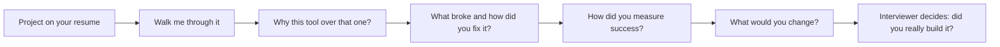
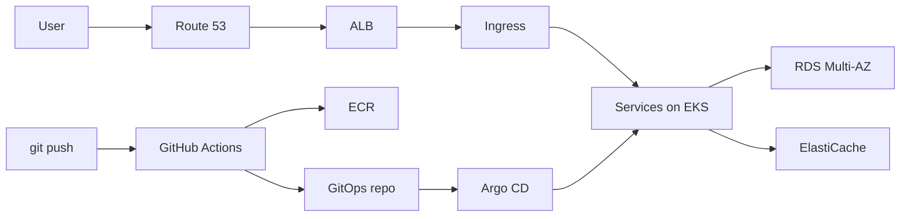

# Real-World Interview — Projects & Experience Deep-Dive

<!-- DEVOPS-SHACK:HEADER -->
<p align="center">
  <a href="https://www.youtube.com/@devopsshack"></a>
  <a href="https://www.youtube.com/@shackverse"></a>
  <a href="https://devopsshack.com"></a>
  <a href="https://www.instagram.com/devopsshack"></a>
  <a href="https://github.com/jaiswaladi246/DevOps-Cloud-Interview-Preparation-by-DevOps-Shack"></a>
</p>
<p align="center"><sub>Part of <b><a href="https://github.com/jaiswaladi246/DevOps-Cloud-Interview-Preparation-by-DevOps-Shack">DevOps &amp; Cloud Interview Preparation</a></b> — created by <b><a href="https://www.youtube.com/@devopsshack">DevOps Shack</a></b>. Free to learn from; please credit DevOps Shack when sharing.</sub></p>
<!-- /DEVOPS-SHACK:HEADER -->

> The questions interviewers ask about the projects on your resume, with what a strong answer sounds like, the follow-ups that come next, and the red flags that lose the offer · 200 questions · 🟢 Beginner 🟡 Intermediate 🔴 Advanced

[⬅ Back to Real-World Interview](./README.md) · [🏠 Home](../README.md)

## Table of contents
- [Walking through your project](#walking-through-your-project) — Q1–Q25
- [CI/CD pipeline deep-dive](#cicd-pipeline-deep-dive) — Q26–Q50
- [Infrastructure as Code & Terraform state](#infrastructure-as-code--terraform-state) — Q51–Q70
- [Kubernetes, GitOps & deployment strategy](#kubernetes-gitops--deployment-strategy) — Q71–Q95
- [Secrets, security & access](#secrets-security--access) — Q96–Q115
- [Monitoring, incidents & measuring success](#monitoring-incidents--measuring-success) — Q116–Q135
- [Freshers: presenting home-lab projects honestly](#freshers-presenting-home-lab-projects-honestly) — Q136–Q160
- [1–3 years of experience](#13-years-of-experience) — Q161–Q180
- [5+ years: senior and lead-level deep-dives](#5-years-senior-and-lead-level-deep-dives) — Q181–Q200



Every project question follows this funnel. The interviewer starts broad and keeps drilling until they hit the edge of what you actually did. Prepare each resume project down to the "what broke" and "what would you change" level.

---

## Walking through your project

<!-- DEVOPS-SHACK:SECTION -->
> 🎥 **Learn this hands-on with DevOps Shack** → [YouTube @devopsshack](https://www.youtube.com/@devopsshack) · [Hindi @shackverse](https://www.youtube.com/@shackverse) · [Courses at devopsshack.com](https://devopsshack.com)

### Q1. Walk me through the most important project on your resume. 🟢

<details>
<summary><b>Answer</b></summary>

**Good answer looks like →** "We had 12 Node.js and Java microservices deployed manually to EC2. I built the path from commit to production: GitHub Actions builds and tests, pushes images to ECR, updates a Helm values file in a GitOps repo, and Argo CD syncs to EKS. Infrastructure is Terraform with remote state in S3. Deploys went from 45 minutes and manual to about 8 minutes and automatic, with rollback by reverting a Git commit." Structure it as problem, architecture (draw it if there's a whiteboard), your part, result.

**Follow-ups to expect →** Which part did you personally build? What broke in the first month? How do you roll back? How many services and environments?

**Red flags →** Listing tools with no problem or result, or saying "we" for every sentence so the interviewer can't tell what you did.

</details>

### Q2. What problem was this project solving for the business? 🟢

<details>
<summary><b>Answer</b></summary>

**Good answer looks like →** Tie it to a business outcome, not a tool. "Releases happened once every two weeks over a weekend and about one in four needed a rollback. Product couldn't ship fixes quickly and customers waited days for bug fixes. The goal was daily, low-risk deploys during working hours."

**Follow-ups to expect →** Who asked for it? How did you know it was the most important problem? Did the business goal change during the project?

**Red flags →** "We wanted to use Kubernetes" as the problem statement.

</details>

### Q3. Draw the architecture of your project. 🟡

<details>
<summary><b>Answer</b></summary>

**Good answer looks like →** Draw left to right following a request: user → Route 53 → CloudFront or ALB → ingress controller → services in EKS across 3 AZs in private subnets → RDS Multi-AZ and ElastiCache → S3. Then draw the delivery path separately: developer → GitHub → Actions → ECR → GitOps repo → Argo CD → cluster. Label where secrets come from and where logs and metrics go.



**Follow-ups to expect →** Where are public versus private subnets? How does a pod reach S3? What happens if one AZ goes down?

**Red flags →** A diagram with no network boundaries, or one you can't explain box by box.

</details>

### Q4. What exactly was your role versus your team's? 🟢

<details>
<summary><b>Answer</b></summary>

**Good answer looks like →** Be specific and honest. "There were 3 of us. I owned the CI pipelines and the Helm chart; my senior owned Terraform for EKS and networking; another engineer set up monitoring. I reviewed the Terraform and contributed the IRSA module." Interviewers respect a smaller, clear scope more than an inflated one.

**Follow-ups to expect →** Show me something you'd say you're proud of in your part. What did you learn from the parts you didn't own?

**Red flags →** Claiming you built everything alone in a team project, then failing deep questions on parts someone else built.

</details>

### Q5. How many services, environments and users did this project support? 🟢

<details>
<summary><b>Answer</b></summary>

**Good answer looks like →** Give real numbers: "18 services, 3 environments (dev, staging, prod) plus ephemeral PR environments, around 40 developers using the pipelines, and production served about 2,000 requests per second at peak." If you don't know exact figures, give honest approximations and say so.

**Follow-ups to expect →** Why 3 environments and not 2 or 4? How were they different in size? How did data get into staging?

**Red flags →** No idea of scale, or wildly inflated numbers that don't fit the rest of your story.

</details>

### Q6. Why did you choose this tech stack? 🟡

<details>
<summary><b>Answer</b></summary>

**Good answer looks like →** Show constraints drove choices. "We were already on AWS, so EKS over self-managed Kubernetes to avoid running etcd. GitHub Actions because code lived in GitHub and we didn't want to maintain Jenkins. Terraform because the team knew it and we needed multi-account support." Admit when a choice was inherited.

**Follow-ups to expect →** What alternatives did you consider? Would you choose the same today? What did this stack make hard?

**Red flags →** "It's the industry standard" with no project-specific reasoning.

</details>

### Q7. What was the hardest technical problem you hit in this project? 🟡

<details>
<summary><b>Answer</b></summary>

**Good answer looks like →** One specific, technical story with debugging steps. "Pods intermittently failed to reach RDS with timeouts. I checked security groups (fine), then saw failures only on nodes in one subnet. That subnet's route table had lost its NAT route after a Terraform refactor, and the RDS endpoint was resolved to a public IP because the VPC had DNS hostnames disabled. I enabled `enableDnsHostnames`, fixed the route, and added a connectivity smoke test to the pipeline."

**Follow-ups to expect →** How long did it take? What tools did you use? How would you detect it faster now?

**Red flags →** "Nothing was really hard" or a vague answer like "Kubernetes networking was complex".

</details>

### Q8. What would you change if you rebuilt this project today? 🟡

<details>
<summary><b>Answer</b></summary>

**Good answer looks like →** Show you've reflected. "I'd split Terraform state per environment and component from day one; one big state made plans slow and risky. I'd use OIDC for CI from the start instead of IAM user keys we later migrated off. And I'd define SLOs before building dashboards, since we built 30 dashboards nobody used."

**Follow-ups to expect →** Why didn't you do that at the time? How much effort would the change take now?

**Red flags →** "Nothing, it was perfect", or bashing decisions without understanding the constraints at the time.

</details>

### Q9. How long did the project take, and how was the work planned? 🟢

<details>
<summary><b>Answer</b></summary>

**Good answer looks like →** "About 4 months. We broke it into milestones: month 1 infrastructure with Terraform, month 2 CI pipelines and the first service on EKS, months 3–4 migrating the remaining services in waves. We tracked tasks in Jira in 2-week sprints with a demo at the end of each milestone."

**Follow-ups to expect →** What slipped? What did you cut from scope? Who decided the migration order?

**Red flags →** No sense of timeline or phases.

</details>

### Q10. How did you test this project before it went live? 🟡

<details>
<summary><b>Answer</b></summary>

**Good answer looks like →** Layered testing: "`terraform validate`, `tflint` and Checkov on every PR; `helm lint` and `helm template | kubeconform` for charts; the full stack built in a staging account from the same modules; load testing with k6 at 2x expected peak; and a game day where we killed nodes and one AZ's instances to confirm recovery."

**Follow-ups to expect →** Did staging match production? What did load testing find? What couldn't you test?

**Red flags →** "We tested it in production."

</details>

### Q11. How did you document the project? 🟢

<details>
<summary><b>Answer</b></summary>

**Good answer looks like →** "A README per repo with setup and deploy steps, architecture diagrams in Mermaid next to the code, ADRs for big decisions like 'Argo CD over Flux', and runbooks for the top failure scenarios linked from alerts." Mention a doc that actually helped someone.

**Follow-ups to expect →** How do you keep docs current? Show me an ADR you wrote.

**Red flags →** "The code is the documentation."

</details>

### Q12. What was the cost of running this infrastructure? 🟡

<details>
<summary><b>Answer</b></summary>

**Good answer looks like →** Ballpark figures and drivers. "Roughly $14,000 a month in production: about 55% EC2 for EKS nodes, 20% RDS, 10% NAT gateway and data transfer, the rest S3, CloudWatch and load balancers. Biggest saving was Graviton nodes plus a Compute Savings Plan." Freshers can talk about free-tier choices and teardown discipline.

**Follow-ups to expect →** How did you track cost per team? What would you cut first? Why was NAT so expensive?

**Red flags →** No idea at all what anything cost.

</details>

### Q13. Who were the users of your platform and how did they interact with it? 🟢

<details>
<summary><b>Answer</b></summary>

**Good answer looks like →** "Developers were our users. They opened PRs, saw pipeline results as GitHub checks, viewed deployments in the Argo CD UI, and checked logs in Grafana. To create a new service they copied a template repo. We had a Slack channel for help and a monthly survey."

**Follow-ups to expect →** What did developers complain about most? What did you change based on feedback?

**Red flags →** Never having spoken to the people who used your pipelines.

</details>

### Q14. How did you handle the rollout or migration to the new system? 🟡

<details>
<summary><b>Answer</b></summary>

**Good answer looks like →** "We migrated service by service, lowest risk first. For each, we deployed to the new cluster, sent 10% of traffic using Route 53 weighted records, watched error rate and latency for a day, then 50%, then 100%. The old deployment stayed up a week as rollback."

**Follow-ups to expect →** How did you handle stateful services? What was the worst migration? How did you handle sessions?

**Red flags →** "We switched everything over one weekend" with no rollback.

</details>

### Q15. What dependencies or integrations did your project have? 🟡

<details>
<summary><b>Answer</b></summary>

**Good answer looks like →** "Identity through Okta for Argo CD and Grafana SSO, Slack for notifications, PagerDuty for alerts, a third-party payment API whitelisting our NAT IPs, and an on-prem LDAP over a Site-to-Site VPN. The VPN and the payment IP whitelist were the most fragile."

**Follow-ups to expect →** What happened when one of those failed? How did you handle fixed egress IPs?

**Red flags →** Describing the project as if it existed in isolation.

</details>

### Q16. What was the biggest mistake made in this project? 🟡

<details>
<summary><b>Answer</b></summary>

**Good answer looks like →** Own a real one. "We didn't set resource requests on early deployments. The scheduler packed pods onto a few nodes, and under load those nodes ran out of memory and the kubelet evicted pods. We set requests from observed usage, added a LimitRange default per namespace, and a Kyverno policy requiring requests."

**Follow-ups to expect →** How did you find it? How long was it in place? Who made the decision?

**Red flags →** Blaming someone else, or having no mistakes.

</details>

### Q17. How did you keep environments consistent? 🟡

<details>
<summary><b>Answer</b></summary>

**Good answer looks like →** "Same Terraform modules for every environment with only variables differing (`dev.tfvars`, `prod.tfvars`), same Helm chart with per-environment values files, and the same container image promoted by digest from staging to production, never rebuilt. Drift was checked by a nightly `terraform plan -detailed-exitcode` job."

**Follow-ups to expect →** What was intentionally different between environments? How did you handle drift when found?

**Red flags →** Rebuilding images per environment or hand-editing staging.

</details>

### Q18. What did the project teach you that you didn't know before? 🟢

<details>
<summary><b>Answer</b></summary>

**Good answer looks like →** Something concrete. "I learned how IRSA actually works: the pod gets a projected service-account token, the AWS SDK calls `AssumeRoleWithWebIdentity` against the cluster's OIDC provider, and the IAM trust policy checks the `sub` claim for the namespace and service account. Before that I just copied examples."

**Follow-ups to expect →** How did you learn it? How would you explain it to a junior?

**Red flags →** Generic answers like "teamwork" with nothing technical.

</details>

### Q19. How did you handle data or state in this project? 🔴

<details>
<summary><b>Answer</b></summary>

**Good answer looks like →** "We kept the cluster stateless. Databases were RDS PostgreSQL Multi-AZ with automated backups and 14-day PITR, Redis was ElastiCache, files went to S3. The only stateful thing in Kubernetes was Prometheus, using gp3 PVCs with 15-day retention and remote write to long-term storage. That made cluster rebuilds a non-event."

**Follow-ups to expect →** Have you tested restores? Why not run Postgres in Kubernetes? How did you handle schema migrations during deploys?

**Red flags →** Running databases on emptyDir or not knowing how backups work.

</details>

### Q20. If I gave you access to this project's repo right now, what would I see? 🟡

<details>
<summary><b>Answer</b></summary>

**Good answer looks like →** Describe the layout accurately: "`terraform/` with `modules/` and `envs/dev|staging|prod`, a `charts/` folder with our base chart, `.github/workflows/` with reusable workflows, and a separate `gitops` repo with one folder per environment containing Argo CD Applications and values files."

**Follow-ups to expect →** Why separate app code and GitOps repos? How were modules versioned? Show me a workflow file.

**Red flags →** Not being able to describe your own repo structure.

</details>

### Q21. How did your project handle scaling? 🟡

<details>
<summary><b>Answer</b></summary>

**Good answer looks like →** Two layers. "HPA on CPU at 70% target and on a custom requests-per-second metric through the Prometheus Adapter for the API. Node scaling with Karpenter, which picked instance types from a list including Spot for stateless workloads. During a sale we went from 12 to 45 pods and 6 to 19 nodes automatically."

**Follow-ups to expect →** How long did a scale-up take end to end? What was the bottleneck at peak? Did the database scale?

**Red flags →** Only mentioning HPA and forgetting nodes need to scale too.

</details>

### Q22. How did you make the project highly available? 🔴

<details>
<summary><b>Answer</b></summary>

**Good answer looks like →** "Nodes across 3 AZs, at least 3 replicas for critical services with `topologySpreadConstraints` on `topology.kubernetes.io/zone`, PodDisruptionBudgets with `minAvailable: 2`, RDS Multi-AZ, and ALB health checks. We tested by terminating all nodes in one AZ: error rate peaked at 0.4% for about 60 seconds."

**Follow-ups to expect →** What's still a single point of failure? What about a regional outage? Why spread constraints instead of pod anti-affinity?

**Red flags →** Claiming "99.99% availability" with no evidence or testing.

</details>

### Q23. What happens when a developer merges a PR in your project? Step by step. 🟡

<details>
<summary><b>Answer</b></summary>

**Good answer looks like →** "The merge to `main` triggers a GitHub Actions workflow: unit tests, Docker build with BuildKit cache, Trivy scan, push to ECR tagged with the commit SHA. A second job updates the image tag in the GitOps repo's `staging` values and opens an automerged PR. Argo CD syncs staging, smoke tests run, then a manual approval in a GitHub environment promotes the same tag to production."

**Follow-ups to expect →** How long does each stage take? What if the smoke test fails? Who can approve production?

**Red flags →** Steps out of order, or not knowing how production gets the new version.

</details>

### Q24. How did you get buy-in for this project? 🔴

<details>
<summary><b>Answer</b></summary>

**Good answer looks like →** "I showed the cost of the status quo: 2 failed weekend releases a month, about 30 engineer-hours each, plus 3 customer-facing incidents from manual deploys. I proposed a pilot with one service in 4 weeks, delivered it, and used its numbers (deploy time 45 to 8 minutes, zero failed deploys) to get the rest funded."

**Follow-ups to expect →** Who resisted? What did leadership care about most?

**Red flags →** "My manager told me to" for a project you claim to have led.

</details>

### Q25. What's one thing in this project you're not proud of? 🔴

<details>
<summary><b>Answer</b></summary>

**Good answer looks like →** "Our alerting. We alerted on CPU and memory thresholds for every pod and the on-call got 30 pages a week, mostly noise. It took us 6 months to move to SLO-based burn-rate alerts. I should have pushed for that design at the start."

**Follow-ups to expect →** What did you change it to? How did you measure the improvement?

**Red flags →** Refusing to name anything.

</details>

---

## CI/CD pipeline deep-dive

<!-- DEVOPS-SHACK:SECTION -->
> 🎥 **Learn this hands-on with DevOps Shack** → [YouTube @devopsshack](https://www.youtube.com/@devopsshack) · [Hindi @shackverse](https://www.youtube.com/@shackverse) · [Courses at devopsshack.com](https://devopsshack.com)

### Q26. Walk me through your CI/CD pipeline stage by stage. 🟢

<details>
<summary><b>Answer</b></summary>

**Good answer looks like →** Name each stage, what it does, how long it takes, and what stops the pipeline. "Lint and unit tests (2 min) → build image with BuildKit (3 min) → Trivy scan, fail on fixable CRITICAL (40 s) → push to ECR by SHA → deploy to staging via GitOps → smoke tests (1 min) → manual approval → production canary 10% for 10 minutes → full rollout."

**Follow-ups to expect →** Which stage fails most? How do you stop a bad build reaching production? Where do integration tests run?

**Red flags →** Describing a generic pipeline from a tutorial with no timings or gates.

</details>

### Q27. Why did you choose GitHub Actions (or Jenkins, or GitLab CI) for this pipeline? 🟡

<details>
<summary><b>Answer</b></summary>

**Good answer looks like →** "Code was already in GitHub, so Actions gave us PR checks, environments with required reviewers, and OIDC to AWS with no extra servers. Jenkins would have meant maintaining a controller, plugins and agents. The trade-off: Actions minutes cost money at scale, so we ran self-hosted runners on Kubernetes with Actions Runner Controller for heavy builds."

**Follow-ups to expect →** What can't Actions do well? How did you share logic across repos? How did you secure self-hosted runners?

**Red flags →** "Jenkins is outdated" or tool tribalism without trade-offs.

</details>

### Q28. How did you share pipeline logic across many repositories? 🟡

<details>
<summary><b>Answer</b></summary>

**Good answer looks like →** "Reusable workflows in a central repo, called with `uses: org/ci-templates/.github/workflows/build.yml@v3`, pinned to a tag. Inputs covered language and Dockerfile path. Breaking changes went into a new major tag so teams upgraded on their own schedule." For Jenkins: a shared library; for GitLab: `include:` with templates.

```yaml
jobs:
  build:
    uses: org/ci-templates/.github/workflows/build.yml@v3
    with:
      image-name: orders-api
    secrets: inherit
```

**Follow-ups to expect →** How did you roll out a fix to all repos? How did you test changes to the shared workflow?

**Red flags →** Copy-pasting the same 200-line YAML into 30 repos.

</details>

### Q29. How did your pipeline authenticate to AWS (or your cloud)? 🟡

<details>
<summary><b>Answer</b></summary>

**Good answer looks like →** "OIDC federation. GitHub's OIDC provider is registered in IAM; each repo has a role whose trust policy checks `token.actions.githubusercontent.com:aud` is `sts.amazonaws.com` and `sub` matches `repo:org/orders-api:environment:production`. The workflow uses `aws-actions/configure-aws-credentials` with `role-to-assume`. No long-lived keys anywhere."

**Follow-ups to expect →** What stops a fork's PR from assuming the role? What permissions did the role have? What did you do before OIDC?

**Red flags →** AWS access keys stored as repo secrets with admin rights.

</details>

### Q30. How did you tag and version container images? 🟢

<details>
<summary><b>Answer</b></summary>

**Good answer looks like →** "Every image tagged with the full Git commit SHA, plus a semantic version tag on releases. We deployed by digest in production so a tag couldn't be moved under us. ECR had tag immutability enabled. We never deployed `latest`."

**Follow-ups to expect →** How do you trace a running pod back to a commit? How did you clean up old images?

**Red flags →** Using `latest` in production.

</details>

### Q31. How did you promote a build from staging to production? 🟡

<details>
<summary><b>Answer</b></summary>

**Good answer looks like →** "Build once, promote the same artifact. The staging deploy records the image digest; promotion is a PR to the production values file changing only that digest, which requires approval from a code owner. We never rebuilt for production, so what we tested is exactly what shipped."

**Follow-ups to expect →** Who approves? How do you handle config differences? How long does promotion take?

**Red flags →** Rebuilding the image from the `main` branch for production.

</details>

### Q32. How long did your pipeline take, and how did you make it faster? 🟡

<details>
<summary><b>Answer</b></summary>

**Good answer looks like →** "It went from 28 to 9 minutes. Biggest wins: Docker layer caching with `cache-from: type=gha`, reordering the Dockerfile to copy `package-lock.json` and install deps before copying source, running tests in 4 parallel shards with a matrix, and path filters so docs-only changes skipped the build."

**Follow-ups to expect →** What's the slowest stage now? How did you measure it? Did caching ever cause wrong builds?

**Red flags →** No idea how long the pipeline took.

</details>

### Q33. What tests ran in your pipeline, and where? 🟡

<details>
<summary><b>Answer</b></summary>

**Good answer looks like →** "Unit tests and linting on every PR. Integration tests on PRs against containers spun up with service containers (Postgres, Redis). Contract tests between two key services. End-to-end Playwright tests against staging after deploy. Load tests weekly, not per commit, because they took 20 minutes."

**Follow-ups to expect →** How did you handle flaky tests? What was your test coverage? Did any tests block production?

**Red flags →** "QA handles testing" with nothing automated.

</details>

### Q34. How did you handle database migrations in your pipeline? 🔴

<details>
<summary><b>Answer</b></summary>

**Good answer looks like →** "Migrations ran as a Kubernetes Job triggered as an Argo CD PreSync hook, using Flyway. We followed expand-contract: add columns and tables first, deploy code that uses both, then remove old columns in a later release. That kept rollbacks safe because old code still worked against the new schema."

**Follow-ups to expect →** What if a migration fails halfway? How do you roll back a migration? What about long-running migrations on big tables?

**Red flags →** Running migrations from the app on startup with multiple replicas racing.

</details>

### Q35. How did you roll back a bad deployment? 🟢

<details>
<summary><b>Answer</b></summary>

**Good answer looks like →** "Revert the commit in the GitOps repo; Argo CD syncs the previous image within a minute or two. In an emergency, `argocd app rollback` to the previous history ID, then fix Git so it doesn't drift. With Argo Rollouts, a failed canary analysis aborts automatically and traffic returns to the stable version."

**Follow-ups to expect →** How long does it take? What if the bad release ran a migration? Have you actually done it?

**Red flags →** "We'd redeploy the old version manually" with no tested procedure.

</details>

### Q36. How did you handle secrets in your pipeline? 🟡

<details>
<summary><b>Answer</b></summary>

**Good answer looks like →** "The pipeline needed very few secrets because of OIDC. The ones it did (a Sonar token, a Slack webhook) were environment-scoped GitHub secrets, only available to jobs in that environment. Application secrets never passed through CI; they lived in AWS Secrets Manager and were synced into the cluster by External Secrets Operator."

**Follow-ups to expect →** How do you stop a secret being printed in logs? What about secrets for PRs from forks?

**Red flags →** Secrets baked into images or passed as build args.

</details>

### Q37. How did you make sure only good code reached the main branch? 🟢

<details>
<summary><b>Answer</b></summary>

**Good answer looks like →** "Branch protection on `main`: PRs required, 1 approval (2 for infra repos), required status checks for lint, tests and security scans, CODEOWNERS for sensitive paths like `terraform/prod/`, no force pushes, and linear history with squash merges."

**Follow-ups to expect →** Could admins bypass it? How did you handle urgent hotfixes?

**Red flags →** Pushing directly to `main` as normal practice.

</details>

### Q38. What security checks did you add to CI/CD? 🟡

<details>
<summary><b>Answer</b></summary>

**Good answer looks like →** "Gitleaks for secrets, Semgrep for SAST on the main languages, Trivy for image and dependency CVEs, Checkov for Terraform and Kubernetes manifests, and image signing with Cosign verified at admission by Kyverno. Only fixable HIGH and CRITICAL findings blocked; everything else went to a report."

**Follow-ups to expect →** How did you handle false positives? How much time did it add? Who owned fixing findings?

**Red flags →** Listing 8 scanners with no idea what any of them blocked.

</details>

### Q39. How did your pipeline handle a monorepo (or many repos)? 🔴

<details>
<summary><b>Answer</b></summary>

**Good answer looks like →** "Monorepo with 14 services. A first job computed changed paths with `dorny/paths-filter` and emitted a matrix of affected services; only those built and deployed. Shared libraries triggered rebuilds of their dependents through a small dependency map. Each service still had its own image and Argo CD Application."

**Follow-ups to expect →** How do you deploy two dependent changes together? How do you prevent one team's broken test blocking others?

**Red flags →** Rebuilding all 14 services on every commit with no reason.

</details>

### Q40. How did you implement deployment approvals? 🟢

<details>
<summary><b>Answer</b></summary>

**Good answer looks like →** "GitHub environments: `production` had required reviewers from the service's team lead group and a wait timer of 0. Deploy jobs referenced `environment: production`, so the job paused until approved, and environment-scoped secrets were only released after approval. Every approval was logged for audits."

**Follow-ups to expect →** Was approval a rubber stamp? Did you consider removing it?

**Red flags →** Approvals by email or Slack with no record.

</details>

### Q41. What did your pipeline do when a deploy failed in production? 🔴

<details>
<summary><b>Answer</b></summary>

**Good answer looks like →** "Argo Rollouts ran a canary at 10%, then 50%, with an AnalysisTemplate querying Prometheus for success rate above 99% and p95 latency under 400 ms. If analysis failed twice, the rollout aborted and traffic went back to stable automatically, then a Slack alert with the failing metric went to the team. No human needed to start the rollback."

**Follow-ups to expect →** What if the metric query itself fails? How did you choose thresholds? Did it ever roll back a good release?

**Red flags →** "Someone would notice and roll back."

</details>

### Q42. How did you handle feature flags alongside the pipeline? 🔴

<details>
<summary><b>Answer</b></summary>

**Good answer looks like →** "We decoupled deploy from release. Code shipped dark behind flags managed in a flag service (we used LaunchDarkly; open-source options are Unleash or Flagsmith). Product turned features on for 1% of users, then up. Flags had owners and an expiry ticket so we didn't accumulate dead flags."

**Follow-ups to expect →** How did you test flag combinations? What happens if the flag service is down? How many stale flags did you have?

**Red flags →** Long-lived release branches instead of flags, with painful merges.

</details>

### Q43. How did you handle pipelines for infrastructure changes versus application changes? 🟡

<details>
<summary><b>Answer</b></summary>

**Good answer looks like →** "Separate pipelines. App changes were fully automated to staging. Terraform changes ran `plan` on PR and posted the output as a comment; `apply` ran only after merge with approval, per environment, and production applies needed a second reviewer. We used Atlantis for a while, then moved to GitHub Actions with the same flow."

**Follow-ups to expect →** How did you stop two applies running at once? What if apply fails halfway?

**Red flags →** Running `terraform apply` from laptops.

</details>

### Q44. How did you secure your CI runners? 🔴

<details>
<summary><b>Answer</b></summary>

**Good answer looks like →** "Ephemeral self-hosted runners on Kubernetes via Actions Runner Controller, one pod per job, destroyed after. No Docker socket mounted; image builds used BuildKit rootless. Runners for public repos were separate and never ran on fork PRs with secrets. Runner IAM roles were scoped per repo through OIDC, not attached to the node."

**Follow-ups to expect →** Why not persistent runners? What about `pull_request_target`? How did you stop runners reaching production networks?

**Red flags →** A persistent shared runner with Docker socket access and admin credentials on disk.

</details>

### Q45. How did you measure your pipeline's success? 🟡

<details>
<summary><b>Answer</b></summary>

**Good answer looks like →** "DORA metrics: deploy frequency went from weekly to about 12 a day, lead time from merge to production from 3 days to 40 minutes, change failure rate from 22% to 6%, and MTTR for bad deploys from 1 hour to 8 minutes. We pulled these from GitHub and Argo CD events into a Grafana dashboard."

**Follow-ups to expect →** How did you define a "failed change"? Which metric improved most and why?

**Red flags →** "Developers liked it" as the only measure.

</details>

### Q46. What was the most annoying pipeline failure you debugged? 🟡

<details>
<summary><b>Answer</b></summary>

**Good answer looks like →** "Builds randomly failed with `npm ERR! code ECONNRESET`. It only happened on self-hosted runners at peak. The NAT gateway was fine; the cause was too many parallel jobs exhausting the node's ephemeral ports through a single proxy. We added an npm cache via a pull-through registry, which cut external requests by 90% and the failures stopped."

**Follow-ups to expect →** How did you narrow it down? How did you prove the fix?

**Red flags →** "We just retried until it passed."

</details>

### Q47. Did your pipeline produce an SBOM or sign artifacts? Why? 🔴

<details>
<summary><b>Answer</b></summary>

**Good answer looks like →** "Yes. Syft generated an SPDX SBOM per image, attached as an attestation with `cosign attest`, and images were signed keylessly with Cosign using the workflow's OIDC identity. Kyverno's `verifyImages` rule rejected unsigned images in production namespaces. When a new CVE appeared, we could query SBOMs to find affected images in minutes."

**Follow-ups to expect →** Keyless versus key-based signing? What about base images you don't build?

**Red flags →** Mentioning "supply chain security" with no concrete mechanism.

</details>

### Q48. How did you handle hotfixes through the pipeline? 🟡

<details>
<summary><b>Answer</b></summary>

**Good answer looks like →** "Same pipeline, no shortcuts on tests or scans, but with a fast lane: a `hotfix` label skipped the staging soak timer (not staging itself) and approval needed only one on-call reviewer. With trunk-based development the fix went to `main` like any change, so nothing needed back-merging."

**Follow-ups to expect →** How fast could a hotfix reach production? Did people abuse the hotfix label?

**Red flags →** Hotfixes built on a laptop and deployed manually.

</details>

### Q49. Why trunk-based development (or GitFlow) in your project? 🟡

<details>
<summary><b>Answer</b></summary>

**Good answer looks like →** "Trunk-based with short-lived branches, merged within a day or two, with feature flags for unfinished work. GitFlow's `develop` and release branches caused merge pain and delayed integration. The trade-off is you need good tests and flags; without those, trunk-based is risky."

**Follow-ups to expect →** How did you handle a release that needed to be held back? How long did branches actually live?

**Red flags →** Not knowing what branching strategy your own team used.

</details>

### Q50. If your CI system went down for a day, what would happen? 🔴

<details>
<summary><b>Answer</b></summary>

**Good answer looks like →** "Deploys would stop, but production keeps running because the cluster state lives in Git and Argo CD. For an emergency fix we had a documented break-glass: an engineer with the deploy role builds and pushes the image from a hardened bastion, and updates the GitOps repo by PR, so Argo CD still applies it. We tested that procedure twice a year."

**Follow-ups to expect →** How do you audit break-glass use? What about if GitHub itself is down?

**Red flags →** Never having thought about it, or "we'd `kubectl apply` from a laptop".

</details>

---

## Infrastructure as Code & Terraform state

<!-- DEVOPS-SHACK:SECTION -->
> 🎥 **Learn this hands-on with DevOps Shack** → [YouTube @devopsshack](https://www.youtube.com/@devopsshack) · [Hindi @shackverse](https://www.youtube.com/@shackverse) · [Courses at devopsshack.com](https://devopsshack.com)

### Q51. What did your Terraform state setup look like? 🟡

<details>
<summary><b>Answer</b></summary>

**Good answer looks like →** "Remote state in an S3 bucket in a dedicated management account, with versioning, SSE-KMS encryption, and Block Public Access. Locking with a DynamoDB table (newer Terraform versions also support S3-native locking with `use_lockfile = true`). One state file per environment per component, for example `prod/network`, `prod/eks`, `prod/data`."

```hcl
terraform {
  backend "s3" {
    bucket         = "acme-tfstate-mgmt"
    key            = "prod/eks/terraform.tfstate"
    region         = "ap-south-1"
    encrypt        = true
    dynamodb_table = "tf-locks"
  }
}
```

**Follow-ups to expect →** Who can read the state bucket? Why split state? How do components share outputs?

**Red flags →** State committed to Git or stored on a laptop.

</details>

### Q52. How did you structure your Terraform code? 🟢

<details>
<summary><b>Answer</b></summary>

**Good answer looks like →** "Reusable modules in a separate repo (vpc, eks, rds, iam-role), versioned with Git tags. A live repo with `envs/dev`, `envs/staging`, `envs/prod`, each calling modules with environment-specific variables. Each env folder had its own backend config."

**Follow-ups to expect →** Workspaces or folders, and why? How did you test module changes?

**Red flags →** One giant `main.tf` for everything.

</details>

### Q53. Why did you use folders per environment rather than Terraform workspaces (or vice versa)? 🟡

<details>
<summary><b>Answer</b></summary>

**Good answer looks like →** "Folders, because environments differed in real ways (prod had Multi-AZ RDS and more node groups) and separate backends let us restrict prod state access by IAM. Workspaces share one backend and configuration, which made it too easy to run `apply` against the wrong workspace. We used workspaces only for identical, short-lived test stacks."

**Follow-ups to expect →** How did you avoid duplicating code across folders? Have you used Terragrunt?

**Red flags →** Not knowing the trade-off at all.

</details>

### Q54. How did different Terraform stacks share information? 🟡

<details>
<summary><b>Answer</b></summary>

**Good answer looks like →** "The EKS stack needed VPC and subnet IDs from the network stack. We used SSM Parameter Store: the network stack wrote outputs as parameters and the EKS stack read them with `data "aws_ssm_parameter"`. That avoided giving the EKS stack read access to the whole network state, which `terraform_remote_state` would require."

**Follow-ups to expect →** What happens when an upstream value changes? Why not `terraform_remote_state`?

**Red flags →** Hardcoding IDs copied from the console.

</details>

### Q55. Did you ever have a state lock or corrupted state? What did you do? 🔴

<details>
<summary><b>Answer</b></summary>

**Good answer looks like →** "A CI job was cancelled mid-apply and left a lock: `Error acquiring the state lock`. I confirmed no apply was running (checked the CI run and the DynamoDB lock item's `Info` field for who held it), then ran `terraform force-unlock <LOCK_ID>`. I ran `plan` to check the state matched reality. Since S3 versioning was on, we could have restored a previous state version if needed."

**Follow-ups to expect →** When is force-unlock dangerous? How would you recover a resource missing from state?

**Red flags →** Deleting the lock or state file without checking.

</details>

### Q56. How did you handle Terraform drift? 🟡

<details>
<summary><b>Answer</b></summary>

**Good answer looks like →** "A nightly job ran `terraform plan -detailed-exitcode` per stack; exit code 2 means changes, which posted to Slack with the diff. For each drift we decided: if the manual change was right, codify it; otherwise apply to revert it. We reduced drift at the source by removing console write access for humans in production."

**Follow-ups to expect →** What was the most common source of drift? How do you handle attributes changed by AWS itself?

**Red flags →** Discovering drift only when an apply unexpectedly destroys something.

</details>

### Q57. How did you import existing resources into Terraform? 🟡

<details>
<summary><b>Answer</b></summary>

**Good answer looks like →** "We had about 80 resources created by hand. I used `import` blocks (Terraform 1.5+) and `terraform plan -generate-config-out=generated.tf` to draft the config, then cleaned it up into our modules. The goal was a plan with no changes after import, which proved the code matched reality."

```hcl
import {
  to = aws_s3_bucket.assets
  id = "acme-prod-assets"
}
```

**Follow-ups to expect →** What resources were hard to import? How did you handle resources inside modules?

**Red flags →** Recreating production resources instead of importing them.

</details>

### Q58. How did you review and approve Terraform changes? 🟢

<details>
<summary><b>Answer</b></summary>

**Good answer looks like →** "Every PR ran `fmt -check`, `validate`, `tflint`, Checkov, and `plan`, with the plan summary posted as a PR comment. Reviewers looked closely at any destroy or replace. Production applies required approval from a CODEOWNER on the infra team."

**Follow-ups to expect →** What if the plan at review time differs from apply time? How do you catch a replace hiding in a big plan?

**Red flags →** Approving infrastructure PRs without reading the plan.

</details>

### Q59. How did you protect critical resources from accidental deletion? 🟢

<details>
<summary><b>Answer</b></summary>

**Good answer looks like →** "`lifecycle { prevent_destroy = true }` on databases, state buckets and KMS keys; `deletion_protection = true` on RDS and load balancers; S3 versioning; and a CI check that fails if the plan contains any delete on resources tagged `critical=true` unless a specific PR label is present."

**Follow-ups to expect →** What if someone removes the `prevent_destroy` line? Did it ever save you?

**Red flags →** Relying only on "being careful".

</details>

### Q60. How did you version and release Terraform modules? 🟡

<details>
<summary><b>Answer</b></summary>

**Good answer looks like →** "Modules in a separate repo with semantic version tags. Consumers pinned `source = "git::https://github.com/acme/tf-modules.git//vpc?ref=v2.3.0"`. A changelog noted breaking changes. Renovate opened PRs in consuming repos when a new module version was tagged, so upgrades were visible and reviewed."

**Follow-ups to expect →** How did you test a module before tagging? What counts as a breaking change?

**Red flags →** Every environment referencing the module's `main` branch.

</details>

### Q61. How did you manage provider and Terraform versions? 🟢

<details>
<summary><b>Answer</b></summary>

**Good answer looks like →** "`required_version` and `required_providers` with pessimistic constraints like `~> 5.0`, and the `.terraform.lock.hcl` committed so everyone and CI used identical provider builds. Upgrades went through a PR with a plan for every environment."

**Follow-ups to expect →** What broke during a provider major upgrade? Why commit the lock file?

**Red flags →** No version pinning and "works on my machine" plans.

</details>

### Q62. How did you test your Terraform code? 🔴

<details>
<summary><b>Answer</b></summary>

**Good answer looks like →** "Static checks on every PR (validate, tflint, Checkov). Native `terraform test` with `.tftest.hcl` files for module logic using `command = plan` assertions, which are fast and free. For the VPC and EKS modules, a nightly job applied the module into a sandbox account, ran checks, and destroyed it."

**Follow-ups to expect →** How long did the integration tests take? How did you clean up after failed tests?

**Red flags →** "We test by applying to dev and seeing what happens" as the only strategy.

</details>

### Q63. How did you handle multiple AWS accounts in Terraform? 🔴

<details>
<summary><b>Answer</b></summary>

**Good answer looks like →** "Each environment had its own AWS account. CI assumed a deploy role in the target account using OIDC into a central account, then `assume_role` in the provider block. Shared resources like Route 53 zones lived in a networking account, managed via a provider alias."

```hcl
provider "aws" {
  alias  = "network"
  region = "ap-south-1"
  assume_role {
    role_arn = "arn:aws:iam::111122223333:role/terraform-deploy"
  }
}
```

**Follow-ups to expect →** How did you bootstrap the roles themselves? How did you create new accounts?

**Red flags →** One set of admin credentials used for every account.

</details>

### Q64. Did you use Terragrunt, Terraform Cloud, Atlantis or Spacelift? Why or why not? 🟡

<details>
<summary><b>Answer</b></summary>

**Good answer looks like →** "We used plain Terraform with GitHub Actions. We looked at Terragrunt to reduce backend duplication, but with only 3 environments and ~12 stacks the duplication was small and the team preferred fewer tools. If we grew to dozens of accounts, I'd reconsider Terragrunt or a managed runner for policy and drift features."

**Follow-ups to expect →** What problem would make you adopt one? What does Atlantis give you that Actions doesn't?

**Red flags →** Adopting a tool because a blog said so.

</details>

### Q65. How did you handle secrets in Terraform? 🔴

<details>
<summary><b>Answer</b></summary>

**Good answer looks like →** "We didn't put secret values in Terraform where avoidable. RDS used `manage_master_user_password = true` so AWS generated and stored the password in Secrets Manager. When a secret had to pass through Terraform, we marked outputs `sensitive = true`, knowing the value still lands in state, which is why the state bucket was encrypted with KMS and tightly restricted."

**Follow-ups to expect →** Does `sensitive` keep the value out of state? Have you used ephemeral resources or write-only arguments?

**Red flags →** Passwords in `.tfvars` committed to Git.

</details>

### Q66. Tell me about a Terraform change that went wrong. 🟡

<details>
<summary><b>Answer</b></summary>

**Good answer looks like →** "Changing `name` on a launch template forced replacement of the EKS node group, and because `create_before_destroy` wasn't set, the old group drained before the new one was ready. Pods went pending for 6 minutes. I added `create_before_destroy` and a CI check that highlights replacements of node groups."

**Follow-ups to expect →** Why didn't the reviewer catch it? How do you know which attributes force replacement?

**Red flags →** No Terraform mistakes in years of use.

</details>

### Q67. How did you manage Kubernetes resources: Terraform, Helm, or GitOps? 🟡

<details>
<summary><b>Answer</b></summary>

**Good answer looks like →** "Terraform for the cluster and its AWS dependencies (VPC, EKS, IAM roles for IRSA, node groups), plus bootstrapping Argo CD. Everything inside the cluster, including add-ons like cert-manager and ingress-nginx, was managed by Argo CD from Git. Managing in-cluster resources with Terraform's Kubernetes provider caused ordering problems during cluster replacement."

**Follow-ups to expect →** Where's the line between Terraform and GitOps? How do Terraform outputs reach Helm values?

**Red flags →** Mixing both for the same resources and fighting over ownership.

</details>

### Q68. How did you refactor Terraform code without destroying resources? 🟡

<details>
<summary><b>Answer</b></summary>

**Good answer looks like →** "When moving resources into a module, I used `moved` blocks so Terraform updated state addresses instead of destroy and create. I ran `plan` to confirm zero changes before merging. For moving resources between states, I used `terraform state rm` in one and an `import` block in the other."

```hcl
moved {
  from = aws_security_group.app
  to   = module.app.aws_security_group.this
}
```

**Follow-ups to expect →** When would you use `state mv` instead? How did you coordinate with others during the refactor?

**Red flags →** Accepting a plan with destroys during a "refactor".

</details>

### Q69. How did you enforce policies on infrastructure code? 🔴

<details>
<summary><b>Answer</b></summary>

**Good answer looks like →** "Checkov in CI for common misconfigurations, plus custom OPA Rego policies evaluated against `terraform show -json` plan output with Conftest, for rules like 'every resource has the `owner` tag' and 'no security group allows 0.0.0.0/0 on port 22'. Org-level SCPs were the final backstop for things like disabling CloudTrail."

**Follow-ups to expect →** Why evaluate the plan rather than the code? How did you handle exceptions?

**Red flags →** Policies written down in a wiki with no enforcement.

</details>

### Q70. How long did a typical Terraform plan take, and how did you improve it? 🟢

<details>
<summary><b>Answer</b></summary>

**Good answer looks like →** "Our original single state with 900 resources took 9 minutes to plan. Splitting into stacks per component brought most plans under 1 minute. We also stopped refreshing data sources we didn't need and used `-refresh=false` only for quick syntax checks, never for applies."

**Follow-ups to expect →** What's the risk of `-refresh=false`? How many resources per state do you aim for?

**Red flags →** Accepting 10-minute plans as normal without investigating.

</details>

---

## Kubernetes, GitOps & deployment strategy

<!-- DEVOPS-SHACK:SECTION -->
> 🎥 **Learn this hands-on with DevOps Shack** → [YouTube @devopsshack](https://www.youtube.com/@devopsshack) · [Hindi @shackverse](https://www.youtube.com/@shackverse) · [Courses at devopsshack.com](https://devopsshack.com)

### Q71. Why ArgoCD over Flux in your project? 🟡

<details>
<summary><b>Answer</b></summary>

**Good answer looks like →** "Both are CNCF-graduated and both would have worked. We chose Argo CD for its UI, which let developers see sync status, diffs and logs without `kubectl`; built-in SSO and RBAC through Dex; and ApplicationSets for generating apps per cluster and per PR. Flux is lighter and more composable, which would appeal to a team that's fully CLI-driven. Team familiarity tipped it."

**Follow-ups to expect →** How did you structure Argo CD Applications? App of apps or ApplicationSets? How did you secure the Argo CD UI?

**Red flags →** "Flux is dead" or "Argo is the only real GitOps tool".

</details>

### Q72. How was your GitOps repository structured? 🟡

<details>
<summary><b>Answer</b></summary>

**Good answer looks like →** "A separate `gitops` repo: `apps/<service>/` with a base Helm values file, and `envs/dev|staging|prod/<service>/values.yaml` for overrides including the image tag. An ApplicationSet with a Git directory generator created one Argo CD Application per service per environment. Platform add-ons lived in `platform/`."

**Follow-ups to expect →** Why separate from app code? How do you avoid conflicts when many pipelines bump tags at once?

**Red flags →** No clear separation of environments in Git.

</details>

### Q73. How many clusters did you run, and why? 🟡

<details>
<summary><b>Answer</b></summary>

**Good answer looks like →** "Three: one non-prod for dev and staging namespaces, one production, and one small tooling cluster for Argo CD, monitoring and CI runners. Separating production gave a hard blast-radius boundary and cleaner IAM; combining dev and staging saved cost. The tooling cluster managed the others."

**Follow-ups to expect →** What if the tooling cluster goes down? Why not one cluster per team?

**Red flags →** Not being able to justify the number of clusters.

</details>

### Q74. What deployment strategy did you use and why? 🟡

<details>
<summary><b>Answer</b></summary>

**Good answer looks like →** "Rolling updates with `maxSurge: 25%` and `maxUnavailable: 0` for most services, plus readiness probes. For the checkout and payments services, canary with Argo Rollouts and automated analysis, because a bad release there costs money directly. Blue-green was considered but doubled capacity during deploys for little extra benefit."

**Follow-ups to expect →** How did the canary split traffic? How long did a canary take?

**Red flags →** "We used blue-green" without knowing how traffic switched.

</details>

### Q75. How did you set resource requests and limits? 🟡

<details>
<summary><b>Answer</b></summary>

**Good answer looks like →** "Requests from observed usage: p95 CPU and peak memory over two weeks, read from Prometheus and VPA in recommendation mode. Memory limit equal to request to avoid overcommit surprises; no CPU limits for latency-sensitive services, to avoid CFS throttling, with CPU requests guaranteeing their share. A LimitRange gave defaults per namespace."

**Follow-ups to expect →** What's CPU throttling and how did you detect it? What QoS class did your pods get?

**Red flags →** Copying `500m`/`512Mi` everywhere with no data.

</details>

### Q76. How did you expose services to the internet? 🟢

<details>
<summary><b>Answer</b></summary>

**Good answer looks like →** "AWS Load Balancer Controller creating an ALB from Ingress resources, with ACM certificates and HTTPS redirect. DNS records created automatically by ExternalDNS. Internal services used `ClusterIP` only; nothing used `NodePort` in production."

**Follow-ups to expect →** One ALB per service or shared? How did TLS work end to end? Why not ingress-nginx?

**Red flags →** Each service with its own `LoadBalancer` Service and public IP.

</details>

### Q77. How did you configure health checks and probes? 🟢

<details>
<summary><b>Answer</b></summary>

**Good answer looks like →** "Readiness probe on `/ready` that checks the app can serve, including its database connection pool; liveness probe on `/healthz` that only checks the process isn't stuck, never dependencies, so a database outage doesn't restart every pod. A startup probe for the Java service with a slow boot, so liveness didn't kill it during startup."

**Follow-ups to expect →** What happens if liveness checks the database? How did you choose timeouts?

**Red flags →** Identical liveness and readiness probes hitting a dependency.

</details>

### Q78. How did you handle configuration for different environments in Kubernetes? 🟢

<details>
<summary><b>Answer</b></summary>

**Good answer looks like →** "One Helm chart per service, with `values.yaml` for defaults and `values-prod.yaml` for overrides like replica count and resources. Non-secret config in ConfigMaps, secrets from External Secrets. A config change rolled the pods automatically via a checksum annotation of the ConfigMap in the pod template."

**Follow-ups to expect →** Why Helm over Kustomize? How did pods pick up ConfigMap changes?

**Red flags →** Separate hand-edited YAML copies per environment.

</details>

### Q79. How did you upgrade Kubernetes versions in your project? 🔴

<details>
<summary><b>Answer</b></summary>

**Good answer looks like →** "One minor version at a time. Before each: check deprecated APIs with `kubent` or `pluto`, read the changelog, upgrade add-ons to compatible versions. Upgrade the control plane, then roll nodes by creating a new managed node group and draining the old one so we could fall back. Dev first, a week of soak, then production."

**Follow-ups to expect →** What broke during an upgrade? How did PDBs affect draining? How long did each upgrade take?

**Red flags →** Never having done an upgrade on a cluster you claim to run.

</details>

### Q80. How did you handle pod-to-AWS authentication? 🟡

<details>
<summary><b>Answer</b></summary>

**Good answer looks like →** "IRSA at first, now EKS Pod Identity for new services. Each service account maps to its own IAM role with least-privilege policies, for example only `s3:GetObject` on one bucket prefix. No node instance role permissions beyond what the node itself needs, and IMDSv2 hop limit set to 1 so pods can't use the node's role."

**Follow-ups to expect →** IRSA versus Pod Identity differences? How did you debug `AccessDenied` from a pod?

**Red flags →** Attaching S3 permissions to the node role so every pod gets them.

</details>

### Q81. How did you handle multi-tenancy between teams in your cluster? 🔴

<details>
<summary><b>Answer</b></summary>

**Good answer looks like →** "Namespace per team per environment, with ResourceQuotas, LimitRanges, RBAC RoleBindings to the team's SSO group, default-deny NetworkPolicies with explicit allows, and Pod Security Admission at `baseline` enforce and `restricted` warn. Argo CD AppProjects restricted each team to their namespaces and allowed repos."

**Follow-ups to expect →** Is namespace isolation enough for untrusted tenants? How did you handle a noisy neighbour?

**Red flags →** Everyone with `cluster-admin`.

</details>

### Q82. What CNI and networking setup did your cluster use? 🔴

<details>
<summary><b>Answer</b></summary>

**Good answer looks like →** "Amazon VPC CNI, so pods got real VPC IPs; that made security groups and VPC flow logs work for pods, but consumed subnet IPs fast. We added a secondary CIDR (100.64.0.0/16) for pods with custom networking, and enabled prefix delegation to raise pod density per node. NetworkPolicies were enforced by the VPC CNI's network policy agent."

**Follow-ups to expect →** What happens when you run out of IPs? Why not Cilium?

**Red flags →** Not knowing which CNI your cluster used.

</details>

### Q83. How did you handle node scaling and instance types? 🟡

<details>
<summary><b>Answer</b></summary>

**Good answer looks like →** "We moved from Cluster Autoscaler with fixed node groups to Karpenter. Karpenter picks from a wide list of instance types per NodePool, uses Spot for stateless workloads with an on-demand fallback, and consolidates under-used nodes. Node cost dropped about 30% and scale-up time went from ~4 minutes to ~1."

**Follow-ups to expect →** How did you handle Spot interruptions? How did consolidation affect running pods?

**Red flags →** Fixed-size node groups with manual scaling.

</details>

### Q84. How did you ensure zero-downtime deployments? 🟡

<details>
<summary><b>Answer</b></summary>

**Good answer looks like →** "Readiness probes so traffic only reaches ready pods, `maxUnavailable: 0`, a `preStop` hook with a short `sleep` so the load balancer deregisters the pod before it stops, graceful shutdown handling SIGTERM within `terminationGracePeriodSeconds`, and PDBs. We confirmed with a k6 test running through a deploy: zero errors."

**Follow-ups to expect →** Why is the `preStop` sleep needed? How did ALB target deregistration delay fit in?

**Red flags →** Claiming zero downtime without having measured it.

</details>

### Q85. How did you handle stateful workloads in Kubernetes, if any? 🔴

<details>
<summary><b>Answer</b></summary>

**Good answer looks like →** "We avoided them for business data and used managed RDS and ElastiCache. The exceptions were Prometheus and a Kafka cluster run with the Strimzi operator, on StatefulSets with gp3 EBS volumes, a StorageClass with `volumeBindingMode: WaitForFirstConsumer` so volumes were created in the pod's AZ, and backups tested monthly."

**Follow-ups to expect →** What happens to an EBS-backed pod if its AZ fails? Why an operator?

**Red flags →** Running a production database in a Deployment with a hostPath volume.

</details>

### Q86. How did you handle ingress TLS certificates? 🟢

<details>
<summary><b>Answer</b></summary>

**Good answer looks like →** "For ALB ingress, ACM certificates with automatic renewal, selected via annotation or auto-discovery. For internal ingress-nginx, cert-manager with a Let's Encrypt ClusterIssuer using DNS-01 through Route 53. We alerted on certificates expiring in under 14 days as a safety net."

**Follow-ups to expect →** HTTP-01 versus DNS-01? What happens if cert-manager fails to renew?

**Red flags →** Manually uploading certificates every year.

</details>

### Q87. How did Argo CD handle drift or manual changes in the cluster? 🟡

<details>
<summary><b>Answer</b></summary>

**Good answer looks like →** "Automated sync with `selfHeal: true` and `prune: true` in production, so manual `kubectl` edits were reverted within minutes and removed resources were deleted. HPA-managed `replicas` were excluded with `ignoreDifferences` so Argo didn't fight the autoscaler."

```yaml
syncPolicy:
  automated:
    prune: true
    selfHeal: true
ignoreDifferences:
  - group: apps
    kind: Deployment
    jsonPointers:
      - /spec/replicas
```

**Follow-ups to expect →** Is `prune` dangerous? How do you do an emergency manual change?

**Red flags →** Auto-sync off everywhere so Git and the cluster drift apart.

</details>

### Q88. How did you promote changes between environments with GitOps? 🔴

<details>
<summary><b>Answer</b></summary>

**Good answer looks like →** "Each environment had its own values file in the GitOps repo. CI updated the image tag in `dev` automatically; promotion to staging and prod was a PR copying the tested tag, created by a small workflow and merged after checks. We considered Argo CD Image Updater but wanted every production change to be an explicit, reviewed commit."

**Follow-ups to expect →** How do you promote config changes, not just images? How do you see what's different between staging and prod?

**Red flags →** Branch-per-environment GitOps with constant merge conflicts and no clear reason.

</details>

### Q89. Helm or Kustomize, and why? 🟡

<details>
<summary><b>Answer</b></summary>

**Good answer looks like →** "Helm for our own services, because a shared library chart gave every team the same Deployment, Service, HPA and PDB with a values contract. Kustomize for small overlays on third-party manifests where we only patched a few fields. Argo CD supports both natively."

**Follow-ups to expect →** How did you test chart changes? Did you use Helm hooks?

**Red flags →** Strong opinions with no understanding of either tool's model.

</details>

### Q90. What was the most interesting Kubernetes issue you debugged in this project? 🟡

<details>
<summary><b>Answer</b></summary>

**Good answer looks like →** "Pods were `Running` but the service returned 503s after a deploy. Endpoints were empty: `kubectl get endpointslices -l kubernetes.io/service-name=orders` showed no ready addresses. The new version changed the container port name, and the Service's `targetPort` referenced the old name. Fixed the chart and added a `helm template | kubeconform` and a smoke test against the Service in CI."

**Follow-ups to expect →** What commands did you run in order? How long did it take?

**Red flags →** A story with no commands or evidence.

</details>

### Q91. How did you handle cluster add-ons and their upgrades? 🟡

<details>
<summary><b>Answer</b></summary>

**Good answer looks like →** "EKS managed add-ons for VPC CNI, CoreDNS, kube-proxy and the EBS CSI driver, version-pinned in Terraform. Other add-ons (ingress controller, cert-manager, External Secrets, Karpenter, Prometheus stack) were Helm charts deployed by Argo CD with pinned versions, upgraded through Renovate PRs tested in non-prod first."

**Follow-ups to expect →** Which add-on upgrade caused trouble? How did you check compatibility with the cluster version?

**Red flags →** Add-ons installed once with `helm install` and never updated.

</details>

### Q92. How did you handle Kubernetes access for engineers? 🟡

<details>
<summary><b>Answer</b></summary>

**Good answer looks like →** "EKS access entries mapping IAM Identity Center permission sets to Kubernetes groups: developers got `view` plus `pods/log` and `pods/exec` in their namespaces in non-prod and read-only in prod; the platform team got admin through a separate break-glass role with session logging. No shared kubeconfigs or static tokens."

**Follow-ups to expect →** How did you migrate from the `aws-auth` ConfigMap? How do you audit who ran what?

**Red flags →** Everyone sharing one admin kubeconfig.

</details>

### Q93. How did you handle cron jobs and batch workloads? 🟢

<details>
<summary><b>Answer</b></summary>

**Good answer looks like →** "Kubernetes CronJobs with `concurrencyPolicy: Forbid` so runs don't overlap, `startingDeadlineSeconds` to avoid floods of catch-up runs, `backoffLimit` set deliberately, and `ttlSecondsAfterFinished` to clean up Jobs. Each job pushed a success timestamp metric so we alerted on 'hasn't succeeded in 25 hours'."

**Follow-ups to expect →** What happens if the cluster is down when a job should run? How did you alert on failures?

**Red flags →** Alerting only on job failure, so a job that never runs goes unnoticed.

</details>

### Q94. What would you do differently in your Kubernetes setup today? 🔴

<details>
<summary><b>Answer</b></summary>

**Good answer looks like →** "Start with Karpenter and Pod Identity rather than migrating later. Use Gateway API instead of Ingress annotations, which became messy. Enforce Pod Security and resource requests from day one rather than retrofitting. And plan pod IP space up front: we ran out of subnet IPs at 70% of expected scale."

**Follow-ups to expect →** How hard would each change be now? Which would have the biggest impact?

**Red flags →** "I'd use something newer" without explaining the problem it solves.

</details>

### Q95. How did you ensure your cluster could be rebuilt from scratch? 🔴

<details>
<summary><b>Answer</b></summary>

**Good answer looks like →** "Everything was in code: Terraform for the cluster, Argo CD bootstrapped by Terraform pointing at the GitOps repo, which brought up every add-on and app. We proved it twice a year by building a new cluster in a test account; it took about 45 minutes to full health. The gaps it found were usually secrets in Secrets Manager needing IAM wiring and DNS cutover."

**Follow-ups to expect →** What about persistent volumes? How would you migrate traffic to a rebuilt cluster?

**Red flags →** "We'd figure it out" with no tested procedure.

</details>

---

## Secrets, security & access

<!-- DEVOPS-SHACK:SECTION -->
> 🎥 **Learn this hands-on with DevOps Shack** → [YouTube @devopsshack](https://www.youtube.com/@devopsshack) · [Hindi @shackverse](https://www.youtube.com/@shackverse) · [Courses at devopsshack.com](https://devopsshack.com)

### Q96. How did you handle secrets in your project? 🟢

<details>
<summary><b>Answer</b></summary>

**Good answer looks like →** "AWS Secrets Manager as the source of truth. External Secrets Operator synced them into Kubernetes Secrets per namespace, authenticating with IRSA so each namespace could only read its own paths. Nothing secret lived in Git, images, or CI variables. Database passwords rotated every 30 days through Secrets Manager rotation."

**Follow-ups to expect →** How did apps pick up rotated secrets? Are Kubernetes Secrets encrypted? Why not Vault?

**Red flags →** Base64-encoded Secrets in Git described as "encrypted".

</details>

### Q97. Why did you choose Secrets Manager (or Vault, or Sealed Secrets)? 🟡

<details>
<summary><b>Answer</b></summary>

**Good answer looks like →** "We were AWS-only, so Secrets Manager gave managed rotation for RDS, IAM-based access, and CloudTrail audit with nothing to run. Vault would add dynamic secrets and multi-cloud, but needs HA operation, unsealing and upgrades. Sealed Secrets keeps encrypted secrets in Git, but rotation and key management get awkward at scale."

**Follow-ups to expect →** What does Secrets Manager cost per secret? What would make you move to Vault?

**Red flags →** Choosing Vault "because it's the best" for a 3-service AWS project.

</details>

### Q98. How did applications get updated secrets after rotation? 🔴

<details>
<summary><b>Answer</b></summary>

**Good answer looks like →** "External Secrets refreshed every hour (`refreshInterval: 1h`). For env-var based apps we used Reloader to trigger a rolling restart when the Secret changed. For the Java services we mounted secrets as files and the app re-read them on connection failure. RDS rotation used the alternating-users strategy so the old credential stayed valid during the switch."

**Follow-ups to expect →** What happens to in-flight connections during rotation? Env vars versus mounted files?

**Red flags →** Rotation that silently breaks apps until someone restarts them.

</details>

### Q99. Were your Kubernetes Secrets encrypted at rest? 🟡

<details>
<summary><b>Answer</b></summary>

**Good answer looks like →** "Yes. EKS envelope-encrypts Secrets with a KMS key; we used our own customer-managed key so we controlled the key policy and could see usage in CloudTrail. Base64 is just encoding. We also restricted `get` and `list` on Secrets in RBAC, since anyone who can read the Secret object sees the plaintext."

**Follow-ups to expect →** Who could read Secrets in your cluster? Does encryption at rest protect from someone with `kubectl get secret`?

**Red flags →** Thinking base64 is encryption.

</details>

### Q100. How did you scan for secrets accidentally committed to Git? 🟢

<details>
<summary><b>Answer</b></summary>

**Good answer looks like →** "Gitleaks as a pre-commit hook and in CI on every PR, plus GitHub secret scanning with push protection enabled for the org. When something was found, we treated it as compromised and rotated it first, then cleaned history."

**Follow-ups to expect →** Is removing it from history enough? How did you handle false positives?

**Red flags →** "We'd just delete the commit."

</details>

### Q101. How did you implement least-privilege IAM in your project? 🟡

<details>
<summary><b>Answer</b></summary>

**Good answer looks like →** "One IAM role per workload and per pipeline. Policies scoped to specific ARNs, for example `arn:aws:s3:::acme-uploads/orders/*`, not `*`. We started from IAM Access Analyzer's generated policies based on CloudTrail activity, then trimmed. Permission boundaries stopped teams from creating roles more powerful than their own."

**Follow-ups to expect →** How did you debug an `AccessDenied`? What's a permission boundary for?

**Red flags →** `"Action": "*"` on application roles.

</details>

### Q102. How did you secure container images in your project? 🟡

<details>
<summary><b>Answer</b></summary>

**Good answer looks like →** "Multi-stage builds onto minimal or distroless base images, running as a non-root user, no shells or package managers in the final image for Go services. Trivy scans in CI, ECR enhanced scanning for continuous rescans after deployment, and Renovate PRs for base image updates weekly."

**Follow-ups to expect →** How did you debug a distroless container? What did you do about CVEs with no fix?

**Red flags →** Images based on full `ubuntu:latest` running as root.

</details>

### Q103. How did you handle network security in your project? 🟡

<details>
<summary><b>Answer</b></summary>

**Good answer looks like →** "Private subnets for nodes and databases, public subnets only for load balancers and NAT. Security groups referencing other security groups rather than CIDRs. RDS only accepted connections from the node security group (later from pod security groups for specific services). Default-deny NetworkPolicies in each namespace with explicit allows. VPC endpoints for S3, ECR and Secrets Manager."

**Follow-ups to expect →** How did you debug a NetworkPolicy blocking traffic? Why VPC endpoints?

**Red flags →** Databases in public subnets "with a strong password".

</details>

### Q104. How did you control who could deploy to production? 🟢

<details>
<summary><b>Answer</b></summary>

**Good answer looks like →** "Only the pipeline deploys. Humans approve via GitHub environment reviewers or by merging a PR to the production GitOps folder, protected by CODEOWNERS. Engineers had read-only production access day to day; write access needed a time-limited break-glass role that alerted the security channel."

**Follow-ups to expect →** How was break-glass audited? How often was it used?

**Red flags →** Every developer with production admin "for speed".

</details>

### Q105. How did you handle security scanning results that the team couldn't fix immediately? 🟡

<details>
<summary><b>Answer</b></summary>

**Good answer looks like →** "We triaged: fixable CRITICAL and HIGH blocked the build. Unfixable ones went into a `.trivyignore` with an expiry date, the CVE ID and a reason, reviewed by security. We checked whether the vulnerable package was actually reachable. A weekly report showed open findings per team with age."

**Follow-ups to expect →** Who approves exceptions? What happens when an exception expires?

**Red flags →** Disabling the scanner because it was "too noisy".

</details>

### Q106. Did your project have to meet any compliance standard? How did that affect the design? 🔴

<details>
<summary><b>Answer</b></summary>

**Good answer looks like →** "SOC 2 Type II. It drove: all changes through PRs with approval (change management), CloudTrail and EKS audit logs to a separate log-archive account with Object Lock, encryption at rest with KMS everywhere, SSO with MFA, quarterly access reviews exported automatically, and tested backups. The audit cared most about evidence that controls ran continuously."

**Follow-ups to expect →** What evidence did auditors ask for? What would change for PCI DSS?

**Red flags →** "Compliance team handled it" with no idea what controls existed.

</details>

### Q107. How did you protect the Terraform state and CI credentials? 🟡

<details>
<summary><b>Answer</b></summary>

**Good answer looks like →** "State bucket in a separate management account, encrypted with a dedicated KMS key, bucket policy allowing only the Terraform deploy roles and a break-glass role, versioning and access logging enabled. CI credentials were short-lived OIDC sessions, so there was nothing long-lived to steal from the CI system."

**Follow-ups to expect →** Why is state sensitive? Who could read it?

**Red flags →** A state bucket readable by every engineer.

</details>

### Q108. How did you enforce security policies in the cluster? 🔴

<details>
<summary><b>Answer</b></summary>

**Good answer looks like →** "Kyverno as an admission controller with policies for: no privileged containers, no `latest` tags, required resource requests, images only from our ECR registry, and signed images verified with Cosign in production. Policies ran in `Audit` mode for two weeks before `Enforce` so teams could fix violations first."

**Follow-ups to expect →** Kyverno versus OPA Gatekeeper? How did you handle exceptions for system namespaces?

**Red flags →** Enforcing policies on day one and breaking every deploy.

</details>

### Q109. How did you handle access for third parties or contractors? 🟢

<details>
<summary><b>Answer</b></summary>

**Good answer looks like →** "Contractors got accounts in our identity provider with an expiry date, mapped to restricted permission sets: non-prod only by default, read-only on specific production log groups if needed. Access was reviewed monthly and removed automatically at contract end."

**Follow-ups to expect →** How did you share access with a vendor's system rather than a person?

**Red flags →** Sharing an IAM user's credentials with the contractor.

</details>

### Q110. What security incident or near miss happened in your project? 🔴

<details>
<summary><b>Answer</b></summary>

**Good answer looks like →** "A developer accidentally made an S3 bucket with customer export files public through a bucket policy change. AWS Config flagged it in about 10 minutes. We removed the policy, checked S3 server access logs to confirm no external downloads, and then enabled account-level Block Public Access and an SCP so it couldn't be turned off."

**Follow-ups to expect →** How did you confirm nothing was accessed? Who did you notify?

**Red flags →** "We never had any security issues."

</details>

### Q111. How did you handle TLS between services inside the cluster? 🟡

<details>
<summary><b>Answer</b></summary>

**Good answer looks like →** "TLS terminated at the ALB, and inside the cluster traffic was plain HTTP protected by NetworkPolicies. For the payments service, compliance required encryption in transit end to end, so we used Linkerd for automatic mTLS between those services rather than managing certificates in each app."

**Follow-ups to expect →** Why not mesh everything? What does mTLS add over NetworkPolicies?

**Red flags →** Claiming "everything is encrypted" without knowing where TLS terminates.

</details>

### Q112. How did you manage SSH or shell access to servers? 🟢

<details>
<summary><b>Answer</b></summary>

**Good answer looks like →** "No SSH keys and no port 22 open. Shell access through AWS Systems Manager Session Manager, authorised by IAM, with sessions logged to CloudWatch and S3. For Kubernetes, `kubectl debug` with ephemeral containers, controlled by RBAC."

**Follow-ups to expect →** How do you copy files without SSH? How do you audit sessions?

**Red flags →** A shared `.pem` key passed around in Slack.

</details>

### Q113. How did you approach secrets for local development? 🟡

<details>
<summary><b>Answer</b></summary>

**Good answer looks like →** "Local development used Docker Compose with fake or dev-only credentials. When developers needed real dev secrets, they pulled them with the AWS CLI using their SSO session (`aws secretsmanager get-secret-value`) into a git-ignored `.env`. Production secrets were never accessible from laptops."

**Follow-ups to expect →** How did you stop `.env` files being committed? How did new developers get set up?

**Red flags →** A shared `.env` file with production credentials passed around.

</details>

### Q114. How did you keep dependencies and base images patched? 🟢

<details>
<summary><b>Answer</b></summary>

**Good answer looks like →** "Renovate opened PRs for dependency and base-image updates, grouped weekly, with patch updates automerged if tests passed. Monthly AMI rebuilds for nodes via EKS-optimised AMI updates and Karpenter drift replacement. We tracked mean time to patch criticals, aiming under 7 days."

**Follow-ups to expect →** How did you avoid breaking changes from automerge? What's your actual time to patch?

**Red flags →** Base images that hadn't been rebuilt in a year.

</details>

### Q115. If an attacker got a shell in one of your pods, what could they reach? 🔴

<details>
<summary><b>Answer</b></summary>

**Good answer looks like →** Answer honestly with your controls. "They'd run as a non-root user with a read-only root filesystem and no service-account token mounted unless needed. NetworkPolicies limit them to that service's dependencies. The pod's IAM role only reads one bucket prefix. IMDSv2 hop limit 1 blocks the node role. Their biggest reach would be that service's database credentials, so the database user has only the tables it needs."

**Follow-ups to expect →** What would you detect, and how fast? What would you improve?

**Red flags →** "Nothing, our cluster is secure."

</details>

---

## Monitoring, incidents & measuring success

<!-- DEVOPS-SHACK:SECTION -->
> 🎥 **Learn this hands-on with DevOps Shack** → [YouTube @devopsshack](https://www.youtube.com/@devopsshack) · [Hindi @shackverse](https://www.youtube.com/@shackverse) · [Courses at devopsshack.com](https://devopsshack.com)

### Q116. How did you measure the success of your project? 🟡

<details>
<summary><b>Answer</b></summary>

**Good answer looks like →** Baseline, target, result. "Before: weekly deploys, 3-day lead time, 22% change failure rate, 1-hour MTTR. Six months after: 10+ deploys a day, 45-minute lead time, 6% change failure rate, 12-minute MTTR. Plus cost per request down 25% and a developer survey score from 2.9 to 4.1 out of 5."

**Follow-ups to expect →** How did you collect those numbers? Which metric would you show a CFO?

**Red flags →** "It went well and everyone was happy."

</details>

### Q117. What did your monitoring stack look like? 🟢

<details>
<summary><b>Answer</b></summary>

**Good answer looks like →** "kube-prometheus-stack for metrics (Prometheus, Alertmanager, Grafana), Loki with Promtail (later Grafana Alloy) for logs, and OpenTelemetry SDKs sending traces to Tempo. Alertmanager routed to PagerDuty for pages and Slack for warnings. Long-term metrics went to Amazon Managed Prometheus via remote write."

**Follow-ups to expect →** Why self-hosted versus a SaaS like Datadog? How long did you retain metrics and logs?

**Red flags →** Listing tools without explaining how they connect.

</details>

### Q118. What did you alert on? 🟡

<details>
<summary><b>Answer</b></summary>

**Good answer looks like →** "Symptoms users feel: error rate, latency against SLO, and burn-rate alerts on the error budget (fast burn over 1 hour pages, slow burn over 6 hours tickets). A few cause-based alerts that predict outages: disk filling within 4 hours using `predict_linear`, certificate expiry, and job freshness. CPU above 80% was a dashboard signal, not a page."

**Follow-ups to expect →** How many pages per week did on-call get? Show me a burn-rate expression.

**Red flags →** Paging on CPU and memory thresholds for every pod.

</details>

### Q119. What SLOs did your services have and how did you choose them? 🔴

<details>
<summary><b>Answer</b></summary>

**Good answer looks like →** "Checkout: 99.9% of requests succeed and 99% complete under 500 ms over 30 days, measured at the load balancer. We chose targets from 3 months of historical data and what the business said users tolerated, not from what sounded impressive. 99.9% gave a 43-minute monthly error budget, which product used to decide release pace."

**Follow-ups to expect →** What happened when you ran out of budget? Why measure at the load balancer?

**Red flags →** "Our SLO was 100%" or confusing SLA with SLO.

</details>

### Q120. Tell me about a production incident in this project and how you handled it. 🟡

<details>
<summary><b>Answer</b></summary>

**Good answer looks like →** "After a deploy, p99 latency on orders went from 200 ms to 3 s. Traces in Tempo showed time spent waiting for database connections. The new version had reduced the pool size by mistake in config. We rolled back via Git revert in 6 minutes, fixed the config, and added the pool size to the canary analysis metrics. Total impact: 14 minutes, about 2% of requests slow."

**Follow-ups to expect →** How did you detect it? What was in the postmortem? What prevents a repeat?

**Red flags →** An incident story with no timeline or detection method.

</details>

### Q121. How did you handle logging in your project? 🟢

<details>
<summary><b>Answer</b></summary>

**Good answer looks like →** "Apps logged structured JSON to stdout with a request ID and trace ID in every line. A DaemonSet agent shipped logs to Loki, labelled by namespace, app and pod. We kept 14 days hot and 90 days in S3. Debug logging was off by default and could be enabled per service via a config flag."

**Follow-ups to expect →** How did you avoid high-cardinality labels in Loki? How did you keep PII out of logs?

**Red flags →** Logs written to files inside containers.

</details>

### Q122. How did you run postmortems in your team? 🟢

<details>
<summary><b>Answer</b></summary>

**Good answer looks like →** "Any customer-facing incident got a blameless postmortem within 5 working days: timeline, impact, contributing factors, what went well, and action items with owners and due dates in Jira. We reviewed open action items weekly, because postmortems only matter if actions get done."

**Follow-ups to expect →** What percentage of action items got completed? Give an example action item that changed the system.

**Red flags →** Postmortems that end with "be more careful".

</details>

### Q123. How did you reduce MTTR in your project? 🟡

<details>
<summary><b>Answer</b></summary>

**Good answer looks like →** "Three things: alerts linked directly to a runbook and the relevant dashboard; a deploy marker annotation on every Grafana dashboard so 'did something change?' took seconds to answer; and one-command rollback. MTTR dropped from about 50 minutes to 15, mostly from faster diagnosis, not faster fixes."

**Follow-ups to expect →** How did you measure MTTR? Which part of the incident took longest before?

**Red flags →** Measuring MTTR from when someone started working, not when the problem began.

</details>

### Q124. How did you use tracing in your project? 🔴

<details>
<summary><b>Answer</b></summary>

**Good answer looks like →** "OpenTelemetry SDKs with auto-instrumentation for HTTP and database calls, exported to an OpenTelemetry Collector that did tail-based sampling: keep 100% of errors and slow traces above 1 s, 5% of the rest. Traces linked to logs by trace ID. The biggest win was finding an N+1 query that added 600 ms to the order page."

**Follow-ups to expect →** Head versus tail sampling? How much did tracing cost to store?

**Red flags →** "We had Jaeger" with no example of using it.

</details>

### Q125. How did you monitor the pipeline and deployments themselves? 🟡

<details>
<summary><b>Answer</b></summary>

**Good answer looks like →** "We exported GitHub Actions workflow durations and outcomes to Prometheus, plus Argo CD's own metrics (`argocd_app_info` for sync and health status). Alerts fired if an app was `Degraded` or `OutOfSync` for more than 15 minutes in production, and we tracked pipeline p50 and p95 duration weekly."

**Follow-ups to expect →** How did you notice a gradually slowing pipeline? How did you track deploy frequency?

**Red flags →** Treating CI/CD as unmonitored infrastructure.

</details>

### Q126. How did you make dashboards useful rather than decorative? 🟡

<details>
<summary><b>Answer</b></summary>

**Good answer looks like →** "One standard service dashboard generated from a template: RED metrics (rate, errors, duration), saturation, recent deploys, and SLO status at the top. Dashboards were code in Git, provisioned by Grafana's sidecar. We deleted dashboards nobody had viewed in 90 days, which removed about 60% of them."

**Follow-ups to expect →** What's the first panel on-call looks at? How did you keep dashboards consistent?

**Red flags →** Dozens of dashboards built by clicking with no owner.

</details>

### Q127. How did you handle monitoring costs or cardinality? 🔴

<details>
<summary><b>Answer</b></summary>

**Good answer looks like →** "Prometheus memory grew to 40 GB because a service put `user_id` in a metric label. I found it with `topk(10, count by (__name__)({__name__=~".+"}))` and the TSDB status page, dropped the label with `metric_relabel_configs`, and added a CI check on new metrics. Memory dropped to 12 GB. For logs, we dropped health-check log lines at the agent, cutting volume 30%."

**Follow-ups to expect →** How do you find high-cardinality series? How do you stop it recurring?

**Red flags →** Not knowing what cardinality is.

</details>

### Q128. How did you test that your alerts actually work? 🟡

<details>
<summary><b>Answer</b></summary>

**Good answer looks like →** "Unit tests for alert rules with `promtool test rules`, feeding synthetic series and asserting which alerts fire. Game days where we broke something on purpose in staging and checked the right page arrived with a working runbook link. We also had a dead-man's-switch `Watchdog` alert that always fires, so silence from Alertmanager itself would be noticed."

**Follow-ups to expect →** How does the dead-man's switch work? What did a game day reveal?

**Red flags →** Assuming alerts work because they were created.

</details>

### Q129. How did you know your backups worked? 🟡

<details>
<summary><b>Answer</b></summary>

**Good answer looks like →** "A monthly automated restore: a job restored the latest RDS snapshot to a temporary instance, ran row-count and checksum queries on key tables, reported the time taken, and deleted the instance. The restore time became our real RTO number: 38 minutes for the main database."

**Follow-ups to expect →** What's your RPO? Have you ever needed a real restore?

**Red flags →** "AWS takes backups automatically" with no restore test.

</details>

### Q130. How did you handle capacity planning? 🔴

<details>
<summary><b>Answer</b></summary>

**Good answer looks like →** "We tracked monthly peak RPS, CPU and memory per service, and database connections and IOPS against limits. Ahead of a big sale, we load-tested at 3x last year's peak, found the database connection limit was the first bottleneck, added RDS Proxy, and pre-warmed by raising Karpenter NodePool limits and HPA minimums the day before."

**Follow-ups to expect →** What was the first bottleneck? How much headroom did you keep?

**Red flags →** "Autoscaling handles everything", forgetting databases and quotas.

</details>

### Q131. How did on-call work for your project? 🟢

<details>
<summary><b>Answer</b></summary>

**Good answer looks like →** "A weekly rotation of 6 engineers with primary and secondary, PagerDuty escalation after 15 minutes. Each alert linked a runbook. We reviewed every page in a weekly meeting and either fixed the cause, tuned the alert, or deleted it. Average was about 3 pages a week."

**Follow-ups to expect →** What were the most common pages? How did you handle a bad on-call week?

**Red flags →** Never having been on call for a system you claim to run.

</details>

### Q132. How did you handle a dependency (third-party API) failing? 🔴

<details>
<summary><b>Answer</b></summary>

**Good answer looks like →** "We monitored dependencies with synthetic checks and client-side metrics (error rate and latency per external host). Calls had timeouts and retries with exponential backoff and jitter, and circuit breakers in the app so a slow dependency didn't exhaust threads. For the SMS provider we had a second provider behind a feature flag."

**Follow-ups to expect →** How did you set timeout values? What happens to retries during an outage?

**Red flags →** No timeouts, letting a slow dependency take down your service.

</details>

### Q133. What's the most valuable alert or dashboard you built? 🟢

<details>
<summary><b>Answer</b></summary>

**Good answer looks like →** "A 'business heartbeat' alert: orders per minute compared to the same time last week. When it dropped more than 50% for 10 minutes, it paged. It caught two incidents our technical alerts missed, including a broken payment redirect that returned HTTP 200 with an error page."

**Follow-ups to expect →** How did you avoid false alarms during holidays? How did you write the query?

**Red flags →** Choosing a CPU dashboard as your most valuable work.

</details>

### Q134. How did you calculate availability for your service? 🟢

<details>
<summary><b>Answer</b></summary>

**Good answer looks like →** "Request-based: successful requests divided by total valid requests, from load-balancer metrics, excluding 4xx client errors. For example, 99.95% over 30 days. We avoided uptime-ping availability because a service can answer health checks while failing real requests."

**Follow-ups to expect →** Why exclude 4xx? Should 429s count as failures?

**Red flags →** Using a single uptime ping as your availability number.

</details>

### Q135. What did your incident-management process look like end to end? 🟢

<details>
<summary><b>Answer</b></summary>

**Good answer looks like →** "Alert pages on-call → acknowledge within 5 minutes → declare an incident in Slack with a bot that creates a channel → assign incident commander for SEV1/SEV2 → status page updates every 30 minutes → mitigate first, root-cause later → postmortem within 5 days for SEV1/SEV2 → action items tracked."

**Follow-ups to expect →** How did you define severity levels? Who updates customers?

**Red flags →** No defined process, just "everyone jumps in".

</details>

---

## Freshers: presenting home-lab projects honestly

<!-- DEVOPS-SHACK:SECTION -->
> 🎥 **Learn this hands-on with DevOps Shack** → [YouTube @devopsshack](https://www.youtube.com/@devopsshack) · [Hindi @shackverse](https://www.youtube.com/@shackverse) · [Courses at devopsshack.com](https://devopsshack.com)

### Q136. You don't have work experience. Tell me about a project you've built. 🟢

<details>
<summary><b>Answer</b></summary>

**Good answer looks like →** Present it like real work, honestly labelled. "This is a personal project, but I built it the way a team would. I took a 3-tier Node.js app, containerised it, wrote Terraform for a VPC and EKS cluster on AWS, built a GitHub Actions pipeline that scans and pushes images to ECR, and deployed with Argo CD. I added Prometheus and Grafana. The repo has a README with a diagram and screenshots, and I destroy it after each session to control cost."

**Follow-ups to expect →** What broke? How much did it cost? What would change in a real company?

**Red flags →** Presenting a home lab as production experience at a company.

</details>

### Q137. Is this project your own work or from a tutorial? 🟢

<details>
<summary><b>Answer</b></summary>

**Good answer looks like →** Be honest and show what you added. "I started from a course project, then extended it: I replaced the hardcoded AWS keys with GitHub OIDC, added Trivy scanning and a canary rollout, split the Terraform into modules with remote state, and wrote my own Helm chart instead of the raw manifests. The commit history shows those changes."

**Follow-ups to expect →** Show me something you changed and why. What did the tutorial get wrong?

**Red flags →** Claiming a copied project as entirely original, then failing basic questions about it.

</details>

### Q138. Walk me through your home-lab architecture. 🟢

<details>
<summary><b>Answer</b></summary>

**Good answer looks like →** "A VPC with 2 public and 2 private subnets across 2 AZs, one NAT gateway to save cost (I know production would use one per AZ), an EKS cluster with a managed node group of 2 `t3.medium` nodes in private subnets, an ALB through the AWS Load Balancer Controller, and RDS PostgreSQL in private subnets. Everything is created by `terraform apply` and removed by `terraform destroy`."

**Follow-ups to expect →** Why one NAT gateway? What would you change for production?

**Red flags →** Not knowing which subnet your pods or database sit in.

</details>

### Q139. How much did your project cost to run and how did you control it? 🟢

<details>
<summary><b>Answer</b></summary>

**Good answer looks like →** "EKS control plane is about $0.10 an hour, plus nodes and the NAT gateway, so roughly $5–6 a day when running. I ran it only during practice sessions and destroyed it after, set an AWS Budget alert at $20 a month, and used kind or k3d locally for most Kubernetes practice. My total was about $15 a month."

**Follow-ups to expect →** What's the most expensive part? What resources get left behind after destroy?

**Red flags →** No idea about cost, or leaving resources running for weeks.

</details>

### Q140. What broke while you were building your project? 🟢

<details>
<summary><b>Answer</b></summary>

**Good answer looks like →** A specific failure with debugging steps. "My pods were stuck in `ImagePullBackOff`. `kubectl describe pod` showed `401 Unauthorized` from ECR. The node role didn't have `AmazonEC2ContainerRegistryReadOnly` attached because my Terraform module skipped it. I added the policy attachment and the pods started. Now I always check `describe` events first."

**Follow-ups to expect →** What other errors did you hit? How did you find the fix?

**Red flags →** "Everything worked first time."

</details>

### Q141. How do you write a home-lab project on your resume without overstating it? 🟢

<details>
<summary><b>Answer</b></summary>

**Good answer looks like →** Put it under "Projects", not "Experience", with a GitHub link. Lead with what you built and measurable facts: "Built a CI/CD pipeline with GitHub Actions, Trivy and Argo CD deploying a 3-tier app to EKS provisioned with Terraform; pipeline runs in 6 minutes; infrastructure created and destroyed in under 20 minutes." Avoid words like "production" or "led a team" unless true.

**Follow-ups to expect →** Interviewers will open your repo and pick a file to ask about.

**Red flags →** "Managed production infrastructure for 10,000 users" for a lab nobody used.

</details>

### Q142. What would change if your home-lab project ran in a real company? 🟡

<details>
<summary><b>Answer</b></summary>

**Good answer looks like →** Show you know the gap. "Separate AWS accounts per environment, NAT gateways per AZ, Multi-AZ RDS with backups and PITR, remote state with locking shared by a team, approvals for production, SSO instead of IAM users, proper alerting with on-call, cost allocation tags, and change management through PRs reviewed by others."

**Follow-ups to expect →** Which of those would you prioritise first? Why?

**Red flags →** Thinking the lab setup is production-ready as-is.

</details>

### Q143. Why should we trust home-lab experience if you've never run production? 🟡

<details>
<summary><b>Answer</b></summary>

**Good answer looks like →** "I don't claim it equals production experience. What it shows is that I can build things end to end, debug them, and learn on my own. I've hit real errors and fixed them, written docs, and kept costs under control. In my first months, I'd expect to learn production practices from the team, and I'm ready to start with smaller tickets and shadowing on-call."

**Follow-ups to expect →** Tell me about the hardest thing you debugged alone.

**Red flags →** Getting defensive or overclaiming.

</details>

### Q144. Show me your GitHub. What should I look at first? 🟢

<details>
<summary><b>Answer</b></summary>

**Good answer looks like →** Point to your strongest repo and explain what makes it good: "Start with this repo. The README has an architecture diagram, setup steps and screenshots. Look at `.github/workflows/ci.yml` for the pipeline and `terraform/modules/` for how I structured infrastructure. The commit history shows how it evolved."

**Follow-ups to expect →** Why did you write this file this way? What does this line do?

**Red flags →** Repos that are forks with no changes, or a single giant commit.

</details>

### Q145. What did you learn from your project that a course didn't teach you? 🟢

<details>
<summary><b>Answer</b></summary>

**Good answer looks like →** "Courses show the happy path. I learned that `terraform destroy` can fail when the AWS Load Balancer Controller created an ALB that Terraform doesn't know about, leaving the VPC undeletable. Now I delete Ingress resources before destroying the cluster. I also learned how much time goes into IAM permissions compared to writing YAML."

**Follow-ups to expect →** What else surprised you?

**Red flags →** Repeating course content as your own learning.

</details>

### Q146. Which part of your project are you most confident explaining in depth? 🟢

<details>
<summary><b>Answer</b></summary>

**Good answer looks like →** Pick the part you truly understand and invite depth. "The CI/CD pipeline. I can explain every step: how OIDC authenticates to AWS, how Docker layer caching works in Actions, why I scan before push, and how the image tag gets into the GitOps repo for Argo CD to sync."

**Follow-ups to expect →** The interviewer will dig hard into exactly that area.

**Red flags →** Saying "all of it" and then struggling with basics.

</details>

### Q147. Did you work alone or with others on this project? 🟢

<details>
<summary><b>Answer</b></summary>

**Good answer looks like →** Be truthful. "Alone, but I tried to work like a team: PRs into `main` with branch protection, CI checks required, issues for tasks, and I asked a friend from my study group to review my Terraform. I also asked questions on community forums when stuck."

**Follow-ups to expect →** How would you work differently in a team?

**Red flags →** Inventing team members or roles.

</details>

### Q148. How did you monitor your home-lab project? 🟢

<details>
<summary><b>Answer</b></summary>

**Good answer looks like →** "I installed kube-prometheus-stack with Helm, imported dashboards for nodes and pods, and added a ServiceMonitor for my app's `/metrics` endpoint exposing request count and latency. I set one alert for high error rate sent to a Slack webhook and tested it by making the app return 500s."

**Follow-ups to expect →** What metrics did your app expose? How did Prometheus find your app?

**Red flags →** Installing monitoring and never looking at it.

</details>

### Q149. Why did you pick these tools for a personal project? 🟢

<details>
<summary><b>Answer</b></summary>

**Good answer looks like →** "I picked tools that appeared most in job descriptions I was targeting: AWS, Terraform, Kubernetes, GitHub Actions, Argo CD and Prometheus. I deliberately kept the app simple so I could focus on the infrastructure rather than application code."

**Follow-ups to expect →** Would you choose Kubernetes for a small app in a real company?

**Red flags →** No reasoning beyond "it's popular".

</details>

### Q150. Your project uses Kubernetes for a tiny app. Isn't that over-engineering? 🟡

<details>
<summary><b>Answer</b></summary>

**Good answer looks like →** Agree, and explain the purpose. "For a real app this small, yes. I'd use ECS Fargate, App Runner or a single VM with Docker. I used EKS because the goal was learning Kubernetes. In a company, I'd choose based on team size, scale, and operational cost."

**Follow-ups to expect →** When does Kubernetes become worth it?

**Red flags →** Defending Kubernetes as right for everything.

</details>

### Q151. How did you handle secrets in your personal project? 🟢

<details>
<summary><b>Answer</b></summary>

**Good answer looks like →** "No credentials in the repo. GitHub Actions used OIDC to assume an IAM role. App secrets lived in AWS Secrets Manager and were synced into Kubernetes with External Secrets Operator. I added Gitleaks to CI after accidentally committing a test token early on, which I rotated immediately."

**Follow-ups to expect →** What happens if you commit a secret to a public repo?

**Red flags →** Credentials visible in the public repo history.

</details>

### Q152. How do you talk about an internship or college project in a DevOps interview? 🟢

<details>
<summary><b>Answer</b></summary>

**Good answer looks like →** Focus on the DevOps parts and your contribution. "During my internship I wrote a Jenkins pipeline for a Java service that ran Maven tests and built a Docker image, cutting manual build time for the team. It was a small part of their system, but it ran for real users and I learned how code review works."

**Follow-ups to expect →** What feedback did you get? What would you do differently?

**Red flags →** Inflating an internship task into "owned the CI/CD platform".

</details>

### Q153. What's one thing you would add to your project next? 🟢

<details>
<summary><b>Answer</b></summary>

**Good answer looks like →** Something with a clear reason. "Canary deployments with Argo Rollouts and automated analysis based on Prometheus error rate, because right now a bad release reaches all users at once. After that, policy enforcement with Kyverno to block privileged pods."

**Follow-ups to expect →** How would canary analysis work? What metrics would you use?

**Red flags →** A random list of buzzwords.

</details>

### Q154. How do you prove you can learn quickly without work experience? 🟢

<details>
<summary><b>Answer</b></summary>

**Good answer looks like →** Show evidence. "In 3 months I went from basic Linux to building this project and passing the CKA. My GitHub shows steady commits across the period. I keep notes on what I learn and have written short posts explaining Kubernetes networking and Terraform state."

**Follow-ups to expect →** What's something you learned last week?

**Red flags →** Certifications with no hands-on work behind them.

</details>

### Q155. How do you answer "Do you have production experience?" as a fresher? 🟢

<details>
<summary><b>Answer</b></summary>

**Good answer looks like →** "No, not in a company production environment. What I do have is hands-on experience building and running full systems in my own AWS account: deploying, breaking, debugging and rebuilding them. I understand production adds things my lab doesn't have, like real users, on-call and change management, and I'm eager to learn those."

**Follow-ups to expect →** What do you think is hardest about production?

**Red flags →** Saying yes and getting caught on follow-ups.

</details>

### Q156. Did you write tests or scans for your project's infrastructure? 🟡

<details>
<summary><b>Answer</b></summary>

**Good answer looks like →** "Yes, basic ones. `terraform fmt -check`, `validate` and `tflint` in CI, Checkov for misconfigurations (it caught an S3 bucket without encryption), `helm lint`, and Trivy on images. After deploy, a smoke test curls the app's health endpoint through the ALB."

**Follow-ups to expect →** What did Checkov find? How did you handle a finding you disagreed with?

**Red flags →** No automated checks at all.

</details>

### Q157. How do you present a project you did by following a YouTube or course series? 🟡

<details>
<summary><b>Answer</b></summary>

**Good answer looks like →** "I'll be upfront: I built the base following a course, and then I extended it myself." Then list concrete extensions and decisions you made. Interviewers mainly want to know you understand what you built and can go beyond the instructions. Credit the source in your README.

**Follow-ups to expect →** What did you change and why? What would you have done differently from the course?

**Red flags →** Hiding the source, then being unable to explain parts the course did for you.

</details>

### Q158. Explain one design decision in your project and its trade-off. 🟡

<details>
<summary><b>Answer</b></summary>

**Good answer looks like →** "I used a single NAT gateway instead of one per AZ. It saves about $32 a month per extra gateway plus data charges, which matters for a personal account. The trade-off is that if that AZ fails, private subnets in the other AZ lose outbound internet access. In production I'd use one per AZ."

**Follow-ups to expect →** What else depends on NAT? How would VPC endpoints help?

**Red flags →** Not being able to name any trade-off in your own design.

</details>

### Q159. How would you explain your project to a non-technical HR interviewer? 🟢

<details>
<summary><b>Answer</b></summary>

**Good answer looks like →** "I built an automatic system that takes code a developer writes, checks it for errors and security problems, and puts it live on a website without anyone doing it by hand. It takes about 6 minutes from saving the code to it being live, and it can undo a bad change in a minute."

**Follow-ups to expect →** Why does that matter to a business?

**Red flags →** Using jargon with an HR interviewer.

</details>

### Q160. You built a project with 5 tools. Which one do you understand least, honestly? 🟡

<details>
<summary><b>Answer</b></summary>

**Good answer looks like →** "Argo CD. I can install it, connect a repo, and sync apps, and I understand the reconciliation idea. But I haven't worked with ApplicationSets, multi-cluster setups or SSO for it. I'm working through that next." Honesty here builds trust for everything else you said.

**Follow-ups to expect →** The interviewer may test where your knowledge ends, so be ready.

**Red flags →** "I understand all of them equally well."

</details>

---

## 1–3 years of experience

<!-- DEVOPS-SHACK:SECTION -->
> 🎥 **Learn this hands-on with DevOps Shack** → [YouTube @devopsshack](https://www.youtube.com/@devopsshack) · [Hindi @shackverse](https://www.youtube.com/@shackverse) · [Courses at devopsshack.com](https://devopsshack.com)

### Q161. What does a typical week look like in your current DevOps role? 🟢

<details>
<summary><b>Answer</b></summary>

**Good answer looks like →** Concrete and proportionate. "About 50% project work, currently migrating pipelines to reusable workflows. About 25% requests from developers, like new environments or pipeline issues. 15% on-call and incident follow-ups when it's my week. 10% reviews and team meetings. Last week I shipped the reusable build workflow and fixed a failing cert-manager renewal."

**Follow-ups to expect →** What's the most common request you get? What would you automate next?

**Red flags →** Vague answers like "I handle DevOps tasks".

</details>

### Q162. How many environments did you manage, and how were they different? 🟢

<details>
<summary><b>Answer</b></summary>

**Good answer looks like →** "Four: dev, QA, staging and prod, each in its own AWS account. Dev and QA ran smaller node groups and single-AZ RDS, scaled to zero at night by a scheduled job. Staging mirrored prod's topology at smaller scale for realistic testing. Prod was Multi-AZ with deletion protection everywhere."

**Follow-ups to expect →** How did you keep them in sync? How did you handle test data in staging?

**Red flags →** Not knowing the difference between your environments.

</details>

### Q163. What's a change you made that you're proud of in your current role? 🟡

<details>
<summary><b>Answer</b></summary>

**Good answer looks like →** "I noticed our Docker builds rebuilt dependencies every time. I reordered the Dockerfiles, added BuildKit cache mounts for npm and Maven, and enabled registry caching. Average build time across 20 services dropped from 7 to 2.5 minutes, saving about 150 CI hours a month."

**Follow-ups to expect →** How did you roll it out to all services? Did anything break?

**Red flags →** A change with no measurable outcome.

</details>

### Q164. What was your on-call experience like? Describe a real page. 🟡

<details>
<summary><b>Answer</b></summary>

**Good answer looks like →** "I've been on a 1-in-6 rotation for a year. One night I got `KubePersistentVolumeFillingUp` for Prometheus. I checked the PVC usage, saw retention was 30 days but volume had grown with new services, expanded the gp3 volume (the StorageClass had `allowVolumeExpansion: true`), and next day reduced retention to 15 days with remote write for long-term storage."

**Follow-ups to expect →** What was your scariest page? When did you escalate?

**Red flags →** Never having been on call, if the role you're applying for includes it.

</details>

### Q165. Which parts of the infrastructure did you own, and which did you just use? 🟡

<details>
<summary><b>Answer</b></summary>

**Good answer looks like →** "I owned the CI/CD pipelines and the Helm library chart. I contributed to Terraform modules for RDS and S3. I used, but didn't own, the networking and EKS cluster setup, which the senior engineer managed. I understand them well enough to debug, but I haven't designed a VPC from scratch at work."

**Follow-ups to expect →** Questions will target your owned areas deeply and your used areas lightly.

**Red flags →** Claiming ownership of everything you've touched.

</details>

### Q166. How did you handle a request from a developer you couldn't fulfil? 🟢

<details>
<summary><b>Answer</b></summary>

**Good answer looks like →** "A developer wanted `cluster-admin` in production to debug. I explained why we don't grant that, and instead gave them `kubectl logs` and `exec` access in their namespace for a day through a temporary RoleBinding, and joined them for the session. They found the issue in an hour."

**Follow-ups to expect →** How do you handle developers who push back repeatedly?

**Red flags →** Simply saying no without offering an alternative.

</details>

### Q167. How did you contribute to Terraform in a shared codebase? 🟡

<details>
<summary><b>Answer</b></summary>

**Good answer looks like →** "I added a reusable module for SQS queues with a dead-letter queue, encryption and CloudWatch alarms built in, so teams stopped creating queues without DLQs. I wrote variables with validation blocks, examples, and a `terraform test` file. Six teams adopted it in two months."

**Follow-ups to expect →** How did you handle a breaking change to the module? How was it reviewed?

**Red flags →** Only ever having changed variable values in existing code.

</details>

### Q168. What's the biggest production issue you were directly involved in? 🟡

<details>
<summary><b>Answer</b></summary>

**Good answer looks like →** "Our main API returned 502s for 20 minutes after a node group upgrade. I was secondary on-call. I noticed the new nodes were missing the security group rule allowing the ALB to reach the pod port, because the new launch template didn't include the cluster security group. I worked with the primary to add it via Terraform. I wrote the postmortem timeline."

**Follow-ups to expect →** What was your exact role? What changed afterwards?

**Red flags →** Taking credit for the whole resolution if you were a participant.

</details>

### Q169. How do you handle work you don't know how to do yet? 🟢

<details>
<summary><b>Answer</b></summary>

**Good answer looks like →** "I timebox research, usually half a day, using official docs and a quick experiment in a sandbox account. If I'm still stuck, I ask a senior with a specific question and what I've tried. For example, setting up cross-account ECR pulls: I got the repository policy right but missed the KMS key policy, and a 10-minute chat with a senior unblocked it."

**Follow-ups to expect →** When do you decide to ask for help?

**Red flags →** Either never asking or asking before trying anything.

</details>

### Q170. How did you work with developers on a day-to-day basis? 🟢

<details>
<summary><b>Answer</b></summary>

**Good answer looks like →** "I joined two product teams' standups once a week, reviewed their Dockerfiles and Helm values in PRs, and held a weekly office hour. When a team planned a new service, I helped them set up the pipeline from our template in the first week so they didn't build their own."

**Follow-ups to expect →** What friction did you see? How did you reduce it?

**Red flags →** Only interacting with developers through tickets.

</details>

### Q171. How do you decide whether to fix something properly or apply a quick patch? 🟡

<details>
<summary><b>Answer</b></summary>

**Good answer looks like →** "During an incident, I apply the quickest safe mitigation. Afterwards, I create a ticket for the proper fix with a due date. For example, we raised a pod's memory limit during an incident, then the developer found and fixed a memory leak the next week, and we reverted the limit."

**Follow-ups to expect →** How do you make sure the proper fix actually happens?

**Red flags →** Quick patches that stay forever.

</details>

### Q172. What technical skills have you improved most in the last year, and how? 🟢

<details>
<summary><b>Answer</b></summary>

**Good answer looks like →** "Kubernetes debugging and networking. I took on every pod-networking ticket for 3 months, read the VPC CNI docs, and practised NetworkPolicies in a kind cluster. Now I'm the person on my team who debugs DNS and connectivity issues, and I passed the CKA."

**Follow-ups to expect →** Give an example networking issue you solved.

**Red flags →** Listing certifications only.

</details>

### Q173. How did you contribute to reducing cloud costs in your team? 🟡

<details>
<summary><b>Answer</b></summary>

**Good answer looks like →** "I wrote a small Lambda that scaled dev and QA EKS node groups and RDS instances down at 8 p.m. and up at 8 a.m. on weekdays, with an opt-out tag. It cut non-prod compute cost by about 55%, roughly $3,000 a month. I also found and deleted 4 TB of orphaned EBS snapshots."

**Follow-ups to expect →** How did developers react? What about people working late?

**Red flags →** Cost savings with no actual number.

</details>

### Q174. What would your manager say you need to improve? 🟡

<details>
<summary><b>Answer</b></summary>

**Good answer looks like →** "In my last review: writing design docs before starting bigger changes. I tend to jump into implementation. For my last project, a Loki retention change, I wrote a one-page design first and got feedback that changed my approach to use per-tenant retention. It saved me rework."

**Follow-ups to expect →** How are you working on it?

**Red flags →** A fake weakness or none at all.

</details>

### Q175. How did you approach your first big project at your current job? 🟡

<details>
<summary><b>Answer</b></summary>

**Good answer looks like →** "My first big project was moving our logs from ELK on EC2 to Loki. I started by measuring the current setup (volume, retention, query patterns), wrote a short plan, ran both systems in parallel for 2 weeks, and switched dashboards team by team. Storage cost dropped 70%. A senior reviewed my plan and caught that I'd missed audit log retention."

**Follow-ups to expect →** What went wrong? What did the senior teach you?

**Red flags →** A first project described as if done without any guidance.

</details>

### Q176. You've used Jenkins for 2 years. Why should we trust you with GitHub Actions or GitLab CI? 🟡

<details>
<summary><b>Answer</b></summary>

**Good answer looks like →** "The concepts transfer: stages, artifacts, caching, secrets, approvals, runners. Jenkins shared libraries map to reusable workflows or GitLab includes. I've already migrated a side project to GitHub Actions with OIDC to AWS to learn the differences, and I can show it."

**Follow-ups to expect →** What's different about secrets and runners? How do matrix builds work?

**Red flags →** "CI tools are all the same" with no evidence of learning the new one.

</details>

### Q177. What did you automate that saved the most time? 🟡

<details>
<summary><b>Answer</b></summary>

**Good answer looks like →** "Environment provisioning for QA. Testers waited 2 days for a new environment. I built a workflow where they pick a branch and get an ephemeral namespace with the app and seeded database within 10 minutes, auto-deleted after 48 hours. That saved roughly 20 hours of my team's time a month."

**Follow-ups to expect →** How did you handle databases for ephemeral environments? Cost?

**Red flags →** Automation with no measured benefit.

</details>

### Q178. How do you handle being the only DevOps engineer on a team? 🟡

<details>
<summary><b>Answer</b></summary>

**Good answer looks like →** "At my last company I was the only DevOps engineer for 15 developers. I focused on self-service so I wasn't a bottleneck (templates, docs), documented everything so others could cover when I was off, and taught two developers enough to handle common issues. I also joined a community for peer review."

**Follow-ups to expect →** Who reviewed your infrastructure changes? What happened when you were on leave?

**Red flags →** Being proud of being irreplaceable.

</details>

### Q179. Tell me about a time you disagreed with a senior engineer's design. 🔴

<details>
<summary><b>Answer</b></summary>

**Good answer looks like →** "A senior proposed storing all Helm values for every environment in each app repo. I thought a separate GitOps repo would give clearer production control. I wrote down pros and cons, including his point that a separate repo adds an extra PR. We tried both on two services for a sprint, and the team chose the separate repo. He was fine with it because the decision was based on evidence."

**Follow-ups to expect →** What if you'd lost? How did you raise it?

**Red flags →** Going around the senior to their manager.

</details>

### Q180. You've been at one company for 3 years. How do you know your skills apply elsewhere? 🔴

<details>
<summary><b>Answer</b></summary>

**Good answer looks like →** "I've worked across the whole stack, from Terraform to Kubernetes to observability, and I built things using open standards (OpenTelemetry, Helm, GitOps) rather than in-house tools. I've also checked my skills against other companies' stacks by contributing to an open-source Helm chart and building a project on GCP to compare."

**Follow-ups to expect →** What in-house practices would you miss? What would be new for you here?

**Red flags →** Knowing only company-specific internal tools.

</details>

---

## 5+ years: senior and lead-level deep-dives

<!-- DEVOPS-SHACK:SECTION -->
> 🎥 **Learn this hands-on with DevOps Shack** → [YouTube @devopsshack](https://www.youtube.com/@devopsshack) · [Hindi @shackverse](https://www.youtube.com/@shackverse) · [Courses at devopsshack.com](https://devopsshack.com)

### Q181. Walk me through the platform architecture you designed, and the key decisions behind it. 🔴

<details>
<summary><b>Answer</b></summary>

**Good answer looks like →** Lead with constraints, then decisions. "80 engineers, 60 services, SOC 2, two regions. I designed a multi-account AWS Organization (prod, non-prod, shared services, security, log archive), EKS per environment with Karpenter, GitOps with Argo CD from a central tooling cluster, golden-path templates in Backstage, and SLO-based alerting. Each decision has an ADR: for example, cluster per environment rather than per team, because team-level isolation was achievable with namespaces and policies at a fraction of the operational cost."

**Follow-ups to expect →** What would break first at 5x scale? Which decision would you reverse? How did you get teams to adopt it?

**Red flags →** Describing tools without trade-offs, constraints or the decision process.

</details>

### Q182. How did you decide between multi-region active-active and active-passive? 🔴

<details>
<summary><b>Answer</b></summary>

**Good answer looks like →** "We started from business requirements: RTO 1 hour, RPO 5 minutes for checkout. Active-active would need multi-writer data, conflict handling and roughly double cost. Active-passive with Aurora Global Database (typically sub-second replication lag), infrastructure pre-deployed at minimal scale, and Route 53 failover met the targets at about 40% extra cost. We drilled it quarterly; best time was 22 minutes."

**Follow-ups to expect →** How do you fail back? What breaks in the passive region that nobody tests?

**Red flags →** Choosing active-active by default without considering the data layer.

</details>

### Q183. How many environments did you have, and how did you decide that number? 🔴

<details>
<summary><b>Answer</b></summary>

**Good answer looks like →** "Three long-lived (dev, staging, prod) plus ephemeral per-PR environments. We removed a fourth 'QA' environment because it drifted, was always occupied, and its tests could run in ephemeral environments instead. Every long-lived environment costs money and maintenance, so I ask what risk each one catches that another doesn't."

**Follow-ups to expect →** How do you test infrastructure changes safely? What about integration with third parties in ephemeral environments?

**Red flags →** "More environments means more safety" without considering drift and cost.

</details>

### Q184. How did you measure the success of your platform team? 🔴

<details>
<summary><b>Answer</b></summary>

**Good answer looks like →** "Outcome metrics, not output: DORA metrics across the org, time to first deploy for a new service (3 weeks to 1 day), percentage of services on the golden path (82%), platform-caused incidents, developer satisfaction survey (quarterly), and cloud cost per transaction. We reviewed these quarterly with engineering leadership and used them to set the roadmap."

**Follow-ups to expect →** Which metric moved least, and why? How do you avoid gaming them?

**Red flags →** Counting tickets closed or number of tools deployed.

</details>

### Q185. How did you handle a migration across many teams with minimal disruption? 🔴

<details>
<summary><b>Answer</b></summary>

**Good answer looks like →** "Moving 60 services from self-managed Kubernetes to EKS: I made the new platform clearly better first (faster deploys, less toil), migrated two willing teams as lighthouses, built migration tooling that did 80% of the work automatically (manifest conversion, DNS weighting), published a tracker with deadlines agreed with leadership, and gave teams office hours. The last 10% got hands-on help from my team."

**Follow-ups to expect →** How did you handle the team that refused? What was the hardest service?

**Red flags →** Mandating a deadline with no tooling or support.

</details>

### Q186. How did your Terraform setup scale across many teams and accounts? 🔴

<details>
<summary><b>Answer</b></summary>

**Good answer looks like →** "Platform-owned modules in a private registry with semantic versioning; team-owned stacks in their own repos consuming those modules; state per account per component in a central encrypted bucket with per-team IAM prefixes; plan and apply through a shared GitHub Actions workflow with OPA policies on the plan JSON; and account vending through Account Factory for Terraform. About 400 state files, each planning in under a minute."

**Follow-ups to expect →** How do you roll out a security fix in a module to all consumers? Who can apply to production accounts?

**Red flags →** A single central team running every apply for every team.

</details>

### Q187. What would you change about your current company's infrastructure if you had full authority? 🔴

<details>
<summary><b>Answer</b></summary>

**Good answer looks like →** Show judgment, not a wish list. "Three things, in order: consolidate our 3 observability tools into one OpenTelemetry-based stack, which costs $40k a year more than needed and splits on-call context; move from IAM users to SSO everywhere, a security risk; and kill our last two snowflake VMs. I wouldn't change our CI tool even though I'd prefer another, because switching cost outweighs the benefit."

**Follow-ups to expect →** Why haven't those been done yet? How would you sequence them?

**Red flags →** "Rewrite everything in the newest tools."

</details>

### Q188. How did you handle secrets management at organisation scale? 🔴

<details>
<summary><b>Answer</b></summary>

**Good answer looks like →** "Vault with Kubernetes auth for 15 clusters across two clouds, dynamic database credentials with 1-hour TTLs so there were no long-lived passwords, a PKI engine for internal mTLS certificates, and path-based policies per team generated from a Git repo. We ran Vault on its own hardened cluster with Raft storage, auto-unseal with KMS, and DR replication. For single-cloud teams, cloud-native secrets managers would be simpler."

**Follow-ups to expect →** What happens if Vault is down? How do you bootstrap Vault's own secrets?

**Red flags →** Recommending Vault without understanding its operational cost.

</details>

### Q189. Tell me about a technical decision you made that turned out wrong at scale. 🔴

<details>
<summary><b>Answer</b></summary>

**Good answer looks like →** "I chose one shared Argo CD instance managing 20 clusters. At about 1,500 Applications, reconciliation slowed to 10+ minutes and the repo-server ran out of memory. I sharded the application controller across replicas, increased repo-server replicas, and later split into one Argo CD per region. Lesson: I didn't load-test the control plane of our control plane."

**Follow-ups to expect →** How did you detect the problem? What would you do from the start now?

**Red flags →** A "mistake" that was actually someone else's fault.

</details>

### Q190. How did you balance platform standardisation with team autonomy? 🟡

<details>
<summary><b>Answer</b></summary>

**Good answer looks like →** "Paved roads, not walls. Golden paths are the easy default, with full support. Teams can go off-path but then own the extra operations, and must still meet non-negotiables enforced by policy: security baseline, observability standards, cost tagging. About 85% stayed on the path because it was easier, not because they were forced."

**Follow-ups to expect →** What's non-negotiable, and why? How did you handle a team going off-path badly?

**Red flags →** Either "everyone must use our stack" or "teams can do anything".

</details>

### Q191. How did you approach cost optimisation at a large scale? 🔴

<details>
<summary><b>Answer</b></summary>

**Good answer looks like →** "We had $1.8M a year in AWS spend. I made costs visible per team with tagging and a weekly report, then attacked in order of size: Savings Plans for steady compute (about 25% saving on that portion), Karpenter with Spot and Graviton for stateless workloads, rightsizing based on VPA data, S3 lifecycle policies, and cutting cross-AZ data transfer by keeping chatty services zone-local. Total: 34% reduction in 9 months with no reliability impact."

**Follow-ups to expect →** How did you avoid over-committing Savings Plans? How did you get teams to care?

**Red flags →** One-off cleanups with no lasting process.

</details>

### Q192. How do you evaluate whether to build or buy a tool? 🔴

<details>
<summary><b>Answer</b></summary>

**Good answer looks like →** "I compare total cost over 3 years: licence versus engineering time to build and, more importantly, maintain. Is it our differentiator? Usually not for infrastructure tooling. Can we exit? I check data export and open standards. For our feature-flag service we bought; for our deploy orchestration we built a thin layer on open-source Argo, because our multi-tenant model didn't fit vendors."

**Follow-ups to expect →** A build decision you regretted? How do you handle vendor lock-in?

**Red flags →** Always building because "we can do it better".

</details>

### Q193. How did you set up incident management for an entire engineering org? 🔴

<details>
<summary><b>Answer</b></summary>

**Good answer looks like →** "Severity definitions tied to customer impact, an incident commander rotation separate from on-call responders, a Slack bot to declare incidents and create channels and status page entries, communication templates, postmortems for SEV1/2 with a weekly review where action items were tracked to completion. I trained 30 engineers as incident commanders. Median time to mitigation dropped from 52 to 19 minutes over a year."

**Follow-ups to expect →** How did you keep postmortems blameless in practice? How do you track action item completion?

**Red flags →** Process without training or follow-through.

</details>

### Q194. How did you grow and structure your DevOps or platform team? 🔴

<details>
<summary><b>Answer</b></summary>

**Good answer looks like →** "I grew it from 3 to 9. I split into two streams: developer experience (CI/CD, templates, portal) and infrastructure (clusters, networking, data stores), with a shared on-call. I hired for fundamentals and communication over specific tools, created a career ladder with clear expectations, and paired every new hire with a buddy for their first on-call."

**Follow-ups to expect →** How did you decide when to hire? How do you avoid the team becoming a ticket queue?

**Red flags →** Measuring team success by headcount.

</details>

### Q195. What's your approach to reliability for a system you've just inherited? 🟡

<details>
<summary><b>Answer</b></summary>

**Good answer looks like →** "First 30 days: read postmortems, talk to on-call, map dependencies and single points of failure, check that backups restore. Then define SLOs from real data, fix alerting so pages are actionable, and pick the top 3 risks by likelihood times impact. I don't rewrite anything until I understand why it is the way it is."

**Follow-ups to expect →** What usually turns up first? How do you prioritise against feature work?

**Red flags →** Proposing a full rewrite in the first week.

</details>

### Q196. How did you handle compliance requirements across the platform? 🟡

<details>
<summary><b>Answer</b></summary>

**Good answer looks like →** "Compliance as code: controls mapped to technical enforcement (SCPs, Config rules, Kyverno policies, required CI checks), with evidence collected automatically into a locked bucket. We designed so the default path was compliant, which meant teams on the golden path got compliance for free. Audit prep went from 6 weeks to 1."

**Follow-ups to expect →** Which control was hardest to automate? How do you handle exceptions?

**Red flags →** Compliance handled by spreadsheets and screenshots once a year.

</details>

### Q197. How do you explain infrastructure investments to executives? 🟡

<details>
<summary><b>Answer</b></summary>

**Good answer looks like →** "In terms of revenue risk, cost and speed. For our multi-region investment: 'Our last regional outage cost an estimated $180k in lost orders in 3 hours. This project costs $220k a year and reduces that risk to under 30 minutes of impact.' One page, options with costs, and a recommendation. Then I report progress in the same terms."

**Follow-ups to expect →** An investment you couldn't get approved? What did you do?

**Red flags →** Leading with Kubernetes versions and CVE counts.

</details>

### Q198. How do you keep a large platform secure without slowing teams down? 🔴

<details>
<summary><b>Answer</b></summary>

**Good answer looks like →** "Make the secure path the easy path: OIDC everywhere so nobody handles keys, base images patched centrally, policies in audit mode before enforce, security scanning built into templates, and short-lived just-in-time access instead of permanent admin. We measured 'time blocked by security' in the developer survey and kept it low while critical findings closed in under 7 days on average."

**Follow-ups to expect →** Where did security and speed genuinely conflict? How did you decide?

**Red flags →** Security as a separate gate at the end of the pipeline.

</details>

### Q199. What's the most complex project on your resume, and what would a junior get wrong about it? 🔴

<details>
<summary><b>Answer</b></summary>

**Good answer looks like →** "The zero-downtime migration of our 4 TB PostgreSQL database to Aurora. A junior would focus on the copy (DMS works) and miss the hard parts: sequence values after cutover, long-running transactions blocking CDC, application connection pools caching old DNS, and rehearsing the rollback path. We rehearsed 4 times and wrote a minute-by-minute runbook; actual write downtime was 4 minutes."

**Follow-ups to expect →** What was your rollback plan after cutover? How did you validate data?

**Red flags →** Being unable to articulate where the real difficulty was.

</details>

### Q200. If you joined us, what would you want to understand in your first 2 weeks before proposing changes? 🟡

<details>
<summary><b>Answer</b></summary>

**Good answer looks like →** "How code gets to production today, end to end. The last 10 incidents and their postmortems. Where the money goes in the cloud bill. What developers complain about most. Who owns what, and which decisions were deliberate trade-offs versus accidents. Then I'd propose small, visible improvements first to earn trust before anything large."

**Follow-ups to expect →** What would make you raise an alarm in week one?

**Red flags →** Arriving with a solution before understanding the problem.

</details>

---

[⬅ Back to Real-World Interview](./README.md) · [🏠 Home](../README.md)

<!-- DEVOPS-SHACK:FOOTER -->
---

<div align="center">

### 🚀 Made with ❤️ by [DevOps Shack](https://www.youtube.com/@devopsshack)

**Learn DevOps, DevSecOps, Cloud and Kubernetes the practical way.**

[▶️ YouTube — DevOps Shack](https://www.youtube.com/@devopsshack) · [▶️ Hindi — @shackverse](https://www.youtube.com/@shackverse) · [🎓 devopsshack.com](https://devopsshack.com) · [📸 Instagram @devopsshack](https://www.instagram.com/devopsshack)

[🏠 Back to Home](../README.md) · [⭐ Star the original repo](https://github.com/jaiswaladi246/DevOps-Cloud-Interview-Preparation-by-DevOps-Shack)

<sub>© DevOps Shack · Licensed CC BY-NC-SA 4.0 · If you found this copy anywhere other than <a href="https://github.com/jaiswaladi246/DevOps-Cloud-Interview-Preparation-by-DevOps-Shack">github.com/jaiswaladi246</a>, the original and latest version is maintained by DevOps Shack.</sub>

</div>
<!-- /DEVOPS-SHACK:FOOTER -->
