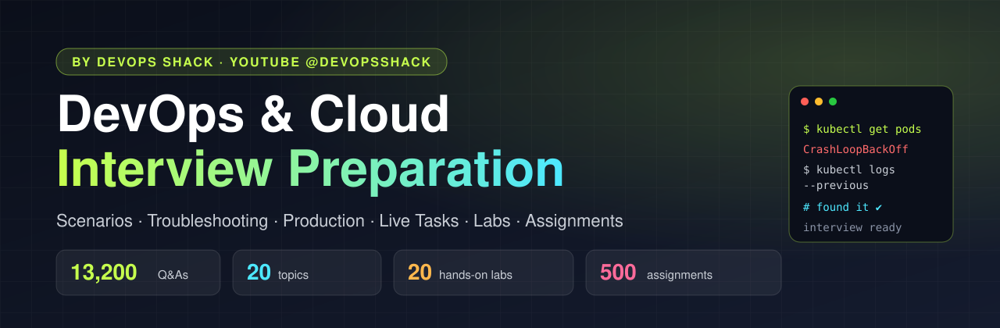
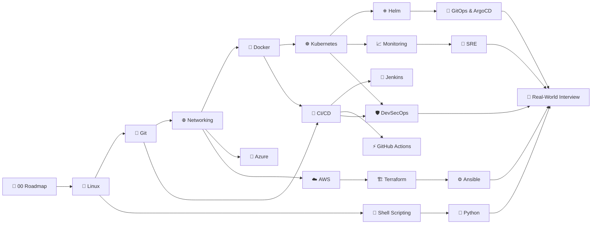
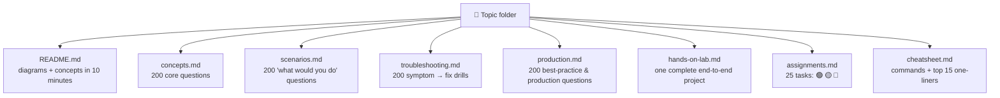

# DevOps & Cloud Interview Preparation — by DevOps Shack

**13,200+ interview questions with answers across 20 DevOps & Cloud topics, 20 hands-on labs, 500 assignments and an ultimate roadmap.**
Everything you need to crack DevOps, SRE and Cloud interviews, in one repo.

**⭐ Star this repo** so you can find it the night before your interview, and so it reaches more engineers.

<!-- DEVOPS-SHACK:HEADER -->

  
  
  
  
  

Part of <b><a href="https://github.com/jaiswaladi246/DevOps-Cloud-Interview-Preparation-by-DevOps-Shack">DevOps &amp; Cloud Interview Preparation</a></b> — created by <b><a href="https://www.youtube.com/@devopsshack">DevOps Shack</a></b>. Free to learn from; please credit DevOps Shack when sharing.

<!-- /DEVOPS-SHACK:HEADER -->

---

## Why this repo exists

Most interview lists are a wall of one-line questions. Real DevOps interviews don't work that way. They ask you what you'd do when a pod is stuck in `CrashLoopBackOff` at 2 AM, why your Terraform plan wants to destroy production, or how you'd roll back a bad Helm release without downtime.

This repo is built around that reality. Every topic has the same structure: concepts first, then scenarios, troubleshooting drills, production-grade practices, a complete hands-on project, assignments and a cheatsheet. Every answer is written the way a senior engineer would explain it in the room: what's happening, what to run, why, and what the interviewer is really checking.

---

## 🧭 Start here: 00 · The Ultimate DevOps Roadmap

New to DevOps, switching careers, or preparing for your next job? Open **[00 · Ultimate Roadmap](./00-ultimate-roadmap/README.md)** first. It tells you exactly what to learn, in what order, which folders to study, what to build, and how long each phase takes (3, 6 and 12-month tracks).

---

## 🗺️ The topics

Topics 01–11 have **4 question banks of 200** (concepts, scenarios, troubleshooting, production). Topics 12–19 have 200 concepts plus 100 scenarios and 100 troubleshooting drills, with production banks coming soon. Every topic also has a complete **hands-on lab**, **25 assignments** and a **cheatsheet**.

| # | Topic | Concepts | Scenarios | Troubleshooting | Production | Lab · Assignments · Cheatsheet |
|:-:|---|:-:|:-:|:-:|:-:|:-:|
| 01 | 🐧 [**Linux**](./01-linux/README.md) | [200](./01-linux/concepts.md) | [200](./01-linux/scenarios.md) | [200](./01-linux/troubleshooting.md) | [200](./01-linux/production.md) | [Lab](./01-linux/hands-on-lab.md) · [25](./01-linux/assignments.md) · [Sheet](./01-linux/cheatsheet.md) |
| 02 | 🌿 [**Git & GitHub**](./02-git/README.md) | [200](./02-git/concepts.md) | [200](./02-git/scenarios.md) | [200](./02-git/troubleshooting.md) | [200](./02-git/production.md) | [Lab](./02-git/hands-on-lab.md) · [25](./02-git/assignments.md) · [Sheet](./02-git/cheatsheet.md) |
| 03 | 🌐 [**Networking**](./03-networking/README.md) | [200](./03-networking/concepts.md) | [200](./03-networking/scenarios.md) | [200](./03-networking/troubleshooting.md) | [200](./03-networking/production.md) | [Lab](./03-networking/hands-on-lab.md) · [25](./03-networking/assignments.md) · [Sheet](./03-networking/cheatsheet.md) |
| 04 | 🐳 [**Docker**](./04-docker/README.md) | [200](./04-docker/concepts.md) | [200](./04-docker/scenarios.md) | [200](./04-docker/troubleshooting.md) | [200](./04-docker/production.md) | [Lab](./04-docker/hands-on-lab.md) · [25](./04-docker/assignments.md) · [Sheet](./04-docker/cheatsheet.md) |
| 05 | ☸️ [**Kubernetes**](./05-kubernetes/README.md) | [200](./05-kubernetes/concepts.md) | [200](./05-kubernetes/scenarios.md) | [200](./05-kubernetes/troubleshooting.md) | [200](./05-kubernetes/production.md) | [Lab](./05-kubernetes/hands-on-lab.md) · [25](./05-kubernetes/assignments.md) · [Sheet](./05-kubernetes/cheatsheet.md) |
| 06 | 🔁 [**CI/CD Fundamentals**](./06-cicd/README.md) | [200](./06-cicd/concepts.md) | [200](./06-cicd/scenarios.md) | [200](./06-cicd/troubleshooting.md) | [200](./06-cicd/production.md) | [Lab](./06-cicd/hands-on-lab.md) · [25](./06-cicd/assignments.md) · [Sheet](./06-cicd/cheatsheet.md) |
| 07 | 🏗️ [**Terraform**](./07-terraform/README.md) | [200](./07-terraform/concepts.md) | [200](./07-terraform/scenarios.md) | [200](./07-terraform/troubleshooting.md) | [200](./07-terraform/production.md) | [Lab](./07-terraform/hands-on-lab.md) · [25](./07-terraform/assignments.md) · [Sheet](./07-terraform/cheatsheet.md) |
| 08 | ⚙️ [**Ansible**](./08-ansible/README.md) | [200](./08-ansible/concepts.md) | [200](./08-ansible/scenarios.md) | [200](./08-ansible/troubleshooting.md) | [200](./08-ansible/production.md) | [Lab](./08-ansible/hands-on-lab.md) · [25](./08-ansible/assignments.md) · [Sheet](./08-ansible/cheatsheet.md) |
| 09 | ☁️ [**AWS**](./09-aws/README.md) | [200](./09-aws/concepts.md) | [200](./09-aws/scenarios.md) | [200](./09-aws/troubleshooting.md) | [200](./09-aws/production.md) | [Lab](./09-aws/hands-on-lab.md) · [25](./09-aws/assignments.md) · [Sheet](./09-aws/cheatsheet.md) |
| 10 | 📈 [**Monitoring & Observability**](./10-monitoring/README.md) | [200](./10-monitoring/concepts.md) | [200](./10-monitoring/scenarios.md) | [200](./10-monitoring/troubleshooting.md) | [200](./10-monitoring/production.md) | [Lab](./10-monitoring/hands-on-lab.md) · [25](./10-monitoring/assignments.md) · [Sheet](./10-monitoring/cheatsheet.md) |
| 11 | 🛡️ [**DevSecOps**](./11-devsecops/README.md) | [200](./11-devsecops/concepts.md) | [200](./11-devsecops/scenarios.md) | [200](./11-devsecops/troubleshooting.md) | [200](./11-devsecops/production.md) | [Lab](./11-devsecops/hands-on-lab.md) · [25](./11-devsecops/assignments.md) · [Sheet](./11-devsecops/cheatsheet.md) |
| 12 | 🐚 [**Shell Scripting (Bash)**](./12-shell-scripting/README.md) | [200](./12-shell-scripting/concepts.md) | [100](./12-shell-scripting/scenarios.md) | [100](./12-shell-scripting/troubleshooting.md) | coming soon | [Lab](./12-shell-scripting/hands-on-lab.md) · [25](./12-shell-scripting/assignments.md) · [Sheet](./12-shell-scripting/cheatsheet.md) |
| 13 | 🐍 [**Python for DevOps**](./13-python-for-devops/README.md) | [200](./13-python-for-devops/concepts.md) | [100](./13-python-for-devops/scenarios.md) | [100](./13-python-for-devops/troubleshooting.md) | coming soon | [Lab](./13-python-for-devops/hands-on-lab.md) · [25](./13-python-for-devops/assignments.md) · [Sheet](./13-python-for-devops/cheatsheet.md) |
| 14 | 🤵 [**Jenkins**](./14-jenkins/README.md) | [200](./14-jenkins/concepts.md) | [100](./14-jenkins/scenarios.md) | [100](./14-jenkins/troubleshooting.md) | coming soon | [Lab](./14-jenkins/hands-on-lab.md) · [25](./14-jenkins/assignments.md) · [Sheet](./14-jenkins/cheatsheet.md) |
| 15 | ⚡ [**GitHub Actions**](./15-github-actions/README.md) | [200](./15-github-actions/concepts.md) | [100](./15-github-actions/scenarios.md) | [100](./15-github-actions/troubleshooting.md) | coming soon | [Lab](./15-github-actions/hands-on-lab.md) · [25](./15-github-actions/assignments.md) · [Sheet](./15-github-actions/cheatsheet.md) |
| 16 | ⎈ [**Helm**](./16-helm/README.md) | [200](./16-helm/concepts.md) | [100](./16-helm/scenarios.md) | [100](./16-helm/troubleshooting.md) | coming soon | [Lab](./16-helm/hands-on-lab.md) · [25](./16-helm/assignments.md) · [Sheet](./16-helm/cheatsheet.md) |
| 17 | 🔄 [**GitOps & ArgoCD**](./17-gitops-argocd/README.md) | [200](./17-gitops-argocd/concepts.md) | [100](./17-gitops-argocd/scenarios.md) | [100](./17-gitops-argocd/troubleshooting.md) | coming soon | [Lab](./17-gitops-argocd/hands-on-lab.md) · [25](./17-gitops-argocd/assignments.md) · [Sheet](./17-gitops-argocd/cheatsheet.md) |
| 18 | 🚨 [**SRE & Reliability**](./18-sre/README.md) | [200](./18-sre/concepts.md) | [125](./18-sre/scenarios.md) | [100](./18-sre/troubleshooting.md) | coming soon | [Lab](./18-sre/hands-on-lab.md) · [25](./18-sre/assignments.md) · [Sheet](./18-sre/cheatsheet.md) |
| 19 | 🔷 [**Azure for DevOps**](./19-azure/README.md) | [200](./19-azure/concepts.md) | [100](./19-azure/scenarios.md) | [100](./19-azure/troubleshooting.md) | coming soon | [Lab](./19-azure/hands-on-lab.md) · [25](./19-azure/assignments.md) · [Sheet](./19-azure/cheatsheet.md) |

### 🎯 20 · Real-World Interview (cross-topic, 1,200 questions)

The questions senior interviews actually ask, where one answer spans five tools.

| Bank | Questions | What it trains |
|---|:-:|---|
| [Production scenarios](./20-real-world-interview/production-scenarios.md) | 200 | "Users see 502s after a deploy on EKS behind an ALB. Go." |
| [Incident troubleshooting](./20-real-world-interview/incident-troubleshooting.md) | 200 | Cross-stack debugging, from symptom to root cause |
| [Scripting & live tasks](./20-real-world-interview/scripting-and-live-tasks.md) | 200 | The live hands-on round: write the script, Dockerfile, manifest or pipeline |
| [Rapid-fire round](./20-real-world-interview/rapid-fire.md) | 200 | The first 10 minutes of every interview |
| [Behavioral & STAR](./20-real-world-interview/behavioral-star.md) | 200 | Incidents, conflict, ownership, on-call, mistakes |
| [Projects & experience](./20-real-world-interview/project-and-experience.md) | 200 | Explaining your projects, resume deep-dives, HR round |

Plus the [**capstone project**](./20-real-world-interview/hands-on-lab.md), [**25 mock-interview drills**](./20-real-world-interview/assignments.md) and a [**night-before revision sheet**](./20-real-world-interview/cheatsheet.md).

---

## 🧭 The learning roadmap

Start at the left. Each arrow means "this builds on that". If you already work with a tool, jump straight into its **scenarios** and **troubleshooting** banks; that's where interviews are won.

---

## 📦 What's inside every topic

Every question is tagged by level: 🟢 **Beginner** · 🟡 **Intermediate** · 🔴 **Advanced**. Answers are hidden behind a click, so you can test yourself first.

---

## 🗓️ How to use it: 30 / 60 / 90 days

| Plan | Who it's for | How |
|---|---|---|
| **30 days** | Interview in a month, already working in IT | Days 1–20: one topic a day (skip the ones not on the job description), scenarios + troubleshooting only. Days 21–30: the Real-World Interview section and the capstone project. |
| **60 days** | Switching into DevOps | Follow the roadmap. Per topic: README → concepts → lab → scenarios → troubleshooting. Do 5 assignments per topic. |
| **90 days** | Fresher, starting from zero | Same as 60 days, but finish every 🟢 and 🟡 assignment and build all 20 labs. Present the capstone in your interviews. |

> **Tip:** say your answers out loud before opening them. Interviews test how you explain, not just what you know.

---

## 📢 Sharing, forking or re-uploading?

You're welcome to learn from this repo, fork it and share it, **as long as DevOps Shack is credited**. That's what the licence requires (CC BY-NC-SA 4.0):

- Keep the DevOps Shack headers, footers and links on every page.
- Link back to the original: **https://github.com/jaiswaladi246/DevOps-Cloud-Interview-Preparation-by-DevOps-Shack**
- No commercial resale, and no passing it off as your own course material.

The original, always-updated version is maintained by **[DevOps Shack on YouTube](https://www.youtube.com/@devopsshack)**.

---

## 🤝 Contributing

Found a mistake, an outdated flag, or a great question that's missing? Open an issue or a pull request; see [CONTRIBUTING.md](./CONTRIBUTING.md). Every answer here should be something you'd be comfortable saying in a real interview.

---

### Built by [DevOps Shack](https://devopsshack.com)

Live DevOps, DevSecOps & Cloud bootcamps · [YouTube](https://www.youtube.com/@devopsshack) · [Instagram](https://www.instagram.com/devopsshack) · [Website](https://devopsshack.com)

If this repo helped you, **⭐ star it** and share it with one friend who's preparing.

<!-- DEVOPS-SHACK:FOOTER -->
---

### 🚀 Made with ❤️ by [DevOps Shack](https://www.youtube.com/@devopsshack)

**Learn DevOps, DevSecOps, Cloud and Kubernetes the practical way.**

[▶️ YouTube — DevOps Shack](https://www.youtube.com/@devopsshack) · [▶️ Hindi — @shackverse](https://www.youtube.com/@shackverse) · [🎓 devopsshack.com](https://devopsshack.com) · [📸 Instagram @devopsshack](https://www.instagram.com/devopsshack)

[🏠 Back to Home](./README.md) · [⭐ Star the original repo](https://github.com/jaiswaladi246/DevOps-Cloud-Interview-Preparation-by-DevOps-Shack)

© DevOps Shack · Licensed CC BY-NC-SA 4.0 · If you found this copy anywhere other than <a href="https://github.com/jaiswaladi246/DevOps-Cloud-Interview-Preparation-by-DevOps-Shack">github.com/jaiswaladi246</a>, the original and latest version is maintained by DevOps Shack.

<!-- /DEVOPS-SHACK:FOOTER -->
